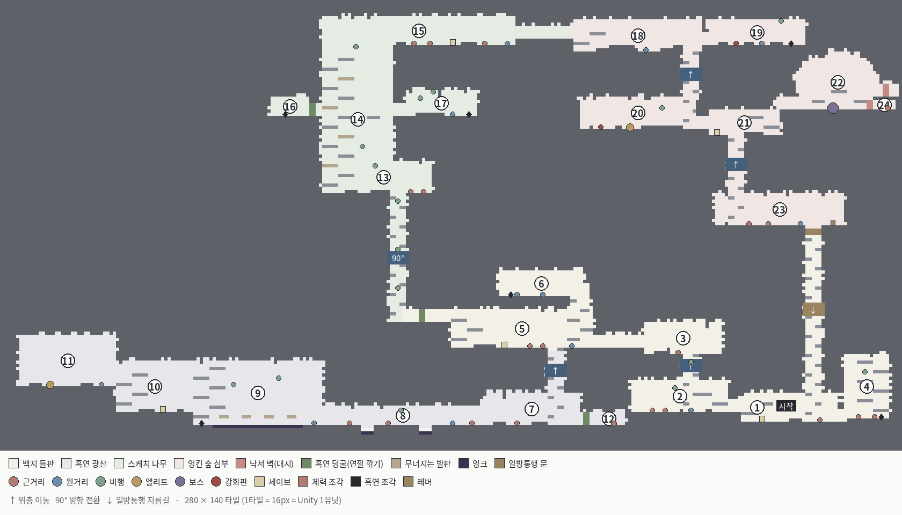

# 04. 1지역 연필 숲 · 맵 상세

> 상태: 🧪 그레이박스 프로토타입 v15 기준 (구조는 ✅, 수치·배치는 테스트 중)

## 📏 기본 규격

| 항목 | 값 |
|---|---|
| 지역 크기 | **280 × 140 타일** (화면 약 9.3 × 8.3개) |
| 타일 | 1타일 = 16px = Unity 1유닛 |
| 화면 | 480 × 270px (30 × 17 타일) |
| 구역 | 4개 |
| 방 / 수직굴 | **24개 / 6개** |
| 시작 지점 | 1번 방, 타일 (244, 131) |
| 목표 클리어 시간 | 그레이박스 12~15분 → 인게임 약 30분 |

## 🧩 4개 구역

| 구역 | 위치 | 성격 | 대표 몬스터 |
|---|---|---|---|
| 🏞️ 백지 들판 | 오른쪽 아래 | 시작, 튜토리얼, 허브(갈림길 숲) | 구겨진 종이공 |
| ⛏️ 흑연 광산 | 아래쪽 왼편 | 깊은 갱도, 잉크 구덩이, 무너지는 발판, 엘리트 | 흑연 두더지 |
| 🌳 스케치 나무 | 왼쪽 위 | 위로 길게 오르는 수직 탑 | 지우개 거미 |
| 🕸️ 엉킨 숲 심부 | 오른쪽 위 | 엘리트 2, 보스, 출구, 지름길 | 잉크 방울 |

---

## 🚶 진행 흐름 ✅

| 단계 | 구역 | 하는 일 | 열리는 것 | 목표 시간 (그레이박스) |
|---|---|---|---|---|
| 1 | 백지 들판 | 이동·공격·벽 점프 익히기, 풀 그림자 굴 탐험 | 갈림길 숲 허브 | 2~3분 |
| 2 | 흑연 광산 | 잉크 구덩이, 무너지는 갱도, 엘리트 광산 감독 | **연필 깎기** | 4~5분 |
| 3 | 갈림길 숲 복귀 | 흑연 덩굴 자르기 (지역 안 되돌아오기) | 스케치 나무 입구, 광산 창고 | 1분 |
| 4 | 스케치 나무 | 40타일 수직굴 + 무너지는 발판 탑 등반 | 엉킨 숲 심부 | 3~4분 |
| 5 | 엉킨 숲 심부 | 엘리트 덩굴 사냥꾼, 보스 엉킨 낙서 덩어리 | **지우개 대시** | 3~4분 |
| 6 | 마무리 | 대시로 바로 옆 비밀 방과 출구, 뿌리 내리막 레버로 지름길 | 2지역 크레파스 언덕 | 1~2분 |

```mermaid
flowchart TD
  S["1 시작의 백지길"] --> F["2 바람 든 풀밭"] --> H["3 종이 언덕"] --> HUB["5 갈림길 숲 (허브·세이브)"]
  S --> G4["4 풀 그림자 굴 (곁가지)"]
  HUB --> LOFT["6 갈림 숲 다락 (곁가지)"]
  HUB -->|"광산 승강로 ↓"| M7["7 광산 입구"] --> M8["8 흑연 갱도"] --> M9["9 무너진 갱도"] --> M10["10 광부의 쉼터 (세이브)"] --> M11["11 감독의 채굴장 · 엘리트"]
  M11 -->|"연필 깎기 획득"| HUB
  HUB -->|"🌿 흑연 덩굴 (연필 깎기)"| V["덩굴 수직굴 90°"] --> T13["13 옹이 방"] --> T14["14 나무 속 탑"] --> T15["15 꼭대기 가지 (세이브)"]
  M7 -->|"🌿 흑연 덩굴"| M12["12 덩굴 뒤 창고 · 체력 조각"]
  T14 -->|"🌿 흑연 덩굴"| T16["16 지워진 둥지 · 흑연 조각"]
  T14 --> T17["17 새 둥지 (곁가지)"]
  T15 --> D18["18 덩굴 다리"] --> D19["19 위쪽 갈림 (곁가지)"]
  D18 --> D20["20 사냥꾼의 굴 · 엘리트"] --> D21["21 둥지 앞 쉼터 (세이브)"] --> BOSS["22 보스방"]
  D21 --> D23["23 뿌리 내리막 · 레버"] -->|"↓ 일방통행 지름길"| S
  BOSS -->|"지우개 대시 획득"| SEC["24 비밀 방 · 체력 조각 (낙서 벽)"]
  BOSS -->|"낙서 벽 (대시)"| EXIT["→ 2지역 크레파스 언덕 (책장 넘김)"]
```

---

## 🏠 방 목록 (24개)

| # | 구역 | 방 이름 | 위치 (x, y) | 크기 (w × h) | 몬스터 | 아이템·장치 | 설명 |
|---|---|---|---|---|---|---|---|
| 1 | 백지 들판 | 시작의 백지길 | 230, 122 | 30 × 9 | 흑연 벌레 | 세이브 | 시작 · 세이브. 위쪽 굴은 닫힌 일방통행 문 |
| 2 | 백지 들판 | 바람 든 풀밭 | 196, 118 | 30 × 10 | 흑연 벌레 2, 연필깎이 포탑, 종이 나방 | — | 근거리 2 + 뒤에서 쏘는 포탑 + 나방 첫 조합 |
| 3 | 백지 들판 | 종이 언덕 | 200, 100 | 24 × 10 | 구겨진 종이공 | — | 바람 굴뚝으로 올라옴 · 종이공 첫 등장 (혼자) |
| 4 | 백지 들판 | 풀 그림자 굴 | 262, 110 | 14 × 20 | 구겨진 종이공 2, 종이 나방 | 흑연 조각 | 곁가지 탐험 |
| 5 | 백지 들판 | 갈림길 숲 | 140, 96 | 44 × 12 | 흑연 벌레, 구겨진 종이공, 연필깎이 포탑 | 세이브 | 허브. 서쪽 위 흑연 덩굴 (연필 깎기 필요) |
| 6 | 백지 들판 | 갈림 숲 다락 | 155, 84 | 26 × 8 | 연필깎이 포탑 2 | 흑연 조각 | 엇갈리는 탄 사이로 이동. 5번에서 계단식 발판으로 올라옴 |
| 7 | 흑연 광산 | 광산 입구 | 150, 122 | 30 × 10 | 흑연 두더지 | — | 두더지 첫 등장 (혼자) · 동쪽 끝 덩굴 너머 창고 |
| 8 | 흑연 광산 | 흑연 갱도 | 100, 126 | 50 × 6 | 흑연 벌레, 흑연 두더지, 종이 나방, 연필깎이 포탑, 구겨진 종이공 | — | 잉크 구덩이 2개 · 평평한 바닥 유지 |
| 9 | 흑연 광산 | 무너진 갱도 | 60, 112 | 40 × 20 | 종이 나방 2, 연필깎이 포탑 | 흑연 조각 | 잉크 바닥 위 무너지는 발판 4개 · 언덕 제외 |
| 10 | 흑연 광산 | 광부의 쉼터 | 36, 112 | 24 × 16 | — | 세이브 | 쉬는 방 (적 없음) |
| 11 | 흑연 광산 | 감독의 채굴장 | 6, 104 | 30 × 16 | 광산 감독 지우개(엘리트), 연필깎이 포탑 | — | 엘리트 처치 → 연필 깎기 |
| 12 | 흑연 광산 | 덩굴 뒤 창고 | 184, 128 | 10 × 4 | — | 체력 조각 | 연필 깎기로 되돌아와야 함 |
| 13 | 스케치 나무 | 옹이 방 | 104, 50 | 30 × 10 | 흑연 벌레 2, 지우개 거미 | — | 덩굴 수직굴 꼭대기, 위아래 동시 압박 |
| 14 | 스케치 나무 | 나무 속 탑 | 100, 14 | 22 × 46 | 지우개 거미, 종이 나방 | — | 46타일 높이 탑, 3칸마다 무너지는 발판 |
| 15 | 스케치 나무 | 꼭대기 가지 | 100, 5 | 60 × 9 | 구겨진 종이공, 흑연 벌레, 흑연 두더지, 연필깎이 포탑 | 세이브 | 나무 구역 마무리 시험 · 동쪽 다리로 이어짐 |
| 16 | 스케치 나무 | 지워진 둥지 | 84, 30 | 12 × 6 | — | 흑연 조각 | 흑연 덩굴 뒤 (탑을 오르며 연필 깎기로) |
| 17 | 스케치 나무 | 새 둥지 | 126, 28 | 22 × 8 | 연필깎이 포탑, 지우개 거미, 종이 나방 | 흑연 조각 | 곁가지 |
| 18 | 엉킨 숲 심부 | 덩굴 다리 | 178, 6 | 40 × 10 | 잉크 방울 | — | 잉크 방울 첫 등장 (혼자) |
| 19 | 엉킨 숲 심부 | 위쪽 갈림 | 220, 6 | 30 × 8 | 붉은 흑연 벌레(강화), 잉크 방울, 지우개 거미 | 흑연 조각 | 곁가지 |
| 20 | 엉킨 숲 심부 | 사냥꾼의 굴 | 180, 30 | 36 × 10 | 덩굴 사냥꾼(엘리트), 붉은 흑연 벌레(강화), 종이 나방 | — | 엘리트 처치 → 체력 조각 |
| 21 | 엉킨 숲 심부 | 둥지 앞 쉼터 | 220, 34 | 22 × 8 | — | 세이브 | 보스 전 쉬는 방 |
| 22 | 엉킨 숲 심부 | 낙서 덩어리의 둥지 | 246, 16 | 28 × 19 (원형) | 엉킨 낙서 덩어리(보스) | — | 둥근 아레나, 발판 3개, 동쪽 낙서 벽 너머 출구 |
| 23 | 엉킨 숲 심부 | 뿌리 내리막 | 222, 60 | 40 × 10 | 흑연 벌레, 흑연 두더지, 잉크 방울 | 레버 | 레버 → 시작 지점 일방통행 지름길 |
| 24 | 엉킨 숲 심부 | 둥지 뒤 비밀 방 | 271, 31 | 7 × 3 | — | 체력 조각 | 보스방 오른쪽 아래 낙서 벽 뒤. 대시 획득 직후 바로 사용 |

## ↕️ 수직굴 (6개)

| 구역 | 이름 | 종류 | 위치 (x, y) | 크기 (w × h) | 몬스터 |
|---|---|---|---|---|---|
| 백지 들판 | 바람 굴뚝 | ↑ 위층 이동 | 212, 108 | 5 × 11 | 종이 나방 |
| 흑연 광산 | 광산 승강로 | ↑ 위층 이동 (허브 ↔ 광산) | 170, 107 | 5 × 16 | — |
| 스케치 나무 | 덩굴 수직굴 | **90° 방향 전환** (가로 덩굴 길 → 세로 40타일) | 121, 60 | 5 × 40 | 지우개 거미 2, 종이 나방 |
| 엉킨 숲 심부 | 다리 아래 굴 | ↑ 위층 이동 | 212, 15 | 5 × 16 | — |
| 엉킨 숲 심부 | 쉼터 아래 굴 | ↑ 위층 이동 | 226, 41 | 5 × 20 | — |
| 백지 들판 | 일방통행 뿌리굴 | ↓ 일방통행 지름길 | 250, 69 | 5 × 54 | — |

---

## 🚧 길막 · 기믹 배치

| 기믹 | 위치 | 필요 능력 | 너머에 있는 것 |
|---|---|---|---|
| 🌿 흑연 덩굴 | 덩굴 길 (130~131, 96~99) | 연필 깎기 | 스케치 나무 전체 |
| 🌿 흑연 덩굴 | 광산 입구 동쪽 (181~182, 128~131) | 연필 깎기 | 12 덩굴 뒤 창고 · 체력 조각 |
| 🌿 흑연 덩굴 | 나무 속 탑 서쪽 (96~97, 32~35) | 연필 깎기 | 16 지워진 둥지 · 흑연 조각 |
| ✏️ 낙서 벽 | 보스방 동쪽 위 (274~275, 26~29) | 지우개 대시 | 2지역 출구 |
| ✏️ 낙서 벽 | 보스방 동쪽 아래 (269~270, 31~33) | 지우개 대시 | 24 비밀 방 · 체력 조각 |
| 🚪 일방통행 문 | 뿌리굴 위쪽 (250~254, 71~72) | 23번 레버 | 시작 지점 지름길 |
| ⚫ 잉크 구덩이 | 흑연 갱도 2곳 (112~115, 130~133) | — | 폭 4타일, 점프로 넘음 |
| ⚫ 잉크 바닥 | 무너진 갱도 (66~93) | — | 무너지는 발판 4개 (3타일 높이) |
| 🟫 무너지는 발판 | 무너진 갱도 4개, 나무 속 탑 계단 3칸마다 | — | 밟고 0.45초 뒤 무너짐, 2.6초 뒤 복구 |

> 🔒 **검증 완료**: 능력 없이는 광산·엘리트까지만, 연필 깎기가 있으면 보스·레버까지, 지우개 대시가 있어야 출구·비밀 방에 도달. (자동 도달 범위 검사)

## 🎁 수집품 위치

| 종류 | 개수 | 위치 |
|---|---|---|
| 세이브 (연필꽂이 석상) | 5 | 1, 5, 10, 15, 21번 방 |
| 체력 조각 | 3 | 12 창고 (연필 깎기), 20 덩굴 사냥꾼 처치 보상, 24 비밀 방 (대시) |
| 흑연 조각 | 6 | 4, 6, 9, 16, 17, 19번 방 |
| 레버 | 1 | 23 뿌리 내리막 |

> 세이브가 있는 방은 **쉬는 곳**이라 적을 두지 않음 (10, 21번). 1·5·15번은 세이브 주변만 비워 둠.

---

## ⛰️ 지형 규칙 ✅

| 규칙 | 값 | 이유 |
|---|---|---|
| 단차 | **3타일** | 최대 점프 4.2타일 → 여유 있게 오름 |
| 구덩이 폭 | **4타일 이하** | 최대 점프 거리 약 5.9타일 |
| 통로 높이 | 4타일 | 머리 위 여유 |
| 수직굴 폭 | 5타일 | 벽 점프 지그재그 등반 |
| 수직굴 발판 | 3타일 간격, 양옆 번갈아 2칸 | |
| 방 계단 발판 | 3타일 간격, 5칸 너비, 지그재그 | |
| 발판 위 여유 | 발판 위 2칸은 반드시 비움 | 머리 박는 것 방지 |

### 벽과 바닥 모양 ✅
- **벽·천장**: 울퉁불퉁하게 (오리 맵처럼 불규칙한 동굴 느낌). 종유석도 가끔 매달림
- **바닥**: **파이지 않게**. 대신 **4타일 단위 계단식 언덕**
  - 블록 높이 0~2타일, 옆 블록과 높이 차 **최대 1타일**
  - 높이 10타일 미만 방은 언덕 최대 1타일
  - 방 양 끝 3타일은 평평 (통로 입구 확보)
  - 몬스터·세이브·아이템 주변 2타일은 평평
  - **언덕 제외 방**: 8 흑연 갱도 (점프 거리 유지), 9 무너진 갱도 (퍼즐), 22 보스방
- 결과: 바닥 파임 72곳 → **0곳**

### 바닥 표면 색 구분 (그레이박스)
| 타일 | 색 |
|---|---|
| 벽·바닥 | 진회색 + 연필 빗금 |
| 발판 | 밝은 회색 |
| 무너지는 발판 | 베이지 + 금 간 선 |
| 낙서 벽 | 붉은 낙서 |
| 흑연 덩굴 | 어두운 초록 |
| 잉크 | 짙은 보라 |
| 일방통행 문 | 갈색 창살 |

---

## 🛠️ 설계 중 수정 이력

| 문제 | 수정 |
|---|---|
| 5 → 6번 가는 발판 단차가 4타일이라 사실상 못 올라감 | 3타일 계단 5단으로 재배치, 천장 구멍 4 → 6타일, 입구 표시 |
| 바닥이 중간중간 파여 불편 | 바닥 침식 제거 + 계단식 언덕 |
| 점프를 낮추면서 4타일 단차가 된 곳 | 무너지는 발판·보스방 발판을 3타일로 조정 |
| 16번 체력 조각이 보스 후에만 갈 수 있는데 너무 멀어서 되돌아가야 함 | 16번은 흑연 덩굴(연필 깎기)·흑연 조각으로 변경, 체력 조각은 보스방 옆 24번 비밀 방으로 이동 |
| 보스방 원형 테두리가 비밀 방 천장을 파먹어 대시 없이 들어가짐 | 출구 통로 바닥을 막아 봉인 |
