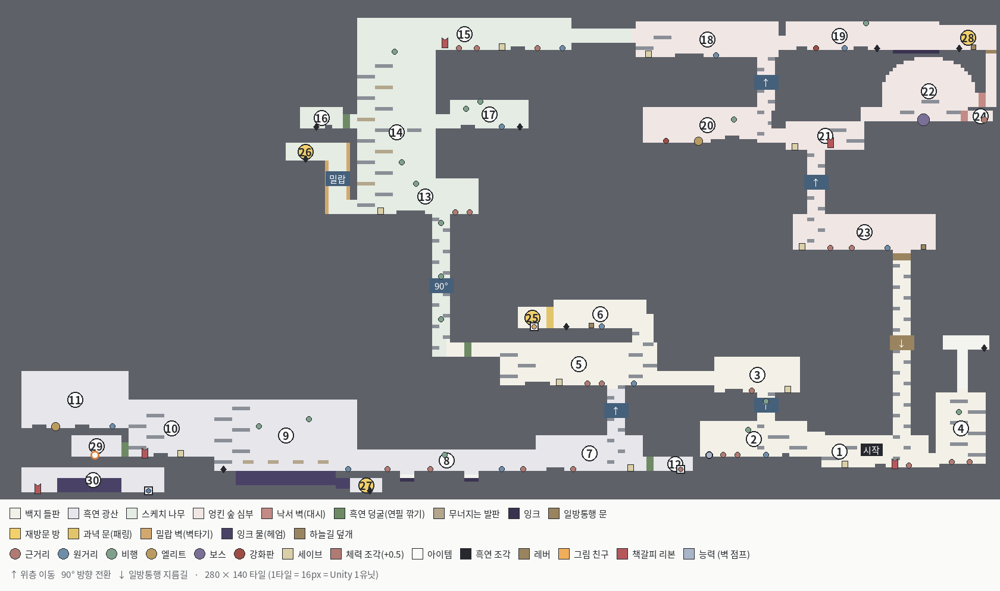

# 10. 능력 · 성장 · 재방문 보상

> 상태: 표 안에 ✅ 확정 / 🧪 프로토타입 반영 / 💡 제안으로 표시

## 🧭 기본 틀 ✅

- 모든 지역은 **엘리트 → 중간 능력, 보스 → 메인 능력** 구조
- 새 능력은 얻자마자 **바로 써보는 자리**를 둠
- 새 능력을 얻으면 **이전 지역에 새 길**이 열림 (재방문 보상)

## 1️⃣ 지역별 능력

| 지역 | 중간 능력 (엘리트) | 메인 능력 (보스) | 표지 글자 |
|---|---|---|---|
| 🌲 1 연필 숲 | ✅ **연필 깎기** · 흑연 덩굴 자르기 | ✅ **지우개 대시** · 낙서 벽 지우기, 짧은 돌파 | i |
| 🖍️ 2 크레파스 언덕 | ✅ **밀랍 튕기기 (패링)** · 깎인 크레파스 거북 (상세는 2장 문서) | ✅ **크레파스 벽타기** · 밀랍 벽 오르기 | s |
| 💧 3 수채화 호수 | 💡 **물감 방울 타기** · 방울을 공격해 터뜨리면 위로 튀어 오름 | ✅ **물감 헤엄** · 잉크 물·수중 구간 이동 | h |
| 📄 4 색종이 도시 | 💡 **접기 스위치 조작** (능력으로 줄지, 기믹으로 둘지 미정) | ✅ **종이접기 활공** · 넓은 낭떠러지 횡단 | e |
| 🖋️ 5 잉크 심연 | — | 💡 **덧칠** · 모은 색으로 잉크 벽 정화 | d (진 엔딩) |

### ✋ 시작 능력: 또렷해진 손 (벽 점프) 🧪

| 항목 | 내용 |
|---|---|
| 얻는 곳 | 1장 **2 바람 드는 종이 틈 서쪽 끝** · **종이 틈의 파수꾼** 처치 후 봉인 해제, E로 획득 |
| 흐름 | ① 2번 방에 들어오면 위쪽 **바람 굴뚝**이 보이는데 발판이 없어서 못 오름 → ② 서쪽의 파수꾼 돌진을 기본 점프로 피하며 처치 → 손의 봉인이 풀리면 E로 획득 → ③ 돌아와서 **바로 굴뚝을 벽 점프로** 오름 |
| 스토리 | 흐린 선 몇 개뿐이던 주인공의 **손이 또렷하게 그려짐** → 벽을 짚을 수 있게 됨 (얼굴·색이 없는 주인공이 조금씩 그려지는 흐름의 첫 단계) |
| 바로 쓰는 곳 | 바람 굴뚝 (본길, 튜토리얼) · 4 풀 그림자 굴 좁은 굴뚝 (첫 비밀) |
| 2장과 대비 | 밀랍 벽에는 손이 미끄러져 안 붙음 → 2장 보스 보상 **크레파스 벽타기**로만 오름 |

### 능력 획득 도전 규칙 (2026-10-26)

- 새 능력은 필수 전투나 이동 도전 뒤에서 획득한다. 획득 전의 능력으로 반드시 해결 가능해야 한다.
- 첫 벽 점프: 기존 적 배치 1번을 **종이 틈의 파수꾼** 중간보스로 변경. 기존 광산 감독의 이동·돌진·죽음 그림을 공유하되 별도 능력치와 타이밍을 사용한다. 체력 9, 돌진 준비 0.48초, 돌진 0.48초(최대 약 3.2칸), 후동작 0.42초, 다음 공격 대기 0.35초. 방향은 준비 시작에 고정되며 기본 점프로 넘을 수 있다. 전투는 방 서쪽 197.5~211.5칸에 머무른다.
- 손은 처치 전 회청색과 원을 도는 입자로 봉인 상태를 표시한다. E를 눌러도 획득하지 못한다. 처치 후 은은하게 밝아지고 기존 자리(198,128)에서 획득한다. 잡기 전에 먼저 주워 전투를 건너뛰는 방식은 불가능하다.
- 파수꾼을 잡기 전 죽으면 체력이 초기화된다. 처치 이후에는 부활하지 않으며, 획득하지 않고 저장했다면 손을 다시 찾아갈 수 있다. 이미 벽 점프를 가진 기존 저장 데이터에는 재도전을 강요하지 않는다.
- 연필 깎기(1지역 중간보스), 대시(1지역 보스), 패링(2지역 중간보스), 밀랍 벽타기(2지역 보스)의 기존 보상 순서를 유지한다. 이후 지역도 같은 원칙을 적용한다.

## 2️⃣ 체력 성장 ✅

| 항목 | 값 |
|---|---|
| 시작 체력 | 5칸 |
| 체력 조각 1개 | **최대 체력 +0.5칸** (반 칸 하트) + 체력 가득 회복 |
| 엔딩 때 최대 | **9칸** (상한) → 전체 체력 조각 **8개** |
| 나머지 숨은 자리 | 아이템 · 흑연 조각으로 채움 |

### 지역별 체력 조각 배분

| 지역 | 체력 조각 | 누적 최대 체력 |
|---|---|---|
| 1 연필 숲 | 2 (✅ 20 엘리트 보상, 24 비밀 방) | 6칸 |
| 2 크레파스 언덕 | 2 | 7칸 |
| 3 수채화 호수 | 2 | 8칸 |
| 4 색종이 도시 | 1 | 8.5칸 |
| 5 잉크 심연 | 1 | 9칸 |

> 후반 보스의 큰 공격이 1.5~2칸이라, 9칸이면 큰 공격 4~5번에 쓰러지는 긴장감이 유지됨.

## 3️⃣ 색 회복 패시브 💡 (미확정)

보스를 잡을 때마다 세상에 색이 돌아오는 스토리를 패시브 효과로 연결하고, 5장에서 그 색으로 **덧칠**하게 하는 안.

| 지역 클리어 | 돌아오는 색 | 패시브 효과 |
|---|---|---|
| 1 연필 숲 | 흑연 회색 | **흔적 읽기** · 숨은 낙서 벽, 비밀 입구에 희미한 연필 자국이 보임 |
| 2 크레파스 언덕 | 크레파스 주황 | **덧칠 방어** · 피격 후 무적 1.0초 → 1.3초 |
| 3 수채화 호수 | 수채 파랑 | **번짐 회복** · 세이브에서 흑연 조각 1개로 체력 반 칸 보충 |
| 4 색종이 도시 | 색종이 빨강 | **날 선 종이** · 공격 피해 +1 |

---

## 4️⃣ 1지역 재방문 보상 🧪 (프로토타입 반영)

노란 번호 원(25~28)이 재방문 방이야.

| # | 방 | 필요 능력 | 입구 위치 | 막는 방식 | 보상 |
|---|---|---|---|---|---|
| 25 | 과녁 뒤 서재 | 패링 (2장) | 6 갈림굴 다락 서쪽 끝 | **노란 과녁 문**. 다락 포탑(168, 92)의 탄을 패링으로 반사해서 앞에 있는 **과녁**(165, 92)을 맞히면 열림 | 🎒 종이 방패 |
| 26 | 밀랍 둥지 | 벽타기 (2장) | 14 나무 속 탑 바닥 서쪽 통로 → 밀랍 수직굴 | 폭 5 × 높이 20타일 수직굴, 양쪽이 **밀랍 벽**이라 미끄러워서 **벽 점프 불가**. 발판 없음 | 흑연 조각 |
| 27 | 잠긴 수로 끝 | 물감 헤엄 (3장) | 9 무너진 갱도 바닥 | 바닥이 **잉크 물**(깊이 4타일). 헤엄 없이 들어가면 피해 + 직전 발판 복귀. 물속 수로를 따라 동쪽으로 | 흑연 조각 |
| 28 | 솜뭉치 선반 | 활공 (4장) | 19 위쪽 갈림 동쪽 끝 | 폭 **13타일 잉크 웅덩이**. 점프 최대 약 5.9타일, 대시를 섞어도 약 9.5타일이라 못 건넘. 활공이면 약 17타일까지 | 흑연 조각 + **하늘길** |

### 하늘길 (28번)
- 솜뭉치 선반 동쪽 끝의 **덮개**는 선반 위에서 밟아야 열림 (아래에서는 못 엶)
- 열면 아래로 떨어져 **2지역 출구 통로**로 바로 이어짐 → 보스방을 거치지 않는 지름길

### 프로토타입에서 다른 지역 능력 흉내 내기 (QA 버튼)
| 버튼 | 동작 |
|---|---|
| 벽타기 (2장) | 밀랍 벽 쪽 방향키를 누르고 있으면 위로 오름. 벽 끝에서 자동으로 올라섬 |
| 물감 헤엄 (3장) | 잉크 물속에서 ↑↓로 헤엄, 수면에서 점프로 빠져나옴 |
| 활공 (4장) | 공중에서 점프 키를 누르고 있으면 천천히 내려옴 (낙하 속도 45), 종이 날개 표시 |
| 패링 (2장) | 기존 패링 테스트 기능 그대로 |

### 검증 ✅
| 검사 | 결과 |
|---|---|
| 패링 없이 25번 | 못 들어감 (문 위 침식 틈까지 막음) |
| 헤엄 없이 27번 | 못 들어감 |
| 밀랍 수직굴 | 양쪽 벽이 전부 밀랍, 안에 발판·돌출 없음 |
| 잉크 웅덩이 | 13타일 전부 잉크, 위 공간 비어 있음, 양쪽 가장자리 바닥 있음 |
| 하늘길 덮개 | 아래에서 막힘 |
| 과녁 사격 경로 | 다락 바닥이 평평해서 탄이 지형에 막히지 않음 |

## 5️⃣ 다른 지역 재방문 후보 💡

| 얻은 능력 | 2 크레파스 언덕 | 3 수채화 호수 | 4 색종이 도시 |
|---|---|---|---|
| 물감 헤엄 | 언덕 아래 **물웅덩이 동굴** | — | |
| 활공 | 협곡 건너 **바람 굴** | 호수 위 **폭포 꼭대기** | — |
| 덧칠 (5장) | 각 지역 **잉크로 덮인 문** (진 엔딩 캐릭터 단서) | ← | ← |

## 처치 보상과 갈피 교환소 (2026-10-25 구현)

탐험용 흑연 조각과 별개로 **먹빛 가루**를 전투 재화로 사용한다. 일반 적은 2개, 체력 5 이상 적은 4개, 붉게 강화된 적은 6개를 준다. 1지역 정예 12개, 첫 능력 정예 25개, 1지역 보스 60개, 2지역 거북 35개, 기사 75개를 지급한다. 일반 적은 재생성된 뒤 다시 처치하면 보상을 준다. 정예·보스는 기존 영구 처치 기록을 따른다.

보상은 최대 5개의 작은 보랏빛 흑연 조각 모양으로 흩어지고, 기본 2.4칸 안으로 접근하면 플레이어에게 흡수된다. 여러 개의 재화를 하나의 표시물로 묶어 동시에 최대 64개 표시물을 재사용한다. 벽 너머로 즉시 끌어당기지 않으며, 늪 표면에는 머무른다. 오래 남은 보상(45초), 맵 밖으로 떨어진 보상, 사망·재배치 때 남은 보상도 회수하여 획득 권리를 잃지 않는다.

교환소는 **1지역 시작의 백지길(236,131)**과 **2지역 삼색 광장(408,36)**, 지역당 한 곳씩 총 2곳에 둔다. 이 두 거점 근처에서 **E → 상점 보기 / 뒤로가기**를 선택한다. 저장·회복 지점은 기존 10곳을 유지하며, 나머지 8곳에서는 상점이 열리지 않는다. 지도와 미니맵에서는 교환소를 금색 사각형으로 구분한다.

새로 생성한 진열대 그림에서 상품·현재 단계·가격·보유 재화를 표시한다. 마우스 또는 방향키로 상품을 선택하고 Enter/교환하기로 효과와 사용 재화를 확인한 뒤 최종 교환한다. 상점과 선택창에서는 게임이 정지하며, 취소하면 재화나 물체 상태가 변하지 않는다. Esc/뒤로가기는 한 단계씩 돌아간다.

- **책등 보강**: 최대 체력 +1씩, 최대 3단계. 비용 40 / 90 / 160 가루.
- **물감 주머니**: 회복 물감 사용 횟수 +1씩, 최대 2단계. 비용 60 / 120 가루. 탐험으로 회복 물감을 먼저 얻어야 한다.
- **먹빛 끌림**: 보상 회수 반경 +0.8칸씩, 최대 3단계. 비용 20 / 50 / 90 가루. 최종 반경 4.8칸.

강화는 영구 유지되며 구매 즉시 기존 저장 시스템에 기록한다. 재화와 강화 단계는 기존 세이브 형식에 추가 필드로 저장되어 이전 세이브도 0단계부터 호환된다. 저장 순간 아직 떨어져 있는 보상은 저장 재화에 포함하고 불러올 때 중복 표시물을 제거한다. 벽 점프·대시·패링 등 진행 능력과 탐험 보상은 재화로 판매하지 않는다. 현재 가격은 1·2지역 플레이테스트용 기본값이다.
