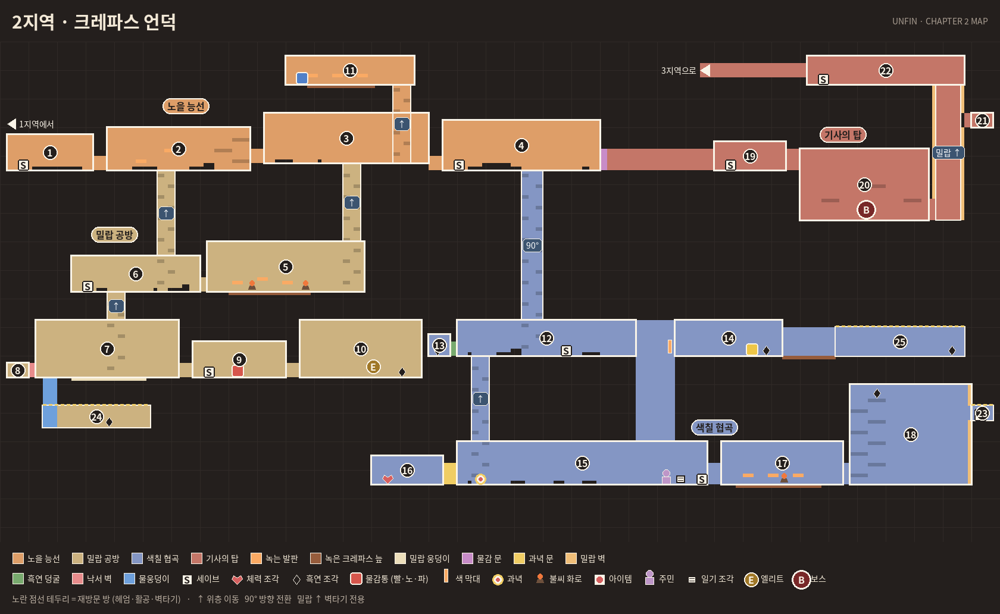
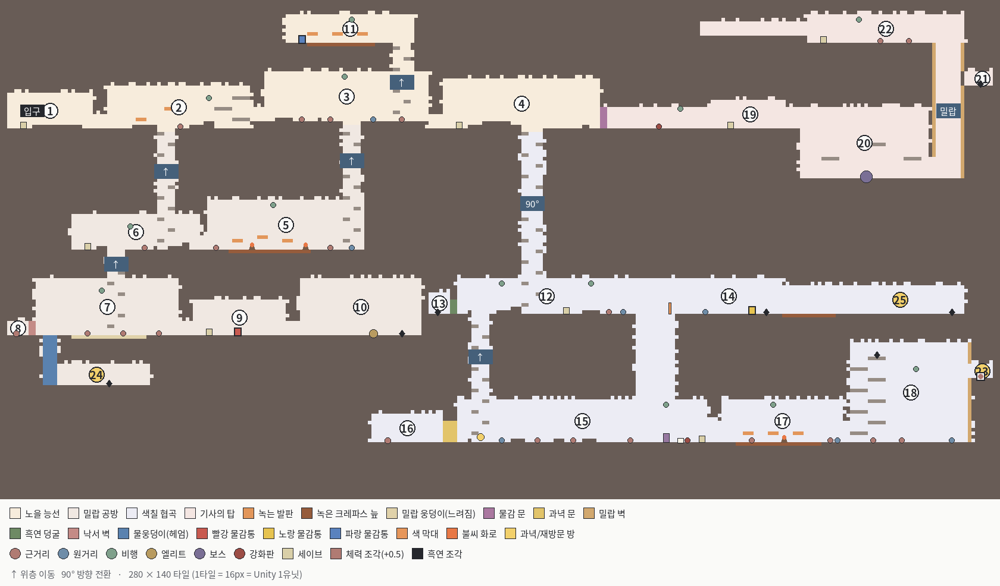
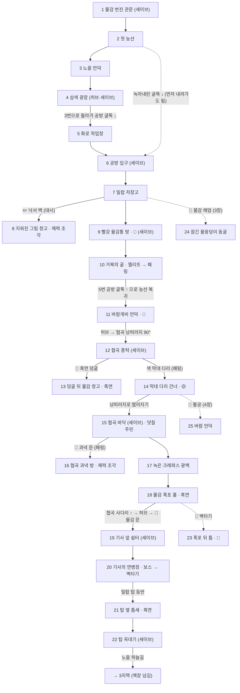

# 13. 2지역 크레파스 언덕 · 맵 구조

> 상태: 🧪 프로토타입 v1 (`Prototype/unfin_region2.html` — 브라우저로 열면 바로 플레이)
> 데이터: `Prototype/region2_map_data.js` · 1지역과 같은 규격 (280 × 140 타일, 1타일 = 16px)
> **방 번호 = 플레이어가 지나가는 추천 순서** (재방문 방은 맨 뒤 23~25)

타일 단위 상세 맵 (적·발판 위치)

## 🎮 플레이 프로토타입 v1 🧪

| 항목 | 내용 |
|---|---|
| 파일 | `Prototype/unfin_region2.html` (1지역 엔진 그대로 + 2지역 데이터·기믹·적) |
| 시작 상태 | 1지역 클리어 상태: 연필 깎기 · 지우개 대시 · 회복 물감 · 체력 6칸 |
| 조작 | 1지역과 동일 (A D · Space · W/S+Space · J · K · L · Q · Shift) |
| 패링 | 처음엔 잠김 → 10 거북의 굴 엘리트를 잡으면 해금 |
| 벽타기 | 20 기사의 연병장 보스를 잡으면 해금 → 밀랍 벽 등반 → 22 탑 꼭대기 출구 |
| 출구 | 22 탑 꼭대기에서 페이지 넘김 → "3장 수채화 호수" |

| 기믹 | 프로토타입 동작 |
|---|---|
| 녹는 발판 | 밟고 1.5초 뒤 녹음 (불 붙은 화로 근처 0.6초), 3초 뒤 다시 생김 · 통과 발판 |
| 밀랍 웅덩이 | 이동 50% 느려짐, 점프 약간 낮아짐 |
| 밀랍 벽 | 벽 점프 불가, 벽타기 해금 후 등반 |
| 화로 | J로 치면 5초간 꺼짐 → 그동안 발판이 천천히 녹음 |
| 물감통 3개 | J로 치면 칠해짐 · 3개 모두 칠하면 4 삼색 광장 물감 문 열림 |
| 색 막대 다리 | 투척꾼의 밀랍 덩이를 **패링으로 튕겨** 막대에 맞히면 다리가 내려옴 |
| 과녁 문 | 튕겨낸 탄으로 맞히면 열림 (16 협곡 과녁 방) |

| 적 | 프로토타입 동작 |
|---|---|
| 크레용 병정 | 다가와서 창 2연속 찌르기 |
| 밀랍 투척꾼 | 포물선 밀랍 덩이 (패링으로 튕겨낼 수 있음), 바닥에 잠깐 웅덩이 |
| 색가루 박쥐 | 천장에 매달려 있다가 급강하 |
| 깎인 크레파스 거북 (엘리트) | 정면 공격을 껍질로 막음 → 뒤로 돌아가서 공격 |
| 부러진 크레파스 기사 (보스) | 창 돌진 → 벽에 꽂힘(빈틈), 체력 절반 이하 2페이즈 |

> QA 버튼: 패링·벽타기 해금, 물감통 3개 칠하기, 무적, 비행, 세이브 이동 등

## 🎨 테마
노을색 크레파스로 **너무 두껍게 덧칠된** 언덕. 주민들이 흠을 감추려고 몸을 계속 덧칠해서 끈적하고 무겁다. 녹은 크레파스가 늪처럼 고여 있고, 밀랍을 녹이는 공방이 언덕 아래에 있다.

## 📏 기본 규격

| 항목 | 값 |
|---|---|
| 크기 | 280 × 140 타일 |
| 구역 | 4개 |
| 방 / 수직굴 | 25개 (재방문 3 포함) / 7개 |
| 몬스터 | 44 (일반 42 + 엘리트 1 + 보스 1) |
| 세이브 | 8개 |
| 입구 | 1번 방 서쪽 (1지역 출구에서 책장 넘김으로 도착) |
| 출구 | 22번 방 서쪽 **노을 하늘길** → 3지역 수채화 호수 |
| 목표 시간 | 그레이박스 약 15분 → 인게임 약 30분 |

## 🧩 4개 구역

| 구역 | 방 | 성격 | 핵심 |
|---|---|---|---|
| 🌅 노을 능선 | 1~4, 11 | 입구 → 허브. 넓은 언덕 | 녹는 발판, 🔵 파랑 물감통 |
| 🕯️ 밀랍 공방 | 5~10, 24 | 굴뚝으로 내려가는 작업장·저장고 | 불씨 화로, 밀랍 웅덩이, 🔴 빨강 물감통, **엘리트 → 패링** |
| 🎨 색칠 협곡 | 12~18, 23, 25 | 허브에서 **90°로 꺾여** 내려가는 협곡 + 동쪽 광맥·폭포 홀 | 색 막대 다리, 🟡 노랑 물감통, 과녁 문, 덧칠 주민 이야기 |
| 🗡️ 기사의 탑 | 19~22 | 물감 문 너머 보스 → 밀랍 탑 등반 | **보스 → 벽타기**, 탑 꼭대기 출구 |

## 🔑 핵심 구조: 물감통 3개 → 물감 문

허브 **4 삼색 광장** 동쪽의 **물감 문**은 세 구역에 흩어진 물감통을 모두 쳐야 열림. 칠 때마다 문에 그 색이 칠해짐.

| 물감통 | 위치 | 가는 법 | 필요 조건 |
|---|---|---|---|
| 🔴 빨강 | 9 빨강 물감통 방 | 3번 공방 굴뚝 → 5 → 6 → 7 → 9 | 없음 |
| 🔵 파랑 | 11 바람개비 언덕 | 3번 바람개비 수직굴 → 늪 위 **녹는 발판 징검다리** (발판 3개, 간격 4칸) | 컨트롤 |
| 🟡 노랑 | 14 막대 다리 건너 | 12번 동쪽 11칸 낭떠러지 → 건너편 투척꾼의 밀랍을 **패링으로 튕겨서 색 막대**를 맞히면 다리 | **패링** (10번 엘리트) |

## 🚶 추천 동선 (= 방 번호 순서)

| 단계 | 방 | 내용 | 열리는 것 | 시간 |
|---|---|---|---|---|
| 1 | 1 → 4 | 능선에서 녹는 발판·병정·투척꾼 익히기, 허브와 물감 문 확인 | 허브 | 2분 |
| 2 | 5 → 10 | 공방 → 저장고 → 🔴 → 엘리트 거북 | **패링** | 4~5분 |
| 3 | 11 | 공방 굴뚝으로 능선 복귀 → 바람개비 징검다리 🔵 | — | 2분 |
| 4 | 12 → 18 | 협곡 → 막대 다리 (패링) → 🟡 → 협곡 바닥 (주민 이야기) → 과녁 방 → 광맥·폭포 홀 | 물감 문 | 5~6분 |
| 5 | 19 → 20 | 물감 문 → 보스 크레파스 기사 | **벽타기** | 2~3분 |
| 6 | 21 → 22 | 밀랍 탑 등반 → 탑 옆 틈새 → 꼭대기 → 출구. (선택) 18번으로 돌아가 23번 | 3지역 | 1~2분 |

> 2번 바닥의 녹아내린 굴뚝으로 **공방에 먼저 내려가도** 진행에 문제는 없음. 번호는 추천 순서야.

---

## 🏠 방 목록 (25개)

| # | 구역 | 방 이름 | 위치 (x, y) | 크기 (w × h) | 몬스터 | 아이템·장치 | 설명 |
|---|---|---|---|---|---|---|---|
| 1 | 노을 능선 | 물감 번진 관문 | 2, 26 | 24 × 10 | — | 세이브 | 1지역에서 넘어오는 입구 |
| 2 | 노을 능선 | 첫 능선 | 30, 24 | 40 × 12 | 크레용 병정, 색가루 박쥐 | — | 녹는 발판 소개 · 크레용 병정 첫 등장 · 바닥에 녹아내린 굴뚝 |
| 3 | 노을 능선 | 노을 언덕 | 74, 20 | 46 × 14 | 크레용 병정 2, 밀랍 투척꾼, 색가루 박쥐, 녹은 방울 | — | 병정 + 투척꾼 조합 · 바닥에 공방 굴뚝 (공방으로 내려가는 길) |
| 4 | 노을 능선 | 삼색 광장 | 124, 22 | 44 × 14 | — | 세이브 | **허브** · 동쪽 물감 문 · 남쪽 협곡 낭떠러지 |
| 5 | 밀랍 공방 | 화로 작업장 | 58, 56 | 44 × 14 | 크레용 병정, 녹은 방울, 밀랍 투척꾼, 색가루 박쥐 | 불씨 화로 2 | 늪 위 녹는 발판 3개 + 화로 2개 (화로 근처는 빨리 녹음) |
| 6 | 밀랍 공방 | 공방 입구 | 20, 60 | 36 × 10 | 종이 나방, 크레용 병정 | 세이브 | 녹아내린 굴뚝 아래 |
| 7 | 밀랍 공방 | 밀랍 저장고 | 10, 78 | 40 × 16 | 녹은 방울 2, 크레용 병정, 색가루 박쥐 | — | 밀랍 웅덩이 바닥 (느려짐) · 녹은 방울 첫 등장 · 서쪽 낙서 벽 |
| 8 | 밀랍 공방 | 지워진 그림 창고 | 2, 90 | 6 × 4 | — | 체력 조각 | 7번 서쪽 낙서 벽 뒤 (지우개 대시) |
| 9 | 밀랍 공방 | 빨강 물감통 방 | 54, 84 | 26 × 10 | — | 세이브, 🔴 빨강 물감통 | 🔴 빨강 물감통 · 엘리트 앞 쉬는 방 |
| 10 | 밀랍 공방 | 거북의 굴 | 84, 78 | 34 × 16 | 깎인 크레파스 거북 (엘리트) | 흑연 조각 | 엘리트 처치 → **밀랍 튕기기(패링)** |
| 11 | 노을 능선 | 바람개비 언덕 | 80, 4 | 36 × 8 | 색가루 박쥐 | 🔵 파랑 물감통 | 3번 바람개비 수직굴 위 · 늪 위 녹는 발판 징검다리 끝에 🔵 |
| 12 | 색칠 협곡 | 협곡 중턱 | 128, 78 | 50 × 10 | 색가루 박쥐 2, 크레용 병정, 밀랍 투척꾼 | 세이브 | 박쥐 본격 등장 · 동쪽 11칸 낭떠러지 · 서쪽 흑연 덩굴 |
| 13 | 색칠 협곡 | 덩굴 뒤 물감 창고 | 120, 82 | 6 × 6 | — | 흑연 조각 | 12번 서쪽 흑연 덩굴 뒤 (연필 깎기) |
| 14 | 색칠 협곡 | 막대 다리 건너 | 189, 78 | 30 × 10 | 밀랍 투척꾼 | 흑연 조각, 🟡 노랑 물감통 | 투척꾼 밀랍을 패링 → 색 막대가 쓰러져 다리 → 🟡 |
| 15 | 색칠 협곡 | 협곡 바닥 | 128, 112 | 70 × 12 | 연필깎이 포탑, 크레용 병정 2, 녹은 방울, 색가루 박쥐, 밀랍 투척꾼(강화) | 세이브, 덧칠 주민, 일기 조각 1, 과녁 | 낭떠러지로 떨어지면 도착 · 덧칠 주민 이야기 · 서쪽 과녁 문 · 동쪽 광맥 |
| 16 | 색칠 협곡 | 협곡 과녁 방 | 104, 116 | 20 × 8 | — | 체력 조각 | 포탑 탄을 패링해 과녁 → 문 열림 |
| 17 | 색칠 협곡 | 녹은 크레파스 광맥 | 202, 112 | 34 × 12 | 크레용 병정, 색가루 박쥐, 녹은 방울, 밀랍 투척꾼 | 불씨 화로 | 24칸 늪 위 녹는 발판 3개. 가운데 화로를 꺼야 천천히 건넘 |
| 18 | 색칠 협곡 | 물감 폭포 홀 | 238, 96 | 34 × 28 | 크레용 병정, 색가루 박쥐, 밀랍 투척꾼, 녹은 방울 | 흑연 조각 | 28칸 높이 홀. 서쪽 계단 꼭대기 흑연 조각 · 동쪽 벽은 밀랍 |
| 19 | 기사의 탑 | 기사 앞 쉼터 | 200, 28 | 20 × 8 | — | 세이브 | 보스 전 쉬는 방 |
| 20 | 기사의 탑 | 기사의 연병장 | 224, 30 | 36 × 20 | 부러진 크레파스 기사 (보스) | — | 발판 3개 · 처치 → **크레파스 벽타기** |
| 21 | 기사의 탑 | 탑 옆 틈새 | 272, 20 | 6 × 4 | — | 흑연 조각 | 크레파스 탑 동쪽 밀랍 벽 중간 구멍. 벽타기 얻자마자 사용 |
| 22 | 기사의 탑 | 탑 꼭대기 | 226, 4 | 44 × 8 | 색가루 박쥐, 구겨진 종이공, 크레용 병정 | 세이브 | 서쪽 노을 하늘길 → 3지역 |
| 23 | 색칠 협곡 | 폭포 뒤 틈 🔁 | 272, 102 | 6 × 4 | — | 🎒 회복 물감 병 | 18번 홀 동쪽 밀랍 벽 22칸 (벽타기 · 2장 보스 후) |
| 24 | 밀랍 공방 | 잠긴 물웅덩이 동굴 🔁 | 12, 102 | 30 × 6 | — | 흑연 조각 | 7번 저장고 바닥 물웅덩이 아래 (물감 헤엄 · 3장) |
| 25 | 색칠 협곡 | 바람 언덕 🔁 | 234, 80 | 36 × 8 | — | 흑연 조각 | 14번 동쪽 14칸 늪 건너 (활공 · 4장) |

## ↕️ 수직굴 (7개)

| 구역 | 이름 | 종류 | 위치 (x, y) | 크기 |
|---|---|---|---|---|
| 노을 능선 | 바람개비 수직굴 | ↑ 3 노을 언덕 → 11 바람개비 언덕 | 110, 12 | 5 × 22 |
| 밀랍 공방 | 녹아내린 굴뚝 | ↑ 2 첫 능선 ↔ 6 공방 입구 | 44, 36 | 5 × 24 |
| 밀랍 공방 | 저장고 승강로 | ↑ 6 공방 입구 ↔ 7 밀랍 저장고 | 30, 70 | 5 × 8 |
| 밀랍 공방 | 공방 굴뚝 | ↑ 3 노을 언덕 ↔ 5 화로 작업장 (순환 동선) | 96, 34 | 5 × 22 |
| 색칠 협곡 | 협곡 낭떠러지 | **90° 방향 전환** (4 허브 → 12 협곡 중턱, 세로 42칸) | 146, 36 | 6 × 42 |
| 색칠 협곡 | 협곡 사다리 | ↑ 15 협곡 바닥 → 12 협곡 중턱 | 132, 88 | 5 × 24 |
| 기사의 탑 | 크레파스 탑 | **벽타기 전용** (20 연병장 → 22 꼭대기, 양쪽 밀랍 벽) | 262, 12 | 7 × 38 |

---

## ⚙️ 2지역 기믹

| 기믹 | 동작 | 위치 |
|---|---|---|
| 🟧 녹는 크레파스 발판 | 밟고 **1.5초** 뒤 녹음, 3초 뒤 다시 굳음. 화로 4칸 안이면 **0.6초**에 녹음 | 2 (소개), 5, 11, 17 |
| 🟫 녹은 크레파스 늪 | 닿으면 피해 1 + 직전 발판 복귀 (1지역 잉크와 같은 규칙) | 5, 11, 17 바닥 · 14 동쪽 14칸 |
| 🟨 밀랍 웅덩이 | 피해 없음. 이동 속도 50%, 점프 높이 70% | 7 밀랍 저장고 바닥 |
| 🔥 불씨 화로 | 근처 녹는 발판을 빨리 녹임. **공격하면 5초 꺼짐** | 5 (2개), 17 (1개) |
| 🎨 물감통 (빨·노·파) | 공격하면 그 색이 물감 문에 칠해짐 | 9, 14, 11 |
| 🚪 물감 문 | 물감통 3개 모두 치면 열림 | 4 삼색 광장 동쪽 |
| 🖍️ 색 막대 | **튕겨낸 탄**이 맞으면 쓰러져 11칸 낭떠러지에 다리가 됨 | 14 서쪽 끝 |
| 🎯 과녁 문 | 포탑 탄을 패링해서 과녁을 맞히면 열림 | 15 서쪽 |
| 🕯️ 밀랍 벽 | 벽 점프 불가, 벽타기로만 오름 | 크레파스 탑, 18 동쪽 벽 |
| 🌿 흑연 덩굴 · ✏️ 낙서 벽 | 1지역 능력 재활용 (연필 깎기 · 대시) | 12 서쪽 · 7 서쪽 |
| 💧 물웅덩이 | 3장 물감 헤엄으로만 들어감 | 7 바닥 서쪽 |

## 📖 15번 협곡 바닥 이야기 이벤트

| 요소 | 내용 |
|---|---|
| 덧칠에 굳은 주민 | 흠을 감추려고 몸을 너무 덧칠해서 **움직이지 못하는 주민**. *"조금만 더 칠하면 괜찮아질 거야…"* |
| 일기 조각 1 | 주민 옆. *"오늘 그린 기사, 유치하대."* → 보스 크레파스 기사의 정체 복선 |
| 보스 처치 후 | 주민의 덧칠이 조금 벗겨져서 한 걸음 움직임 ("덧칠하지 않아도 되는 거였어"와 연결) |

## 👾 몬스터

| 몬스터 | 유형 | 신규 | 첫 등장 | 행동 | 패링 |
|---|---|---|---|---|---|
| 크레용 병정 | 근거리 | 🆕 | 2 첫 능선 | 창을 앞으로 **2연속 찌르기**. 사이 0.3초 | 🟡 2번 다 튕기면 그로기 |
| 밀랍 투척꾼 | 원거리 | 🆕 | 3 노을 언덕 | **포물선** 밀랍 덩이. 떨어진 자리에 2초 밀랍 웅덩이 (느려짐) | 🟡 반사 → 투척꾼 피해, 색 막대 쓰러뜨리기 |
| 색가루 박쥐 | 비행 | 🆕 | 2 / 12 본격 | 천장에 매달려 있다가 **급강하** 후 다시 올라감 | 🟡 급강하 튕기면 그로기 |
| 녹은 크레파스 방울 | 근거리 | 🆕 | 7 밀랍 저장고 | 바닥을 기며 지나간 자리에 **미끄러운 자국** (3초) | ⚫ 몸통 접촉 |
| 종이 나방 | 비행 | 1지역 | 6 | 1지역과 같음 | — |
| 구겨진 종이공 | 근거리 | 1지역 | 22 | 1지역과 같음 | 🟡 |
| 연필깎이 포탑 | 원거리 | 1지역 | 15 | 과녁 퍼즐용 | 🟡 반사 |
| 붉은 병정 · 붉은 투척꾼 | 강화판 | | 15, 물감 문 복도 | 1.5배 빠름, 체력 +2 (2마리만) | |

→ 일반 **7종 + 강화판**, 신규 4종

### ⭐ 엘리트: 깎인 크레파스 거북 (10 거북의 굴)

| 패턴 | 내용 |
|---|---|
| 껍질 방어 | 정면 공격을 막음. 뒤나 위에서 때려야 함 |
| 굴러 돌진 | 껍질에 숨어 굴러옴 → 벽에 부딪히면 1초 뒤집힘 (약점 노출) |
| 깎인 조각 뿌리기 | 크레파스 조각 3개 발사 |
| 보상 | **밀랍 튕기기 (패링)**. *"막기만 하면 갇혀. 튕겨내야 나아가."* |

### 👑 보스: 부러진 크레파스 기사 (20 기사의 연병장)

| 항목 | 내용 |
|---|---|
| 체력 | 45 · 2페이즈 (절반에서 전환) |
| 경기장 | 36 × 20, 발판 3개 |
| 패턴 1 · 3연속 찌르기 | 🟡 3번 다 튕기면 그로기 |
| 패턴 2 · 부러진 창 던지기 | 🟡 반사하면 큰 피해 |
| 패턴 3 · 언덕 돌진 | 🟡 튕기면 벽에 꽂힘 → **꽂힌 창이 발판** (벽타기 예고) |
| 패턴 4 · 밀랍 내려찍기 | ⚫ 광역, 대시로 피하기 |
| 2페이즈 | 창이 더 짧아지고 빨라짐 + 경기장 양쪽 화로 점화 → 발판이 녹는 발판으로 |
| 처치 | **크레파스 벽타기**. *"부러져도 기사는 기사지."* |

---

## 💾 세이브 (8개)

1 관문 · 4 삼색 광장 · 6 공방 입구 · 9 빨강 물감통 방 (엘리트 앞) · 12 협곡 중턱 · 15 협곡 바닥 · 19 기사 앞 쉼터 · 22 탑 꼭대기

## 🎁 수집품

| 종류 | 개수 | 위치 |
|---|---|---|
| 체력 조각 (+0.5칸) | **2** | 8 지워진 그림 창고 (대시), 16 협곡 과녁 방 (패링) |
| 흑연 조각 | 7 | 10, 13, 14, 18, 21, 🔁 24, 🔁 25 |
| 🎒 아이템 | 1 | 🔁 23 폭포 뒤 틈 · **회복 물감 병** (회복 물감 횟수 +1) |

→ 1지역과 합치면 최대 체력 **7칸** (체력 상한 9칸 배분표와 같음)

## 🔁 재방문

| 필요 능력 | 위치 | 보상 |
|---|---|---|
| 벽타기 (이 지역 보스) | 18 물감 폭포 홀 동쪽 **밀랍 벽 22칸** → 23 폭포 뒤 틈 | 🎒 회복 물감 병 |
| 물감 헤엄 (3장) | 7 밀랍 저장고 바닥 서쪽 물웅덩이 → 24 동굴 | 흑연 조각 |
| 활공 (4장) | 14 동쪽 **14칸** 녹은 크레파스 늪 → 25 바람 언덕 | 흑연 조각 |

## ✅ 데이터 검증 (자동)

| 검사 | 결과 |
|---|---|
| 방끼리 겹침 | 없음 |
| 몬스터·아이템이 벽 속이나 공중에 있음 | 없음 |
| 능력 없이 갈 수 있는 곳 | 1~7, 9~12, 15, 17, 18 |
| 패링 없이 16 과녁 방 | 못 감 |
| 물감 문 없이 19·20 | 못 감 |
| 연필 깎기 없이 13 / 대시 없이 8 | 못 감 |
| 헤엄 없이 24 | 못 감 |
| 18번 동쪽 밀랍 벽 22칸 | 전부 밀랍, 주변 발판 없음 |

> 낭떠러지(11칸)·늪(14칸)·밀랍 벽처럼 **점프 거리로 막는 곳**은 점프 수치(최대 약 5.9칸, 대시 섞어 약 9.5칸)로 설계함.

## 🤔 메모
- 1지역보다 **가로로 넓고 수직 구간이 적음** (언덕 테마). 협곡 42칸 낙하와 밀랍 탑 38칸 등반으로 높낮이 대비
- 허브 3갈래 구조라 순서가 자유롭지만, 노랑은 패링이 필요해서 공방을 먼저 가게 유도됨
- 💡 17·18번은 지금 곁가지라, 18번 꼭대기를 14번과 이어 **지름길**로 만드는 안이 있음
