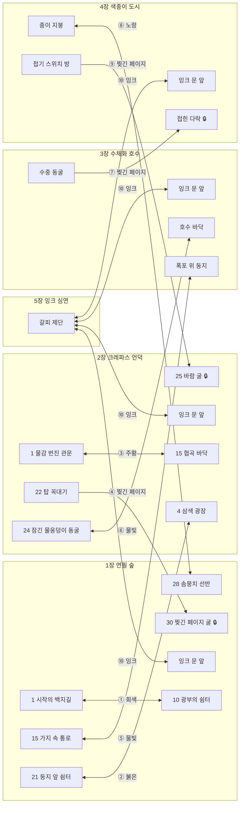

# 15. 책갈피 리본 (정해진 곳끼리 잇는 텔레포트)

> 상태: ✅ 방향 확정 (고르는 방식 ❌ → **정해진 짝으로만 이동**) · 🧪 1·2장 프로토타입 반영 · 💡 3~5장은 설계안

## 📌 한 줄 요약
책 사이를 지나가는 **리본의 양 끝**이 맵 곳곳에 꽂혀 있어. 한쪽 끝에서 W 길게를 누르면 **반대쪽 끝으로만** 넘어가. 목적지를 고를 수 없으니까 **어느 리본이 어디로 이어지는지 알아내는 것**이 탐험이 되고, 초반에 못 갔던 곳을 **후반 능력 + 리본**으로 다시 찾아가게 돼.

## 🎀 리본 3종류

| 종류 | 생김새 | 열리는 조건 | 역할 |
|---|---|---|---|
| 🎀 **보통 리본** | 색 리본 | **양 끝을 모두 한 번 만져야** 매듭이 풀림 | 편의: 맵 끝과 끝, 장과 장 사이 |
| 🔵 **찢긴 페이지 리본** (비밀) | 찢긴 종이 조각 + 파란 리본 | **한쪽 끝만 찾으면 바로** 쓸 수 있음 | 전략: 다른 길로는 못 가는 **봉인된 곳**으로 데려감. 처음엔 보상이 능력 너머에 보이고, 능력을 얻은 뒤 다시 와서 가져감 |
| 🪢 **매듭 리본** | 검은 매듭이 묶인 리본 | 반대쪽 끝이 **아직 안 간 장**에 있음. 그 장에서 끝을 찾으면 풀림 | 예고: "이 리본은 언젠가 어딘가로 이어진다" |

## 🎮 조작 · 규칙

| 항목 | 내용 |
|---|---|
| 넘어가기 | 리본 앞에서 **W 길게 (0.3초)** → 정해진 짝으로 이동. **선택 메뉴 없음** |
| 리본 열기 | 끝에 **닿으면** 그 끝이 열림 (색이 들어오고 링 연출) |
| 사용 가능 표시 | 쓸 수 있으면 리본이 펄럭이고 머리 위에 `^` 표시. 못 쓰면 **매듭**이 묶여 있음 |
| 연출 | 출발: 몸이 위에서부터 **지우개로 지워짐** → 도착: 위에서부터 **연필로 다시 그려짐** (각 0.42초). 지역 이동 책 넘김과는 다르게 함 |
| 못 쓰는 때 | 보스전 중 |
| 텍스트 | 이동 중 문구 없음 |
| 휴대 갈피 | ❌ 삭제 (자유롭게 고르는 이동이 돼서 "정해진 위치" 원칙과 안 맞음) |

## 🗺️ 전체 리본 지도 (1~5장)

## 📋 리본 목록

| # | 색 · 종류 | 끝 A | 끝 B | 열리는 시점 | 넘어가서 하는 일 | 상태 |
|---|---|---|---|---|---|---|
| ① | 회색 · 보통 | 1장 1 시작의 백지길 | 1장 10 광부의 쉼터 | 1장 중반 (광산 도착) | 1장 동남 ↔ 서남 끝 왕복. 강아지 굴(29)도 10번 옆 | 🧪 |
| ② | 붉은 · 보통 | 1장 21 둥지 앞 쉼터 | 2장 4 삼색 광장 | 2장 허브 도착 | 장 사이 허브 연결. 1장 재방문의 기본 통로 | 🧪 |
| ③ | 주황 · 보통 | 2장 1 물감 번진 관문 | 2장 15 협곡 바닥 | 2장 중반 (협곡 바닥) | 2장 서쪽 끝 ↔ 남쪽 바닥 | 🧪 |
| ④ | 파랑 · **찢긴 페이지** | 2장 22 탑 꼭대기 | 1장 **30 찢긴 페이지 굴** (봉인) | 2장 끝 (벽타기로 탑 오른 뒤) | 처음엔 18칸 잉크 물 건너 🎒 **물감 탄**이 보이기만 함 → **3장 헤엄** 후 다시 와서 획득 | 🧪 |
| ⑤ | 물빛 · 매듭 → 보통 | 1장 15 가지 속 통로 | 3장 폭포 위 둥지 | 3장 폭포 위 도착 | 3장에서 1장 꼭대기로 바로 → 1장 26 밀랍 둥지(벽타기) 재방문 | 🧪(1장 끝) · 💡 |
| ⑥ | 물빛 · 매듭 → 보통 | 2장 24 잠긴 물웅덩이 동굴 | 3장 호수 바닥 | 3장 호수 바닥 도착 | 2장 끝은 헤엄으로만 닿는 동굴. 3장 쪽에서 먼저 열면 2장 24로 바로 들어감 | 🧪(2장 끝) · 💡 |
| ⑦ | 파랑 · **찢긴 페이지** | 3장 수중 동굴 | 4장 접힌 다락 (봉인) | 3장 (헤엄) | 4장을 **미리 엿봄**: 낭떠러지 건너 🕊️ 종이학(그림 친구)이 보임 → **4장 활공** 후 다시 와서 완성 | 💡 |
| ⑧ | 노랑 · 보통 | 4장 종이 지붕 | 1장 28 솜뭉치 선반 | 4장 지붕 도착 | 1장 활공 재방문 방에 바로 내려감 → 하늘길 덮개 | 💡 |
| ⑨ | 보라 · **찢긴 페이지** | 4장 접기 스위치 방 | 2장 25 바람 굴 (봉인) | 4장 (활공) | 2장 늪 건너편 바람 굴에 바로 도착 → 상승 기류 코스 + 보상 | 💡 |
| ⑩ | 잉크 · 보통 ×4 | 5장 갈피 제단 | 1~4장 각 **잉크 문 앞** | 5장 (덧칠) | 덧칠로 각 장의 잉크 문을 열고 진 엔딩 단서 회수 (5장 자화상 방 열쇠) | 💡 |

## ⏳ 장이 진행될수록 넘나드는 흐름

| 시점 | 새로 쓰게 되는 리본 | 경험 |
|---|---|---|
| 1장 | ① | 리본이 뭔지 배움 (같은 장 안 끝과 끝) |
| 2장 | ② ③ · ④ 발견 | 1장 ↔ 2장 왕복. ④로 1장 봉인 굴에 갔다가 **"헤엄이 있어야 저걸 먹겠네"** |
| 3장 | ⑤ ⑥ 열림 · ④ 회수 · ⑦ 발견 | 헤엄 얻고 ④로 1장 가서 물감 탄 획득. ⑦로 4장을 미리 엿보고 종이학 발견 |
| 4장 | ⑧ ⑨ 열림 · ⑦ 회수 | 활공으로 종이학 완성. ⑧⑨로 1·2장 활공 재방문 방에 바로 내려감 |
| 5장 | ⑩ ×4 | 5장 한가운데서 1~4장 잉크 문으로 뻗어 나가며 마무리 |

## ⚖️ 설계 원칙
- **세이브 ≠ 리본**: 세이브는 장마다 8~10개, 리본 끝은 장마다 4~6개. 가까운 곳은 걸어감
- **목적지 고정**: 리본마다 짝이 하나뿐 → "이 리본은 어디로 가지?"가 탐험거리
- **찢긴 페이지 = 미리 보여주기**: 봉인된 곳에 먼저 데려가서 보상을 **보여만 주고**, 필요한 능력을 얻은 뒤 다시 오게 함 (장 하나 뒤의 능력)
- **순서 깨기 방지**: 보통 리본은 양 끝을 다 만져야 열려서, 아직 못 간 곳으로 미리 넘어갈 수 없음. 찢긴 페이지 리본의 도착지는 **막다른 봉인 구역**이라 진행을 건너뛸 수 없음
- **재방문 보장**: 1·2장 재방문 방(26·27·28 / 23·24·25)은 리본 끝에서 걸어서 1~2분 안

## 🔧 프로토타입 메모
- 1장 끝 5곳 (①×2, ②, ④ 도착지, ⑤), 2장 끝 5곳 (②, ③×2, ④ 출발지, ⑥)
- ⑤ ⑥은 3장이 아직 없어서 **매듭 리본**으로 보임 (W를 눌러도 안 넘어감)
- 1·2장이 한 장의 지도로 합쳐져서(`unfin_world.html`) 리본도 전부 **같은 지도 안에서** 이동함
- 1장 30 찢긴 페이지 굴: 서쪽 땅(리본) — 18칸 잉크 물 (천장이 매끈해서 점프·대시·벽 점프로 못 건넘) — 동쪽 땅(🎒 물감 탄)

## 💡 남은 결정
- 찢긴 페이지 리본을 **처음 찾았을 때**, 도착지가 봉인 구역이라는 걸 어떻게 암시할지 (찢긴 종이 모양으로 충분한지)
- 3~5장 리본 끝 정확한 위치는 각 장 맵 설계 때 확정
