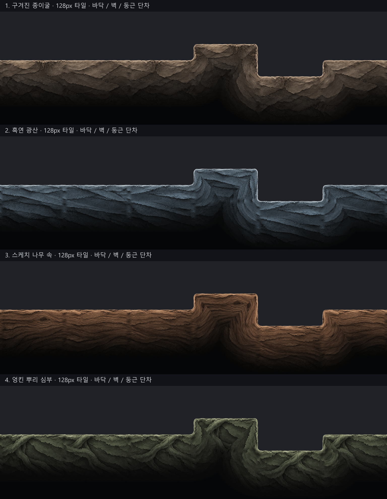

# 16. 아트 컨셉 · 통일 규칙

> 상태: ✅ 방향 확정 (이 문서가 아트의 기준) · ✅ v5 **분위기 중심의 선명한 2D 일러스트 · 실루엣 · 공간 깊이** (§0-1이 현행 기준) · 🧪 Unity 1지역은 v8 구역별 컬러 연속 타일, 2지역은 v6 원화 적용, 캐릭터·특수 지형은 표식 · 💡 3~5장 세부 색은 맵 설계 때 확정
> 이 문서는 **"누가 그려도 같은 게임처럼 보이게"** 하는 규칙집이야. AI로 뽑을 땐 [17 AI 아트 프롬프트](17_AI_아트_프롬프트.md)를 그대로 써. 새 에셋을 만들 땐 마지막 [✅ 체크리스트](#-에셋-체크리스트)부터 확인해.

> **2026-10-16 지형 질감 보완 · v6:** 모든 지역의 지형 패턴은 **큰 흙덩어리·넓고 둥근 면·얕은 불규칙 굴곡**을 기본으로 한다. 가는 선·촘촘한 잔입자·뾰족한 파편을 줄이고 이전 디테일 100 대비 70을 미술 목표로 삼는다. 입자는 크게 다시 그리며 흐림 효과로 뭉개지 않는다. 밟는 윗선도 얕게 울퉁불퉁하게 만들고 평평한 띠를 덧그리지 않는다. 지역마다 같은 스타일의 A/B/C 패턴을 연결해 반복감을 줄인다. 표면부터 깊이 끝까지 서서히 거의 검정으로 어두워진다. v6 원화와 연결 타일 282종은 2지역 및 기존 검수 카탈로그에 남겨 두며, 1지역은 아래 v8 컬러 연속 타일로 갱신한다. v6 검수 카탈로그의 직선 구간 요철은 최대 3px이며, 현재 1지역 v8은 아래의 약 2~12px 윤곽을 사용한다. 꺾이는 부분은 바깥 반경 28px·안쪽 반경 24px로 부드럽게 연결하며 충돌 격자는 유지한다. 이 지형 규칙은 적 실루엣의 위협 표현과 별개다.

---

## 2026-10-16 · 1지역 구역별 연속 재질 · v8 Unity 적용

사용자가 선택한 두 번째 시작 바닥 시안([구겨진 종이굴](../Art/samples/region1-start-v7-concept/start-ground-concept.png))과 이후 구역별 색조 수정을 기준으로 한다. 1지역 전체의 일반 지형에 새 컬러 타일을 적용하며, 2지역은 v6를 유지한다. 아래 비교 이미지는 재질 예시이고 실제 적용 규격과 파일 구분은 [Unity 타일 정리](../Art/samples/region1-tiles-v8/UNITY.md)에 기록한다.

- **구겨진 종이굴 · 7개 방:** 1~6, 25번. 시작·튜토리얼·허브. 부드러운 종이 지층과 흑연 흙을 길게 연결한다.
- **흑연 광산 · 9개 방:** 7~12, 27, 29, 30번. 갱도·잉크 구덩이·채굴장. 눌린 흑연층과 넓은 채굴 흔적으로 밀도를 높인다.
- **스케치 나무 속 · 6개 방:** 13~17, 26번. 옹이 방·수직 탑·가지 통로. 길게 휘는 목질과 드문 옹이로 바닥과 벽을 연결한다.
- **엉킨 뿌리 심부 · 8개 방:** 18~24, 28번. 덩굴 다리·보스 둥지·출구. 굵기가 다른 뿌리 덩어리를 어두운 흙에 묻는다.

네 구역은 절제된 디테일, 원화에서 추출한 약 2~12px의 불규칙한 표면 윤곽, 둥근 꺾임과 지중의 점진적 암부를 공유한다. 색 텍스처 정렬과 별도로 윤곽 높이를 보존하며, 변환 과정에서 일직선으로 펴지지 않도록 실제 알파 경계를 검사한다. 구역을 구분할 수 있도록 종이굴은 따뜻한 회갈색, 흑연 광산은 차가운 청회색, 나무 속은 낮은 채도의 목재 갈색, 뿌리 심부는 이끼빛 회녹색으로 나눈다. 색은 표면과 중간 깊이에서 읽히며, 깊어질수록 거의 중성 검정으로 사라진다. [색조 수정 프롬프트](../Art/samples/region1-tiles-v8/color-revision.json)를 별도로 보존한다.

큰 문양 하나를 매 칸에 반복하지 않고 **4칸 너비 × 3칸 깊이의 A/B/C 재질 묶음**을 128×128px 타일로 분할한다. 묶음 내부의 순서를 유지해 긴 재료 결이 이어지고, 서로 다른 묶음의 양 끝은 공통 재질로 맞춘다. 아무 타일이나 무작위로 섞어도 연결되는 방식은 아니다.

실제 타일 조립 자료는 `Art/samples/region1-tiles-v8/`에 있다. `sources/`는 내장 image_gen 원본, 구역별 `tiles/`는 128px PNG, `atlas.png`는 아틀라스, `*-tilemap.json`은 셀별 타일 ID다. `build.cjs`가 원본을 정렬·분할하고 곡선 연결 조각을 만든 뒤, **저장한 아틀라스를 다시 읽어** 긴 바닥과 단차 두 배치의 최종 이미지를 재조립한다. 재구성 일치, 타일 재사용 및 묶음 접합 검증은 `validation.json`, 생성 프롬프트는 `prompts.json`에 기록한다.

[격자와 실제 타일 ID 표시](../Art/samples/region1-tiles-v8/all-regions-grid.png) · [시작 구역 반복 배치 검수](../Art/samples/region1-tiles-v8/01-paper-cavern/straight-grid.png)

비교 시안의 두 배치와 별도로 실제 월드용 아틀라스를 `Book/Assets/Unfin/Art/Region1V8/`에 생성한다. 1지역 30개 방과 통로의 일반 지형 28,940칸을 128px 타일로 배치한다. 바닥·벽·천장·단차의 재질은 384px 깊이에 걸쳐 어두워지고, 방 구역 경계는 약 4칸에 걸쳐 혼합한다. 원본 맵 구조·충돌·캐릭터 배율은 유지한다. 현재 지도에 맞춰 생성한 타일셋이므로 지도 구조를 바꾸면 내보내기와 Unity 임포트를 다시 실행한다.

## 2026-10-16 · 1지역 배경 디자인 v1

현재 지형 v8의 색에 맞춘 **구역 대표 배경 4장과 경계 전환 시안 4장**을 [배경 디자인 폴더](../Art/samples/region1-backgrounds-v1/)에 보존한다. 내장 image_gen으로 생성했으며 [전체 프롬프트](../Art/samples/region1-backgrounds-v1/prompts.json), [30개 방·11개 세부 구획의 배정과 변주 지침](../Art/samples/region1-backgrounds-v1/design.json)을 함께 기록한다.

- [A 구겨진 종이굴](../Art/samples/region1-backgrounds-v1/A-paper-cavern.png): 회갈색 종이 지층과 넓은 주름, 여러 겹의 공동으로 시작·허브의 깊이를 표현한다.
- [B 흑연 광산](../Art/samples/region1-backgrounds-v1/B-graphite-mine.png): 청회색 흑연층, 넓은 채굴 흔적과 드문 지지대로 공간을 무겁게 만든다.
- [C 스케치 나무 속](../Art/samples/region1-backgrounds-v1/C-sketch-tree.png): 목재 갈색의 굵은 나뭇결, 옹이와 속 빈 줄기로 수직 공간을 표현한다.
- [D 엉킨 뿌리 심부](../Art/samples/region1-backgrounds-v1/D-root-depths.png): 회녹색 뿌리 덩어리, 먼 둥지와 섬유를 겹쳐 보스 구역의 밀도를 만든다.

경계는 단순한 색 그라디언트 대신 재료의 겹침과 공통 안개로 연결한다. [A→B](../Art/samples/region1-backgrounds-v1/transition-AB-vertical.png)는 위 종이층에서 아래 흑연층으로, [C→A](../Art/samples/region1-backgrounds-v1/transition-CA-vertical.png)는 위 목질에서 아래 종이층으로 이어진다. [C→D](../Art/samples/region1-backgrounds-v1/transition-CD-horizontal.png)는 왼쪽 나무에서 오른쪽 뿌리로, [D→A](../Art/samples/region1-backgrounds-v1/transition-DA-vertical.png)는 위 뿌리에서 아래 시작 구역으로 내려가는 지름길이다. 가운데 넓은 구간에서 양쪽 재료가 함께 나타난다.

**현재 상태는 디자인 시안이다.** Unity·웹에는 아직 적용하지 않았다. 원경과 중경은 합쳐진 그림이고, 이미지 간 가장자리 일치·반복 연결·실제 플레이 가독성 검증은 후속 제작 단계다. 기존 배경 자동화에 즉시 투입할 완성 타일로 취급하지 않는다. 아래 예전 구역 팔레트 중 C 회녹색·D 장미색 대신 현재 v8의 C 목재 갈색·D 회녹색을 우선한다.

## 0. 한 줄 콘셉트

> **"아이가 그리다 만 스케치북 한 권, 그 종이 위에서 살아 움직이는 그림들."**

| 키워드 | 뜻 |
|---|---|
| 📄 **종이** | 모든 것은 종이 위에 그려져 있다. 화면 = 스케치북 한 페이지 |
| ✏️ **재료** | 지역마다 그림 재료가 다르다 (연필 → 크레파스 → 수채화 → 색종이 → 잉크) |
| 🫥 **미완성** | 점선으로 남은 외곽, 외곽선만 있고 안 칠한 면. 그게 이 세계의 아름다움 (지저분하게가 아니라 **깔끔하게 비워 둔 것**) |
| 🌈 **색은 보상** | 처음엔 흑백. 보스를 잡을 때마다 세상에 색이 돌아온다 |
| ✒️ **부드러운 그래픽** | 손그림이 아니라 **깔끔하고 선명한 선 + 부드러운 면**의 그래픽 디자인. 스케치북 세계라는 건 **모양·무늬·색**으로 보여줌 (거친 연필 선으로 ❌) |
| 👀 **읽히는 그림** | **플레이에 필요한 정보는 한눈에** 읽혀야 한다 |
| 🎮 **게임 그림체** | 현실적인 그림·사실적인 묘사가 아니라 **게임 화면에 나올 법한** 단순하고 정돈된 그래픽. 디테일은 큰 덩어리로 묶음 |
| 🌗 **미드키** | 전투 게임이라 **너무 밝지 않게, 그렇다고 어둡지도 않게**. 종이는 흐린 스탠드 불빛 아래 톤, 가장 밝은 건 주인공 |

---

### 0-1. 현재 아트 방향 · v5

**할로우 나이트를 실루엣·공간 깊이·고요하고 신비한 분위기의 레퍼런스로 삼는 고해상도 2D 메트로배니아.** 작화 기법의 명칭보다 실제 화면 인상을 기준으로 한다.

- 캐릭터는 작은 크기에서도 읽히는 단순한 형태, 매끈한 외곽선과 선명한 면으로 만든다.
- 배경은 동굴·나무 속·공방·탑의 규모와 여러 겹의 실루엣으로 깊이를 만든다. 먼 곳은 대비와 디테일을 줄이고 앞쪽은 더 진하게 잡는다.
- 방별로 낮은~중간 명도의 색조를 쓰고, 국소광·얇은 안개·미세한 부유 입자로 시선을 안내한다. 적·탄·발판은 항상 분리되어 읽혀야 한다.
- 연필·크레파스·종이는 **세계의 재료와 구조물**로 표현한다. 거친 연필 해칭, 흔들리는 선, 화면 전체 종이 결과 모눈을 주된 스타일로 쓰지 않는다.
- 기존의 종이 명도 70% 고정, 전면 평면광, 모든 빛 번짐·림라이트 금지는 현행 규칙에서 해제한다. 재사용 타일은 중립 조명, 실제 빛과 안개는 별도 장면 레이어로 만든다.
- 주인공·적·건축·문양은 Unfin의 화구 세계 디자인을 사용한다. 레퍼런스의 특정 캐릭터 외형을 목표 형태로 삼지 않는다.
- 256px/칸·PPU 256, 다중 타일셋, 1080p·1440p·4K 직접 출력은 [21 문서](21_고해상도_타일맵_규격.md)를 유지한다.

## 1. 일곱 가지 원칙

| # | 원칙 | 규칙 | 이유 |
|---|---|---|---|
| ① | **스케치북 세계, 깔끔한 그래픽** | 배경·지형·캐릭터·UI·이펙트 전부 스케치북 세계의 사물이지만, 그리는 방식은 **선명한 외곽선 + 부드러운 평면색 + 은은한 2단 음영**. 과한 광택·네온은 피하고, 장면의 은은한 국소광·안개·색 전환을 허용 | 세계관 = 스케치북, 화면 = 정돈된 게임 그래픽 |
| ② | **재료가 곧 지역** | 한 지역 = 한 재료 **테마**. 그 지역의 지형·적·이펙트는 그 재료의 **모양·무늬·색**으로 표현 (연필 = 사선 줄무늬·흑연 회색, 크레파스 = 물결 줄무늬·뭉툭한 모양…) | 지역 구분이 모양·무늬로 바로 됨 |
| ③ | **덜 그려진 게 정상** | 미완성은 **깔끔한 점선 외곽**과 **외곽선만 있고 안 칠한 면**으로 표현 (지저분한 선·지우개 자국 ❌). 플레이 판정에 쓰이는 선은 항상 실선 | "Unfin(ished)" 주제 |
| ④ | **색은 이야기를 따라감** | 채도는 낮게 시작해서 장이 진행될수록 조금씩 올라감. 가장 진한 색은 엔딩에 아껴둠 | 색 = 회복의 보상 |
| ⑤ | **가독성이 예쁨보다 먼저** | 플레이 레이어(땅·적·탄·기믹)는 배경보다 **명도 차 30% 이상**, 굵은 외곽선 | 메트로배니아는 읽혀야 재밌음 |
| ⑥ | **게임 그림이지 그림 작품이 아님** | 사실적인 질감·세밀한 묘사·실사 같은 빛 금지. 형태는 단순하게, 디테일은 큰 덩어리로, 한눈에 읽히게 | 전투 중 0.2초 안에 읽혀야 함 |
| ⑦ | **미드키 명도** | 방별 낮은~중간 명도, 국소광과 거리별 대비. **주인공과 적·탄이 배경에서 분리됨** (§4-6) | 눈이 덜 피곤하고, 전투의 긴장감 + 주인공이 항상 보임 |

---

## 2. 화면 = 스케치북 한 페이지

### 2-1. 종이 바탕
| 항목 | 규칙 |
|---|---|
| 바탕색 | 방별 낮은~중간 명도의 공기색. 종이색은 재료 기준색이며 모든 화면을 덮는 고정 밝기 바탕이 아니다. |
| 질감 | 아주 옅은 종이 결(노이즈) + **모눈은 표지·지도·특정 장소에만 선택 사용**. 실제 플레이 배경은 공간감이 우선 |
| 얼룩 | 생활감 얼룩(커피 자국 같은 둥근 무늬)을 깔끔한 모양으로 배경에 **드물게** (화면당 0~2개) |
| 가장자리 | 전경 실루엣과 절제된 비네트로 공간을 감싸되 시야와 위험 지형을 가리지 않음 |

### 2-2. 레이어 구조 (패럴랙스 5겹) — **실내형** 🏠

> 우리 맵은 **천장·바닥이 있는 닫힌 공간**(책 속)이고, 세로로 아주 높은 수직굴도 있어. 그래서 배경은 하늘·지평선이 있는 야외 풍경이 아니라 **그 공간의 뒷벽**이야.

| 레이어 | 내용 | 움직임 | 선 굵기 | 명도·채도 |
|---|---|---|---|---|
| L0 공기색 | 방별 배경색, 종이 결·모눈은 선택 | 고정 | — | 방 분위기에 맞춤 |
| L1 **뒷벽** | **배경 구획**(구역마다 2~3개, 총 22개)마다 다른 실내 벽 질감 (종이 틈 입구·풀뿌리 갈림굴·깊은 채굴장…). **하늘·지평선·바닥 없음, 위아래 방향 없음** → **가로·세로 4방향으로 이어지는 그림**이라 변형 3장을 섞어 깔면 어떤 크기의 방도 이음새 없이 채움 | 카메라의 0.2배 (가로·세로) | 흐린 실루엣과 성긴 디테일 | 공기색에 가까운 낮은 대비 |
| L2 **세트 조각** | ① **방 대표 조각** — 그 방에만 있는 배경 그림 1개 (방 56개 전부) ② **공용 조각** — 구역마다 5개, 방마다 1~3개 골라 배치 (세로 1:2 = 수직굴용) | 0.5배 (가로·세로) | 보통 선 (1.5px) | 플레이 지형보다 조용한 중경 명도 |
| **L3 플레이** | 땅·벽·발판(이어진 바탕) + 방 장식 · 적·플레이어·기믹 | 1배 | **굵은 선 (2.5~3px)** | **명도 차 30% 이상**, 가장 또렷 |
| L4 전경 | 화면 위·아래 가장자리를 가리는 매달린 뿌리·바위 덩어리 | 1.3배 | 굵지만 흐리게 (투명도 40%) | 가운데는 비움, 플레이를 가리면 안 됨 |

> **공중에 떠 보이지 않게**: 세트 조각은 전부 붙는 곳이 정해져 있어 — ⬇️ 천장에 매달림(위가 잘림) · ⬆️ 아래에서 솟음(밑동이 어둠으로 흐려지거나 지형 뒤에 묻힘) · ↕️ 바닥~천장(위아래 잘림) · 🧱 벽에 붙음. 배경 조각은 **위가 평평하지 않게** (발판으로 착각 금지). 패럴랙스는 **방 가운데 기준**, 세로는 가로보다 약하게 ([17](17_AI_아트_프롬프트.md) §7-2).
> **🔲 4방향 이어짐**: 뒷벽·세로 뒷벽·구획 이음·지형 채움·전경 테두리·바닥~천장 조각은 전부 **가로·세로로 끊김 없이 이어지는 그림**으로 만들어. 방법은 "공통 테두리 띠" — 구획마다 변형 A를 스스로 이어지게 먼저 만들고, B·C는 A의 바깥 띠를 그대로 둔 채 안쪽만 새로 그림 ([17](17_AI_아트_프롬프트.md) §7-2, `Tools/tile_kit.py`).
> **높은 곳**: 한 화면보다 높은 16곳 중 1.5화면 이상 6곳(나무 속 탑, 뿌리굴, 덩굴 수직굴, 물감 폭포 홀, 협곡 낭떠러지, 크레파스 탑)은 **아래→위로 바뀌는 세로 전용 뒷벽**, 나머지는 4방향으로 이어지는 뒷벽을 그대로 쌓기. 높은 방은 대표 조각을 높이마다 2~3개.
> **같은 구역이라도 방마다 다르게**: 구획 뒷벽이 바뀌고, 방마다 대표 조각이 있어서 1장 전체가 같은 그림으로 반복되지 않음.
> 바깥(초원·하늘)은 **구멍·창문 세트 조각 안으로만 살짝** 보여. "책 속 실내에서 바깥을 엿보는" 느낌 = 답답하지 않으면서 실내감 유지.
> 구역 사이는 뒷벽 전환 질감(이음)으로 이어서 끊기지 않게 ([17](17_AI_아트_프롬프트.md) §7-2, [19](19_에셋_목록_프롬프트.md) §7-3).
> 프로토타입은 L0 + L3만 있음. 실제 제작 땐 L1·L2로 깊이감을 줌 (3D 대신 패럴랙스, 01 문서).

---

## 3. 선 (라인) 규칙

| 항목 | 규칙 |
|---|---|
| 선 색 | **순흑(#000) 금지**. 기본 외곽선은 잉크 회색 `#25272C`. 지역 재료에 따라 색이 섞임 (2장은 갈색 기운 `#7A4A30` 쪽으로) |
| 굵기 (1080p 기준) | 플레이어·적·상호작용 물체 **3px** · 지형 외곽 **2.5px** · 중경 1.5px · 먼 배경 1px |
| ✒️ 선명도 | **흔들림 없는 깔끔한 선.** 매끈한 곡선(베지어 느낌), 일정한 굵기, 가장자리는 부드럽게 안티앨리어싱. 스케치·거친 연필 선·덧그은 선 ❌ |
| 선 끝 | 둥근 끝(라운드 캡). 선은 **닫혀 있음** (일부러 연 곳은 점선으로) |
| 점선 | 미완성·채울 수 있는 부분만 **깔끔한 점선**. **판정에 쓰이는 외곽(땅 표면, 벽, 적 몸통, 탄)은 항상 실선** |
| 선 떨림 (boil) | **쓰지 않음** (v4). 깔끔한 선이라 떨림 대신 **60fps 움직임과 부드러운 형태 변화**로 살아 있는 느낌 ([18 문서](18_애니메이션_프롬프트.md)) |

---

## 4. 색 규칙

### 4-1. 전체 원칙
| 항목 | 규칙 |
|---|---|
| 채도 | **화방 재료 색을 살짝 뺀 톤**. 기본 채도 상한 HSV S 55% (기능색만 65%까지) |
| 명도 | **방별 낮은~중간 명도.** 공기색·국소광·거리별 대비로 깊이를 만들고 주인공·적·탄을 분리 (§4-6) |
| 면 · 음영 | **평면색 + 부드러운 음영 1단계 + 밝은 면 1단계** (음영은 항상 모양의 오른쪽 아래). 면 안의 은은한 그라디언트는 허용, 강한 무지개 그라디언트·광택 금지 |
| 순백 `#FFF` | 피격 깜빡임(0.12초)에만 사용. 주인공 몸도 순백이 아닌 **분필 흰색** `#F0EEE6` |
| 한 화면 색 수 | 지역 색 3~4개 + 기능색. 그 이상은 어수선해짐 |

### 4-2. 공통 기능색 (모든 장에서 같은 뜻) ✅

> 지역이 바뀌어도 **이 색들은 뜻이 안 바뀜**. 플레이어가 한 번 배우면 끝까지 통하게.

| 색 | 값 | 뜻 | 쓰는 곳 |
|---|---|---|---|
| 🟡 금빛 노랑 | `#F2D06B` / 테두리 `#E2B93B` | **튕겨낼 수 있다 · 연결돼 있다** | 패링 가능 탄 예고, 열쇠 몬스터 금빛 테두리·점선, 과녁 |
| 🌹 탁한 장미 | `#B07B73` | 체력 · 회복 | 하트, 회복 물감, 체력 조각 |
| ⚫ 잉크 검보라 | `#2A2438` (2장 늪은 `#7A4A30`) | **닿으면 아픔** | 잉크 웅덩이, 녹은 크레파스 늪, 적 공격 판정 |
| 🔴 리본 붉은색 | `#B5585A` | 책갈피 리본 (이동) | 리본 끝, 리본 지도 |
| 🔵 찢긴 페이지 파랑 | `#5D7FA8` | 비밀 · 봉인 구역 | 찢긴 페이지 리본 |
| 🟠 그림 친구 주황 | `#D9823F` / `#F0AE5C` | **그려 넣을 수 있다** | 그림 친구 테두리, 연필 아이콘, 장 제목 밑줄 |
| ⬜ 점선 | 같은 색 40% 투명 점선 | **아직 덜 그려진 것 = 채울 수 있음** | 그림 친구의 빠진 부분, 매듭 리본 |

### 4-3. 지역별 팔레트

| 장 | 재료 | 종이 | 선·그림자 | 지형 | 대표색 | 위험색 | 분위기 |
|---|---|---|---|---|---|---|---|
| 1 연필 숲 | 연필·지우개 | `#BDBCB5` | `#25272C` | `#5E6168` 흑연 회색 | 거의 무채색. 구역 틴트만 (`#C2C1B9` `#B8B8BC` `#B6BDB6` `#C0B8B6`) | `#2A2438` 잉크 | 조용함, 쓸쓸함, 연필 사각거림 |
| 2 크레파스 언덕 (언덕 속 동굴·공방·협곡·탑 내부) | 크레파스·밀랍 | `#C7BBA8` | `#7A4A30` 갈색 | `#685C56` 따뜻한 회갈 | 노을 주황 `#E8A060` · 밀랍 `#E4D6A8` · 물감통 `#D6564C` `#5080C8` `#EEC648` | `#7A4A30` 녹은 늪 | 따뜻하지만 끈적하고 무거움 (덧칠) |
| 3 수채화 호수 💡 | 수채 물감·물 | `#B4BEC6` 푸른 기운 | `#4E5E78` | `#7D8CA0` | `#9EB8D2` `#B6C8DA` `#8FA8C4` + 번진 분홍 `#D8A8B4` | 짙은 번짐 `#3E4E6A` | 고요함, 슬픔, 젖은 종이 |
| 4 색종이 도시 💡 | 색종이·가위·자 | `#C9C3B6` | `#3A3A44` | 단색 면 (그림자 1단계) | 빨강 `#C96A5E` · 노랑 `#E3C26A` · 초록 `#7FA98A` · 남색 `#4E6A8C` | 가위 날 `#2E2E36` | 반듯하고 완벽해 보이지만 텅 빔 |
| 5 잉크 심연 💡 | 잉크·펜 | `#9E9A92` 바랜 종이 (가장 어둡지만 밤처럼 까맣지 않음) | `#14121A` | 잉크 덩어리 `#1F1D26` | 1~4장 색 **조각**이 잉크 속에 박혀 있음 | 잉크 전체 | 무겁지만, 덧칠할 때 색이 확 살아남 |

> **구역 색 기운** (종이·뒷벽·지형에 아주 옅게, 같은 장 안에서 구역 구분용): A 따뜻한 크림 회색 `#C2C1B9` · B 차가운 푸른 회색 `#B8B8BC` · C 세이지 회녹 `#B6BDB6` · D 먼지 장미 회색 `#C0B8B6` · E 주황 베이지 `#C5BCB1` · F 밀랍 베이지 `#C0BAB3` · G 푸른 보라 회색 `#BABBC2` · H 벽돌 장미 회색 `#C2B8B5`

### 4-4. 색이 돌아오는 규칙 (진행 연출) ✅
| 시점 | 화면 |
|---|---|
| 프롤로그 · 1장 | 거의 흑백. 색은 기능색(하트·금빛 예고)뿐 |
| 1장 보스 처치 | 표지에 `i` 회복. 연필 숲 종이가 아주 조금 따뜻해짐 |
| 2장 | 크레파스 색이 처음 등장 (채도 상한 45%) |
| 2장 보스 처치 후 | **1장 연필 숲에 크레파스 터치가 스며듦** (나뭇잎 끝 몇 개, 꽃 몇 송이에 주황) → 다시 들르면 바뀐 게 보임 |
| 3·4장 | 같은 방식으로 이전 장들에 그 장의 색이 조금씩 스며듦 |
| 5장 덧칠 → 진 엔딩 | 처음으로 채도 상한을 풀고 **가장 진한 색**을 씀. 잉크 윤곽선 + 모든 재료 색 |

> 핵심: **같은 장소를 다시 와도 색이 달라져 있음** → 재방문 동선(리본·재방문 방)과 짝을 이룸.
> 종이 값은 v3(미드키)에서 한 단계 낮춤. 구역 틴트·2장 이후 종이도 같은 비율(약 ×0.8)로 낮춘 값을 씀. 프로토타입은 아직 예전 밝은 값 (그레이박스라 그대로 둠).

### 4-5. 지역 경계 색 전환 ✅
- 지역 사이는 걸어서 이어지고, 경계 앞뒤 **약 28칸** 동안 종이색·선색이 섞이며 바뀜 (프로토타입 반영)
- 경계 지형은 두 재료가 **겹쳐 그려진 것처럼** (연필 선 위에 크레파스가 덧칠되기 시작) → 장 경계 지형 이음 `TL-DE-*`가 **2~3화면 폭**에 걸쳐 깔림
- 배경도 뒷벽 이음(`BL-DE-wall`)으로 엉킨 뿌리 벽 → 크레파스 동굴 벽이 한 그림처럼 이어짐

### 4-6. 명도·깊이·조명 ✅ v5

- 전체 화면을 같은 종이 밝기에 맞추지 않는다. 방의 기능에 따라 고요한 어둠, 중간 밝기의 길, 소규모 빛 영역을 구성한다.
- 주인공의 분필 흰색 `#F0EEE6`과 명확한 실루엣은 유지한다. 적과 탄도 주변과 명도·색·윤곽 차이를 확보한다.
- 먼 배경은 공기색에 가까워지고 디테일과 대비가 줄어든다. 중경은 장소의 규모를 보여주고, 전경은 짙은 실루엣으로 화면을 감싼다.
- 발판과 벽의 접촉 면은 선명하게 유지한다. 그림자가 길을 가리거나 안개가 탄을 숨기면 강도를 낮춘다.
- 국소광·얇은 안개·은은한 림 분리는 장면 레이어에서 허용한다. 반복 타일 이미지에 강한 광원이나 그림자를 구워 넣지 않는다.
- 기존 `art_check.py`의 평균 밝기 대역과 `unify_pass.py`의 종이색 보정은 v3/v4 기준이다. v5 골든 장면으로 재조정 전에는 스타일 합격 판정에 사용하지 않는다. 크기·비율·이음·투명도 검사는 계속 활용한다.

---

## 5. 재료별 표현 규칙

| 장 | 지형 질감 | 면 칠하는 법 | 이펙트 재료 | 특징 소품 |
|---|---|---|---|---|
| 1 연필 | 흑연색 매끈한 덩어리와 드문 사선 모티프 | 넓은 면 음영, 거친 해칭 금지 | 작은 흑연·지우개 조각 | 그리다 만 나무, 화구 구조물, 지운 빈 형태 |
| 2 크레파스 | **뭉툭하고 둥근 모양** + 깔끔한 물결 줄무늬 (크레파스 결을 무늬로) | 따뜻한 평면색 + 부드러운 음영 | 크레파스 부스러기, 녹아 흐르는 밀랍 방울 | 녹는 발판(주황 띠 + 늘어지는 방울), 화로, 물감통 |
| 3 수채화 💡 | 깔끔한 모양 안의 **부드러운 그라디언트**, 물방울·동그라미 무늬 | 옅은 색 겹치기 (가장자리는 선명) | 물방울, 번지는 동그라미 | 물감 방울, 젖은 종이(주름), 붓 |
| 4 색종이 💡 | **단색 평면** + 접힌 선 1개 + 그림자 1단계 | 칠하지 않음. 종이를 오려 붙인 면 | 종이 조각, 가위로 자른 직선 조각 | 접기 스위치, 컴퍼스 리프트, 가위 함정 |
| 5 잉크 💡 | 매끈한 **잉크 방울·흘러내림 모양** | 깊은 검보라 면 + 이전 장 색 조각이 은은하게 | 잉크 튐, 잉크 웅덩이 | 이전 장 방 조각, 덧칠 제단 |

---

## 6. 형태 언어 (Shape Language)

| 대상 | 기본 형태 | 규칙 |
|---|---|---|
| 🧑 플레이어 | **동그란 머리 + 둥근 사각 몸**, 눈 점 하나 | 게임에서 가장 단순한 그림. 미드키 화면 위에서 **가장 밝은 분필 흰색 몸** + 굵은 외곽으로 바로 보임 |
| 🙂 중립·친구 | 동그라미 위주 | 그림 친구, 주민, 갈피 → 둥글고 부드러움 |
| 👾 일반 적 | 그 지역 재료의 모양 + **뾰족한 부분 1곳** | 크레용 병정 = 크레파스 끝, 밀랍 투척꾼 = 뭉툭한 덩어리 |
| ⭐ 엘리트 | 일반 적보다 1.5~2배, 실루엣에 **결정적인 특징 1개** | 거북 = 껍질 (정면 막음 → 뒤가 약점이라는 게 모양으로 보임) |
| 👑 보스 | 화면 1/3 이상, **부서진·덜 그려진 곳 1개**가 상징 | 부러진 크레파스 기사 = 부러진 창 → "미완성"이 보스의 정체 |
| 🧸 그림 친구 | **아이 그림체** (선이 가장 서툴고, 비율이 귀엽게 틀림) | 빠진 부분은 점선. 완성되면 그 장 재료 색이 채워짐 |

> 실루엣 테스트: **검은색으로 칠해도** 플레이어 / 적 / 엘리트 / 보스 / 기믹이 구분돼야 함.

---

## 7. 캐릭터

### 7-1. 주인공 (이름 없음)
| 항목 | 규칙 |
|---|---|
| 크기 | 0.75×1.375유닛 (HTML 판정 12×22 논리 단위); 시각 기준 192×352px @ PPU 256 |
| 몸 | **분필 흰색** (`#F0EEE6`, 화면에서 가장 밝은 색) + 굵은 외곽 `#25272C`. **얼굴은 눈 점 하나**, 입·코 없음 |
| 색 | **끝까지 색이 없음** (진 엔딩 마지막 장면만 예외) |
| 또렷해지는 흐름 | 처음엔 외곽선이 군데군데 끊긴 흐린 선 → ✋ 손(1장 벽 점프) → 능력을 얻을 때마다 **선이 한 부분씩 또렷해짐**. 3장에서 얼굴이 없다는 걸 깨닫고, 진 엔딩에서 얼굴이 그려짐 |
| 능력 표현 | 몸에 **작은 도구 흔적**만 추가 (지우개 가루, 크레파스 자국, 물감 얼룩, 접힌 종이 날개). 몸 색을 바꾸지 않음 |
| 애니메이션 | 움직임 60fps (선 떨림 없음). 점프할 때 살짝 늘어나고 착지할 때 찌그러짐 (스쿼시 6~12%). 상세 [18 문서](18_애니메이션_프롬프트.md) |

### 7-2. 적 · 보스 공통
| 항목 | 규칙 |
|---|---|
| 예비 동작 | 공격 0.4~0.6초 전 **색이 밝아지거나 몸을 웅크림** (프로토타입의 wind 상태) |
| 공격 판정 | 판정이 있는 부분(창끝, 탄)은 **가장 진한 색 + 가장 굵은 선** |
| 패링 가능 | 금빛 노랑 반짝임 (★) → 모든 장 공통 |
| 피격 | 0.12초 흰색 깜빡 + 종이 찢긴 조각 2~4개 |
| 처치 | 그 재료로 **지워지거나 흩어짐** (연필 = 지우개로 지워짐, 크레파스 = 부스러짐, 수채 = 번져 사라짐, 색종이 = 접혀서 납작, 잉크 = 웅덩이로 녹음) |
| 존재감 | 그림자(바닥 타원), 발견 시 작은 놀람 동작 (말풍선 텍스트 없음) |

---

## 8. 지형 · 타일

> **제작 기준:** 지형 한 칸 이미지는 **256×256px, PPU 256**. 16×16은 HTML의 논리 격자 설명에만 사용한다. 단위·큰 배경 예외·검수는 [21 고해상도 타일맵 규격](21_고해상도_타일맵_규격.md).

### 다중 타일맵 구성 · 반복 억제

- **충돌 타일맵 + 채움 타일맵 + 표면 무늬 타일맵 + 가장자리 타일맵 + 장식 레이어**로 구성한다. 바닥·벽·천장은 같은 충돌 격자를 공유하고, 시각 레이어를 겹쳐 표현한다.
- 픽셀 느낌 없이 **선명한 곡선·둥근 모서리·안티앨리어싱**을 사용한다. 흔들리는 손그림 선 대신 v8의 깔끔한 그래픽 스타일을 유지한다.
- 구역별 재료 세트를 섞고, 표면 무늬는 최소 4가지 계열을 사용한다. 인접한 무늬 구획에는 같은 계열을 놓지 않고, 크기·간격·밀도·위치를 달리한다. 충돌 타일 한 칸마다 같은 그림을 찍지 않는다.
- 큰 명암 덩어리와 무늬는 여러 충돌 타일에 걸쳐 이어진다. 구역 색은 넓게 섞고, 별도 방 장식으로 장소의 개성을 더한다. 연결용 원본의 회전·반전 금지는 유지한다.
- 위치 기반 고정 시드로 무늬를 선택해 카메라 이동·재시작 때 바뀌거나 반짝이지 않게 한다. 발 딛는 면과 이동 경로는 기존 판정을 따른다.

**HTML 적용 범위:** `Prototype/unfin_world.html`은 `terrain_layers.js`로 일반 지형의 채움·무늬·가장자리를 분리해 그린다. 4가지 절차적 무늬 계열을 6×6타일 크기의 구획에 배치하고, 구역 색을 부드럽게 섞는다. 렌더링은 3배 해상도와 청크 캐시를 사용한다. 이는 최종 이미지 에셋을 적용하기 전의 시각 프로토타입이며, 에셋 목록의 구역별 채움 이미지 A~C와는 별개다. 특수 벽·문·발판의 기능색과 충돌 데이터는 유지한다.

| 항목 | 규칙 |
|---|---|
| 단단한 땅·벽 | 재료 무늬(줄무늬 등)로 채운 덩어리 + **선명한 굵은 외곽**. 벽·천장은 **쥐가 파먹은 홈 없이 평평하게** (04 문서), 그 대신 **가장자리는 부드럽고 자연스러운 곡선** (둥근 모서리, 매끈한 곡선 윤곽, 안티앨리어싱) |
| 🗺️ 구역별 지형 | 장 재료·명도는 같고(한 지역), **구역마다 바닥·천장·벽 디테일과 옅은 색 기운**이 다름 — 종이굴 = 접힌 종이 결·찢긴 조각, 흑연 광산 = 흑연 덩어리·곡괭이 자국, 나무 속 = 나뭇결·껍질, 뿌리 심부 = 엉킨 뿌리 털, 크레파스 굴 = 크레파스 부스러기·노을색 금, 밀랍 공방 = 매끈한 밀랍·그을음, 지하 협곡 = 물감 지층, 기사의 탑 = 모양이 다 다른 돌. 맞닿은 구역 사이엔 **지형 이음**(속 + 띠)으로 서서히 바뀜 ([17](17_AI_아트_프롬프트.md) §7-1) |
| 🔗 이어진 바탕 | 지형 그림은 **월드 전체가 한 줄로 이어짐** (방 경계·장 경계에서 끊기지 않음). 고해상도 Tilemap + 여러 재료 타일셋 + 가장자리 레이어 (Sprite Shape는 긴 곡선 구간의 선택 보조) ([19](19_에셋_목록_프롬프트.md) §1) |
| 🚫 반복 금지 | 벽·바닥 무늬를 **찍어 붙이지 않음**. 바탕은 **4방향으로 이어지는** 질감 변형 A~C와 4가지 이상의 표면 무늬 계열을 섞어 깔고 (변형끼리 테두리 띠가 같아서 이음새 없음, 돌리기·뒤집기는 금지), **방마다 다른 장식**(금·지운 자국·낙서·뿌리·소품)을 투명 레이어로 얹어 같은 바닥이 매번 다르게 보이게 ([17](17_AI_아트_프롬프트.md) §7-1·7-3) |
| 🪨 가장자리 3단 | ① **굵고 불규칙한 윤곽선** (바닥 윗면이 가장 굵게 = 밟을 곳이 바로 읽힘) → ② 윤곽 안쪽 **진한 표면 띠** (돌·재료 부스러기·풀/뿌리·금) → ③ **밝고 성긴 속** (희미한 지층, 덜 칠해서 종이가 비치는 곳). 처음부터 끝까지 같은 회색 ❌, 자로 그은 선·일정한 물결 ❌ ([17](17_AI_아트_프롬프트.md) §7-1) |
| 판정과 그림 | 판정은 네모 타일 데이터 그대로, 그림은 곡선. **발판·땅 윗면 높이만 정확히 맞추고**, 모서리·옆면은 1/4타일까지 어긋나도 됨 |
| 바닥 | 파이지 않게. 4타일 단위 계단식 언덕 |
| 통과 발판 | 땅보다 **한 단계 밝은 회색 판** + 위쪽만 굵은 선 → "올라설 수 있지만 단단한 땅은 아님" |
| 무너지는·녹는 발판 | 금이 간 무늬 / 녹아 흐르는 방울. 밟으면 떨림 |
| 위험 지형 | 기능색 ⚫ (잉크·늪). 표면에 잔물결 |
| 물 | 반투명 + 표면 선 (1장 잉크 물 검보라, 2장부터 물감 물 파랑) |

### 능력 길막 (모양으로 알아보게, 반복 타일이 아닌 하나의 그림으로) ✅
| 길막 | 모양 | 필요 능력 |
|---|---|---|
| ✏️ 낙서 벽 | 붉은 회색 낙서가 마구 그어진 벽 | 지우개 대시 |
| 🌿 흑연 덩굴 | 초록 회색 덩굴이 엉킨 세로 줄 | 연필 깎기 |
| 🕯️ 밀랍 벽 | 반들반들한 밀랍색 + 세로 광택 줄 | 크레파스 벽타기 |
| 🎯 과녁 문 | 노란 문 + 과녁 무늬 | 패링 (튕긴 탄) |
| 🎨 물감 문 | 보라 문 + 세 색 줄 (칠해진 만큼 색이 참) | 물감통 3개 |
| 🚪 일방통행 문 · 덮개 | 나무색 판 + 화살표 | 레버 / 위에서 밟기 |

> 규칙: **같은 능력이 필요한 길막은 모든 장에서 같은 모양**. 장마다 재료 질감만 살짝 바뀜.

---

## 9. 공통 시각 문법 (플레이어가 배우는 "그림 언어") ✅

| 보이는 것 | 뜻 |
|---|---|
| 금빛 반짝임 ★ | 지금 패링하면 튕겨진다 |
| 금빛 점선으로 이어짐 | 이 둘은 연결돼 있다 (열쇠 몬스터 ↔ 과녁) |
| 흐린 점선 | 아직 덜 그려진 것 → 그려 넣을 수 있다 |
| 머리 위 연필 아이콘 | 지금 W 길게로 그릴 수 있다 |
| 머리 위 `^` | 지금 W 길게로 리본을 쓸 수 있다 |
| 검은 매듭 | 아직 잠겨 있다 (다른 쪽 끝을 찾아야 함) |
| 찢긴 종이 조각 | 비밀 · 봉인된 곳과 연결 |
| 화면 가장자리 낙서 흔적 | 근처에 숨은 길 (1장 클리어 패시브 "흔적 읽기", 💡) |

---

## 10. 이펙트

| 종류 | 규칙 |
|---|---|
| 기본 재료 | 종이 조각, 깔끔한 연필 모양 선, 지우개 가루 점, 그 장의 재료 부스러기 (전부 선명한 모양) |
| 타격감 | 히트스톱(0.04~0.08초) + 짧고 선명한 선 조각 + 종이 조각. 과한 화면 전체 섬광·폭발은 피하고, 짧은 타격광과 작은 파티클은 가독성 범위에서 허용 |
| 링 | 얇고 깔끔한 원이 퍼짐 (획득, 문 열림, 리본 열림) |
| 텔레포트 | 위에서부터 **지우개로 지워졌다가 연필로 다시 그려짐** |
| 색 전환 | 색이 "칠해지는" 방향성 있는 붓질 (페이드 인 금지) |
| 개수 | 한 번에 화면 파티클 30개 이하. 플레이 정보를 가리면 안 됨 |

---

## 11. UI · 글자

| 항목 | 규칙 |
|---|---|
| 전체 느낌 | **스케치북에 붙인 메모지·종이 쪽지**. 반투명 종이 + 깔끔한 둥근 테두리 |
| 제목 글꼴 | 손글씨체 (프로토타입: **Gaegu**). 장 제목, 독백 |
| 본문 글꼴 | 깔끔한 고딕 (프로토타입: **IBM Plex Sans KR**). 메뉴, 설명 |
| 숫자 | 고정폭 (IBM Plex Mono) — 타이머·횟수 |
| 금지 | 궁서체·장식 서체, 네온·금속 질감 UI |
| 인게임 텍스트 | **전투 중 떠오르는 글자 금지** ("등 뒤!", "헛!" 같은 피드백 ❌). 소리·모양으로 전달 |
| HUD | 왼쪽 위 하트(둥근 그래픽 하트) + 능력 · 오른쪽 위 그림 친구 · 왼쪽 아래 아이템 쪽지. 화면을 덜 가리게 작게 |
| 메뉴 | 스케치북 페이지를 넘기는 형식. 지도 = 스케치북에 그린 지도 |
| 아이콘 | 전부 같은 스타일의 깔끔한 그래픽 아이콘, 같은 선 굵기, 기능색 규칙 따름 |

---

## 12. 연출

| 장면 | 아트 규칙 |
|---|---|
| 독백 | 화면 여백에 **연필 글씨가 써졌다가 지우개로 지워짐** |
| 장 제목 | 새 지역에 처음 들어가면 가운데 손글씨 제목 + 그 장 색 밑줄, 3초 |
| 표지 글자 회복 | 보스 처치 순간 화면 구석에 표지가 떠오르고 글자가 **연필로 써짐** |
| 일기 조각 | 아이 글씨체 (삐뚤빼뚤 → 장이 갈수록 조금씩 자란 글씨) |
| 4장 반전 | X 표시 그림은 **굵고 날카로운 빨간 X** — 게임에서 유일하게 일부러 거칠게 그은 선 (연출용 예외) |
| 엔딩 | 현실 장면만 유일하게 사진처럼 부드러운 색 (스케치북 밖 세상) |

---

## 13. 빛 · 분위기

| 항목 | 규칙 |
|---|---|
| 조명 | 2D Light는 **최소한**. 빛은 "연필로 그린 음영"과 "종이가 비치는 밝은 면"으로 표현 |
| 그림자 | 캐릭터 발밑 타원 그림자(13% 검정). 지형 그림자는 2단 음영(오른쪽 아래)으로 |
| 시간대 | 낮·밤 개념 없음. 대신 지역 재료가 분위기를 만듦 (2장 노을빛 = 크레파스 주황) |
| 어둠 | 잉크 심연도 완전한 검정이 아님 → 잉크 속에 이전 장 색 조각이 희미하게 보임 |
| 전체 밝기 | **미드키** (§4-6). 밝은 동화책 ❌, 어두운 고딕 ❌ → 해 질 녘 스탠드 불빛 아래 스케치북. 긴장감은 어둠이 아니라 **선의 거칠기·적의 뾰족함·진한 공격 색**으로 |

---

## 14. 화면 · 해상도 · 제작 규격 ✅

| 항목 | 값 |
|---|---|
| 기준 화면 | 시야 30×16.875유닛. 1080p·1440p·4K에서 직접 렌더링; HTML의 480×270 논리 좌표는 출력 해상도가 아님 |
| 📐 AI 생성 → 최종 | 기본 AI 요청 예시는 한 변 약 1024~1536px · 비율 1:1·3:2·2:3·16:9이며 실제 지원 크기는 도구별로 확인 → **AI 크기로 뽑고, 자르고, 일러스트용 업스케일러로 최종 크기** (뒷벽·지형 2048² · 띠 2048×512 · 방 장식 3840×2160 · 세로 뒷벽은 조각 인페인팅으로 2048×4096). 표는 [17](17_AI_아트_프롬프트.md) 📐, 도구는 `tile_kit.py prep` · 배경 전체 흐름(유니티 배치·검증 포함)은 [20](20_배경_제작_파이프라인.md) |
| 원화 배율 | **지형·캐릭터 원화 256px/유닛** (HTML 논리 좌표 대비 ×16). 1080p 표시 크기의 4배, 4K 표시 크기의 2배 |
| 타일 | **256×256px/칸 · PPU 256 · Grid Cell Size 1×1유닛**. 1080p에서 64px/칸, 4K에서 128px/칸. HTML의 16은 논리 계산용 |
| 플레이어 원화 | **192×352px** (0.75×1.375유닛 @ PPU 256), 프레임 캔버스 512×512 이상 → 1080p에서 48×88px, 4K에서 96×176px |
| 선 굵기 원화 | 플레이 레이어 2.5~3px @1080p = **10~12px 원화 @ PPU 256**. 배경은 별도 PPU 128 기준으로 계산 |
| 스프라이트 | PNG, 투명 배경, 🚫 **픽셀·도트 절대 아님**. 부드럽게 안티앨리어싱된 **선명한** 가장자리. Unity 필터 **Bilinear/Trilinear + 밉맵** (Point·Pixel Perfect 금지) |
| 애니메이션 | **움직임 60fps** (달리기 시작~멈춤 96프레임 등, [18 문서](18_애니메이션_프롬프트.md)) (선 떨림 없음) |
| 브러시 | 장마다 전용 브러시 1세트 (연필 / 크레파스 / 수채 / 평면 / 펜) + 공용 외곽선 브러시 1개 |
| 파일 이름 | `ch2_enemy_soldier_atk_01.png` (장_분류_이름_동작_번호) |

---

## 15. Do / Don't

| ✅ Do | ❌ Don't |
|---|---|
| 깊은 공간·절제된 종이 단서·방별 국소광 | 화면 전체 거친 종이 결·의무적인 모눈·시야를 덮는 광원 |
| 게임 화면처럼 단순하고 정돈된 그래픽, **선명한 외곽선** | 사실적인 묘사, 세밀한 질감, 실사 같은 빛 · 스케치·거친 연필 선·흔들리는 선 |
| 주인공이 화면에서 가장 밝음 | 흰 적, 주인공보다 밝은 배경 |
| 잉크 회색 `#25272C` 외곽선 | 순흑 `#000` 외곽선 |
| 부드럽고 매끈한 곡선 가장자리 (고해상도 깔끔한 그래픽) | 픽셀·도트, 계단 모양 가장자리, 디더링 |
| 지형 = 굵은 윤곽 + 진한 표면 띠 + 밝은 속 (3단) | 회색 천을 물결 모양으로 자른 듯한 단조로운 지형 |
| 배경 = 실내 뒷벽 + 세트 조각, 바깥은 틈으로만 | 천장 있는 방 뒤로 펼쳐진 야외 초원·하늘, 층이 섞인 한 장, 하늘의 새 떼 |
| 월드 전체가 이어진 바탕 + 방마다 다른 장식 | 같은 무늬를 찍어 붙인 반복 타일 · 방마다 통째로 따로 그려 경계에서 끊김 |
| 미완성은 깔끔한 점선·안 칠한 면 | 판정 선(땅·적·탄)을 점선·끊긴 선으로 · 지저분한 지우개 자국 |
| 지역마다 재료 질감이 다름 | 모든 지역을 같은 질감에 색만 바꿈 |
| 기능색은 모든 장에서 같은 뜻 | 장마다 위험 색·패링 색이 바뀜 |
| 채도 낮게 시작 → 엔딩에서 가장 진하게 | 처음부터 쨍한 원색 |
| 벽·천장 평평, 바닥은 계단식 언덕 | 쥐가 파먹은 듯한 울퉁불퉁한 벽 |
| 타격 = 히트스톱 + 종이 조각 | 빛 번쩍임, 폭발 파티클, 화면 흔들림 과다 |
| 소리·모양으로 피드백 | 전투 중 떠오르는 텍스트 |
| 주인공은 끝까지 색 없음 | 주인공에 색·장비 꾸미기 |

---

## 16. 레퍼런스 (가져올 점만)

| 작품 | 가져올 점 | 가져오지 않을 점 |
|---|---|---|
| GRIS | **색이 돌아오는 서사**, 절제된 색 | 몽환적 그라디언트 |
| Ori and the Blind Forest | 패럴랙스 깊이, 플레이 레이어 가독성, **중간 톤 배경 위에 밝은 주인공** | 화려한 빛 효과, 사실적인 숲 묘사 |
| Hollow Knight | 실루엣 가독성, 지역마다 확실한 정체성, **단순화된 게임 그림체** | 아주 어두운 고딕 톤 (우리는 한 단계 밝은 미드키) |
| Tearaway · Paper Mario | 종이 물성 (접힘, 찢김, 두께) | 3D 종이 공작 |
| Okami | 붓·잉크 획으로 그리는 이펙트 (5장 덧칠) | 일본풍 장식 |
| Crayon Physics Deluxe | 크레파스로 그린 세계의 질감 (2장) | 물리 퍼즐 화면 |

---

## ✅ 에셋 체크리스트

새 그림을 넣기 전에 하나씩 확인해.

1. 종이 위에 그린 것처럼 보이나? (매끈한 디지털 느낌 없음)
2. 그 지역 **재료**로 그린 것처럼 보이나?
3. 외곽선이 `#25272C` 계열이고, 굵기가 레이어 규칙에 맞나?
4. 판정에 쓰이는 선은 끊기지 않았나?
5. 배경과 명도 차 30% 이상인가? (플레이 레이어)
6. 검은 실루엣만으로도 무엇인지 알아보나?
7. 기능색을 다른 뜻으로 쓰지 않았나?
8. 채도가 그 장 상한을 넘지 않나?
9. 이펙트가 플레이 정보를 가리지 않나?
10. 글자로 설명하지 않고 모양·색·소리로 전달되나?
11. **게임 그림처럼** 보이나? (사실적인 묘사·세밀한 질감 없음, 큰 덩어리로 읽힘)
12. **미드키**인가? (너무 밝지도 어둡지도 않음, 주인공보다 밝은 것 없음, §4-6)
