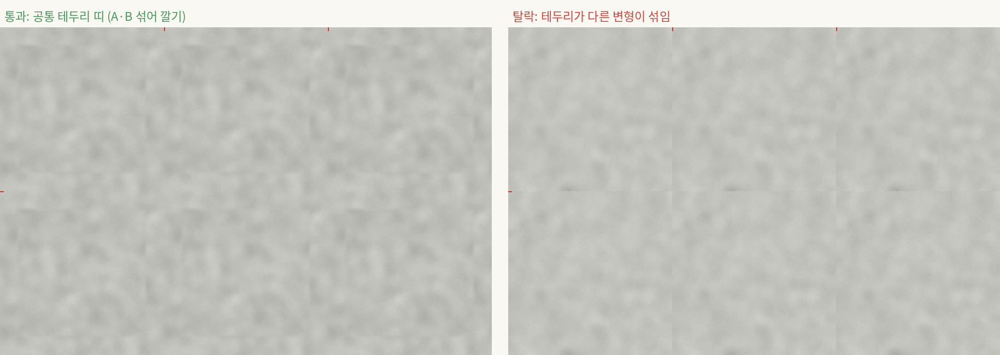

# 17. AI 아트 프롬프트 바이블

> 상태: ✅ 규칙 확정 · 🧪 World 1·2 지형은 v6 생성·적용, 다른 에셋은 개별 생성 검수 필요
> 목적: **개발 시작부터 끝까지, 누가 언제 뽑아도 한 게임처럼 보이게.** 질감·톤·인상이 절대 흔들리지 않도록 프롬프트를 **고정 블록**으로 관리해.
> 기준 문서: [16 아트 컨셉](16_아트_컨셉.md) (이 문서는 16을 AI 프롬프트로 옮긴 것)

### 2026-10-16 지형 형태 추가 블록 · v6 큰 입자

바닥·벽·천장·모서리·계단 원화에는 공통으로 다음 형태 지시를 추가한다. 다른 지역의 새 지형에도 적용한다.

`large irregular rounded earth clumps, oversized coarse texture dabs, broad calm matte planes, sparse shallow seams, reduced detail density around 70 percent of previous art, irregular gently bumpy walkable silhouette, shallow broad divots, no straight cap band, three same-style variants with rearranged masses and compatible edges, gradual darkening across the entire tile depth, faint large forms in the deep half, serious atmospheric metroidvania mood, no perspective top plane`

지형 네거티브: `tiny granular facets, hairline cracks, fine scratches, noisy microtexture, small repeated pebbles, ruler-straight polished surface, early fade to solid black, angular shards, pointed roots, glossy plastic, cartoon bubble piles, blurred forms`.

현재 활성 World 1·2는 지역별 A/B/C 바닥·벽 12장을 사용한다. 내장 이미지 생성으로 큰 입자와 울퉁불퉁한 윗선을 그렸으며, 실제 프롬프트는 [v6 생성 기록](../Art/samples/regional-variants-v6/prompts.json)에 보관한다. 내보내기에서 128px 기준 최대 3px 요철과 공통 접합부를 맞춘다. 이전 v4/v5의 가는 선과 일정한 표면 띠는 새 원화의 기준으로 사용하지 않는다.

---

## 📌 0. 가장 중요한 규칙 10개

| # | 규칙 | 이유 |
|---|---|---|
| 1 | **마스터 스타일 블록은 한 글자도 바꾸지 않는다.** 바꿔야 하면 버전을 올리고(`MSB v5 → v6`) 기존 에셋을 다시 검수 | 단어 하나만 바뀌어도 그림체가 흔들림 |
| 2 | 모든 생성에 **골든 이미지(기준 그림) 3~5장**을 스타일 레퍼런스로 같이 넣는다 | 텍스트만으로는 질감이 매번 달라짐 |
| 3 | 프롬프트 조립 순서는 항상 **내용 → (캐릭터 고정) → 에셋 종류 → 재료 → 마스터 → 통일** | 순서가 바뀌면 가중치가 바뀜 |
| 4 | 판정에 쓰이는 선(땅 윗면, 벽, 적 몸통, 탄)은 **사람이 마지막에 덧그린다** | AI 선은 읽기 어려움 |
| 5 | 뽑은 그림은 전부 **팔레트 보정 + 체크리스트 통과** 후에만 게임에 넣는다 | 색이 조금씩 새는 걸 막음 |
| 6 | 🚫 **픽셀·도트 절대 금지.** 부드럽게 안티앨리어싱된 **선명한 선**의 고해상도 그래픽만 | 우리 게임은 깔끔한 그래픽 디자인 |
| 7 | 🚫 **반복 패턴 금지.** 벽·바닥은 같은 무늬를 찍어 붙이지 않음. 바탕은 월드 전체에 **이어지는 재료 세트(변형 섞기)**, 방 개성은 **투명 배경 장식**으로 | 반복 무늬가 보이면 '타일 게임'처럼 보이고, 방마다 통째로 그리면 경계에서 끊겨 보임 |
| 8 | 🎮 **게임 그림체.** 현실적인 그림·세밀한 묘사 ❌ → 게임 화면에 나올 법한 단순하고 정돈된 그래픽. 디테일은 큰 덩어리로 | 전투 중 한눈에 읽혀야 하고, 사실적일수록 AI 그림이 서로 달라 보임 |
| 9 | 🌗 **방별 분위기.** 낮은~중간 명도, 깊이와 국소광. **주인공·적·발판·탄이 분리되어 읽혀야 함**; 종이 70% 고정 금지 | 전투 게임의 긴장감 + 눈 피로 줄이기 + 내 캐릭터가 항상 보임 |
| 10 | ✒️ **분위기 중심의 선명한 2D 일러스트.** 매끈한 선과 면, 강한 실루엣, 깊은 공간, 절제된 빛과 안개. 거친 스케치·전면 해칭 금지. 재료는 구조·형태·색으로 표현 | 선이 명확해야 전투 중 읽히고, AI 그림끼리도 덜 흔들림 |

---

## 🧱 1. 프롬프트 조립 공식

```
[SUBJECT 무엇을 그리는지 (한두 문장)]
+ [CHAR-LOCK 캐릭터 고정 (플레이어만)]
+ [TYPE 에셋 종류 블록]
+ [MAT 재료 블록 (장마다 1개)]
+ [MSB 마스터 스타일 블록]
+ [UNIFY 통일 블록 (조명·질감·패턴, 19 문서)]
--- 네거티브: [NEG 공통] + [NEG 종류별]
--- 레퍼런스: 골든 이미지 3~5장 (+ 해당 장 골든 1~2장)
--- 파라미터: 아래 4장 표
```

> `SUBJECT`만 바꾸고 나머지는 **복사해서 그대로** 쓰는 게 원칙. 실제 조립은 `Tools/build_prompts.py`가 자동으로 해 ([19 문서](19_에셋_목록_프롬프트.md)). 이미지 AI는 앞쪽 단어를 더 강하게 반영해서 SUBJECT를 맨 앞에 둠 (v1 조립 순서 변경, 2026-10-15)

---

## 🔒 2. MSB · 마스터 스타일 블록 (v5)

> 할로우 나이트에서 참고할 것은 실루엣 가독성·공간 깊이·고요하고 신비한 분위기다. 캐릭터와 구조물은 Unfin의 스케치북/화구 세계로 만든다. 이름만 넣어 요청하기보다 아래 시각 특성을 사용한다.

```
MSB v5:
high-resolution illustrated 2D side-scrolling metroidvania game art, atmospheric subterranean fantasy inside an original unfinished sketchbook world, clean confident contours and smooth anti-aliased curves, strong readable silhouettes, simplified expressive characters, broad quiet shapes, restrained surface detail, layered caverns and architectural depth, desaturated region-specific colors with selective warm accents, calm melancholy and mysterious exploration, crisp gameplay plane against soft low-contrast distant layers, darker foreground framing, a small chalk-white protagonist clearly separated from the environment, environmental storytelling through abandoned art-supply structures, unfinished areas shown as deliberate clean missing shapes or dashed contours, no rough sketch treatment, no visible pixel-art grid, no repeated texture stamps; scene illustrations use restrained localized pools of light and atmospheric haze, while reusable tiles and isolated sprites use neutral lighting so room lighting can be composed separately
```

**검수 기준:** 매끈한 고해상도 선과 면, 또렷한 캐릭터, 여러 겹의 동굴/구조물, 절제된 디테일, 먼 배경의 공기감, 앞쪽의 어두운 실루엣, 길을 안내하는 국소광. 종이 결과 모눈은 필수 효과가 아니다. 반복 타일 원본은 중립 조명으로 만들고 빛·안개는 장면에서 더한다.

### UNIFY v5 · 통일 블록
```
UNIFIED LOOK: consistent clean ink-gray contour language, smooth filled shapes, line weight strongest on gameplay silhouettes and quieter in the background, controlled two-tone local shading, sparse motifs inspired by each region material rather than all-over hatching, paper grain optional and almost invisible, no mandatory graph-paper overlay; DEPTH AND LIGHT: distant layers lose detail and contrast into the room atmosphere, middle-distance forms establish scale, foreground silhouettes frame rather than hide the route, local scene lights guide attention without washing out hazards, subtle haze and rim separation allowed in the scene pass, never bake a repeated spotlight or cast shadow into tiling material; VALUES: use a room-specific low-to-mid-key palette with readable floor edges, enemies and projectiles, the protagonist remains a clear light focal point, no universal paper brightness target, preserve detail in shadows and avoid blown-out highlights; original characters and art-supply architecture, smooth high-resolution illustration, no low-resolution enlargement, no messy strokes, no decorative noise competing with combat
```

---

## 🚫 3. NEG · 네거티브

**공통 (항상)** — 맨 앞에 **픽셀·도트·반복**, 그다음 **스케치·거친 선**, **사실적인 그림**, **너무 밝거나 어두운 톤**을 막음
```
pixel art, pixelated, 8-bit, 16-bit, retro game sprite, dot art, dithering, aliased jagged edges, stair-step edges, blocky, low resolution, mosaic, grid of square tiles, repeating tile pattern, tiled texture, copy-pasted stamps, identical repeated bricks, sketchy lines, rough pencil strokes, wobbly lines, messy hatching, scribbly texture, charcoal smudges, painterly brush strokes, rough texture, photorealistic, realistic painting, hyper-detailed, intricate realistic texture, realistic rendering, matte painting, realistic lighting, 3D render, CGI, voxel, generic corporate flat icons, clip art, stock vector illustration, anime cel shading, glossy, shiny, metallic, chrome, neon overload, excessive bloom, lens flare, glossy specular highlight, inconsistent baked lighting between neighboring tiles, strong rainbow gradients, heavy drop shadow, pure black outline, high contrast HDR, overexposed, high-key, washed out, bright white paper, blown-out highlights, unreadable crushed shadows, saturated rainbow colors, gore, text, letters, numbers, logo, watermark, signature, UI, frame border, blurry, jpeg artifacts, perspective view, isometric, top-down
```

**환경·지형·배경 추가**
```
characters, people, animals, creatures, faces
```

**캐릭터·적 추가**
```
background scenery, multiple characters, cropped body, extra limbs, detailed facial features, mouth, nose,
clothing details, armor ornaments, motion blur
```

---

## 🎨 4. MAT · 재료 블록 (장마다 하나만 사용)

| 장 | 블록 |
|---|---|
| **MAT-1 연필 숲** | `pencil-themed world: graphite-gray near-monochrome palette with warm grays, shapes inspired by pencils, erasers and graphite, clean diagonal stripe patterns that echo clean diagonal pencil-stripe pattern, small pinkish eraser-crumb dots, trees as simple clean pencil-line shapes` |
| **MAT-2 크레파스 언덕** | `crayon-themed world: warm muted palette of orange, beige and dusty red with brown-tinted outlines, chunky rounded crayon-like shapes, clean wavy stripe motifs that echo crayon stripe motifs, smooth wax-drip blob shapes` |
| **MAT-3 수채화 호수** | `watercolor-themed world: misty pale blue, gray-blue and dusty pink, soft smooth gradient washes inside clean shapes, round water-drop and ring motifs` |
| **MAT-4 색종이 도시** | `colored-paper-themed world: flat single-color paper layers with one soft offset shadow, crisp fold lines, muted red, mustard yellow, sage green and slate blue` |
| **MAT-5 잉크 심연** | `ink-themed world: deep black-violet smooth ink-blot silhouettes, clean ink drip shapes, small fragments of the earlier chapters' colors glowing softly through` |

**장 경계 (두 재료 섞기)** — 1↔2장 전환 지형(`TL-DE-*`) · 배경 이음 패널(`BL-DE`) · 경계 장식 때만
```
transition zone: [MAT-A] gradually overpainted by [MAT-B] from left to right
```

---

## 🎯 5. 색 고정 (프롬프트 + 후보정)

> 프롬프트에 색 이름·hex를 넣어도 정확하진 않아. **프롬프트는 방향만, 정확한 색은 후보정으로.**

| 장 | 프롬프트에 넣는 색 표현 | 후보정 기준 팔레트 (16 문서) |
|---|---|---|
| 1 | `toned-down warm gray paper, graphite gray, dark ink gray` | 종이 `#BDBCB5` · 지형 `#5E6168` · 선 `#25272C` · 위험 `#2A2438` |
| 2 | `dusky muted sunset orange, wax beige, brown-gray on toned-down beige paper` | 종이 `#C7BBA8` · 지형 `#685C56` · 선 `#7A4A30` · 발판 `#E8A060` · 밀랍 `#E4D6A8` |
| 3 | `misty gray-blue, muted blue, dusty pink on toned-down blue-gray paper` | 종이 `#B4BEC6` · `#9EB8D2` `#B6C8DA` `#8FA8C4` · 분홍 `#D8A8B4` |
| 4 | `muted red, mustard, sage, slate blue on toned-down cream paper` | 종이 `#C9C3B6` · `#C96A5E` `#E3C26A` `#7FA98A` `#4E6A8C` |
| 5 | `black-violet ink, dim faded paper, faint colored fragments` | 종이 `#9E9A92` · `#1F1D26` · `#14121A` |
| 공통 | `chalk-white` (주인공만) | 주인공 몸 `#F0EEE6` = 화면에서 가장 밝은 색 |

> v3 미드키: 종이 값을 예전(`#EDEDE8` 등)보다 한 단계 낮춤. 명도 순서는 [16 문서](16_아트_컨셉.md) §4-6

**후보정 순서:** ① 채도 상한 맞추기 (HSV S ≤ 55%) → ② 종이색을 위 값으로 맞추기 (Levels, **미드키**) → ③ 팔레트 LUT 적용 → ④ 외곽선 색을 `#25272C`(2장은 `#7A4A30`)로 치환

**기능색은 AI로 칠하지 않음** — 금빛 노랑 `#F2D06B`, 체력 `#B07B73`, 리본 `#B5585A`, 찢긴 페이지 `#5D7FA8`, 그림 친구 `#D9823F` 는 **사람이 따로 칠함** (뜻이 바뀌면 안 되니까).

---

## 🖼️ 6. 골든 이미지 (스타일 기준) — 가장 먼저 만들 것

> 이 5장이 **게임 전체의 그림체를 결정**해. 수십 번 뽑아서 고르고, 사람이 손봐서 확정.

| # | 무엇 | 프롬프트 (MSB + MAT-1 + 아래) | 용도 |
|---|---|---|---|
| G1 | 1장 대표 화면 | `wide game screenshot-like scene, a small chalk-white child figure standing on smooth graphite-themed rock ledges in a half-drawn pencil forest cave, toned-down paper, mid-key brightness, stylized game screen, 16:9` | 전체 분위기·**명도(미드키)** 기준 |
| G2 | 땅 질감 | `close-up of solid ground and wall made of smooth graphite masses with a thick top edge line, flat front view` | 타일 질감 기준 |
| G3 | 주인공 | `a tiny simple character: round head, rounded rectangle body, single dot eye, chalk-white body with ink-gray outline, no face details, standing pose, side view, isolated` | 캐릭터 선 굵기 기준 |
| G4 | 적 1종 | `a small graphite worm creature, simple shape with one pointed tip, side view, isolated` | 적 형태 언어 기준 |
| G5 | 소품 | `a pencil-holder shaped stone statue with three pencils, save point, side view, isolated` | 소품 기준 |

- 장이 바뀔 때마다 **그 장 골든 2장**(G1 대표 화면 + G2 땅 질감)을 추가로 확정
- 이후 모든 생성 = **G1~G5 + 해당 장 골든 2장**을 레퍼런스로

---

## 🧩 7. TYPE · 에셋 종류별 템플릿

### 7-1. 고해상도 타일셋 (256px/칸 + 큰 질감 + 가장자리 + 변형)

> **해상도 공통 기준:** [21 고해상도 타일맵 규격](21_고해상도_타일맵_규격.md). 최종 지형 셀 256×256px·PPU 256, 2×2칸 512², 4×4칸 1024². 2048² 채움은 8×8유닛의 큰 원본이다. 원본/아틀라스 크기와 한 칸 이미지를 구분하고, 저해상도 도트 확대는 금지한다.

> **다중 타일맵 배치 기준:** 충돌·채움·표면 무늬·가장자리·장식을 분리한다. 구역별 채움 A~C 위에 최소 4가지 표면 무늬 계열을 섞고, 같은 계열의 인접 배치를 피한다. 큰 무늬는 여러 충돌 타일에 걸쳐 배치하며 크기·밀도·간격을 달리한다. 타일맵을 써도 픽셀·격자·도장 반복이 보이지 않게 한다. 상세 규칙과 HTML 적용 범위는 [16 문서 §8](16_아트_컨셉.md#8-지형--타일)을 따른다.

> 네모 타일을 찍어 붙이면 **같은 무늬가 반복**되고 **가장자리가 계단처럼** 보여. 반대로 방마다 통째로 그리면 **방 경계에서 톤이 끊겨.** 그래서 화면의 지형은 **월드 전체를 한 줄로 잇는 바탕**(아래 재료 + Unity **Tilemap/Rule Tile** + 가장자리 레이어, 긴 곡선에만 선택적 Sprite Shape)이고, 방 개성은 그 위에 얹는 **방 장식(7-3)**이 맡아. 구조 전체는 [19 문서](19_에셋_목록_프롬프트.md) §1.

| 종류 | 블록 | 규격 | 쓰는 법 |
|---|---|---|---|
| 큰 질감 원본 | `TYPE-TERRAIN` | 최종 2048² (AI 1:1로 뽑아 ×2) · **구역마다 변형 3장 (A~C)** | Tilemap의 큰 채움 원본(PPU 256에서 8×8유닛). **4방향 이어짐 + 공통 테두리 띠**(A가 원본)를 가진 A~C를 섞는다. 돌리기·뒤집기 금지 (테두리가 어긋남) |
| 가장자리 띠 | `TYPE-EDGE` | 최종 2048×512 = 4:1 (AI 3:2로 뽑아 가운데 띠 자르기) · **구역마다** 바닥·천장·벽 | 지형 윤곽선을 따라 늘어놓음. **양 끝이 이어져서** 길이 상관없이 반복 |
| 둥근 모서리 | `TYPE-CORNER` | 1:1 | 바깥·안쪽 모서리를 곡선으로 |
| 통과 발판 | `TYPE-PLATFORM` | 4:1 · 변형 3장 | 발판마다 다른 변형 사용 |
| 특수 블록 | `TYPE-SPECIAL` | 1:2 (AI 2:3로 뽑아 좌우 자르기) | 낙서 벽·덩굴·밀랍 벽·문을 **하나의 그림**으로 (타일 반복 아님) |

```
TYPE-TERRAIN:
large terrain fill texture sheet for the floors, ceilings and walls of an enclosed interior, square, flat
front view, no perspective, no lighting direction, fills the whole image, NO visible repeating motif, pattern
lines vary in density, length and placement everywhere, irregular organic variation like one big designed
surface, big-mass variation is required: darker denser patches and lighter sparse patches, one or two faint
strata lines, a few areas left half-filled with paper showing through, a few small embedded material bits
(pebbles and crumbs of the drawing material), very subtle uniform paper texture (not canvas, not fabric
weave), never one flat even gray, seamless tileable texture in all four directions: the left edge continues
exactly into the right edge and the top edge continues exactly into the bottom edge, no border, no frame, no
vignette, no edge darkening, all variations share the same outer border band so any variation can sit beside
or above any other without a seam
```
```
TYPE-EDGE:
long horizontal strip of a clean terrain edge on transparent background, very wide 4:1 strip, built in three
zones: (1) a thick bold dark clean contour with an irregular rhythm of large bumps and small bends, a few
chips, dents and one or two slight breaks, the contour rises and falls by about a quarter of the strip height,
never a ruler line, never an even sine wave; (2) a dense darker surface band just inside the contour, about
one fifth of the strip deep, with small details; (3) the interior beyond it gets lighter and sparser with a
faint strata line and some half-filled paper showing; very subtle uniform paper texture (not canvas or fabric
weave), same value and texture family as the matching floor or ceiling piece, soft anti-aliased edge, the left
end continues exactly into the right end (same contour height, same band depth, same texture) so the strip
repeats along any length without a seam
```
**🗺️ 구역별 지형 (v4) — 한 지역 안에서도 구역마다 바닥이 다르게**
> 장 재료(1장 연필, 2장 크레파스)와 명도는 같아서 **한 지역으로 보이고**, 구역마다 **바닥·천장·벽의 디테일과 아주 옅은 색 기운**만 달라서 **다른 구역에 왔다는 느낌**이 나. 구역 사이엔 **이음 지형**을 깔아서 끊기지 않게.

| 구역 | 옅은 색 기운 | 속 채움 | 바닥 윗면 | 천장 아랫면 | 벽 옆면 |
|---|---|---|---|---|---|
| A 구겨진 종이굴 | warm cream-gray | layered creased paper sheets pressed together, soft paper pulp patches | creased paper folds, torn paper flakes and a few pencil grass roots poking out | peeling paper layers and dangling grass roots | folded paper layer edges and small tears |
| B 흑연 광산 | cool blue-gray graphite | broad smooth graphite rock shading with matte ore seams and chisel marks | graphite chunks, pickaxe chips and a few old rail spikes | jagged graphite lumps and short graphite stalactite stubs | pickaxe scars and ore seams |
| C 스케치 나무 속 | sage green-gray | curved wood grain and clean growth-ring contours, small knots | wood grain ridges, bark flakes and small root nubs | hanging bark strips and knot bumps | wood grain lines and split cracks |
| D 엉킨 뿌리 심부 | dusty rose-gray | knotted tangled root fibers and clean curved root contours | tangled root fibers, small thorn scribbles and crushed leaves | hanging tangled root hair and thorny knots | twisting root strands |
| E 노을 크레파스 굴 | warm orange-beige | thick layered crayon earth with crossing strokes | crayon crumbs and thin cracks lined with muted sunset orange | melted crayon drips and orange-lined cracks | layered crayon strata and smears |
| F 밀랍 공방 | wax-beige | smooth wax-beige plaster with drawn drip stains and soot smudges | worn smooth wax edges, old wax drips and soot smudges | hanging wax drips and soot stains | plaster cracks and wax runs |
| G 색칠 지하 협곡 | blue-violet gray | uneven paint strata bands in muted blue, red and yellow | dried paint flakes and paint drips at the edge | dripping paint and strata ends | colored strata bands and paint runs |
| H 기사의 탑 | brick-rose gray | uneven clean crayon stones, every stone a different shape, no grid | chipped crayon stones with scratched mortar lines and a few small rubble bits | worn stone undersides with crumbling mortar | irregular stone faces with chips |

- 구역마다: 속 채움 3장(`TZ?-구역-fill_a~c`, 4방향 이어짐, A = 테두리 원본) + 가장자리 띠 3종(`edge_top/bottom/side`, **양 끝 이어짐**)
- 장 공용: 둥근 모서리 · 발판 · 특수 블록(낙서 벽·덩굴·밀랍 벽·문)은 장마다 한 벌 (모양이 곧 능력 길막의 언어라 구역마다 바꾸지 않음)

**🔗 구역 사이 지형 이음** (지도에서 맞닿은 구역 쌍마다 자동, `Art/bg_links.json`에서 구역이 바뀌는 곳)
| 이음 | 구역 | 경계 | 들어가는 것 |
|---|---|---|---|
| `TL-AB-*` | 구겨진 종이굴 → 흑연 광산 지형 속 이음 | 세로 | 속 이음 + 벽 띠 이음 |
| `TL-CA-*` | 스케치 나무 속 → 구겨진 종이굴 지형 속 이음 | 세로 | 속 이음 + 벽 띠 이음 |
| `TL-CD-*` | 스케치 나무 속 → 엉킨 뿌리 심부 지형 속 이음 | 가로 | 속 이음 + 바닥·천장 띠 이음 |
| `TL-DA-*` | 엉킨 뿌리 심부 → 구겨진 종이굴 지형 속 이음 | 세로 | 속 이음 + 벽 띠 이음 |
| `TL-DE-*` | 엉킨 뿌리 심부 → 노을 크레파스 굴 지형 속 이음 | 가로 | 속 이음 + 바닥·천장 띠 이음 ⭐ 장 경계 |
| `TL-EF-*` | 노을 크레파스 굴 → 밀랍 공방 지형 속 이음 | 세로 | 속 이음 + 벽 띠 이음 |
| `TL-EG-*` | 노을 크레파스 굴 → 색칠 지하 협곡 지형 속 이음 | 세로 | 속 이음 + 벽 띠 이음 |
| `TL-EH-*` | 노을 크레파스 굴 → 기사의 탑 지형 속 이음 | 가로 | 속 이음 + 바닥·천장 띠 이음 |

```
TYPE-TERRAIN-LINK (구역 사이 속 이음):
transition sheet of solid terrain fill between two neighboring zones of the same chapter, square, flat front
view, same drawing material and value family on both sides, the first-zone side matches that zone's fill
border band exactly, the second-zone side matches the other zone's fill border band exactly, the zone details
change gradually in between, the two remaining edges continue into each other so it repeats along the whole
boundary, very subtle uniform paper texture, no seam, no border
```
- 가장자리 띠 이음: 왼쪽 끝 = 앞 구역 띠, 오른쪽 끝 = 뒤 구역 띠, 가운데서 디테일이 서서히 바뀜 → 바닥이 구역 경계를 지나도 끊기지 않음
- 만드는 법: `tile_kit.py link-base 앞구역_fill_a.png 뒤구역_fill_a.png --dir h` 밑그림 → 양 끝 띠를 지키고 가운데만 인페인팅
- 검사: `seam_check.py check`가 "앞 구역 fill_a + 이음 + 뒤 구역 fill_a"를 이어 붙여 판정, `art_check`가 띠 양 끝 이어짐을 판정

**🪨 가장자리 3단 구조 (v3.1)** — "회색 천을 물결 모양으로 자른 것"처럼 보이지 않게
| 층 | 바닥 (`edge_top`) | 천장 (`edge_bottom`) | 벽 (`edge_side`) |
|---|---|---|---|
| ① 윤곽선 | **가장 굵고 진한 선** (올라설 곳이 바로 읽히게). 큰 굴곡 + 작은 굽이, 이 빠진 곳·패인 곳, 띠 높이의 약 1/4만큼 오르내림 | 굵은 선 + 처진 덩어리, 짧은 종유석 2~3개 | 굵은 선 + 깨진 곳·작은 턱 |
| ② 표면 띠 (윤곽 안쪽 약 1/5) | 가장 진하고 촘촘. 작은 돌, 재료 부스러기(흑연·지우개/크레파스), 풀 몇 포기 | 금, 매달린 뿌리, 흘러내린 자국 | 긁힌 자국, 부스러기 |
| ③ 속 | 밝고 성글게. 희미한 지층 줄, **덜 칠해서 종이가 비치는 곳** (미완성) | 같음 | 같음 |
- 바닥·천장·벽은 **같은 명도·질감 가족** (한 동굴로 보이게). 질감은 **종이 결** (캔버스·천 결 ❌)
- 지형 추가 네거티브: `canvas texture, fabric weave, flat even gray, uniform texture, perfectly even hatching, ruler-straight edge, even sine wave edge, thin faint contour`
- 검수: 질감 원본을 **2×2로 이어 붙여서** 같은 무늬가 눈에 띄면 탈락. 가장자리는 **2배로 확대해도 계단 모양이 없어야** 함. 자동 검사(`art_check`)가 **질감 단조로움 · 윤곽 높낮이 · 물결 리듬 · 표면 띠**를 잼 ([19](19_에셋_목록_프롬프트.md) §8)

### 7-2. 배경 — 실내형 v6 🏠 (구획 뒷벽 + 공용 조각 + 방 대표 조각)

> 🧱 해상도 → 제작 순서 → 유니티 배치 → 검증까지 한 줄 흐름은 **[20 배경 제작 파이프라인](20_배경_제작_파이프라인.md)**. 여기는 프롬프트 문장 중심.

> ❌ v4까지: 하늘·지평선이 있는 **야외 파노라마** → 천장·바닥 있는 우리 맵과 안 맞고, 40타일 수직굴은 못 채움
> ❌ v5: 실내 뒷벽이지만 **구역 하나에 뒷벽 하나** → 1장 전체가 몇 가지 그림만 반복돼서 허전함
> ✅ v6: **구역(8) → 배경 구획(22) → 방(56)** 세 단계로 나눠서, 방마다 다르게 보이게

| 단계 | 무엇 | 블록 | 개수 | 하는 일 |
|---|---|---|---|---|
| L1 **구획 뒷벽** | 구역을 2~3개 **배경 구획**으로 나누고, 구획마다 다른 뒷벽 (하늘·지평선·바닥 없음, 위아래 방향 없음) | `TYPE-BG-WALL` | 22구획 × 변형 3장 | **4방향 이어짐 + 공통 테두리 띠** → 아무렇게나 섞어 깔아도 이음새 없음, 어떤 크기 방도 채움 |
| L2 **공용 세트 조각** | 그 구역 어디에나 쓰는 낱개 (기둥·뿌리·버팀목…) | `TYPE-BG-SET` | 8구역 × 5개 | 방마다 1~3개 골라 배치 (1:2 = 수직굴용) |
| L2 **방 대표 조각** ⭐ | **그 방에만 있는** 배경 그림 1개 (광부 쉼터의 등불·벤치, 탑 꼭대기의 창문…) | `TYPE-BG-SET` | 방 56개 | 같은 구획이라도 방마다 다르게 보임 = 허전함 해결 |
| L4 **전경 테두리** | 화면 위·아래 가장자리 매달린 뿌리·덩어리 | `TYPE-BG-FORE` | 장마다 1 | 가운데는 비움 |
| 이음 | 맞닿은 **구획** 사이 뒷벽 전환 | `TYPE-BG-WALL-LINK` | 22장 | `seam_check.py`로 판정 |

**방 하나 = 구획 뒷벽 + 방 대표 조각 1 + 공용 조각 1~3 + (전경 테두리)**
- 넓은 방: 대표 조각을 화면 2/3 지점에, 공용 가로 조각 1, 세로 조각 1
- 수직굴·높은 방: 대표 조각(1:2) + 세로 공용 조각 2~3개를 위아래로 엇갈리게
- 작은 방·비밀 방: 뒷벽 + 대표 조각만
- 같은 공용 조각을 **한 화면에 두 번 쓰지 않기**, 이웃 방과 같은 자리에 두지 않기

```
TYPE-BG-WALL (L1):
back wall of an enclosed interior space inside the sketchbook world, seen flat and straight on, fills the
whole frame edge to edge, NO sky, NO horizon, NO ground, NO outdoor landscape, no up or down direction, it is
repeated sideways and stacked upward to fill wide halls and tall shafts, large soft value variation (a few
darker hollows and lighter worn patches), very low contrast, receding into the room atmosphere, lower contrast than the gameplay plane, faint stripe
pattern and a few faint drawn cracks or marks, far-distance layer so details are soft and sparse, no focal
point, no objects, no repeating motif, square, seamless tileable texture in all four directions: the left edge
continues exactly into the right edge and the top edge continues exactly into the bottom edge, no border, no
frame, no vignette, no edge darkening, all variations of the same area share the same outer border band so any
variation can sit beside or above any other without a seam
```
```
TYPE-BG-SET (L2 · 공용 조각과 방 대표 조각 둘 다):
single background set piece for an enclosed interior, isolated on transparent background, sits in the middle-
distance layer behind the gameplay, simple readable silhouette, thin lines, low contrast, 15-20% darker than
the page paper and lighter than the gameplay terrain, it will be placed in front of the back wall, so it must
never look like it floats in the air: its ends are either cut off by the image edges or fade softly into the
dark back wall, no flat horizontal tops that could look like walkable platforms (tops are rounded, slanted or
ragged), soft natural anti-aliased edges, a few outline-only unfilled details
```
```
TYPE-BG-FORE (L4):
foreground frame piece of an enclosed interior on transparent background (hanging roots or rock lumps that
frame the screen edge), dark soft silhouette, slightly faded, sparse, must not cover the middle of the screen,
the left edge continues exactly into the right edge so it repeats sideways without a seam
```
```
TYPE-BG-WALL-LINK (이음):
transition sheet between the back walls of two neighboring interior areas, same rules as a back wall (no sky,
no horizon, no objects, very low contrast), one side matches the first area's wall texture exactly and it
gradually becomes the second area's wall texture toward the other side, the first-area side matches that
area's wall border band exactly, the second-area side matches the other area's wall border band exactly, the
two remaining edges continue into each other so the transition can be repeated along the whole boundary, no
visible seam, same brightness, square
```

**배경 구획 22개** (구획 · 구역 · 이름 · 방 · 뒷벽 문장)
| 구획 | 구역 | 이름 | 방 | 뒷벽 |
|---|---|---|---|---|
| A1 | 구겨진 종이굴 | **종이 틈 입구** | 1, 2, 3 | `the entrance of a paper burrow: layered creased paper sheets with thin bright cracks where the page above is torn, slightly lighter than deeper areas, faint pencil grass roots here and there` |
| A2 | 구겨진 종이굴 | **풀뿌리 갈림굴** | 4, 5, 6, 25 | `a deeper paper burrow: soft paper pulp walls densely threaded with dangling pencil grass roots and faint pencil arrow scribbles` |
| B1 | 흑연 광산 | **광산 입구·갱도** | 7, 8, 12, 27 | `a timbered graphite mine tunnel wall: dark graphite rock with faint pickaxe marks and old rail scratches` |
| B2 | 흑연 광산 | **깊은 채굴장** | 9, 10, 11, 29 | `a deep quarry wall: huge matte graphite veins, cracked and collapsed rock, broad dark shapes` |
| B3 | 흑연 광산 | **찢긴 페이지 굴** | 30 | `a sealed cave where the rock turns into torn page layers with faint ruled lines and ink seeping through` |
| C1 | 스케치 나무 속 | **나무 밑동 속** | 13, 26 | `the base inside a giant hollow tree: wide curved growth rings, knots and thick root bases` |
| C2 | 스케치 나무 속 | **속 빈 줄기** | 14 | `the inside of a tall hollow trunk: long vertical wood grain lines and stacked growth rings, no up or down feeling` |
| C3 | 스케치 나무 속 | **가지 속·둥지** | 15, 16, 17 | `a narrow branch tunnel inside the tree: fine bark grain, small knots, faint pencil feather marks` |
| D1 | 엉킨 뿌리 심부 | **덩굴 다리 위층** | 18, 19, 28 | `an upper root ceiling layer: loose hanging vines and airy tangled root gaps` |
| D2 | 엉킨 뿌리 심부 | **사냥꾼의 굴** | 20, 21, 23 | `a dense dark wall of tangled scribbled roots with old snares` |
| D3 | 엉킨 뿌리 심부 | **낙서 둥지** | 22, 24 | `a wall of angry chaotic scribbles coiling in every direction, the most aggressive lines of chapter one` |
| E1 | 노을 크레파스 굴 | **물감 번진 관문** | 1 | `a wall where smooth graphite tones transition into muted crayon forms` |
| E2 | 노을 크레파스 굴 | **노을빛 굴** | 2, 3, 11 | `thick layered crayon earth with crossing strokes and thin cracks lined with muted sunset-orange crayon` |
| E3 | 노을 크레파스 굴 | **삼색 광장** | 4 | `a huge cavern wall of crayon earth with faint vertical paint drips in muted red, blue and yellow` |
| F1 | 밀랍 공방 | **공방 작업장** | 5, 6 | `workshop back wall of plastered wax-beige panels with soot marks near a furnace, uneven clean panels, no brick grid` |
| F2 | 밀랍 공방 | **밀랍 저장고** | 7, 8, 9 | `storage room wall of stacked wax blocks drawn unevenly, sticky drip stains` |
| F3 | 밀랍 공방 | **물 고인 아래층** | 10, 24 | `a damp lower cave of wax and crayon earth with water rings and soft rounded hollows` |
| G1 | 색칠 지하 협곡 | **협곡 중턱** | 12, 13, 14, 25 | `an underground gorge wall of uneven layered paint strata in muted blue, red and yellow bands` |
| G2 | 색칠 지하 협곡 | **협곡 바닥** | 15, 16, 17 | `the deep gorge floor wall: dark paint strata with dull melted crayon veins` |
| G3 | 색칠 지하 협곡 | **물감 폭포 홀** | 18, 23 | `a wet paint-misted cavern wall with long vertical paint streaks` |
| H1 | 기사의 탑 | **탑 아래층** | 19, 20, 21 | `tower hall interior wall of clean uneven crayon stones, every stone a different shape, no grid pattern` |
| H2 | 기사의 탑 | **탑 위층** | 22, 26 | `upper tower interior wall of worn crayon stones with warm light patches from windows, every stone different` |

**구역 공용 세트 조각** (키(비율))
| 구역 | 조각 |
|---|---|
| A 구겨진 종이굴 | `column`(1:2) · `roots`(1:2) · `opening`(3:2) · `boulder`(3:2) · `support`(1:2) |
| B 흑연 광산 | `frame`(1:1) · `lantern`(1:2) · `stalactites`(3:2) · `trestle`(2:1) · `ladder`(1:2) |
| C 스케치 나무 속 | `root_arch`(2:1) · `fungus`(1:1) · `knot_hole`(1:1) · `moss`(1:2) · `branch_stub`(3:2) |
| D 엉킨 뿌리 심부 | `vine_curtain`(1:2) · `root_pillar`(1:2) · `thorn_knot`(1:1) · `nest`(1:1) · `root_bridge`(2:1) |
| E 노을 크레파스 굴 | `stalagmite`(1:2) · `glow_crack`(1:2) · `drips`(3:2) · `broken_pillar`(1:2) · `ledge`(2:1) |
| F 밀랍 공방 | `vat`(1:1) · `rack`(3:2) · `flue`(1:2) · `shelves`(1:1) · `pulley`(1:2) |
| G 색칠 지하 협곡 | `paint_fall`(1:2) · `arch`(3:2) · `paint_stalactites`(3:2) · `boulder`(1:1) · `strata_spire`(1:2) |
| H 기사의 탑 | `banner`(1:2) · `window`(1:2) · `weapon_rack`(3:2) · `stair`(1:2) · `column`(1:2) |

**방 대표 조각**은 56개라 [19 문서](19_에셋_목록_프롬프트.md) `2 배경`의 `BR1-xx`, `BR2-xx`에 다 있어 (예: `BR1-10` 광부의 쉼터 = 꺼진 등불·벤치·아이 그림이 붙은 벽감, `BR2-22` 탑 꼭대기 = 노을이 보이는 넓은 창문).

**🪝 세트 조각은 공중에 떠 보이면 안 됨 — "어디에 붙어 있나" 4종류** (모든 조각에 지정돼 있고 프롬프트에 자동으로 들어감)
| 붙는 곳 | 예 | 끝 처리 | 프롬프트 문구 |
|---|---|---|---|
| ⬇️ 매달림 `hang` | 뿌리·등불·종유석·덩굴 커튼·깃발 | 위가 그림 밖으로 잘림 (천장 너머로 이어짐) | `hanging from above: its top edge is cut off by the top of the image as if it continues past the ceiling` |
| ⬆️ 솟음 `rise` | 석순·바위·밀랍 통·무기 걸이 | 밑동이 어두운 뒷벽 속으로 흐려짐 | `rising from below: its base fades softly into the dark back wall, no visible bottom and no ground line` |
| ↕️ 바닥~천장 `span` | 뿌리 기둥·굴뚝관·돌기둥 | 위아래 둘 다 잘림 | `floor-to-ceiling: both the top and the bottom are cut off by the image edges` |
| 🧱 벽에 붙음 `wall` | 옹이 구멍·선반·창문·과녁·그림 | 받침 필요 없음 | `drawn flat on the back wall itself, needs no ground or support` |

**🚫 배경이 발판처럼 보이면 안 됨**: 세트 조각은 **위가 평평하지 않게**(둥글거나 기울거나 들쭉날쭉), 나무 다리·선반 같은 가로 막대는 기울이거나 벽에 붙임. 점프로 닿는 높이에 가로로 긴 조각 두지 않기. 금지어: `floating objects with a visible bottom, flat platform-like ledges, horizontal planks, bridges that look walkable`

**📐 배치 규칙 (엔진)**
1. **솟음 조각은 밑동을 지형 아래에 묻기** — 앞쪽 지형(불투명)이 가려 줌. 묻는 깊이 ≥ 그 방에서 카메라가 움직이는 거리 × (1 − 패럴랙스 배율)
2. **패럴랙스 기준점 = 방 가운데** — 카메라가 방 가운데일 때 그린 자리, 멀어질수록 조금씩만 밀림 (맵 전체 기준이면 먼 방일수록 크게 어긋남)
3. **세로 패럴랙스는 약하게** — 세트 조각 가로 0.5배 / 세로 0.8배, 뒷벽 가로 0.2배 / 세로 0.6배 (높은 곳에서 덜 어긋나게)
4. 뒷벽은 **그대로 붙여도 이어지게** 만들어 둠 (아래 "4방향 이어지는 배경 만드는 법"). 엔진에서 2~4% 겹쳐 섞는 건 보험일 뿐 — `seam_check.py`가 "같은 구획 변형끼리 그대로 붙이기"를 검사

**🗼 한 화면보다 높은 곳 (16곳)**
| 높이 | 처리 |
|---|---|
| 1.1~1.4화면 (방 A4·B9·D22·H20, 수직굴 10곳) | 4방향 이어지는 정사각 뒷벽을 위아래로 그대로 쌓기 + 방이면 **추가 대표 조각 1개**(위쪽) |
| **1.5화면 이상 (6곳)** | **세로 전용 뒷벽 한 장** `TYPE-BG-WALL-TALL` — 아래→위로 바뀌어서 "얼마나 올라왔는지" 느껴짐 + 방이면 대표 조각 **3개(아래·중간·위)** |

```
TYPE-BG-WALL-TALL:
tall back wall for one very high interior room or shaft, one single continuous image, flat straight-on view,
fills the frame edge to edge, NO sky, NO horizon, NO ground, the wall slowly changes from bottom to top to
show progress while climbing, seamless on all four sides: the left edge continues exactly into the right edge,
and the top and bottom border bands match the area's square back wall border band so it stacks above and below
the square walls without a seam, very low contrast, receding into the room atmosphere, lower contrast than the gameplay plane, faint stripe pattern, no
objects, no repeating motif
```
| 세로 전용 뒷벽 | 비율 | 아래 → 위 |
|---|---|---|
| 나무 속 탑 (방 14, 2.7화면) | 1:2 | bottom thick root bases and dark dense rings, middle long vertical grain and growth rings, top thinner wood with soft light patches from branch gaps |
| 일방통행 뿌리굴 (수직굴, 3.2화면) | 1:2 | bottom dense paper pulp with tangled grass roots, middle thinning roots, top torn paper layers with thin bright cracks |
| 덩굴 수직굴 (수직굴, 2.4화면) | 1:2 | bottom root base hollow, middle hanging vines getting thicker, top knotty wood |
| 물감 폭포 홀 (방 18, 1.7화면) | 1:2 | bottom wet dark paint stains and mist marks, top drier layered strata near the crack where the waterfall begins |
| 협곡 낭떠러지 (수직굴, 2.5화면) | 1:2 | bottom dark deep strata with dull melted crayon veins, middle banded strata, top lighter worn strata |
| 크레파스 탑 (수직굴, 2.2화면) | 1:2 | bottom large heavy foundation stones, middle medium stones with banner hooks, top small worn stones with warm window light patches, every stone different |

높은 방 추가 대표 조각: `BR1-04b` · `BR1-09b` · `BR1-14b` · `BR1-14c` · `BR1-22b` · `BR2-18b` · `BR2-18c` · `BR2-20b`

**🔲 4방향 이어지는 배경 만드는 법 (공통 테두리 띠)** — 배경 이미지는 **가로·세로 모두 이어져야 함**

| 그림 | 이어지는 방향 | 만드는 법 | 도구 |
|---|---|---|---|
| ① 구획 뒷벽 **A** (테두리 원본) | 좌↔우 · 위↔아래 | 이미지 AI의 **이어지는 질감(타일링) 옵션**으로 생성 — SD: A1111 `Tiling` 체크 / ComfyUI 순환 패딩(Seamless Tile 노드) · Midjourney: `--tile` | 생성 후 `tile_kit.py offset`으로 반 칸 밀어 보고 `check` |
| ② 같은 구획 뒷벽 **B·C** | 좌↔우 · 위↔아래 · **A·B·C 서로** | `tile_kit.py variant-base A.png` → 밑그림 + 마스크. **A의 바깥 띠(10%)는 그대로 두고 안쪽만 인페인팅** (디노이즈 0.55~0.7) | `check A B C` → 테두리 차이 4 이하 |
| ③ **세로 전용 뒷벽** | 좌↔우 · 위아래 띠 = 구획 A | `tile_kit.py tall-base A.png --ratio 2` → A를 세로로 2장 이은 밑그림 (최종 2048×4096). 위·아래 띠만 지키고 안쪽을 아래→위로 바뀌게 인페인팅 (타일링 옵션은 가로만) | `seam_check.py check`가 A 위·아래로 붙여 검사 |
| ④ **구획 이음** | 경계 방향으로 반복 + 양 끝 = 두 구획 A | `tile_kit.py link-base A1.png A2.png --dir h` → 두 구획 A를 서서히 섞은 밑그림. 양 끝 띠를 지키고 가운데만 인페인팅 | `seam_check.py check` |
| ⑤ 지형 채움 A~D | 좌↔우 · 위↔아래 · 서로 | ①·②와 같은 방법 (fill_a가 테두리 원본) | `art_check` 이어짐 검사 |
| ⑥ 전경 테두리 · 바닥~천장 조각 | 전경 = 좌↔우 · 바닥~천장 조각 = 위↔아래 | 타일링 옵션을 그 방향만 (A1111 `Tiling X`/`Tiling Y` 확장, MJ는 생성 후 offset으로 손질) | `art_check` 이어짐 검사 |

- ⚠️ **돌리기·뒤집기 금지** — 테두리를 공유하는 그림을 돌리면 이음새가 생겨. 반복이 안 보이게 하는 건 **변형 섞기 + 방 대표 조각 + 공용 조각**이 맡음
- ⚠️ 이어지는 그림은 **가장자리를 어둡게(비네트) 하거나 테두리 선을 그리면 안 됨** — 금지어 `visible seams, mismatched edges, border frame, edge darkening`
- 확인: `tile_kit.py preview a.png b.png c.png` → 무작위로 섞어 깐 미리보기에서 **격자 선이 보이면 탈락**


> 왼쪽: A와 B가 같은 테두리 띠 → 섞어 깔아도 이음새 없음. 오른쪽: 테두리가 다른 그림이 섞임 → 격자가 그대로 보임

```
TYPE-BG-WALL (4방향 이어짐 포함):
back wall of an enclosed interior space inside the sketchbook world, seen flat and straight on, fills the
whole frame edge to edge, NO sky, NO horizon, NO ground, NO outdoor landscape, no up or down direction, it is
repeated sideways and stacked upward to fill wide halls and tall shafts, large soft value variation (a few
darker hollows and lighter worn patches), very low contrast, receding into the room atmosphere, lower contrast than the gameplay plane, faint stripe
pattern and a few faint drawn cracks or marks, far-distance layer so details are soft and sparse, no focal
point, no objects, no repeating motif, square, seamless tileable texture in all four directions: the left edge
continues exactly into the right edge and the top edge continues exactly into the bottom edge, no border, no
frame, no vignette, no edge darkening, all variations of the same area share the same outer border band so any
variation can sit beside or above any other without a seam
```

**규칙**
- **바깥은 틈으로만**: 바깥이 보이는 건 구멍·창문 조각(`opening`, `window`, `knot_hole`, `BR2-22`)뿐. 이 조각만 하늘·풀밭 금지어를 뺌
- 배경 금지어: `sky, horizon, open landscape, meadow, outdoor scenery, sunlight, clouds, birds, flying creatures, flying shapes, foreground grass, ground plane, centered symmetrical composition, empty edges, vignette framing, mixed foreground and background layers, identical repeated shapes, brick grid, tiled stones, canvas texture, fabric weave, high contrast, sharp detailed rendering`
- 뒷벽은 공기색에 가까운 낮은 대비, 세트 조각은 조용한 중경, 지형은 선명한 접촉 면 → 거리별 대비와 방 분위기 ([16](16_아트_컨셉.md) §4-6)
- 같은 구역의 구획끼리는 **재료·색은 같고, 모양·밀도·밝기만 다르게** (예: 종이 틈 입구는 조금 밝고 금이 있음 → 풀뿌리 갈림굴은 뿌리가 빽빽)
- 패럴랙스: 뒷벽 0.2배, 세트 조각 0.5배 — 가로·세로 둘 다

### 7-3. 방 장식 (투명 배경 오버레이) ⭐ 방 개성
```
TYPE-DECOR:
decoration overlay for one room on a fully transparent background, the provided layout shows where terrain is,
do NOT draw the terrain itself, do NOT fill walls, floors or air, everything except the decorations stays
transparent, place a few unique small details hugging the terrain surfaces: cracks, faded outline-only marks,
little clean scribble motifs, roots, vines, small landmark objects that give this room its own character,
decorations sit on or just inside terrain edges, keep walkable air and every platform top completely clear,
soft natural anti-aliased edges, sparse, no repeated motif, 16:9
```
- **지형은 그리지 않아.** 지형은 바탕(7-1)이 이미 월드 전체에 이어 깔려 있고, 장식은 그 위에 얹기만 함 → 방 경계에서 끊길 게 없음
- **위치 참고 이미지:** `Art/control/` (1920×1080, 부드러운 윤곽). ControlNet 세기 **0.4~0.6** (위치만 맞추면 됨)
- **둘레 3타일(이웃 방과 겹치는 곳)에는 장식 금지**
- 추가 네거티브: `solid ground fill, filled walls, full scene, paper background, opaque background, platforms, terrain blocks, sky`
- 투명 배경이 안 나오면 종이색 배경으로 뽑고 **배경 지우기**(누끼) → 가장자리는 부드럽게 (계단 금지)
- **SUBJECT 예:** `decorations for: collapsed mine shaft, cracked walls, ink pool at the bottom, crumbling planks`

### 7-4. 소품
```
TYPE-PROP:
single game prop, isolated on transparent background, centered, entire object visible, side view, same outline
weight as gameplay objects
```

### 7-5. 캐릭터 · 적
```
TYPE-CHAR:
single 2D game sprite, side view facing right, full body visible, isolated on transparent background, simple
readable silhouette, thick consistent outline, minimal interior detail, designed for smooth frame animation
```
| 대상 | 추가 규칙 |
|---|---|
| 주인공 | **항상 G3를 레퍼런스 1순위로**. 색 금지 (`chalk-white body only, no colors` — 화면에서 가장 밝게). 능력 흔적만 추가: `small eraser dust on hands` 등 |
| 일반 적 | `small enemy made of [재료 물건], one pointed or sharp part, cute but slightly threatening` |
| 엘리트 | `larger elite enemy, 1.5 to 2 times bigger, one defining feature: [특징]` |
| 보스 | `large boss, fills one third of the frame, one broken or unfinished part as its symbol: [부서진 곳]` |
| 그림 친구 | `in a simple childlike style with clean lines, slightly off childlike proportions, missing part shown as faint dashed lines: [빠진 부분]` |

**동작 프레임 뽑는 법:** AI는 **키 포즈까지만**. 중간 프레임·검사·프레임 수는 [18 애니메이션 문서](18_애니메이션_프롬프트.md)를 따름

### 7-6. 이펙트
```
TYPE-FX:
clean 2D game effect, single frame, transparent background, no glow, no light, no bloom, made of drawing-
material pieces
```

### 7-7. UI · 아이콘
```
TYPE-UI:
clean graphic game UI element looking like a small paper note or doodle on a sketchbook, semi-transparent
cream paper slightly lighter than the page, clean rounded border, transparent background, no text
```
- 글자는 **AI로 넣지 않음**. 폰트(Gaegu / IBM Plex Sans KR)로 엔진에서 얹기

### 7-8. 컷신 · 키 아트 · 표지
```
TYPE-KEY:
illustration page from the same sketchbook, slightly more detailed than gameplay art but still stylized game
art, same materials and contour language, room-specific atmospheric depth, restrained local light and haze, 16:9
```
- 표지 제목 글자 `Unfin`은 **손으로 써서 합성** (AI 글자 금지)

---

## 📚 8. 장별 완성 예시 (복사해서 SUBJECT만 바꿔 써)

**1장 · 방 장식 (9 무너진 갱도)**
```
decorations for: a collapsed mine shaft in the pencil forest, cracks in graphite walls, small wooden supports drawn in pencil,
broken pencil stubs near the ink pool, [TYPE-DECOR], [MAT-1], [MSB v4], [UNIFY v4]
NEG: [NEG 공통], [NEG 환경], [NEG 장식]
REF: G1~G5 + 1장 골든 2장 / CONTROL: room09_control.png
```

**2장 · 발판 (녹는 크레파스 발판)**
```
[MSB v4], [MAT-2], [TYPE-PLATFORM],
a thin floating platform made of a melting orange crayon, wax drips hanging from its underside, thick line on top only
NEG: [NEG 공통], [NEG 환경]
REF: G1~G5 + 2장 골든 2장
```

**2장 · 보스 (부러진 크레파스 기사)**
```
[MSB v4], [MAT-2], [TYPE-CHAR],
large boss, a knight made of a thick red-orange crayon, its spear is a crayon snapped in half,
the broken spear is its symbol, proud standing pose, fills one third of the frame
NEG: [NEG 공통], [NEG 캐릭터]
REF: G1~G5 + 2장 골든 2장
```

**2장 · 배경 (밀랍 공방 세트 조각, 수직굴용)**
```
a tall chimney flue pipe going up, in the wax workshop interior, [TYPE-BG-SET], [MAT-2], [MSB v4], [UNIFY v4]
NEG: [NEG 공통], [NEG 환경], [NEG 배경]
```

**그림 친구 (해님, 완성 전)**
```
[MSB v4], [MAT-2], [TYPE-CHAR],
a sun in a simple childlike style with clean lines, round face with dot eyes and a flat mouth,
not colored yet: plain chalk-white, its eight rays shown as faint dashed lines
```

---

## ⚙️ 9. 도구별 설정 (시작값)

| 항목 | Midjourney | Stable Diffusion (ComfyUI) |
|---|---|---|
| 스타일 고정 | `--sref [골든 URL들] --sw 250~400` | IP-Adapter (가중치 0.6~0.8) + 나중에 **LoRA** |
| 버전 고정 | `--v [버전 고정]` 개발 내내 바꾸지 않음 | 체크포인트 파일명·해시 고정 |
| 독창성 | `--stylize 50~100` (낮게) | CFG 5~6 |
| 비율 | **AI에 요청할 비율만** (아래 📐 표): 1:1 · 3:2 · 2:3 · 16:9 — 화면·장식 `--ar 16:9`, 뒷벽 `--ar 1:1`, 세트 조각 `--ar 3:2`/`2:3`, 띠·전경은 `--ar 3:2`로 뽑아 자르기, 지형 재료 `--ar 1:1` / 띠 `--ar 8:1` | 같음 |
| 시드 | 같은 구역은 같은 `--seed` 근처 | 같음 |
| 레이아웃 고정 | (어려움) → 방 장식·이음 패널은 SD 권장 | 방 장식: ControlNet lineart 0.4~0.6 · 이음 패널: 아웃페인팅 |

| 해상도 | AI 기본 크기(1024~1536)로 뽑고 **자르기 → 일러스트용 업스케일러**로 최종 크기 (📐 표, `tile_kit.py prep`) | 같음 (Hires fix 0.35~0.45) |
| 🚫 픽셀 방지 | 스타일 레퍼런스에 픽셀 그림 절대 넣지 않음 | 픽셀·도트 LoRA 금지, 업스케일러는 픽셀용(Nearest·pixel 계열) 금지 |

**엔진 가져오기 (Unity)**: Filter Mode **Bilinear 또는 Trilinear** (Point 금지) · Generate Mip Maps 켜기 · Compression 고품질 · 지형·캐릭터는 **PPU 256**(1080p 표시 크기 4배, 4K 2배), 큰 배경/방 오버레이는 별도 **PPU 128**; 저해상도 프레임버퍼 확대 금지 · Pixel Perfect Camera 쓰지 않음

> **버전·체크포인트를 중간에 바꾸면 그림체가 바뀜.** 바꿔야 하면 골든 5장부터 다시 뽑아서 비교 후 결정.

### LoRA 학습 (에셋 30장 이상 쌓이면)
| 항목 | 값 |
|---|---|
| 학습 이미지 | 검수 통과한 에셋 30~60장 (장·종류 고르게) |
| 트리거 단어 | `unfin_sketchbook_style` |
| 캡션 규칙 | 그림체 말고 **내용만** 적기 (`a mine tunnel with plank platforms`) → 그림체가 트리거 단어에 붙음 |
| 재료별 | 장이 늘면 `unfin_pencil`, `unfin_crayon` 같은 재료 트리거 추가 |

---

## 🗂️ 10. 생성 기록 (모든 채택 에셋에 남기기)

```
파일: ch2_enemy_soldier_idle_01.png
MSB: v1 / MAT: MAT-2 / TYPE: TYPE-CHAR
SUBJECT: a small soldier made of an orange crayon ...
REF: G1 G2 G3 G4 G5 + C2-G1 C2-G2
도구: SD (checkpoint xxx, LoRA unfin_sketchbook_style v1 0.8) / seed 18422 / CFG 5.5
후보정: 채도 -12, 팔레트 LUT ch2_v1, 외곽선 치환, 판정 선 수작업
검수: 체크리스트 10/10 · 담당 도언 · 2026-10-15
```

> 나중에 같은 그림체로 추가 에셋이 필요할 때 이 기록 그대로 다시 뽑을 수 있게.

---

## 📐 AI가 뽑을 수 있는 크기 → 최종 크기 (v7.1)

> ⚠️ 대부분의 이미지 AI는 **한 변 1024~1536px**, 비율은 **1:1 · 3:2 · 2:3 · 16:9** 정도만 돼 (도구마다 조금씩 다름). 그래서 예전 문서의 `2048×2048`, `4096×512`, `1:3`, `8:1`, `32:9` 같은 크기는 **한 번에 못 뽑아.**
> 그래서 **"AI에 요청할 비율"**과 **"최종 크기"**를 나눴어. 프롬프트에는 픽셀 숫자를 넣지 않고, 뽑은 뒤 **자르고 → 키우는** 단계로 최종 크기를 만들어.

| 최종 비율 | AI에 요청 | 보통 나오는 크기 | 최종으로 만드는 법 | 쓰는 곳 · 최종 크기 |
|---|---|---|---|---|
| 1:1 | 1:1 | 1024×1024 | 그대로 → ×2 업스케일 | 뒷벽 · 지형 채움 · 이음 2048² / 캐릭터·소품·이펙트 1024² |
| 3:2 | 3:2 | 1536×1024 | 그대로 → 업스케일 | 세트 조각 2048×1365 |
| 2:3 | 2:3 | 1024×1536 | 그대로 → 업스케일 | 세트 조각 |
| 16:9 | 16:9 (안 되면 3:2) | 1792×1024 / 1536×1024 | 3:2면 위아래를 잘라 16:9 → 업스케일 | 방 장식 · 키 아트 3840×2160 |
| 1:2 | 2:3 | 1024×1536 | 좌우를 잘라 1:2 → 업스케일 | 세로 세트 조각(수직굴용) 1024×2048 |
| 2:1 | 3:2 | 1536×1024 | 위아래를 잘라 2:1 → 업스케일 | 가로 세트 조각 · 전경 2048×1024 |
| 4:1 | 3:2 | 1536×1024 | **가운데 가로 띠**를 잘라 4:1 → 업스케일 | 가장자리 띠 · 발판 2048×512 |
| 세로 뒷벽 1:2 | — | — | **한 번에 못 뽑음**: `tile_kit.py tall-base`로 구획 뒷벽 A를 세로로 이은 밑그림(2048×4096) → 1024 크기 조각씩 인페인팅 | 높은 곳 6장 2048×4096 |

- 자르고 키우기: `python Tools/tile_kit.py prep 뽑은그림.png --id <ID> [--seamless]` → 목록의 최종 비율로 자르고 최종 크기로 키움 (`--seamless` = 이어지는 그림이면 이음까지 처리). 키우기는 Lanczos라 **임시용**, 최종은 **일러스트용 AI 업스케일러**가 더 깨끗해
- **타일링 옵션이 없는 AI**(대화형 AI의 그림 생성 등): `tile_kit.py seamless 그림.png`로 이어지게 만든 뒤, 가운데 십자 이음 자리만 인페인팅으로 다듬기
- **투명 배경을 못 만드는 AI**: 단색(종이색) 배경으로 뽑고 배경 지우기 → 가장자리는 부드럽게
- 에셋마다 요청 비율·최종 크기는 `Art/ALL_PROMPTS.md`의 📐 줄, `Art/prompts_full.csv`의 열에 다 있어
- 자동 검사(`art_check`)는 **최종 크기 기준**: 절반 이상이면 ⚠️(통과), 절반 미만이면 탈락. 비율이 안 맞으면 `prep` 명령을 알려줌

---

## ✅ 11. 채택 / 불합격 기준

| 확인 | 합격 | 불합격 → 다시 뽑기 |
|---|---|---|
| 공간·재료 | 깊은 배경·조용한 재료 단서·방별 국소광 | 전면 종이 결·필수 모눈·전투를 가리는 안개 |
| 🎮 그림체 | 게임 화면처럼 단순·정돈, 큰 덩어리로 읽힘 | 사실적인 묘사, 세밀한 질감, 그림 작품·컨셉 아트 느낌 |
| 🌗 밝기 | 미드키, 주인공이 가장 밝음 | 화면이 하얗게 뜸 / 어두워서 적·탄이 안 보임 / 주인공보다 밝은 물체 |
| ✒️ 선 | **선명하고 깔끔한 외곽선**, 짙은 잉크 회색, 플레이 요소 굵고 일정 | 스케치·거친 연필 선·흔들리는 선·덧그은 선, 순흑, 굵기 들쭉날쭉, 선이 없음 |
| 재료 | 그 장 재료의 모양·무늬·색이 바로 보임 | 다른 장처럼 보임 / 재료 특징 없음 |
| 채도 | 상한 이하 | 원색이 튐 |
| 빛 · 음영 | 평평, 면마다 부드러운 음영 1단계 + 밝은 면 1단계 | 광택, 번쩍임, 방향성 강한 그림자, 여러 단계 그라디언트 |
| 가독성 | 배경과 명도 차 30%↑, 실루엣 또렷 | 배경에 묻힘 |
| 레이아웃 (방) | 땅 윗면이 판정과 0.03125유닛 이내 (1080p 화면 2px, PPU 256 원화 8px) | 발판·구멍 위치가 바뀜 |
| 🚫 픽셀 | 가장자리가 부드럽고 자연스러움 (2배 확대해도 계단 없음) | 도트·픽셀 느낌, 계단 모양 가장자리, 디더링 |
| 🚫 반복 | 2×2로 이어 붙여도 같은 무늬가 안 보임, 벽·바닥이 자리마다 다름 | 같은 돌·같은 무늬 덩어리가 반복됨 |
| 지형 질감 | 줄여도 무늬가 살아 있음, **진한 곳·덜 칠한 곳·지층 같은 큰 덩어리 변화** | 뭉개짐, 이음새 보임, **처음부터 끝까지 같은 회색** |
| 🪨 지형 가장자리 | 굵고 불규칙한 윤곽 + 진한 표면 띠 + 밝은 속 (3단) | 자로 그은 선·일정한 물결, 얇은 윤곽, 표면 띠 없음 |
| 🏠 배경 구성 | **실내**: 뒷벽은 하늘·지평선·바닥 없이 꽉 찬 질감, 세트 조각은 투명 낱개, 바깥은 틈으로만 | 야외 초원·하늘·지평선, 한 장에 층 섞임, 새 떼, 벽돌 격자 |
| 글자 | 없음 | 이상한 글자·서명 |
| 분위기 | 고요·쓸쓸·다정 | 공포, 귀여움 과다, 화려함 |

**옆에 놓고 비교:** 새 에셋은 항상 **골든 G1 옆에 나란히 놓고** 확인. "같은 게임 같아?" 한 질문에 바로 예가 안 나오면 탈락.

---

## 🔄 12. 버전 관리

| 바꾸는 것 | 해야 할 일 |
|---|---|
| MSB 문구 | 버전 올림 (`v1 → v2`), 골든 5장 다시 뽑아 v1과 나란히 비교, 이 문서 변경 이력에 기록 |
| MAT 문구 | 그 장 골든 2장 다시 뽑아 비교 |
| 도구·모델 버전 | 골든 전체 다시 뽑아 비교 (가장 위험) |
| 팔레트 | 16 문서 먼저 수정 → LUT 다시 만들기 |

### 변경 이력
| 날짜 | 버전 | 내용 |
|---|---|---|
| 2026-10-15 | MSB v1 · MAT-1~5 v1 | 최초 작성 |
| 2026-10-15 | **MSB v5 · UNIFY v5** | 할로우 나이트를 공간 깊이·실루엣·분위기 레퍼런스로 채택. 종이/모눈 필수·종이 70% 고정·장면 조명 전면 금지 해제. 타일 중립 조명과 장면 연출 분리. |
| 2026-10-15 | **해상도 v9** | 지형 256px/칸·PPU 256, 큰 원본과 타일 셀 분리, 다중 Tilemap 기본·Sprite Shape 선택, 캐릭터 192×352px, 고해상도 직접 출력. [21 공통 규격](21_고해상도_타일맵_규격.md) |
| 2026-10-15 | **MSB v4 · UNIFY v4 · MAT v2 · 부드러운 그래픽 디자인** | 손그림 → **부드러운 그래픽 디자인 + 선명한 선**: 흔들림·스케치·해칭·지우개 자국 제거, 깔끔한 외곽선·둥근 모양·평면색 + 부드러운 2단 음영, 재료는 모양·무늬·색으로 (MAT v2), 미완성은 점선·안 칠한 면으로, 금지어에 스케치·거친 선 추가, 선 떨림(boil) 폐지, 종이 결 6% → 3% |
| 2026-10-15 | **크기 v7.1 · AI가 뽑을 수 있는 크기** | 다른 AI가 문서 해상도(2048·4096×512·1:3·8:1·32:9)로 못 뽑는 문제 → 프롬프트에서 픽셀 숫자 제거, **AI에 요청할 비율(1:1·3:2·2:3·16:9) ↔ 최종 크기** 분리, 최종 비율 정리(1:3→1:2, 3:1→2:1, 8:1→4:1, 32:9→2:1, 4:3→3:2), `tile_kit.py prep`·`seamless`, 에셋마다 📐 요청 비율·만드는 법 표시 |
| 2026-10-15 | **지형 v4 · 구역별 지형** | 장 공용 속 채움·띠 → **구역마다 속 채움 3장 + 가장자리 띠 3종**(디테일·옅은 색 기운이 구역마다 다름), 맞닿은 구역 쌍마다 **지형 이음**(속 이음 + 띠 이음, `TL-`, 장 경계 D→E 포함 = 예전 `T12-` 대체), 가장자리 띠 양 끝 이어짐, 뒷벽에도 구역 색 기운 |
| 2026-10-15 | **배경 v6.2 · 4방향 이어짐** | 배경 이미지(뒷벽·세로 뒷벽·구획 이음·전경)와 지형 채움, 바닥~천장 조각을 **가로·세로 모두 이어지게**. 공통 테두리 띠 제작법(A = 테두리 원본, B·C = A의 띠 + 안쪽 인페인팅), 돌리기·뒤집기 금지, `tile_kit.py`(마스크·밑그림·반 칸 밀기·미리보기·검사), 자동 검사에 이어짐 추가 |
| 2026-10-15 | **배경 v6.1 · 붙는 곳 · 높은 곳** | 세트 조각마다 붙는 곳 4종류(매달림·솟음·바닥~천장·벽) 지정 → 끝 처리 문구 자동, 발판처럼 보이는 조각 금지(문구·금지어·평평한 조각 5개 수정), 엔진 배치 규칙(밑동 묻기·방 기준 패럴랙스·세로 패럴랙스 약하게·12% 겹쳐 섞기), 1.5화면 이상 6곳 세로 전용 뒷벽, 높은 방 추가 대표 조각 8개 |
| 2026-10-15 | **배경 v6 · 구역 이름 실내화** | 구역 하나 = 뒷벽 하나라 허전 → **배경 구획 22개(구역마다 2~3개, 구획마다 뒷벽 3장) + 방 대표 조각 56개 + 공용 조각 40개**, 이음은 맞닿은 구획 쌍 22장. 구역·방 이름 실내로 (구겨진 종이굴 → 구겨진 종이굴 등), 방 장식 문장도 실내 기준 |
| 2026-10-15 | **배경 v5 실내형** | 야외 파노라마(BG_FAR·BG_MID·BG_LINK 32:9) → **뒷벽 질감(BG_WALL, 구역마다 변형 4장) + 세트 조각(BG_SET, 투명 낱개) + 전경 테두리 + 뒷벽 이음(BG_WALL_LINK)**. 천장·바닥 있는 실내 맵과 맞추고, 세로로 높은 방·수직굴을 채우기 위해. 구역별 실내 테마 표 |
| 2026-10-15 | **지형 3단 · 배경 구성 v3.1** | 가장자리 띠 = 굵은 윤곽 → 진한 표면 띠 → 밝은 속, 바닥·천장·벽 디테일 문구, 지형·배경 추가 네거티브, 배경 블록에 '양 끝 채움·비대칭·한 층만·아래 비움·새 없음' (실제 시험 생성 그림의 문제에서 나옴) |
| 2026-10-15 | **MSB v3 · UNIFY v3** | **게임 그림체**(사실적 묘사 금지, 큰 덩어리) + **미드키 명도**(종이 약 70%, 주인공이 가장 밝은 분필 흰색, 순백·순흑 면 금지). NEG에 사실적·과노출·과암 단어 추가, 장별 종이색 낮춤, `unify_pass` char 레이어, `art_check` 밝기 대역 검사 |
| 2026-10-15 | **배경 이음 v3.1** | 이음 패널을 지도의 실제 맞닿은 쌍으로, 세로 이음(TYPE-BG-LINK-V) 추가, `seam_check.py` 자동 검사 |
| 2026-10-15 | **지형 구조 v3** | 방 통째 덧칠(TYPE-ROOM) → **이어진 바탕 + 투명 방 장식(TYPE-DECOR)**, 배경 이음 패널(TYPE-BG-LINK), 배경 '양 끝 이어짐' → '월드 한 줄 파노라마', 1↔2장 전환 지형 |
| 2026-10-15 | **MSB v2 · UNIFY v2** | 픽셀·도트 금지 강화, 부드럽고 유기적인 가장자리, 반복 패턴 금지. 타일셋 → 지형 재료(큰 질감 변형 4장·가장자리 띠·둥근 모서리), 밑그림 곡선화 |
| 2026-10-15 | UNIFY v1 추가 · 조립 순서 변경 | 조명·질감·패턴 통일 블록 추가, SUBJECT를 맨 앞으로 ([19 문서](19_에셋_목록_프롬프트.md)) |
