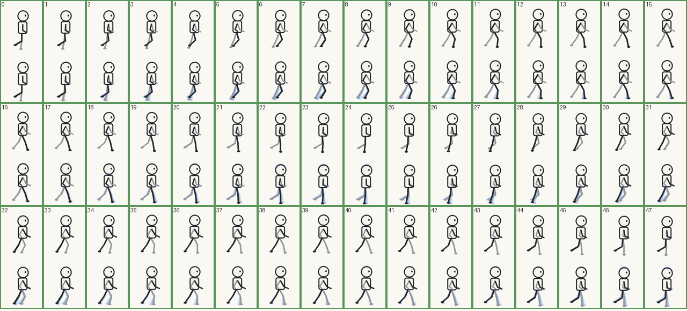
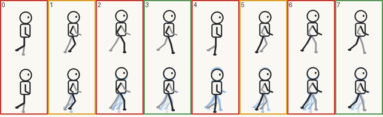

# 18. 애니메이션 제작 · 프롬프트 바이블

> 상태: ✅ 규칙 확정 · 🧪 검사 도구 동작 확인 (`Tools/anim_check.py`) · 💡 프레임 수는 실제 제작하며 보정
> 기준 문서: [16 아트 컨셉](16_아트_컨셉.md) · [17 AI 아트 프롬프트](17_AI_아트_프롬프트.md) · [05 조작 수치](05_플레이어_조작.md)
> 목표: **많은 프레임 · 한 프레임에 조금씩만 변화 · 겹쳐서 이어지는 부드러움 · 역동적인 움직임.** 그리고 지형·색·선이 맵과 한 몸처럼 보이게.

---

## 0. 왜 AI 애니메이션이 어색한가 → 해결 원칙

| AI가 자주 하는 실수 | 어색해 보이는 이유 | 우리 규칙 |
|---|---|---|
| 프레임 수가 적음 (달리기 6~8장) | 다리가 한 프레임에 **휙** 이동 | 60fps 기준으로 만듦. 달리기 시작~멈춤 **최소 96프레임** |
| 포즈와 포즈 사이를 그냥 건너뜀 | 중간 과정(브레이크다운)이 없음 | **키 포즈 → 브레이크다운 → 인비트윈** 3단계 필수 |
| 좌표·각도만 움직임 (딱딱한 종이 인형) | 몸이 휘지 않고 부품만 돎 | 팔다리·몸통이 **휘고 늘어나는** 메시 변형 + 프레임별 덧그림 |
| 모든 부위가 동시에 움직임 | 무게감 없음 | **겹침 동작** (머리·팔·옷자락이 몸보다 2~6프레임 늦게 따라옴) |
| 일정한 속도 | 기계 같음 | **가속·감속(이징)**: 시작은 느리게, 가운데 빠르게, 끝은 느리게 |
| 예비 동작 없는 공격 | 힘이 안 느껴짐 | **예비 동작 → 스미어(잔상) 1~2프레임 → 타격 정지 → 따라가기 → 회복** |
| 픽 쓰러지는 죽음 | 감정이 없음 | 충격 → 버팀 → 무너짐 → **재료로 사라짐**까지 1.5초 연출 |
| 가만히 서 있는 idle | 심심함 | 숨쉬기 루프 + **행동 3가지**가 랜덤으로 |

### 다섯 가지 철칙
1. **한 프레임에 큰 변화 금지.** 모든 프레임은 [§2 검사](#2-겹쳐서-검사하기-어니언-스킨-테스트)를 통과해야 함 (스미어 프레임만 예외)
2. **발이 땅에서 미끄러지면 실패.** 땅에 닿은 발은 한 프레임에 **이동 속도 ÷ 60**만큼만 뒤로 감
3. **모든 동작은 무게중심 곡선을 먼저 그린다.** 머리·손끝은 그 곡선을 늦게 따라감
4. **AI는 키 포즈까지만.** 중간 프레임은 메시 변형 + 사람 손질 (또는 보간 도구 → 반드시 손질)
5. **레퍼런스를 프레임 단위로 멈춰 보고 나서** 우리 프레임 수에 다시 배치한다 ([§3](#3-레퍼런스-분석-프레임-단위로-멈춰-보기))

---

## 1. 공통 규격

> [21 고해상도 타일맵 규격](21_고해상도_타일맵_규격.md) 적용. 원화 좌표는 PPU 256, 동작 설명의 작은 움직임 값(숨쉬기·피격 흔들림·구슬 이동)은 별도 표기가 없으면 1080p 화면 픽셀이다. 기존 자동 검사 데모의 측정값은 당시 샘플 기록으로 유지하며, 새 프레임은 캐릭터 키에 비례해 검수한다.

| 항목 | 값 | 이유 |
|---|---|---|
| **움직임 재생** | **60fps** (게임 로직과 같음) | 프레임마다 아주 조금씩 바뀌어야 부드러움 |
| **선 떨림 (boil)** | **쓰지 않음** (v5: 선명한 실루엣 · 분위기 중심 일러스트) | 깔끔한 선이 떨리면 오히려 지저분해 보임 → 살아 있는 느낌은 60fps 움직임과 부드러운 형태 변화(스쿼시·스트레치)로 |
| 원화 크기 | 플레이어 몸 기준 **192×352px, PPU 256** (논리 12×22 ×16). 1080p에서 키 88px, 4K에서 176px | 크게 그려야 중간 프레임이 섬세함 |
| 📐 AI 생성 크기 | 키 포즈는 AI에 **1:1 (1024×1024)** 로 요청 → 캐릭터를 같은 기준선·같은 키로 잘라 **키 352px** 원화 캔버스(512×512 이상, 발 위치 고정)에 맞춤. 생성 크기는 도구별 지원 설정에서 지정하고, 프롬프트 문장에는 픽셀 숫자 대신 형태와 스타일을 지정 ([17](17_AI_아트_프롬프트.md) 📐) | 프레임마다 크기·위치가 같아야 겹침 검사가 맞음 |
| 🚫 픽셀 금지 | 모든 프레임은 **부드럽게 안티앨리어싱된 고해상도 그래픽, 선명한 외곽선**. 프레임마다 선 굵기·색이 같아야 함. 도트·계단 가장자리·디더링 금지. 확대·축소는 Bilinear/Trilinear (Point 금지) | 우리 게임은 선명한 그래픽 |
| 🎮 그림체 · 🌗 밝기 | **게임 그림체**(단순한 형태, 사실적인 근육·주름·질감 묘사 ❌) · 주인공 몸은 **분필 흰색 `#F0EEE6`** (화면에서 가장 밝음), 적은 항상 주인공보다 어둡게. 프레임마다 밝기가 바뀌면 안 됨 (예고 동작의 '밝아짐'만 예외) | 전투 중 한눈에 읽히게, 미드키 화면에서 주인공이 항상 보이게 |
| 가장자리 | 메시 변형으로 휘어도 윤곽이 **매끈한 곡선**이 되게 메시를 촘촘히 (관절 주변 정점 간격 ≤ 원화 24px @ PPU 256) | 각진 꺾임 방지 |
| 기준점 | 발 사이 바닥 중앙 (pivot) | 판정 박스와 맞춤 |
| 판정 | 애니메이션과 **별도**. 공격 판정 프레임은 표로 지정 | 그림이 어긋나도 판정은 정확 |
| 블렌딩 | 동작 전환 시 **4~6프레임 섞기** (입력 반응은 즉시, 모양만 섞음) | 툭 끊기는 전환 방지 |
| 파일 이름 | `pl_run_loop_0007.png` (대상_동작_구간_번호 4자리) | 순서 보장 |

### 프레임 변화 기준 (캐릭터 키 352px 기준)
| 항목 | ✅ 통과 | ⚠️ 경고 | ❌ 실패 |
|---|---|---|---|
| 실루엣 겹침률 (앞 프레임과) | 0.70 이상 | 0.55~0.70 | 0.55 미만 |
| 팔·다리 끝 순간 점프 거리 | 16px 이하 | 16~28px | 28px 초과 |
| 무게중심 이동 | 18px 이하 | 18~28px | 28px 초과 |
| 가속 튐 (앞뒤 평균 대비) | 2.2배 이하 | 2.2배 초과 | — |
| 스미어 프레임 (지정한 프레임만) | 겹침률 0.25↑ · 점프 120px↓ | | 그 이상 |

---

## 2. 겹쳐서 검사하기 (어니언 스킨 테스트)

### 2-1. 자동 검사 도구 `Tools/anim_check.py` 🧪
```
python Tools/anim_check.py <프레임 폴더> --loop            # 루프 동작 (달리기, idle)
python Tools/anim_check.py <프레임 폴더> --smear 7,8       # 공격: 7·8번은 스미어 프레임
```
- 앞 프레임 3장을 파란 계열로, 현재 프레임을 빨강으로 **겹쳐서** 보여줌 (onion_XXX.png)
- 프레임마다 **겹침률 · 바뀐 면적 · 중심 이동 · 팔다리 끝 점프 거리 · 가속 튐**을 재서 표로 냄 (report.md)
- 전체를 한눈에 보는 **컨택트 시트** (위 줄: 프레임 / 아래 줄: 어니언 스킨, 테두리 초록·노랑·빨강)
- 캐릭터 크기가 달라도 기준이 자동으로 비례 조정됨

### 2-2. 실제로 겹쳐서 테스트한 결과
같은 달리기를 **48프레임**(우리 규격)과 **8프레임**(AI가 흔히 주는 수)으로 만들어 검사했어.

| 버전 | 결과 | 팔·다리 끝 점프 거리 |
|---|---|---|
| 48프레임 루프 (0.8초) | ✅ **통과 48 / 실패 0** | 프레임당 4~5px |
| 8프레임 루프 | ❌ **실패 4 · 경고 2** | 프레임당 최대 25px (다리가 휙 이동) |




> 아래 줄 어니언 스킨을 보면 48프레임은 이전 프레임들과 촘촘히 겹쳐 있고, 8프레임은 다리가 멀리 떨어져 있어.

### 2-3. 사람이 하는 검사 (자동 검사 후)
| # | 검사 | 방법 |
|---|---|---|
| 1 | **0.25배속 재생** | 느리게 보면 튀는 프레임이 바로 보임 |
| 2 | **실루엣 재생** | 검은색으로만 재생 → 동작이 읽히는지 |
| 3 | **발 미끄러짐** | 땅 닿은 발 위치를 점으로 찍어서 이동량 = 속도 ÷ 60 인지 |
| 4 | **루프 이음새** | 마지막 → 첫 프레임 변화가 다른 프레임과 같은 크기인지 (도구 `--loop`) |
| 5 | **게임 안 재생** | 실제 맵 배경 위에서, 실제 이동 속도로 (배경과 선 굵기·색이 어울리는지) |
| 6 | **판정 맞춤** | 판정 박스 표시(QA 충돌 박스)와 칼끝·몸이 맞는지 |

---

## 3. 레퍼런스 분석 (프레임 단위로 멈춰 보기)

> 새 애니메이션을 만들 때마다 **반드시** 이 과정을 먼저 해.

### 3-1. 순서
1. 레퍼런스 **게임 3개 + 실사 1개** 고르기 (§3-3 목록)
2. 영상을 60fps 프레임으로 뽑기
   ```
   ffmpeg -i ref.mp4 -vf fps=60 ref_frames/%04d.png
   ```
3. 한 프레임씩 넘기며 **분석 시트** 채우기 (§3-2)
4. 레퍼런스 3개의 타이밍을 비교해서 **우리 프레임 수로 다시 배치** (예: 레퍼런스 공격 예비동작 9프레임 → 우리는 6프레임 + 예고 연출)
5. 우리 캐릭터 비율(큰 머리, 짧은 팔다리)에 맞게 **과장 정도 조절**
6. 분석 시트를 `Anim/refs/<동작>.md`에 저장 → 나중에 같은 동작 다시 만들 때 재사용

### 3-2. 분석 시트 양식
```
동작: 플레이어 달리기 루프
레퍼런스: ① Ori (run) ② Hollow Knight (run) ③ Rayman Legends (run) ④ 실사: 어린이 달리기
---------------------------------------------------------------
                    ①     ②     ③     ④     → 우리 결정
한 걸음 프레임 수    10    8     9     11       10
접지(contact)       1     1     1     1        1
눌림(down)          3     2     3     3        3   (몸 가장 낮음)
교차(passing)       5     4     5     6        5
뜸(up)              8     6     7     9        8   (몸 가장 높음)
몸 위아래 폭        큼    작음  큼    중간      몸 키의 4%
상체 기울기         15°   10°   20°   8°       12°
팔 흔들림           작음  없음  큼    중간      중간, 다리 반대
머리 늦게 따라오기  3f    2f    4f    3f       3f
특이점: ③은 착지 때 몸이 살짝 찌그러짐 → 우리도 6% 스쿼시
```

### 3-3. 레퍼런스 목록 (동작별)

| 동작 | 게임 | 실사·교재 | 볼 포인트 |
|---|---|---|---|
| 달리기 | Ori and the Will of the Wisps · Rayman Legends · Hollow Knight | 어린이 달리기 영상 · *The Animator's Survival Kit* 달리기 표 | 접지·눌림·교차·뜸 위치, 머리 늦게 따라오기 |
| 달리기 시작·멈춤·방향 전환 | Ori · Celeste · Rayman Legends | 실사 급정거 | 시작 때 몸 숙임, 멈출 때 미끄러지며 발 버팀, 돌 때 몸 비틀기 |
| 점프·착지 | Celeste · Ori · Rayman Legends | 트램펄린 영상 | 웅크림 깊이, 정점 체공, 착지 찌그러짐 후 복원 |
| 벽 점프·벽 미끄러짐 | Celeste · Hollow Knight · Ori | 파쿠르 월 킥 | 벽 짚는 손, 차는 다리, 몸 비틀림 |
| 대시 | Hollow Knight · Celeste · Dead Cells | — | 출발 늘어남 → 도착 압축, 잔상 |
| 공격 (근접 콤보) | Hollow Knight · Dead Cells · Blasphemous · Cuphead | 펜싱·검도 영상 | 예비 동작 길이, 스미어 모양, 타격 정지, 따라가기 |
| 패링 | Sekiro(2D로 단순화) · Hollow Knight(대응) · Blasphemous | 펜싱 패리 | 막는 순간 정지, 성공 시 반동 |
| 피격·넉백 | Hollow Knight · Cuphead | — | 튕겨지는 방향, 몸 젖힘 |
| 죽음 | Cuphead · GRIS · Hollow Knight | — | 버팀 → 무너짐 → 사라짐의 감정 곡선 |
| idle 행동 | Cuphead · Rayman Legends · Ori | 아이가 심심할 때 영상 | 행동 사이 숨, 시선 이동 |
| 적 걷기·공격 | Hollow Knight · Rayman Legends · Cuphead | 곤충·동물 영상 (벌레·박쥐·거북) | 몸 리듬, 예고 동작의 '읽힘' |
| 보스 | Cuphead · Hollow Knight · Blasphemous | — | 큰 몸의 느린 예비 → 빠른 공격 → 긴 빈틈 |
| 구조물 (발판·문·불) | Rayman Legends · Ori | 종이 찢기·접기·크레파스 녹이기 실사 | 재료가 실제로 어떻게 변형되는지 |

> 레퍼런스는 **타이밍과 원리만** 가져와. 포즈·디자인을 베끼지 않아.

---

## 4. 제작 파이프라인 (한 동작 기준)

| 단계 | 내용 | 도구 | AI 사용 |
|---|---|---|---|
| ① 레퍼런스 분석 | §3 시트 작성, 타이밍표 확정 | 영상 프레임 뽑기 | ❌ |
| ② 타이밍표 | 프레임 번호별 키·브레이크다운·스미어·판정 표시 | 스프레드시트 | ❌ |
| ③ 키 포즈 | 극점(가장 뻗음·가장 웅크림·타격 순간) 3~6장 | **AI** (§5 템플릿) + 손질 | ✅ |
| ④ 브레이크다운 | 키 사이 "어떻게 이동하는지" 결정 포즈 (호의 경로) | 사람 / AI img2img(포즈 컨트롤) | △ |
| ⑤ 인비트윈 | 나머지 모든 프레임 | **메시 변형 리그**(Spine / Unity 2D Animation, 몸이 휘게) + 프레임별 덧그림 · 또는 보간 도구(ToonCrafter·RIFE 등) 후 **반드시 손질** | △ |
| ⑥ 겹침 동작 | 머리·팔·종이 귀퉁이가 늦게 따라오게 오프셋 | 리그 | ❌ |
| ⑦ 스미어·이펙트 | 공격 순간 잔상 프레임, 재료 이펙트 | 그래픽 툴 (벡터·브러시 모양) | △ |
| ⑧ ~~선 떨림 층~~ | 폐지 (v4) | — | — |
| ⑨ 검사 | §2 자동 + 사람 검사 | `anim_check.py` | ❌ |
| ⑩ 게임 안 확인 | 실제 맵 위, 실제 속도, 판정 박스 | Unity | ❌ |

> **"좌표·각도만 움직이는" 리그 금지.** 메시를 휘게 하고, 크게 바뀌는 순간(공격·착지)은 프레임을 직접 덧그려.

---

## 5. AI 프롬프트 템플릿 (키 포즈용)

> 모든 프롬프트에 [17 문서의 MSB v4 + UNIFY v4 + 재료 블록]을 붙여 (실제 조립은 `Tools/build_prompts.py`). v3: **게임 그림체 + 미드키** — 주인공은 화면에서 가장 밝은 분필 흰색.

### 5-1. 캐릭터 고정 블록 (플레이어)
```
CHAR-LOCK (player):
the same tiny protagonist in every image: round head about 45% of total height, rounded-rectangle body, very
short thin stick-like arms and legs drawn as single thick lines, one small dot eye, no mouth, no nose, chalk-
white body (the lightest value on screen) with soft dark ink-gray outline, no colors, no clothes, no
accessories, exact same proportions and line weight as the reference character sheet
```

### 5-2. 키 포즈 템플릿
```
[MSB v4], [MAT-n], [CHAR-LOCK], [UNIFY v4],
single animation key pose, side view facing right, full body, isolated on transparent background,
pose: [포즈 설명 — 아래 표의 영어 문장],
body weight clearly readable, line of action is a smooth curve from head to supporting foot,
frame [번호] of [총 프레임] in a [동작] animation
NEG: [17 공통 NEG (픽셀·도트 포함)], [캐릭터 NEG], motion blur, multiple characters, overlapping duplicate poses,
different proportions, longer limbs, realistic anatomy, muscles, fingers detail, stiff straight-line pose
```

### 5-3. 브레이크다운 (img2img)
```
[MSB v4], [MAT-n], [CHAR-LOCK], [UNIFY v4],
in-between pose exactly halfway between pose A and pose B, follow a curved arc path,
keep volume and proportions identical, the head lags slightly behind the body
CONTROL: pose skeleton (A와 B 사이 각도로 만든 골격), strength 0.8
REF: pose A image, pose B image, character sheet
```

### 5-4. 스미어 프레임
```
[MSB v4], [MAT-n], [CHAR-LOCK], [UNIFY v4],
clean smear frame for a fast swing: the arm and eraser stretched into one smooth curved streak shape
with crisp edges in [재료 색 — pencil gray / crayon orange], body still readable, no motion blur filter
```

### 5-5. ~~선 떨림 3종~~ (폐지)
> v4에서 아트가 **부드러운 그래픽 디자인 · 선명한 선**으로 바뀌어 선 떨림(boil)은 쓰지 않아. 프레임마다 외곽선이 **같은 굵기·같은 색·같은 매끈함**이어야 해.

---

## 6. 플레이어 애니메이션 (60fps)

### 6-1. 전체 프레임 예산
| 동작 | 프레임 | 시간 | 루프 | 판정·조작 연결 |
|---|---|---|---|---|
| idle 숨쉬기 | 96 | 1.6초 | ✅ | — |
| idle 행동 ① 둘러보기 | 120 | 2.0초 | | 4초 가만히 있으면 |
| idle 행동 ② 자기 선 고쳐 그리기 | 150 | 2.5초 | | 9초 |
| idle 행동 ③ 기지개 → 하품 | 132 | 2.2초 | | 15초 |
| idle 앉기 → 앉아 졸기 | 60 + 120 | 1.0 + 2.0초 | 졸기 ✅ | 25초 |
| 달리기 시작 | 18 | 0.30초 | | 정지 → 이동 |
| 달리기 루프 | **40** (네 걸음, 두 주기에 변화) | 0.67초 | ✅ | 속도 125 |
| 달리기 멈춤 | 22 | 0.37초 | | 이동 → 정지 |
| 방향 전환 | 16 | 0.27초 | | |
| **달리기 합계** | **96** | | | 요청 기준 64↑ 충족 |
| 점프 예비 | 4 | | | 입력 즉시 뜸 (예비는 모양만, 판정 지연 없음) |
| 상승 | 14 (vy 따라 선택) | | | vy < -150 |
| 정점 | 12 | | | -150 ≤ vy ≤ 150 |
| 낙하 시작 + 낙하 루프 | 8 + 16 | | 낙하 ✅ | vy > 150 |
| 착지 (낮게 / 높게 6칸↑) | 10 / 20 | | | |
| 위로 점프 (W+Space) | 4 + 상승 공용 | | | 팔 위로 뻗기 변형 |
| 벽 미끄러짐 | 24 | | ✅ | |
| 벽 점프 | 14 | 0.23초 | | 잠김 0.17초 동안 |
| 대시 (지우개) | 20 | 0.33초 | | 시작 4 · 이동 10 · 끝 6 |
| 공격 1타 | 22 | 0.37초 | | 판정 8~10프레임 |
| 공격 2타 | 24 | 0.40초 | | 판정 9~11 |
| 3타 접기 베기 | 34 | 0.57초 | | 판정 14~17 |
| 대시 베기 | 20 | 0.33초 | | 판정 4~9 |
| 패링 자세 | 18 | 0.30초 | | 판정 창 0.12초 = 프레임 3~9 |
| 패링 성공 | 20 | 0.33초 | | 튕겨내기 반동 |
| 반격 (패링 후) | 26 | 0.43초 | | 판정 8~11 |
| 덧칠 일격 모으기 + 발사 | 30 루프 + 28 | | 모으기 ✅ | |
| 피격 | 16 | 0.27초 | | 무적 깜빡임과 겹침 |
| 회복 물감 바르기 | 33 | 0.55초 | | 채널링과 같은 길이 |
| 아이템 던지기 (물감 탄) | 20 | 0.33초 | | 발사 프레임 7 |
| 종이 방패 펼치기 | 18 | 0.30초 | | |
| 그리기 (W 길게) | 72 | 1.2초 | | 그림 친구 채우기와 같은 길이 |
| 리본 이동 (지워짐 / 그려짐) | 25 / 25 | 0.42초씩 | | 연출과 동기 |
| 능력 획득 | 90 | 1.5초 | | 구슬 들어 올림 → 몸 선이 또렷해짐 |
| 벽타기 (밀랍) | 32 | | ✅ | |
| 헤엄 | 48 | | ✅ | |
| 활공 | 40 | | ✅ | |
| **죽음** | **90** | 1.5초 | | §6-6 |
| 다시 그려짐 (부활) | 60 | 1.0초 | | |

### 6-2. idle — 숨쉬기 + 행동 3가지
**숨쉬기 루프 (96f):** 몸이 위아래 2px, 몸 폭 1% 늘었다 줄었다. 머리는 몸보다 **4프레임 늦게**. 24프레임마다 아주 작은 눈 깜빡 없음(눈이 점이라) → 대신 **머리 살짝 기울기**.

| 행동 | 타이밍 (프레임) | 포즈 (AI 키 포즈 문장) |
|---|---|---|
| ① 둘러보기 | 0~20 몸 그대로 머리만 뒤로 돌림 → 20~50 뒤쪽 보며 정지(2px 흔들) → 50~70 앞으로 휙(이징) → 70~90 위 올려다봄 → 90~120 원위치 | `turning head to look back over its shoulder, body still facing right` / `looking up curiously, head tilted back slightly` |
| ② 자기 선 고쳐 그리기 | 0~30 팔 선이 흐려져 깜빡 → 30~60 반대 손가락으로 팔을 문지름 → 60~110 연필 획이 팔을 따라 다시 그려짐(이펙트) → 110~150 팔을 털고 만족 | `looking down at its own faded arm line, touching it with the other hand` / `shaking its redrawn arm proudly` |
| ③ 기지개 → 하품 | 0~40 두 팔 위로 쭉 (몸 늘어남 8%) → 40~60 정점 정지 → 60~90 털썩 내려옴(찌그러짐 6%) → 90~132 머리 뒤로 젖히며 하품(머리 들썩) | `stretching both arms high above head, body stretched tall` / `head tilted back yawning, arms relaxed` |
| 앉기 → 졸기 | 0~60 무릎 굽혀 털썩 앉음 → 졸기 루프: 머리가 천천히 끄덕 → 툭 떨어졌다 퍼뜩 | `sitting on the ground with legs out, head nodding sleepily` |

**규칙:** 행동은 랜덤, 같은 행동 연속 금지. 어떤 입력이든 들어오면 **4프레임 섞으며 즉시** 해당 동작으로 (조작감 우선).

### 6-3. 달리기 (시작 18 + 루프 40 + 멈춤 22 + 방향 전환 16 = 96)

**발 미끄러짐 계산:** 이동 속도 125px/s (논리) → 원화 ×16 → **2000px/s ÷ 60 = 프레임당 약 33.3px**. 땅에 닿은 발은 프레임마다 정확히 이만큼 뒤로.
**걸음:** 한 걸음 10프레임(0.167초) → 걸음 길이 = 약 333.3px(원화 @ PPU 256) = 몸 키의 0.95배.

| 구간 | 프레임 | 키 포즈 (AI 문장) |
|---|---|---|
| 시작 | 0 | `standing, about to run, weight shifting forward` |
| | 4 | `leaning forward strongly, back leg pushing off, arms swinging back` (가장 숙임) |
| | 10 | `first long stride, front leg reaching forward` |
| | 18 | → 루프 0번과 같은 포즈 |
| 루프 (한 걸음 10f, 4걸음) | 0 | `contact: front heel touching ground, legs wide, body at mid height` |
| | 3 | `down: front knee bent, body lowest, back leg lifting` |
| | 5 | `passing: legs crossing under the body, body rising` |
| | 8 | `up: pushing off, body highest, arms at widest swing` |
| | 10~40 | 반대 다리로 반복. **두 번째 주기(20~40)는 팔 흔들림·머리 각도를 3~5% 다르게** → 기계 같은 반복 방지 |
| 멈춤 | 0~6 | `braking: leaning back, front foot planted and sliding slightly, arms thrown forward` |
| | 6~14 | 몸이 앞으로 쏠렸다(오버슈트) 뒤로 돌아옴 |
| | 14~22 | `settling into idle stance` (숨쉬기 0번과 같게) |
| 방향 전환 | 0~16 | `skidding turn: body twisting, one foot planted, head already looking the new direction` (머리 먼저 → 몸 → 다리 순서) |

### 6-4. 점프 · 착지 · 벽
| 동작 | 키 포즈 | 비고 |
|---|---|---|
| 예비 (4f) | `quick crouch, knees bent, arms back` | 판정은 입력 즉시 상승 시작, 그림만 4프레임 뒤에 따라옴 |
| 상승 (14f) | `body stretched upward 6%, arms raised, legs trailing down` | vy가 클수록 앞쪽 프레임 |
| 정점 (12f) | `floating at the top, limbs relaxed and spread, slight forward tumble` | 가장 느리게 바뀌는 구간 |
| 낙하 (8+16f) | `falling, arms up flailing gently, legs reaching down for the ground` | 팔 펄럭임은 두 박자 늦게 |
| 착지 낮게 (10f) | 0: `contact, knees bending` → 3: `squashed 8% wider` → 10: idle | |
| 착지 높게 (20f) | 0: 크게 찌그러짐 12% + 종이 가루 → 8: 한 손 땅 짚음 → 20: 일어남 | 6칸 이상 떨어졌을 때 |
| 벽 미끄러짐 (24f 루프) | `pressed against the wall, one hand and one foot on the wall, sliding down` | 손에서 연필 가루 |
| 벽 점프 (14f) | 0: `coiled against the wall` → 3: `kicking off the wall, body twisting away` → 14: 공중 상승 포즈로 | ✋ 손이 **벽을 짚는 프레임** 반드시 2프레임 이상 |

### 6-5. 공격 (예비 → 스미어 → 타격 정지 → 따라가기 → 회복)
| 동작 | 예비 | 스미어 | 타격 | 따라가기 | 회복 | 판정 | 키 포즈 문장 |
|---|---|---|---|---|---|---|---|
| 1타 (22f) | 0~5 지우개 든 팔 뒤로, 몸 비틀기 | 6~7 | 8~10 (히트 시 4프레임 정지) | 11~16 팔이 몸 앞을 지나감 | 17~22 | 8~10 | `wind-up: eraser arm pulled far back, body twisted` / `swing follow-through: arm crossed in front, body leaning forward` |
| 2타 (24f) | 0~5 반대 방향으로 감기 | 6~7 | 9~11 | 12~18 | 19~24 | 9~11 | `reverse backhand wind-up` / `upward backhand finish` |
| 3타 접기 베기 (34f) | 0~10 크게 뛰어오르듯 웅크림 | 11~13 | 14~17 + 화면 정지 6f | 18~26 종이처럼 접히며 착지 | 27~34 | 14~17 | `big leap wind-up, eraser raised over head` / `slamming down, body folded like paper` |
| 대시 베기 (20f) | 0~2 | 3~4 (몸 전체 늘어남) | 4~9 | 10~15 | 16~20 | 4~9 | `lunging forward, body stretched horizontally, eraser leading` |
| 반격 (26f) | 0~4 (패링 반동 이어받음) | 5~7 | 8~11 | 12~19 | 20~26 | 8~11 | `spinning counter swing, golden spark at the eraser tip` |
| 덧칠 일격 발사 (28f) | 모으기 루프에서 이어짐 | 6~8 | 9~13 | 14~22 | 23~28 | 9~13 | `releasing a heavy ink stroke, whole body thrust forward` |

**공격 규칙**
- 스미어 프레임은 **2장 이하**, `--smear`로 지정해서 검사
- 히트 시 **타격 정지(히트스톱) 동안 그림도 정지** + 맞은 쪽만 2px 흔들림
- 따라가기 구간에서 머리·몸이 칼(지우개) 방향으로 **넘어갔다 돌아오는** 오버슈트 1회
- 콤보 연결: 1타 회복 구간(17~22)에 입력이 오면 **2타 예비 0번으로 섞기 4f**

### 6-6. 피격 · 죽음 · 부활
| 동작 | 타이밍 | 키 포즈 |
|---|---|---|
| 피격 (16f) | 0~2 충격으로 몸이 공격 반대쪽으로 젖혀짐 + 종이 조각 → 3~8 젖힘 최대에서 선이 살짝 흐려짐 → 9~16 버티며 복원 | `recoiling backward from a hit, body bent, outline partly smudged` |
| **죽음 (90f)** | 0~6 **강한 충격**: 몸이 크게 젖혀지며 떠오름 (히트스톱 8f) → 6~24 **버팀**: 한쪽 무릎으로 착지, 손으로 땅 짚음 → 24~40 **일어나려다 실패**: 팔이 떨리며 선이 흐려짐 → 40~56 **무너짐**: 옆으로 쓰러지며 종이처럼 바닥에 납작 → 56~90 **지워짐**: 위에서부터 지우개가 지나가며 사라지고 지우개 가루가 흩날림, 마지막에 연필 점 하나만 남았다 사라짐 | `knocked back into the air` / `kneeling, one hand on the ground, trembling` / `collapsed flat on the ground like paper` / `being erased from the top, eraser crumbs flying` |
| 부활 (60f) | 세이브 석상에서 **연필 선이 발부터 위로 그려짐** → 마지막 4f 몸 털기 | `being drawn back from the feet up with a pencil line` |

### 6-7. 기타 능력 · 상호작용 동작
| 동작 | 키 포즈 |
|---|---|
| 패링 자세 (18f) | 0~2 팔 앞으로 → 3~9 **판정 창 동안 정지 자세 유지**(금빛 반원) → 10~18 회복 · `eraser held up in front to block, braced stance` |
| 패링 성공 (20f) | 0~3 튕기는 반동으로 몸이 뒤로 → 4~12 금빛 섬광 원과 함께 다시 앞으로 → 13~20 반격 준비 |
| 회복 물감 (33f) | 0~8 물감 꺼냄 → 8~26 팔·몸에 바르며 색 대신 **선이 진해짐** → 26~33 손 털기 |
| 그리기 (72f) | 0~10 연필 꺼내 쥠 → 10~62 그림 친구 쪽으로 몸 기울여 **선 따라 손 움직임** (그려지는 부분과 손끝 위치 동기) → 62~72 연필 내림 |
| 능력 획득 (90f) | 0~20 구슬을 두 손으로 들어 올림 → 20~50 빛 대신 **깔끔한 선이 몸 위를 달리며** 그 부위가 또렷해짐 → 50~90 손바닥 바라보며 확인, 한 번 시험 동작 |
| 대시 (20f) | 0~4 웅크림 → 4~14 몸이 가로로 18% 늘어나고 지우개 가루 잔상 → 14~20 압축 착지 |
| 벽타기 (32f 루프) | 크레파스로 벽에 **발판을 그리며** 손발 교대로 오름 (손이 그은 자국이 2초간 남음) |
| 헤엄 (48f 루프) | 개헤엄 리듬 + 몸 뒤로 물감 번짐 꼬리 |
| 활공 (40f 루프) | 접힌 종이 날개가 바람에 펄럭 (날개 끝이 몸보다 6f 늦게) |

---

## 7. 적 애니메이션 (60fps)

### 7-1. 공통 구성
| 상태 | 프레임 | 규칙 |
|---|---|---|
| idle | 48~72 루프 | 종마다 **고유 리듬** (벌레 꿈틀, 나방 날갯짓 등) |
| 이동 | 40~48 루프 | 발 미끄러짐 금지 (적 속도 ÷ 60) |
| 발견 | 18 | 몸이 움찔 + 플레이어 쪽으로 돌기 (텍스트 없이) |
| **예고 (wind-up)** | 24~36 (0.4~0.6초) | 색이 밝아지고 몸을 웅크림. **플레이어가 읽을 수 있게 가장 크게 과장** |
| 공격 | 종마다 | 판정 프레임 표기 |
| 회복 (빈틈) | 24~60 | 공격 후 지친 모습 → 반격 타이밍이 보이게 |
| 피격 | 12 | 반대로 젖혀짐 + 흰 깜빡 0.12초 |
| 그로기 | 30 루프 | 머리 위 흐린 소용돌이 낙서 |
| 죽음 | 40~60 | **재료로 사라짐** (16 문서 §7-2) |

### 7-2. 종별 핵심 동작
| 장 | 적 | idle / 이동 | 예고 → 공격 | 죽음 |
|---|---|---|---|---|
| 1 | 흑연 벌레 | 몸 마디가 앞에서 뒤로 물결 (마디당 3f 지연) | 몸을 S자로 웅크림 30f → 튀어 오름 | 마디가 하나씩 지워짐 |
| 1 | 연필깎이 포탑 | 손잡이가 천천히 돎 | 손잡이 빠르게 감김 + 구멍이 노란빛 → 탄 발사 반동 | 깎인 연필 부스러기로 흩어짐 |
| 1 | 종이 나방 | 날갯짓 (위 4f 빠르게, 아래 8f 느리게) | 날개 접고 정지 18f → 급강하 | 날개가 접혀 떨어짐 |
| 1 | 구겨진 종이공 | 굴러가며 주름 회전 | 부풀었다(10%) → 돌진 | 펴지며 납작해짐 |
| 1 | 흑연 두더지 | 흙더미 들썩 | 흙더미 커짐 0.6초 → 솟구침 | 땅속으로 지워짐 |
| 1 | 지우개 거미 | 실에 매달려 흔들 | 다리 오므림 → 낙하 | 지우개 가루로 부서짐 |
| 1 | 잉크 방울 | 출렁 (탄성) | 납작해졌다 → 튀어 오름 | 웅덩이로 퍼짐 |
| 2 | 크레용 병정 | 창 들고 행진 | 창 뒤로 0.45초 → 2연속 찌르기 (각 0.22초, 사이 0.3초) | 크레파스가 부러져 쓰러짐 |
| 2 | 밀랍 투척꾼 | 몸 덩어리 출렁 | 팔 뒤로 감기 0.5초 → 포물선 던지기 | 녹아내림 |
| 2 | 색가루 박쥐 | 천장에 거꾸로 매달려 흔들 | 몸 떨기 0.35초 → 급강하 | 색가루로 흩어짐 |
| 2 | 녹은 방울 | 흘러내리듯 기어감 + 자국 | — (접촉) | 굳어서 금 감 |

### 7-3. 엘리트 · 보스
| 대상 | 핵심 연출 |
|---|---|
| 광산 감독 지우개 | 돌진 전 **발로 땅 긁기 3회**(각 12f) → 돌진 → 벽에 부딪히면 지우개 부스러기 + 휘청 |
| 덩굴 사냥꾼 | 덩굴 채찍: 손목부터 끝까지 **물결처럼 지연** (마디당 2f) |
| 깎인 크레파스 거북 | 껍질 속으로 몸 넣기(18f) → 구르기 루프 → 벽에 부딪혀 **뒤집힘**(빈틈 1.3초: 버둥거림 루프) |
| 엉킨 낙서 덩어리 (1장 보스) | 몸 선들이 **서로 다른 속도로** 꿈틀 (선마다 위상 다르게) → 걸음마다 낙서가 흩날림 |
| 부러진 크레파스 기사 (2장 보스) | 큰 몸은 예비 동작을 **길고 느리게**(0.5~0.6초), 공격은 빠르게, 빈틈은 길게. 돌진 후 벽에 꽂힘 → 창 뽑으려 버둥(1.3초). 2페이즈: 창이 더 부러지는 컷(30f, 화면 정지 10f) |

---

## 8. 상호작용 구조물 애니메이션

> 구조물도 **맵 재료로 그린 것처럼**. 상태 변화는 "재료가 실제로 그렇게 변하는 모습"으로.

| 구조물 | 상태 / 프레임 | 연출 |
|---|---|---|
| 연필꽂이 석상 (세이브) | 대기 72 루프 · 기록 40 | 대기: 연필 3자루가 아주 살짝 흔들림 / 기록: 연필이 하나씩 튀어 올랐다 꽂힘 + 종이에 낙서 스케치 |
| 책갈피 리본 | 펄럭 60 루프 · 열림 30 · 매듭 풀림 36 | 리본 끝이 바람에 S자로 (끝이 뿌리보다 6f 늦게) / 매듭이 스르륵 풀림 |
| 찢긴 페이지 리본 | 펄럭 60 + 종이 귀퉁이 들썩 | 종이 조각 가장자리가 숨 쉬듯 들림 |
| 낙서 벽 | 대기 48 루프 · 지워짐 30 | 낙서 선이 꿈틀 / 대시에 닿으면 **선 하나하나가 지우개질로 사라짐** (위에서 아래로) |
| 흑연 덩굴 | 대기 60 루프 · 잘림 24 | 덩굴 흔들림 / 잘린 위쪽이 떨어지며 흑연 가루 |
| 무너지는 발판 | 떨림 27 (0.45초) · 무너짐 18 · 복구 30 | 금이 점점 벌어짐 → 조각으로 떨어짐 → 연필 선으로 다시 그려짐 |
| 녹는 크레파스 발판 | 녹기 90 (1.5초) / 화로 근처 36 · 다시 굳기 30 | 밑으로 방울이 점점 길게 늘어짐 → 뚝 떨어지며 사라짐 → 크레파스로 다시 칠해짐 |
| 불씨 화로 | 불 48 루프 · 꺼짐 20 · 다시 붙음 18 | 크레파스로 그린 불꽃이 위로 번갈아 솟음 / 꺼지면 연기 낙서 |
| 물감통 | 대기 · 맞음 24 | 맞으면 통이 흔들리고 물감이 문 쪽으로 **획을 그으며** 날아감 |
| 물감 문 | 색 칠해짐 30(색마다) · 열림 48 | 세로줄에 색이 아래에서 위로 칠해짐 → 마지막 색에 문이 물감처럼 흘러내려 열림 |
| 색 막대 → 다리 | 맞음 12 · 쓰러짐 36 | 흔들 → 넘어가며 가속 → 착지 반동 2회 |
| 과녁 · 과녁 문 | 맞음 20 · 열림 30 | 과녁이 회전하며 금빛 링 / 문이 위로 말려 올라감(종이처럼) |
| 레버 · 일방통행 문 | 당김 18 · 열림 30 | |
| 하늘길 덮개 | 열림 24 | 밟으면 경첩처럼 아래로 젖혀짐 |
| 그림 친구 | 미완성 대기 60 루프 · 채워짐 72 · 완성 후 행동 루프 | 대기: 점선이 숨쉬듯 깜빡 / 채워짐: 플레이어 손끝과 동기화된 선 / 완성: 강아지 깡충(48f), 해님 회전·웃음(60f) |
| 아이템 · 능력 구슬 · 체력 조각 | 둥실 72 루프 · 획득 30 | 위아래 4px 이징 / 플레이어 쪽으로 빨려 들어가며 작아짐 |

---

## 9. 맵과 어울리게 하는 규칙

| 항목 | 규칙 |
|---|---|
| 선 | 캐릭터·적·구조물 외곽선 굵기·색 = 지형 외곽선과 같은 규칙 (16 문서 §3) |
| 재료 | 그 장 적·구조물 이펙트는 **그 장 재료** (2장 = 크레파스 부스러기, 밀랍 방울) |
| 지형 반응 | 착지·대시·죽음 때 바닥 재료 가루가 튐 (1장 흑연 가루, 2장 크레파스 부스러기) |
| 그림자 | 발밑 타원 그림자가 점프 높이에 따라 작아짐 (동작 프레임과 동기) |
| 배경 대비 | 실제 맵 화면 위에서 0.25배속으로 확인 (§2-3 #5) |
| 장 경계 | 경계를 지나며 캐릭터 선 색은 **바뀌지 않음** (주인공은 끝까지 색 없음), 이펙트 재료만 바뀜 |

---

## 10. 승인 체크리스트 (한 동작마다)

1. 레퍼런스 분석 시트가 있다 (`Anim/refs/<동작>.md`)
2. 프레임 수가 §6·§7·§8 예산 이상이다
3. `anim_check.py` **실패 0** (경고는 이유를 적고 승인)
4. 스미어 프레임 2장 이하, 지정해서 검사했다
5. 발 미끄러짐이 없다 (속도 ÷ 60)
6. 겹침 동작(머리·끝부분 지연)이 있다
7. 예비 동작이 플레이어에게 읽힌다 (실루엣 재생)
8. 루프 이음새가 보이지 않는다
9. 실제 맵 위·실제 속도에서 확인했다
10. 판정 박스와 그림이 맞는다
11. 🚫 픽셀·도트 느낌이 없다 (2배 확대해도 가장자리 계단 없음, 축소 시 필터 Bilinear 이상)
12. 🎮 게임 그림체 · 🌗 미드키를 지킨다 (사실적인 묘사 없음, 주인공이 가장 밝음, 프레임마다 밝기 일정)

---

## 11. 플레이어 C 애니메이션 프로토타입 (2026-10-17)

**상태 갱신: 아래 v1은 사용자가 외형과 움직임 모두 부적합하다고 피드백하여 반려되었다. 승인된 플레이어 아트나 애니메이션으로 사용하지 않는다. 기술 검증 통과와 시각 품질 승인은 별개다.**

사용자가 선택한 `Art/samples/player-v7/01-compact-proportions.png`의 C를 기준으로 제작했다. 가장 중요한 기준은 **부드러움**이다. 큰 둥근 머리, 짧은 팔다리, 몸 앞뒤를 감싸는 긴 종이 망토를 유지한다.

참고 범위:

- [Josee의 Platformer / Metroidvania Template](https://assetstore.unity.com/packages/2d/characters/2d-pixel-art-character-template-platformer-metroidvania-408592): 공개 설명의 이동·플랫포밍·3연속 공격 구성 참고.
- [Fellor의 Black Knight Pack](https://assetstore.unity.com/packages/2d/characters/free-2d-pixel-art-black-knight-pack-391858): 공개 설명의 34종 애니메이션 패키지 구성 참고.
- 두 패키지 원본은 프로젝트에 가져오지 않았다. 프레임별 동작이나 타이밍을 추출·복제한 결과가 아니며, C 캐릭터에 맞게 새로 작성한 동작이다. 패키지의 모든 동작을 구현한 것은 아니다.

**현재 제작한 18종**: 대기, 걷기, 달리기, 달리기 시작, 정지, 점프 시작, 상승, 정점, 낙하, 착지, 대시, 벽 미끄러짐, 방향 전환, 공격 1·2·3, 피격, 쓰러짐.

원화 파츠는 내장 imagegen으로 만들고 알파를 유지하여 분리했다. Unity `AnimationClip`은 60fps로 작성했다. 각 파츠는 12 × 18칸 메시를 사용하며 망토의 아래쪽이 곡선으로 휘어진다. 달리는 망토는 몸보다 약 3프레임 늦은 위상을 가지며, 동작 전환에는 0.075초 블렌딩을 사용한다. 점프·대시 입력은 애니메이션 예비 동작 때문에 지연시키지 않는다. 별도의 종이 칼라 파츠는 향후 수정용으로 보관하고 현재 몸 파츠에 그려진 칼라를 사용한다.

Unity 경로:

- `Book/Assets/Unfin/Animations/PlayerC/`: 18개 `.anim` 및 `PaperPlayer.controller`.
- `Book/Assets/Unfin/Prefabs/PaperPlayerC.prefab`: 재사용 가능한 시각 프리팹. 단독으로 사용할 때 `PaperPlayerDriver.world`에 월드 컨트롤러를 지정한다.
- `Book/Assets/Unfin/Runtime/PaperPlayerRig.cs`: 메시 변형.
- `Book/Assets/Unfin/Runtime/PaperPlayerDriver.cs`: 기존 이동 상태와 애니메이션 연결.
- `Book/Assets/Unfin/Editor/PaperPlayerImporter.cs`: 클립 생성·장면 적용·검사·Unity 렌더링.
- `Art/animations/player-c-v1/preview.html`: 18종 선택, 0.5/0.25배속, 좌우 반전 미리보기. `sheets/`는 배경이 포함된 미리보기용 프레임 시트이며, 실제 게임에서는 알파 파츠와 메시를 사용한다.
- `Art/animations/player-c-v1/design.json`: 원화 생성 전체 프롬프트와 참고 범위.

기존 `GridMotor`의 12 × 22 논리 크기와 맵 구조는 유지한다. 움직임은 실제 이동 상태에 연결한다. **J 키의 3연속 공격은 무기 없는 동작 시안**이며, 지우개 무기·타격 판정·대미지·공격 이동 제한은 아직 구현하지 않았다. 피격과 쓰러짐도 현재는 독립 클립이며 체력 시스템에 연결하지 않았다.

이 버전은 위 §10의 최종 승인 완료본이 아닌 움직임 검토용 프로토타입이다. 특히 실제 달리기 속도와 보폭에 따른 발 미끄러짐 보정, 전투 판정과의 동기화, 벽 점프의 전용 자세, 눈 깜박임 및 대기 변형은 후속 작업이다. 기존 제작 기준을 이 프로토타입의 수치로 대체하지 않는다.

재생성: Unity 메뉴 `Unfin > Build Paper Player Animations and Preview`를 실행한다. 별도 빌드 복사본에서는 `UNFIN_PLAYER_PREVIEW`에 렌더링 폴더를 지정할 수 있다. 렌더링 뒤 `python Tools/package_player_animations.py --frames <렌더링 폴더>`로 프레임 시트와 GIF를 만든다. GIF는 채팅용 30fps이며 Unity 클립과 HTML 미리보기는 60fps이다.

## 12. 외형·달리기 재작업 시안 v2 (2026-10-17)

v1은 C의 긴 비대칭 망토가 짧은 여러 겹의 패널처럼 변했고, 상체를 거의 세운 상태에서 팔다리를 변형해 움직였다. 부드러운 보간만으로 자연스러운 자세와 무게중심을 대신할 수 없었다.

`Art/animations/player-c-v2/`에 원래 C의 달리는 실루엣을 기준으로 전신 자세 12장을 새로 그렸다. 큰 머리와 짧은 팔다리, 몸을 감싸는 넓은 앞 망토, 뒤로 흐르는 긴 두 자락을 복원하고 작은 톱니 모양의 찢김을 부드러운 곡선으로 바꿨다. 파츠 변형 대신 자세별 원화를 연결한 **24fps 달리기 검토본**이다. 머리의 크기와 위치를 기준으로 프레임을 정렬했으며 자동 보간으로 중간 프레임을 만들어 넣지 않았다.

`preview.html`은 v1과 v2를 나란히 재생하며 느린 재생, 좌우 반전, 한 프레임씩 보기를 지원한다. 전체 프롬프트는 `design.json`, 정렬 수치는 `registration.json`, 배경 없는 시트는 `run-aligned.png`에 있다. `Tools/package_player_run_study.py --source <원화 시트>`로 재생성한다.

이 버전도 시각 검토용이다. 망토 형태의 연속성과 발 접지는 추가 정리가 필요하며, 18종 전체 재제작이나 Unity·웹 게임 교체 적용을 완료한 것으로 보지 않는다. 먼저 외형과 달리기의 방향을 확인한다.

## 13. 발 궤적을 연결한 달리기 시안 v3 (2026-10-17)

사용자는 v2의 방향은 괜찮지만 다리가 주춤거린다고 피드백했다. v2의 일부 프레임은 앞쪽 다리가 비슷한 위치에서 반복되며, 발을 뒤로 밀고 회수하는 연결이 불명확했다. 머리 기준으로 추가한 상하 움직임도 발 접지와 독립적이었다.

이번에는 [Josee 제작자 페이지](https://n3cloud.itch.io/2d-pixel-art-character-template-platformer-metroidvania)의 공개 GIF를 프레임으로 확인했다. 서로 다른 색으로 구분된 다리가 지지·회수 역할을 교대하고, 회수 중에는 뒤꿈치를 접어 올리는 흐름을 참고했다. [AnimSchool의 달리기 강의](https://blog.animschool.edu/2024/04/10/the-key-poses-of-a-run-cycle/)에서 설명한 착지·눌림·밀어내기·정점 구분도 참고했다. 원본 패키지의 그림이나 애니메이션 데이터를 게임에 복제하지 않았다.

`Art/animations/player-c-v3/`는 **36프레임, 60fps, 0.6초** 달리기 검토본이다. 24장의 자세 시트를 두 차례 생성했으나 다리 위상이 충분히 이어지지 않아 채택하지 않았다. 최종본은 내장 imagegen으로 v2 기반 몸통·망토 및 다리 그림 파츠를 만들고, 발 궤적과 두 관절의 위치를 계산해 렌더링했다. **36장의 독립 원화가 아니라 파츠 애니메이션을 36개 시점으로 출력한 것**이다. 관절의 중첩 선을 줄이고 같은 그림의 중앙 질감을 이어 붙여 무릎이 단단한 인형 관절처럼 보이지 않도록 했다.

- 각 발은 한 주기의 38% 동안 지면에 닿으며 일정한 속도로 뒤로 이동한다. 반대 발은 반 주기 뒤의 동일 경로를 따른다.
- 회수 구간은 곡선으로 연결하고 착지·이륙 경계의 수평 속도를 맞춘다. 허벅지와 종아리 길이는 일정하며, 발의 높이는 몸의 상하 움직임과 독립적으로 지면을 기준으로 계산한다.
- 머리의 흔들림은 작게 유지하고 긴 망토 끝에 작은 지연 움직임을 준다. 원화 자체는 기존 v2와 별도 버전으로 보관한다.
- `preview.html`에서 정상·0.5·0.25배속, 프레임 이동, 좌우 반전, 바닥선을 확인한다. 기본값은 이전·수정본을 모두 0.6초 주기로 맞춘 비교이며, 해제하면 v2의 원래 0.5초 주기로 돌아간다.
- `frames/`와 `run-aligned.png`는 투명 PNG 결과, `rig.js`는 재현 가능한 동작, `design.json`은 전체 생성 프롬프트와 방법, `validation.json`은 관절 길이·접지 등 수치 검사다.

재생성: `python Tools/package_player_run_v3.py --source <파츠 원화>` → `Art/animations`를 로컬 HTTP 서버로 제공 → `node Tools/render_player_run_v3.cjs` → `python Tools/package_player_run_v3.py --package`.

이번 변경은 달리기의 외형·움직임 비교용이다. Unity 이동 속도에 맞춘 보폭 동기화, 상태 전환, 실제 맵에서의 접지 검증과 사용자의 시각 승인은 아직 완료하지 않았다. v1 Unity 캐릭터나 배포 웹 게임을 교체한 상태가 아니다. 위 제작 기준과 최종 승인 절차를 이 검토본의 수치 검사로 대체하지 않는다.
