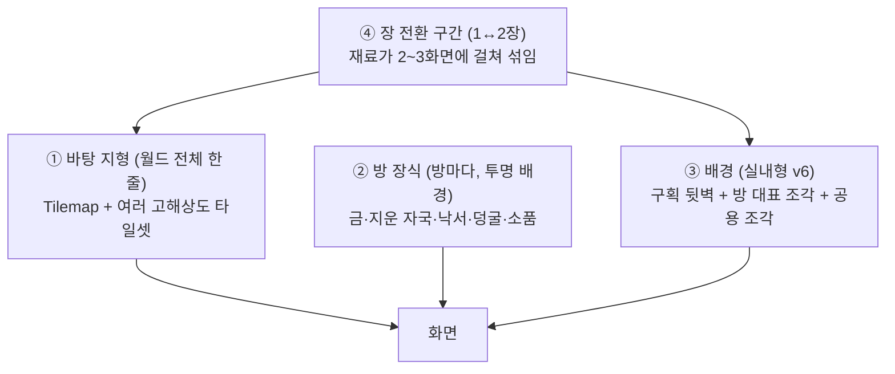
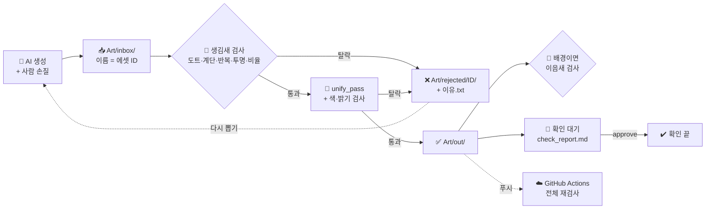

# 19. 에셋 목록 · 완성 프롬프트

> 상태: ✅ 목록·규칙 확정 (1·2장 기준 **594개**) · ✅ v10: 아트 v5 · 고해상도 타일맵 256px/칸 · **부드러운 그래픽 디자인 · 선명한 선 · 게임 그림체 · 미드키 · 픽셀·도트 금지 · 부드러운 가장자리 · 반복 없는 벽/바닥 · 끊김 없이 이어지는 월드 · 자동 검증** · 💡 3~5장은 맵 설계 후 추가
> **아트 v5:** 할로우 나이트의 실루엣·공간 깊이·분위기를 참고한다. 반복 재료는 중립 조명, 국소광·안개는 장면에서 추가한다. 기존 밝기 검사·종이색 후처리는 v3/v4 기준이므로 새 골든 장면에 맞춘 재조정 전에는 v5 스타일 승인에 사용하지 않는다.
> 기준: [16 아트 컨셉](16_아트_컨셉.md) · [17 AI 아트 프롬프트](17_AI_아트_프롬프트.md) · [18 애니메이션](18_애니메이션_프롬프트.md)
> 이 문서 하나로 **"무엇을 · 어떤 프롬프트로 · 무엇을 참고해서 · 어디에 저장하는지"**가 다 정해져. 완성 프롬프트 전문은 `Art/ALL_PROMPTS.md` (복사용) / `Art/prompts_full.csv` (스프레드시트용).
> 이 문서는 `python Tools/build_doc19.py`로 자동 생성돼. 손으로 고치지 말고 스크립트를 고쳐.

---

## 0. 가장 중요한 것: 모든 그림이 한 게임처럼 보이게 하는 **4중 잠금**

> 플레이어 · 보스 · 몬스터 · 배경 · 구조물 · 이펙트 · UI 전부 **조명 · 질감 · 패턴 · 가장자리 · 명도 · 그림체**가 같아야 해. 프롬프트 하나로는 절대 안 돼서 네 겹으로 잠가.

| 잠금 | 무엇 | 어떻게 지키나 |
|---|---|---|
| 🔒 ① **프롬프트 블록** | 모든 에셋 프롬프트 끝에 똑같은 **MSB v5 + UNIFY v5**가 붙음 | `Tools/build_prompts.py`가 자동 조립. 사람이 손으로 고치지 않음 |
| 🔒 ② **골든 레퍼런스** | 모든 생성에 **같은 기준 그림 5장 + 그 장 2장**을 레퍼런스로 넣음 | 목록의 `레퍼런스` 칸 그대로 |
| 🔒 ③ **통일 후처리** | 채택한 모든 그림을 **같은 설정으로** 후처리 (채도 상한 · 종이색 · 선색 · 레이어 대비 · **선택적 미세 종이 결**) | `Tools/unify_pass.py` |
| 🔒 ④ **한 화면 검수** | 새 에셋을 **골든 G1과 실제 게임 화면 위에 같이** 놓고 확인 | §7 검수 |

### MSB v5 블록 (모든 프롬프트에 자동 포함)
```
high-resolution illustrated 2D side-scrolling metroidvania game art, atmospheric subterranean fantasy inside an original unfinished sketchbook world, clean confident contours and smooth anti-aliased curves, strong readable silhouettes, simplified expressive characters, broad quiet shapes, restrained surface detail, layered caverns and architectural depth, desaturated region-specific colors with selective warm accents, calm melancholy and mysterious exploration, crisp gameplay plane against soft low-contrast distant layers, darker foreground framing, a small chalk-white protagonist clearly separated from the environment, environmental storytelling through abandoned art-supply structures, unfinished areas shown as deliberate clean missing shapes or dashed contours, no rough sketch treatment, no visible pixel-art grid, no repeated texture stamps; scene illustrations use restrained localized pools of light and atmospheric haze, while reusable tiles and isolated sprites use neutral lighting so room lighting can be composed separately
```

### UNIFY v5 블록 (모든 프롬프트에 자동 포함)
```
UNIFIED LOOK: consistent clean ink-gray contour language, smooth filled shapes, line weight strongest on gameplay silhouettes and quieter in the background, controlled two-tone local shading, sparse motifs inspired by each region material rather than all-over hatching, paper grain optional and almost invisible, no mandatory graph-paper overlay; DEPTH AND LIGHT: distant layers lose detail and contrast into the room atmosphere, middle-distance forms establish scale, foreground silhouettes frame rather than hide the route, local scene lights guide attention without washing out hazards, subtle haze and rim separation allowed in the scene pass, never bake a repeated spotlight or cast shadow into tiling material; VALUES: use a room-specific low-to-mid-key palette with readable floor edges, enemies and projectiles, the protagonist remains a clear light focal point, no universal paper brightness target, preserve detail in shadows and avoid blown-out highlights; original characters and art-supply architecture, smooth high-resolution illustration, no low-resolution enlargement, no messy strokes, no decorative noise competing with combat
```

| 통일 항목 | 규칙 | 프롬프트 | 후처리 |
|---|---|---|---|
| 💡 조명 | 재사용 타일은 중립 조명. 방 전체 국소광·얇은 안개·림 분리는 장면에서 추가 | MSB v5 + UNIFY v5 | 반복 타일에 빛 얼룩·그림자 굽기 금지 |
| 📄 질감 | 종이 결은 선택적·미세하게. 화면의 주인공은 실루엣과 공간 | MSB v5 | 종이 결 전면 덮기·모눈 강제 금지 |
| ✏️ 무늬 · 음영 | 재료 모티프는 성기게, 넓은 면 음영과 강한 실루엣 | UNIFY v5 | 균일한 사선 해칭·장식 과밀 금지 |
| ✒️ 선 | **선명하고 깔끔한 외곽선** · 같은 짙은 잉크 회색 · 둥근 끝 · 레이어별 같은 굵기 · 흔들림 없음 (손그림 ❌) | MSB v5 + UNIFY v5 + NEG `sketchy lines, rough pencil strokes, wobbly lines…` | 가장 어두운 선을 장 선색으로 치환 |
| 🎨 색 온도 | 같은 낮은 채도, 장마다 상한 | 재료 블록 + 팔레트 단어 | 장별 채도 상한 |
| 🌊 **가장자리** | **픽셀·도트 절대 금지.** 부드럽게 안티앨리어싱된 **선명한** 가장자리, 모서리는 둥글게 | MSB v5 + UNIFY v5 + NEG 맨 앞 `pixel art, pixelated, 8-bit, dot art, aliased jagged edges…` | 확대해서 계단 가장자리 있으면 탈락. Unity는 Bilinear/Trilinear + 밉맵 (Point 금지) |
| 🔁 **반복 없음** | 벽·바닥에 **같은 무늬가 두 번 보이면 안 됨**. 도장 찍은 듯한 벽돌·격자 무늬 금지 | UNIFY v5 + NEG `repeating tile pattern, tiled texture, copy-pasted stamps…` | 구역별 바탕 A~C + 표면 무늬 4종 이상 + 방마다 다른 장식 (§1) |
| 🎮 **게임 그림체** | 현실적인 그림 ❌ → 게임 화면처럼 단순·정돈, 디테일은 큰 덩어리 | MSB v5 `stylized … game art, not realistic` + UNIFY v5 `GAME LOOK` + NEG `realistic painting, hyper-detailed…` | 사람 검수 (§7-1) |
| 🌗 **방 분위기** | 낮은~중간 명도, 거리별 대비, 주인공·적·탄 분리 | MSB v5 + UNIFY v5 | 기존 평균 밝기 검사는 참고값. 최종 장면 가독성 검수 |
| 🔗 **이어짐** | 방·구역·장 경계에서 지형·배경이 **끊기지 않음** | 뒷벽 `edges wrap seamlessly` + 뒷벽 이음 | 바탕은 월드 전체 한 재료 세트, 배경 뒷벽은 변형 섞기 + 이음 (§1) |
| 🏠 **실내** | 천장·바닥 있는 책 속 공간 → 배경도 **하늘·지평선 없는 뒷벽 + 세트 조각**. 바깥은 구멍·창문 조각 안으로만 | BG_WALL `NO sky, NO horizon` + NEG `sky, horizon, open landscape, meadow…` | 사람 검수 (§7-1) |


> 왼쪽: 일부러 튀게 만든 그림 (순백 바탕 · 순흑 선 · 쨍한 색 · 흰 주인공) → 오른쪽: `unify_pass` 2장 설정 통과 후 (**미드키 종이색** · 크레파스 갈색 선 · 채도 낮춤 · 종이 결 · **주인공만 분필 흰색으로 가장 밝게**). `python Tools/unify_pass.py --demo`로 다시 만들 수 있음

---

## 1. 지형 구조: **고해상도 다중 타일맵 + 방 장식**

> **현행 해상도 기준:** [21 고해상도 타일맵 규격](21_고해상도_타일맵_규격.md). 지형 셀 **256×256px, PPU 256**; 큰 배경·방 전체 오버레이 PPU 128. 기존 16은 HTML 논리 단위다. 아래 589개는 제작 원본 목록으로, 최종 타일 셀/아틀라스 수량과 다르다.

> **다중 타일맵:** 충돌·채움·표면 무늬·가장자리·장식 레이어를 분리한다. 구역별 채움 A~C에 4가지 이상의 표면 무늬 계열을 섞고, 인접 구획의 같은 계열 반복을 피한다. 여러 타일에 걸친 무늬와 둥근 모서리로 픽셀·격자 느낌을 억제한다. 배치 규칙과 현재 HTML 적용 범위는 [16 문서 §8](16_아트_컨셉.md#8-지형--타일)을 따른다.

> ❌ 방마다 통째로 그리면 방과 방 사이에서 무늬 밀도·선 굵기·종이 톤이 **뚝 끊겨.** 우리는 1장→2장도 책장 없이 쭉 이어지니까 더 티 나.
> ✅ 그래서 **연결감은 하나로 이어진 바탕이**, **반복 없는 느낌과 방 개성은 장식이** 책임지게 나눴어.



| 층 | 무엇 | 어떻게 이어지나 | 어떻게 반복을 막나 |
|---|---|---|---|
| ① **바탕 지형** | `1 지형` — **구역마다** 속 채움 3장 + 가장자리 띠 3종(디테일·옅은 색 기운이 구역마다 다름) + 장 공용 모서리·발판·특수 + **구역 사이 지형 이음** `TL-` | 월드 전체가 **같은 재료 세트 하나**로 깔림 → 방 경계가 존재하지 않음 | **4방향 이어짐 + 공통 테두리 띠**를 가진 A~C와 표면 무늬 계열 4종 이상을 섞어 반복 억제 (돌리기·뒤집기 금지). 같은 장이 이웃하지 않게. 가장자리 띠는 양 끝이 이어져서 길이 상관없이 반복 |
| ② **방 장식** | `3 방 장식` — 방 하나당 **투명 배경 장식 한 장** | 바탕 위에 얹기만 하니까 경계에서 끊길 게 없음. 방 경계 근처는 장식을 비워 둠 | 방마다 다른 금·자국·낙서·뿌리·소품 → 같은 바닥이라도 **매번 다르게 보임** |
| ③ **배경** | `2 배경` — **배경 구획 22개**(구역마다 2~3개)의 뒷벽(정사각, 변형 3장, 위아래 방향 없음) + **방 대표 조각 56개**(그 방에만) + 구역 공용 조각 40개 + 전경 테두리 + 뒷벽 이음 `BL-` | 뒷벽은 지형 채움처럼 섞어 깔아서 어떤 크기 방이든 채움. 맞닿은 구획 쌍마다 뒷벽 전환 질감 1장 → `seam_check.py`로 판정 (§7-3) | 구획마다 뒷벽이 다르고 방마다 대표 조각이 달라서 같은 그림이 이어지지 않음 |
| ④ **장 전환** | `TL-DE-*` 지형 이음(속 + 바닥·천장 띠) + `BL-D3E1-wall` 배경 이음 + `R-border-1-2` 장식 | 연필 재료가 **2~3화면에 걸쳐** 크레파스로 덧칠됨. 프로토타입의 경계 색 섞기와 같은 개념 | — |

**판정과 그림은 따로:**
- 충돌은 **1유닛 격자**. 그림은 **256px 고해상도 Tilemap/Rule Tile**과 가장자리·장식 레이어로 구성한다. Sprite Shape는 긴 곡선 구간의 선택 보조 도구다
- 그림 윤곽은 판정 선에서 **최대 0.25유닛(64px 원화 @ PPU 256)** 까지만 어긋남
- **발 딛는 윗면 높이는 판정과 정확히 같게** (0.03125유닛 이내 = 1080p 2px = PPU 256 원화 8px)
- 벽 옆면·천장은 조금 더 자유롭게 울퉁불퉁해도 됨 (플레이어가 거기 서지 않으니까)

**대신 비용 ⚠️**
- 방 장식은 **투명 배경**으로 뽑아야 해. AI가 투명 배경을 잘 못해서, 종이색 배경으로 나오면 **배경 지우기**(누끼) 단계가 추가돼 (§3 5번)
- 구역별 바탕 A~C와 표면 무늬 4종 이상이 넓게 깔리니까 **이 재료 세트의 품질이 게임 인상의 절반**이야. 골든급으로 공들이기 (골든 G2·C1-G2·C2-G2 바로 다음 순서)

---

## 2. 폴더 구조
```
Art/
├─ inbox/                 🆕 여기에 그림을 넣으면 자동 검증 (파일 이름 = 에셋 ID) · anim/ = 애니메이션 폴더째
├─ rejected/              🆕 자동 탈락 (ID별 폴더 + 이유.txt)
├─ status.json            🆕 에셋별 상태 (자동 통과 · 확인 끝 · 탈락)
├─ check_report.md        🆕 진행 현황 · 사람 확인 대기 목록 (자동 생성)
├─ asset_catalog.json     에셋 목록 + 블록 원문 (기계용, 자동 생성)
├─ bg_links.json         지도에서 찾은 맞닿은 구역 쌍 (seam_check.py links, 자동 생성)
├─ seam_report.md        배경 이음새 검사 결과 (seam_check.py check, 자동 생성)
├─ seam_preview/         이음새 미리보기 (점선 표시)
├─ bg_unity_manifest.json 🆕 방마다 깔 배경(뒷벽 칸·이음·세로 뒷벽·조각) → 유니티가 그대로 읽음 (bg_manifest.py, 자동 생성)
├─ bg_room_report.md     🆕 방별 배경 준비 상태 (bg_manifest.py check)
├─ bg_preview/           🆕 방별 뒷벽 깔기 미리보기 (bg_manifest.py preview, git 제외)
├─ prompts_full.csv       에셋별 완성 프롬프트 (스프레드시트용, 자동 생성)
├─ ALL_PROMPTS.md         분류별 완성 프롬프트 (복사용, 자동 생성)
├─ tile/                 인페인팅 마스크 (tile_kit.py mask)
├─ control/               방 장식 위치 참고 이미지 57장 (자동 생성, 1920×1080, 부드러운 윤곽)
├─ golden/                골든 이미지 (확정본)
├─ raw/                   inbox에 넣은 원본 보관 (ID별, 시각 붙여서)
└─ out/                   자동 검증 + 후처리 통과본 (파일 경로는 목록의 '파일' 칸) · GitHub에 올라가는 건 여기
   ├─ ch1/terrain/ …      바탕 지형 재료
   ├─ ch1/decor/ …        방 장식 (투명 PNG)
   ├─ ch1/bg/ …           구획 뒷벽(A1_wall_a~c …) · 공용 조각(A_set_*) · 전경
   ├─ ch1/bg/rooms/ …     방 대표 조각 (room_01 …, 높은 방 room_14b·c)
   ├─ ch1/bg/tall/ …      세로 전용 뒷벽
   ├─ link/ …             뒷벽 이음
   └─ border/ …           1↔2장 전환 재료·장식
Tools/
├─ build_prompts.py       블록·목록 → 완성 프롬프트 생성
├─ build_doc19.py         목록 → 이 문서 생성
├─ make_controls.py       통합 지도 → 방별 컨트롤 이미지
├─ unify_pass.py          통일 후처리
├─ paper_grain.png        공용 종이 결 (바꾸지 말 것)
├─ art_check.py          🆕 자동 검증 파이프라인 (§8)
├─ art_watch.bat         🆕 더블클릭 = inbox 감시 시작 (Windows)
├─ seam_check.py         배경 이음새 검사 (§7-3)
├─ tile_kit.py           🆕 4방향 이어지는 배경 만들기 (마스크·밑그림·반 칸 밀기·미리보기·검사)
├─ bg_manifest.py        🆕 방별 배경 배치표 · 준비 상태 · 미리보기 (20 문서)
├─ build_doc20.py        🆕 20 문서 생성
├─ unity/                🆕 유니티 스크립트 (BgParallax · BgSetPiece · BgPaperColor · UnfinArtImporter · BgRoomBuilder) → Unfin/Assets/Scripts 로 복사
└─ anim_check.py          애니메이션 겹침 검사 (18 문서)
.github/workflows/art-check.yml   🆕 푸시할 때마다 Art/out 전체 재검사 (GitHub Actions)
```

## 3. 한 에셋 만드는 순서 (모든 에셋 공통)

> 🤖 = 자동 (`art_check.py`가 함) · 🙋 = 사람

| # | 단계 | 누가 | 내용 |
|---|---|---|---|
| 1 | 목록에서 고르기 | 🙋 | `Art/ALL_PROMPTS.md`에서 ID로 찾기 (예: `R1-09`) |
| 2 | 레퍼런스 준비 | 🙋 | `레퍼런스` 칸의 골든 이미지 (+ 컨트롤 이미지) |
| 3 | 생성 | 🙋/AI | 완성 프롬프트 + 네거티브 그대로. **📐 줄의 'AI에 요청할 비율'로** 뽑기 (1:1·3:2·2:3·16:9, 한 변 1024~1536) → `python Tools/tile_kit.py prep 그림 --id <ID>`로 최종 비율로 자르고 키우기 (최종은 일러스트용 업스케일러 권장, [17](17_AI_아트_프롬프트.md) 📐). 4~8장 뽑기. 후보 거르기는 `python Tools/art_check.py file 후보.png --id R1-09` |
| 4 | 사람 손질 | 🙋 | 판정 선(땅 윗면·벽·적 몸통) 덧그리기, 기능색 칠하기, 글자·이상한 부분 지우기. **방 장식·소품·캐릭터는 배경 지우기(투명 PNG)** |
| 5 | **inbox에 넣기** | 🙋 | `Art/inbox/R1-09.png` (이름 = ID, 뒤에 `_v2` 같은 꼬리 OK). 감시를 켜 두면(`art_watch.bat`) 넣는 즉시 6~8 자동 |
| 6 | 생김새 검사 | 🤖 | 비율 · 해상도 · 도트 확대 · 밝기 단계 · 계단 가장자리 · 투명 배경/가장자리 · 반복 무늬 (§8) |
| 7 | 통일 후처리 + 색 검사 | 🤖 | `unify_pass` (장·레이어 자동, 미드키 종이색·분필 흰색 상한) → 채도 상한 · **밝기 대역 · 순백 영역** · 순흑 선 |
| 8 | 분류 · 이음새 | 🤖 | 통과 → `Art/out/<파일 칸>` / 탈락 → `Art/rejected/<ID>/` + 이유. 배경이면 짝 패널이 다 있을 때 **이음새 자동 검사** |
| 9 | 한 화면 검수 | 🙋 | `Art/check_report.md`의 **확인 대기** 목록을 골든 G1 + 실제 게임 화면에서 확인 (§7-2) → `python Tools/art_check.py approve R1-09` |
| 10 | 푸시 | 🙋 → 🤖 | 커밋·푸시하면 **GitHub Actions가 `Art/out` 전체를 다시 검사** (빠뜨린 것·손으로 넣은 것도 잡음) |

> ⚠️ 해상도가 모자라 업스케일할 땐 **부드러운 그림용 업스케일러**(예: 4x-UltraSharp, ESRGAN 일반 사진/일러스트용)만. **픽셀아트용 업스케일러 · 최근접(Nearest) 확대 금지** — 계단 가장자리가 생겨.

## 4. 프롬프트 조립 순서 (v4)
```
[무엇을 SUBJECT] , [캐릭터 고정 CHAR-LOCK (플레이어만)] , [에셋 종류 TYPE] , [재료 MAT + 팔레트 단어] , [MSB v5] , [UNIFY v5]
네거티브: [NEG 공통 (픽셀·반복 금지가 맨 앞)] + [종류별 NEG]
```
- 이미지 AI는 **앞쪽 단어를 더 강하게** 반영해서 "무엇을"을 맨 앞에 둠. 그림체 통일은 뒤쪽 블록 + 골든 레퍼런스 + 후처리가 책임짐
- 프롬프트가 길어서 Stable Diffusion은 **긴 프롬프트 나눠 넣기(chunking)**가 켜져 있어야 함 (ComfyUI·A1111 기본 지원). 잘리면 MSB·UNIFY가 빠져서 그림체가 흔들림
- 네거티브의 픽셀 금지 단어는 **절대 빼지 말 것**. "game art"라는 말만 들어가도 AI가 픽셀 게임 그림으로 끌려가는 경우가 많아

### NEG 공통 (원문)
```
pixel art, pixelated, 8-bit, 16-bit, retro game sprite, dot art, dithering, aliased jagged edges, stair-step edges, blocky, low resolution, mosaic, grid of square tiles, repeating tile pattern, tiled texture, copy-pasted stamps, identical repeated bricks, sketchy lines, rough pencil strokes, wobbly lines, messy hatching, scribbly texture, charcoal smudges, painterly brush strokes, rough texture, photorealistic, realistic painting, hyper-detailed, intricate realistic texture, realistic rendering, matte painting, realistic lighting, 3D render, CGI, voxel, generic corporate flat icons, clip art, stock vector illustration, anime cel shading, glossy, shiny, metallic, chrome, neon overload, excessive bloom, lens flare, glossy specular highlight, inconsistent baked lighting between neighboring tiles, strong rainbow gradients, heavy drop shadow, pure black outline, high contrast HDR, overexposed, high-key, washed out, bright white paper, blown-out highlights, unreadable crushed shadows, saturated rainbow colors, gore, text, letters, numbers, logo, watermark, signature, UI, frame border, blurry, jpeg artifacts, perspective view, isometric, top-down
```

## 5. 방 장식 위치 참고 이미지 규칙 (`Art/control/`)

> 방 장식은 지형을 **그리지 않고** 장식만 그려. 이 이미지는 "땅이 어디 있는지" 알려줘서 장식이 땅 가장자리에 붙고 공중·발판 위를 막지 않게 하는 용도야.

| 색 | 뜻 |
|---|---|
| 짙은 회색 | 단단한 땅·벽 → 장식은 **이 가장자리를 따라** |
| 밝은 종이색 | 빈 공간 (걸어 다니는 곳) → **장식 금지** |
| 중간 회색 둥근 막대 | 통과 발판 (주황 = 녹는 발판, 갈색 = 무너지는 발판) → **윗면 비워 두기** |
| 검보라 / 파랑 | 위험(잉크·늪) / 물 |
| 붉은 회색 · 초록 회색 · 밀랍색 · 노랑 · 보라 | 낙서 벽 · 흑연 덩굴 · 밀랍 벽 · 과녁 문 · 물감 문 (이건 `1 지형` SPECIAL 그림이 따로 있음) |

- 윤곽은 부드러운 곡선 (AI가 네모 계단을 따라 그리지 않게)
- ControlNet 세기 **0.4~0.6** 권장 (장식 위치만 맞추면 돼서 예전 덧칠 방식보다 약하게)
- 방 + 둘레 3타일을 **16:9로 맞춰** 자름. **둘레 3타일(겹치는 곳)에는 장식을 그리지 않음** → 이웃 방 장식과 겹치지 않게
- 지도가 바뀌면 `python Tools/make_controls.py`로 다시 만들기

## 6. 에셋 목록 (1·2장 · 594개)
| 분류 | 개수 | 먼저 할 것 |
|---|---|---|
| 0 골든 | 9 | ⭐ **가장 먼저**. 이게 확정돼야 나머지를 뽑음 |
| 1 지형 | 95 | 골든 확정 직후 · ⭐ **구역별 고해상도 재료 세트가 게임 인상의 절반** |
| 2 배경 | 205 | 지형 다음 · 구획 뒷벽 → 방 대표 조각 → 공용 조각 → 뒷벽 이음 → `seam_check` |
| 3 방 장식 | 57 | 지형·배경 후 · 투명 배경 |
| 4 소품·구조물 | 26 |  |
| 5 플레이어 키 포즈 | 58 | G3 확정 후 |
| 6 적 | 78 | 시트 → 키 포즈 순 |
| 7 엘리트 | 21 |  |
| 8 보스 | 14 |  |
| 9 이펙트 | 15 |  |
| 10 UI | 13 |  |
| 11 키 아트 | 3 | 마지막 |

### 0 골든 (9)
| ID | 파일 (`Art/out/`) | 무엇 (프롬프트 앞부분) | 📐 AI 요청 → 최종 | 레퍼런스 · 컨트롤 |
|---|---|---|---|---|
| G1 | `golden/G1_scene.png` | wide game screenshot-like scene, a small chalk-white child figure standing on smooth graphite-themed rock ledg… | 16:9 (안 되면 3:2) → 3840×2160 | G1 G2 G3 G4 G5 C1-G1 C1-G2 |
| G2 | `golden/G2_ground.png` | solid ground made of clean diagonal pencil-stripe pattern: a bold irregular top contour, a dense dark surface… | 1:1 → 2048×2048 | G1 G2 G3 G4 G5 C1-G1 C1-G2 |
| G3 | `golden/G3_player_sheet.png` | character sheet of the protagonist: the same tiny protagonist in every image: round head about 45% of total he… | 16:9 (안 되면 3:2) → 1024×576 | G1 G2 G3 G4 G5 |
| G4 | `golden/G4_enemy.png` | a small graphite worm creature made of segmented pencil-lead pieces, one pointed tip at the front | 1:1 → 1024×1024 | G1 G2 G3 G4 G5 C1-G1 C1-G2 |
| G5 | `golden/G5_prop.png` | a pencil-holder shaped stone statue holding three pencils, used as a save point | 1:1 → 1024×1024 | G1 G2 G3 G4 G5 C1-G1 C1-G2 |
| C1-G1 | `golden/C1_G1_scene.png` | pencil forest mine tunnel scene with graphite deposits, plank platforms and a pool of ink | 16:9 (안 되면 3:2) → 3840×2160 | G1 G2 G3 G4 G5 C1-G1 C1-G2 |
| C1-G2 | `golden/C1_G2_ground.png` | ground texture of a graphite mine wall, dense stripe pattern with graphite flecks | 1:1 → 2048×2048 | G1 G2 G3 G4 G5 C1-G1 C1-G2 |
| C2-G1 | `golden/C2_G1_scene.png` | crayon cavern under the sunset hills, thick crayon-painted rock, cracks lined with muted sunset orange, meltin… | 16:9 (안 되면 3:2) → 3840×2160 | G1 G2 G3 G4 G5 C2-G1 C2-G2 |
| C2-G2 | `golden/C2_G2_ground.png` | ground texture of overpainted crayon earth, layered crossing crayon stripe motifs | 1:1 → 2048×2048 | G1 G2 G3 G4 G5 C2-G1 C2-G2 |

### 1 지형 (95)
> 🔁 **월드 전체에 이어 깔리는 바탕.** `TZ?-구역-` = **구역별 지형** (속 채움 A~C는 4방향 이어짐 + 공통 테두리 띠, fill_a가 원본 · 띠는 양 끝 이어짐 · 돌리기·뒤집기 금지) · `TL-` = **구역 사이 지형 이음** · `T?-` = 장 공용 모서리·발판·특수. 1↔2장 경계는 `TL-DE-*` (§1)
| ID | 파일 (`Art/out/`) | 무엇 (프롬프트 앞부분) | 📐 AI 요청 → 최종 | 레퍼런스 · 컨트롤 |
|---|---|---|---|---|
| TZ1-A-fill_a | `ch1/terrain/A/ch1_A_fill_a.png` | interior of solid ground in the crumpled paper burrow: layered creased paper sheets pressed together, soft pap… | 1:1 → 2048×2048 | G1 G2 G3 G4 G5 C1-G1 C1-G2 |
| TZ1-A-fill_b | `ch1/terrain/A/ch1_A_fill_b.png` | interior of solid ground in the crumpled paper burrow: layered creased paper sheets pressed together, soft pap… | 1:1 → 2048×2048 | G1 G2 G3 G4 G5 C1-G1 C1-G2 |
| TZ1-A-fill_c | `ch1/terrain/A/ch1_A_fill_c.png` | interior of solid ground in the crumpled paper burrow: layered creased paper sheets pressed together, soft pap… | 1:1 → 2048×2048 | G1 G2 G3 G4 G5 C1-G1 C1-G2 |
| TZ1-A-edge_top | `ch1/terrain/A/ch1_A_edge_top.png` | walkable top surface edge of ground, the boldest contour on top so the floor reads instantly, surface band wit… | 3:2 → 2048×512 | G1 G2 G3 G4 G5 C1-G1 C1-G2 |
| TZ1-A-edge_bottom | `ch1/terrain/A/ch1_A_edge_bottom.png` | bottom edge of a ceiling, bold contour on the bottom with a few sagging lumps, surface band with peeling paper… | 3:2 → 2048×512 | G1 G2 G3 G4 G5 C1-G1 C1-G2 |
| TZ1-A-edge_side | `ch1/terrain/A/ch1_A_edge_side.png` | vertical wall edge (drawn horizontally, will be rotated), bold contour with chips and small ledges, surface ba… | 3:2 → 2048×512 | G1 G2 G3 G4 G5 C1-G1 C1-G2 |
| TZ1-B-fill_a | `ch1/terrain/B/ch1_B_fill_a.png` | interior of solid ground in the graphite mine: dense graphite rock stripe pattern with matte ore seams and chi… | 1:1 → 2048×2048 | G1 G2 G3 G4 G5 C1-G1 C1-G2 |
| TZ1-B-fill_b | `ch1/terrain/B/ch1_B_fill_b.png` | interior of solid ground in the graphite mine: dense graphite rock stripe pattern with matte ore seams and chi… | 1:1 → 2048×2048 | G1 G2 G3 G4 G5 C1-G1 C1-G2 |
| TZ1-B-fill_c | `ch1/terrain/B/ch1_B_fill_c.png` | interior of solid ground in the graphite mine: dense graphite rock stripe pattern with matte ore seams and chi… | 1:1 → 2048×2048 | G1 G2 G3 G4 G5 C1-G1 C1-G2 |
| TZ1-B-edge_top | `ch1/terrain/B/ch1_B_edge_top.png` | walkable top surface edge of ground, the boldest contour on top so the floor reads instantly, surface band wit… | 3:2 → 2048×512 | G1 G2 G3 G4 G5 C1-G1 C1-G2 |
| TZ1-B-edge_bottom | `ch1/terrain/B/ch1_B_edge_bottom.png` | bottom edge of a ceiling, bold contour on the bottom with a few sagging lumps, surface band with jagged graphi… | 3:2 → 2048×512 | G1 G2 G3 G4 G5 C1-G1 C1-G2 |
| TZ1-B-edge_side | `ch1/terrain/B/ch1_B_edge_side.png` | vertical wall edge (drawn horizontally, will be rotated), bold contour with chips and small ledges, surface ba… | 3:2 → 2048×512 | G1 G2 G3 G4 G5 C1-G1 C1-G2 |
| TZ1-C-fill_a | `ch1/terrain/C/ch1_C_fill_a.png` | interior of solid ground in the sketch tree interior: curved wood grain and growth-ring stripe pattern, small… | 1:1 → 2048×2048 | G1 G2 G3 G4 G5 C1-G1 C1-G2 |
| TZ1-C-fill_b | `ch1/terrain/C/ch1_C_fill_b.png` | interior of solid ground in the sketch tree interior: curved wood grain and growth-ring stripe pattern, small… | 1:1 → 2048×2048 | G1 G2 G3 G4 G5 C1-G1 C1-G2 |
| TZ1-C-fill_c | `ch1/terrain/C/ch1_C_fill_c.png` | interior of solid ground in the sketch tree interior: curved wood grain and growth-ring stripe pattern, small… | 1:1 → 2048×2048 | G1 G2 G3 G4 G5 C1-G1 C1-G2 |
| TZ1-C-edge_top | `ch1/terrain/C/ch1_C_edge_top.png` | walkable top surface edge of ground, the boldest contour on top so the floor reads instantly, surface band wit… | 3:2 → 2048×512 | G1 G2 G3 G4 G5 C1-G1 C1-G2 |
| TZ1-C-edge_bottom | `ch1/terrain/C/ch1_C_edge_bottom.png` | bottom edge of a ceiling, bold contour on the bottom with a few sagging lumps, surface band with hanging bark… | 3:2 → 2048×512 | G1 G2 G3 G4 G5 C1-G1 C1-G2 |
| TZ1-C-edge_side | `ch1/terrain/C/ch1_C_edge_side.png` | vertical wall edge (drawn horizontally, will be rotated), bold contour with chips and small ledges, surface ba… | 3:2 → 2048×512 | G1 G2 G3 G4 G5 C1-G1 C1-G2 |
| TZ1-D-fill_a | `ch1/terrain/D/ch1_D_fill_a.png` | interior of solid ground in the tangled root depths: knotted tangled root fibers and scribble stripe pattern,… | 1:1 → 2048×2048 | G1 G2 G3 G4 G5 C1-G1 C1-G2 |
| TZ1-D-fill_b | `ch1/terrain/D/ch1_D_fill_b.png` | interior of solid ground in the tangled root depths: knotted tangled root fibers and scribble stripe pattern,… | 1:1 → 2048×2048 | G1 G2 G3 G4 G5 C1-G1 C1-G2 |
| TZ1-D-fill_c | `ch1/terrain/D/ch1_D_fill_c.png` | interior of solid ground in the tangled root depths: knotted tangled root fibers and scribble stripe pattern,… | 1:1 → 2048×2048 | G1 G2 G3 G4 G5 C1-G1 C1-G2 |
| TZ1-D-edge_top | `ch1/terrain/D/ch1_D_edge_top.png` | walkable top surface edge of ground, the boldest contour on top so the floor reads instantly, surface band wit… | 3:2 → 2048×512 | G1 G2 G3 G4 G5 C1-G1 C1-G2 |
| TZ1-D-edge_bottom | `ch1/terrain/D/ch1_D_edge_bottom.png` | bottom edge of a ceiling, bold contour on the bottom with a few sagging lumps, surface band with hanging tangl… | 3:2 → 2048×512 | G1 G2 G3 G4 G5 C1-G1 C1-G2 |
| TZ1-D-edge_side | `ch1/terrain/D/ch1_D_edge_side.png` | vertical wall edge (drawn horizontally, will be rotated), bold contour with chips and small ledges, surface ba… | 3:2 → 2048×512 | G1 G2 G3 G4 G5 C1-G1 C1-G2 |
| TZ2-E-fill_a | `ch2/terrain/E/ch2_E_fill_a.png` | interior of solid ground in the sunset crayon caverns: thick layered crayon earth with crossing stripe motifs,… | 1:1 → 2048×2048 | G1 G2 G3 G4 G5 C2-G1 C2-G2 |
| TZ2-E-fill_b | `ch2/terrain/E/ch2_E_fill_b.png` | interior of solid ground in the sunset crayon caverns: thick layered crayon earth with crossing stripe motifs,… | 1:1 → 2048×2048 | G1 G2 G3 G4 G5 C2-G1 C2-G2 |
| TZ2-E-fill_c | `ch2/terrain/E/ch2_E_fill_c.png` | interior of solid ground in the sunset crayon caverns: thick layered crayon earth with crossing stripe motifs,… | 1:1 → 2048×2048 | G1 G2 G3 G4 G5 C2-G1 C2-G2 |
| TZ2-E-edge_top | `ch2/terrain/E/ch2_E_edge_top.png` | walkable top surface edge of ground, the boldest contour on top so the floor reads instantly, surface band wit… | 3:2 → 2048×512 | G1 G2 G3 G4 G5 C2-G1 C2-G2 |
| TZ2-E-edge_bottom | `ch2/terrain/E/ch2_E_edge_bottom.png` | bottom edge of a ceiling, bold contour on the bottom with a few sagging lumps, surface band with melted crayon… | 3:2 → 2048×512 | G1 G2 G3 G4 G5 C2-G1 C2-G2 |
| TZ2-E-edge_side | `ch2/terrain/E/ch2_E_edge_side.png` | vertical wall edge (drawn horizontally, will be rotated), bold contour with chips and small ledges, surface ba… | 3:2 → 2048×512 | G1 G2 G3 G4 G5 C2-G1 C2-G2 |
| TZ2-F-fill_a | `ch2/terrain/F/ch2_F_fill_a.png` | interior of solid ground in the wax workshop: smooth wax-beige plaster with drawn drip stains and soot smudges… | 1:1 → 2048×2048 | G1 G2 G3 G4 G5 C2-G1 C2-G2 |
| TZ2-F-fill_b | `ch2/terrain/F/ch2_F_fill_b.png` | interior of solid ground in the wax workshop: smooth wax-beige plaster with drawn drip stains and soot smudges… | 1:1 → 2048×2048 | G1 G2 G3 G4 G5 C2-G1 C2-G2 |
| TZ2-F-fill_c | `ch2/terrain/F/ch2_F_fill_c.png` | interior of solid ground in the wax workshop: smooth wax-beige plaster with drawn drip stains and soot smudges… | 1:1 → 2048×2048 | G1 G2 G3 G4 G5 C2-G1 C2-G2 |
| TZ2-F-edge_top | `ch2/terrain/F/ch2_F_edge_top.png` | walkable top surface edge of ground, the boldest contour on top so the floor reads instantly, surface band wit… | 3:2 → 2048×512 | G1 G2 G3 G4 G5 C2-G1 C2-G2 |
| TZ2-F-edge_bottom | `ch2/terrain/F/ch2_F_edge_bottom.png` | bottom edge of a ceiling, bold contour on the bottom with a few sagging lumps, surface band with hanging wax d… | 3:2 → 2048×512 | G1 G2 G3 G4 G5 C2-G1 C2-G2 |
| TZ2-F-edge_side | `ch2/terrain/F/ch2_F_edge_side.png` | vertical wall edge (drawn horizontally, will be rotated), bold contour with chips and small ledges, surface ba… | 3:2 → 2048×512 | G1 G2 G3 G4 G5 C2-G1 C2-G2 |
| TZ2-G-fill_a | `ch2/terrain/G/ch2_G_fill_a.png` | interior of solid ground in the underground painted gorge: uneven paint strata bands in muted blue, red and ye… | 1:1 → 2048×2048 | G1 G2 G3 G4 G5 C2-G1 C2-G2 |
| TZ2-G-fill_b | `ch2/terrain/G/ch2_G_fill_b.png` | interior of solid ground in the underground painted gorge: uneven paint strata bands in muted blue, red and ye… | 1:1 → 2048×2048 | G1 G2 G3 G4 G5 C2-G1 C2-G2 |
| TZ2-G-fill_c | `ch2/terrain/G/ch2_G_fill_c.png` | interior of solid ground in the underground painted gorge: uneven paint strata bands in muted blue, red and ye… | 1:1 → 2048×2048 | G1 G2 G3 G4 G5 C2-G1 C2-G2 |
| TZ2-G-edge_top | `ch2/terrain/G/ch2_G_edge_top.png` | walkable top surface edge of ground, the boldest contour on top so the floor reads instantly, surface band wit… | 3:2 → 2048×512 | G1 G2 G3 G4 G5 C2-G1 C2-G2 |
| TZ2-G-edge_bottom | `ch2/terrain/G/ch2_G_edge_bottom.png` | bottom edge of a ceiling, bold contour on the bottom with a few sagging lumps, surface band with dripping pain… | 3:2 → 2048×512 | G1 G2 G3 G4 G5 C2-G1 C2-G2 |
| TZ2-G-edge_side | `ch2/terrain/G/ch2_G_edge_side.png` | vertical wall edge (drawn horizontally, will be rotated), bold contour with chips and small ledges, surface ba… | 3:2 → 2048×512 | G1 G2 G3 G4 G5 C2-G1 C2-G2 |
| TZ2-H-fill_a | `ch2/terrain/H/ch2_H_fill_a.png` | interior of solid ground in the knight's tower: uneven clean crayon stones, every stone a different shape, no… | 1:1 → 2048×2048 | G1 G2 G3 G4 G5 C2-G1 C2-G2 |
| TZ2-H-fill_b | `ch2/terrain/H/ch2_H_fill_b.png` | interior of solid ground in the knight's tower: uneven clean crayon stones, every stone a different shape, no… | 1:1 → 2048×2048 | G1 G2 G3 G4 G5 C2-G1 C2-G2 |
| TZ2-H-fill_c | `ch2/terrain/H/ch2_H_fill_c.png` | interior of solid ground in the knight's tower: uneven clean crayon stones, every stone a different shape, no… | 1:1 → 2048×2048 | G1 G2 G3 G4 G5 C2-G1 C2-G2 |
| TZ2-H-edge_top | `ch2/terrain/H/ch2_H_edge_top.png` | walkable top surface edge of ground, the boldest contour on top so the floor reads instantly, surface band wit… | 3:2 → 2048×512 | G1 G2 G3 G4 G5 C2-G1 C2-G2 |
| TZ2-H-edge_bottom | `ch2/terrain/H/ch2_H_edge_bottom.png` | bottom edge of a ceiling, bold contour on the bottom with a few sagging lumps, surface band with worn stone un… | 3:2 → 2048×512 | G1 G2 G3 G4 G5 C2-G1 C2-G2 |
| TZ2-H-edge_side | `ch2/terrain/H/ch2_H_edge_side.png` | vertical wall edge (drawn horizontally, will be rotated), bold contour with chips and small ledges, surface ba… | 3:2 → 2048×512 | G1 G2 G3 G4 G5 C2-G1 C2-G2 |
| T1-corner_out | `ch1/terrain/ch1_corner_out.png` | outer convex corner of ground, rounded | 1:1 → 1024×1024 | G1 G2 G3 G4 G5 C1-G1 C1-G2 |
| T1-corner_in | `ch1/terrain/ch1_corner_in.png` | inner concave corner where floor meets wall, soft curve | 1:1 → 1024×1024 | G1 G2 G3 G4 G5 C1-G1 C1-G2 |
| T1-platform_a | `ch1/terrain/ch1_platform_a.png` | one-way plank platform, variation A | 3:2 → 2048×512 | G1 G2 G3 G4 G5 C1-G1 C1-G2 |
| T1-platform_b | `ch1/terrain/ch1_platform_b.png` | one-way plank platform, variation B, slightly bent | 3:2 → 2048×512 | G1 G2 G3 G4 G5 C1-G1 C1-G2 |
| T1-platform_c | `ch1/terrain/ch1_platform_c.png` | one-way plank platform, variation C, with a knot | 3:2 → 2048×512 | G1 G2 G3 G4 G5 C1-G1 C1-G2 |
| T1-crumble | `ch1/terrain/ch1_crumble.png` | crumbling platform plank with pencil cracks, pieces about to break | 3:2 → 2048×512 | G1 G2 G3 G4 G5 C1-G1 C1-G2 |
| T1-ink_hazard | `ch1/terrain/ch1_ink_hazard.png` | pool surface of dark black-violet ink with a gently wavy surface line, dangerous | 3:2 → 2048×512 | G1 G2 G3 G4 G5 C1-G1 C1-G2 |
| T1-ink_water | `ch1/terrain/ch1_ink_water.png` | deep ink water body, semi-transparent black-violet, faint uneven surface lines | 1:1 → 2048×2048 | G1 G2 G3 G4 G5 C1-G1 C1-G2 |
| T1-scribble_wall | `ch1/terrain/ch1_scribble_wall.png` | a tall wall made of angry chaotic scribbles in dusty red-gray | 2:3 → 1024×2048 | G1 G2 G3 G4 G5 C1-G1 C1-G2 |
| T1-graphite_vine | `ch1/terrain/ch1_graphite_vine.png` | tall tangled graphite vines in sage gray-green | 2:3 → 1024×2048 | G1 G2 G3 G4 G5 C1-G1 C1-G2 |
| T1-wax_wall | `ch1/terrain/ch1_wax_wall.png` | tall smooth wax wall with vertical sheen stripes shown as clean lines, beige, slippery looking | 2:3 → 1024×2048 | G1 G2 G3 G4 G5 C1-G1 C1-G2 |
| T1-target_door | `ch1/terrain/ch1_target_door.png` | a tall door panel painted muted yellow with a small target symbol | 2:3 → 1024×2048 | G1 G2 G3 G4 G5 C1-G1 C1-G2 |
| T1-oneway_gate | `ch1/terrain/ch1_oneway_gate.png` | wooden one-way gate plank with a drawn downward arrow | 2:3 → 1024×2048 | G1 G2 G3 G4 G5 C1-G1 C1-G2 |
| T1-hatch | `ch1/terrain/ch1_hatch.png` | a wooden trapdoor hatch lying flat, hinge on one side | 3:2 → 2048×512 | G1 G2 G3 G4 G5 C1-G1 C1-G2 |
| T2-corner_out | `ch2/terrain/ch2_corner_out.png` | outer convex corner of ground, rounded | 1:1 → 1024×1024 | G1 G2 G3 G4 G5 C2-G1 C2-G2 |
| T2-corner_in | `ch2/terrain/ch2_corner_in.png` | inner concave corner where floor meets wall, soft curve | 1:1 → 1024×1024 | G1 G2 G3 G4 G5 C2-G1 C2-G2 |
| T2-platform_a | `ch2/terrain/ch2_platform_a.png` | one-way plank platform, variation A | 3:2 → 2048×512 | G1 G2 G3 G4 G5 C2-G1 C2-G2 |
| T2-platform_b | `ch2/terrain/ch2_platform_b.png` | one-way plank platform, variation B, slightly bent | 3:2 → 2048×512 | G1 G2 G3 G4 G5 C2-G1 C2-G2 |
| T2-platform_c | `ch2/terrain/ch2_platform_c.png` | one-way plank platform, variation C, with a knot | 3:2 → 2048×512 | G1 G2 G3 G4 G5 C2-G1 C2-G2 |
| T2-melting | `ch2/terrain/ch2_melting.png` | platform made of a melting orange crayon, wax drips hanging from its underside, thick line on top only | 3:2 → 2048×512 | G1 G2 G3 G4 G5 C2-G1 C2-G2 |
| T2-crayon_swamp | `ch2/terrain/ch2_crayon_swamp.png` | surface of a melted brown-orange crayon swamp, thick wavy waxy surface line, dangerous | 3:2 → 2048×512 | G1 G2 G3 G4 G5 C2-G1 C2-G2 |
| T2-wax_puddle | `ch2/terrain/ch2_wax_puddle.png` | shallow pale beige wax puddle lying on the ground surface, sticky looking | 3:2 → 2048×512 | G1 G2 G3 G4 G5 C2-G1 C2-G2 |
| T2-paint_water | `ch2/terrain/ch2_paint_water.png` | pool of muted blue paint water, semi-transparent, faint uneven surface lines | 1:1 → 2048×2048 | G1 G2 G3 G4 G5 C2-G1 C2-G2 |
| T2-scribble_wall | `ch2/terrain/ch2_scribble_wall.png` | a tall wall of chaotic scribbles drawn over with orange crayon, dusty red-gray | 2:3 → 1024×2048 | G1 G2 G3 G4 G5 C2-G1 C2-G2 |
| T2-graphite_vine | `ch2/terrain/ch2_graphite_vine.png` | tall tangled graphite vines with crayon smudges, sage gray-green | 2:3 → 1024×2048 | G1 G2 G3 G4 G5 C2-G1 C2-G2 |
| T2-wax_wall | `ch2/terrain/ch2_wax_wall.png` | tall smooth beige wax wall with vertical sheen stripes shown as clean lines, slippery looking | 2:3 → 1024×2048 | G1 G2 G3 G4 G5 C2-G1 C2-G2 |
| T2-paint_door | `ch2/terrain/ch2_paint_door.png` | tall door painted muted purple with three vertical stripe slots for red, blue and yellow paint | 2:3 → 1024×2048 | G1 G2 G3 G4 G5 C2-G1 C2-G2 |
| T2-target_door | `ch2/terrain/ch2_target_door.png` | a tall door panel painted muted yellow with a small target symbol, crayon texture | 2:3 → 1024×2048 | G1 G2 G3 G4 G5 C2-G1 C2-G2 |
| TL-AB-fill | `ch1/terrain/link/ch1_AB_fill.png` | terrain fill transition: top side = layered creased paper sheets pressed together, soft paper pulp patches, bo… | 1:1 → 2048×2048 | G1 G2 G3 G4 G5 C1-G1 C1-G2 TZ1-A-fill_a TZ1-B-fill_a |
| TL-AB-edge_side | `ch1/terrain/link/ch1_AB_edge_side.png` | edge side strip transition: the left end matches the crumpled paper burrow strip (folded paper layer edges and… | 3:2 → 2048×512 | G1 G2 G3 G4 G5 C1-G1 C1-G2 TZ1-A-edge_side TZ1-B-edge_side |
| TL-CA-fill | `ch1/terrain/link/ch1_CA_fill.png` | terrain fill transition: top side = curved wood grain and growth-ring stripe pattern, small knots, bottom side… | 1:1 → 2048×2048 | G1 G2 G3 G4 G5 C1-G1 C1-G2 TZ1-C-fill_a TZ1-A-fill_a |
| TL-CA-edge_side | `ch1/terrain/link/ch1_CA_edge_side.png` | edge side strip transition: the left end matches the sketch tree interior strip (wood grain lines and split cr… | 3:2 → 2048×512 | G1 G2 G3 G4 G5 C1-G1 C1-G2 TZ1-C-edge_side TZ1-A-edge_side |
| TL-CD-fill | `ch1/terrain/link/ch1_CD_fill.png` | terrain fill transition: left side = curved wood grain and growth-ring stripe pattern, small knots, right side… | 1:1 → 2048×2048 | G1 G2 G3 G4 G5 C1-G1 C1-G2 TZ1-C-fill_a TZ1-D-fill_a |
| TL-CD-edge_top | `ch1/terrain/link/ch1_CD_edge_top.png` | edge top strip transition: the left end matches the sketch tree interior strip (wood grain ridges, bark flakes… | 3:2 → 2048×512 | G1 G2 G3 G4 G5 C1-G1 C1-G2 TZ1-C-edge_top TZ1-D-edge_top |
| TL-CD-edge_bottom | `ch1/terrain/link/ch1_CD_edge_bottom.png` | edge bottom strip transition: the left end matches the sketch tree interior strip (hanging bark strips and kno… | 3:2 → 2048×512 | G1 G2 G3 G4 G5 C1-G1 C1-G2 TZ1-C-edge_bottom TZ1-D-edge_bottom |
| TL-DA-fill | `ch1/terrain/link/ch1_DA_fill.png` | terrain fill transition: top side = knotted tangled root fibers and scribble stripe pattern, bottom side = lay… | 1:1 → 2048×2048 | G1 G2 G3 G4 G5 C1-G1 C1-G2 TZ1-D-fill_a TZ1-A-fill_a |
| TL-DA-edge_side | `ch1/terrain/link/ch1_DA_edge_side.png` | edge side strip transition: the left end matches the tangled root depths strip (twisting root strands), the ri… | 3:2 → 2048×512 | G1 G2 G3 G4 G5 C1-G1 C1-G2 TZ1-D-edge_side TZ1-A-edge_side |
| TL-DE-fill | `ch2/terrain/link/ch2_DE_fill.png` | terrain fill transition: left side = knotted tangled root fibers and scribble stripe pattern, right side = thi… | 1:1 → 2048×2048 | G1 G2 G3 G4 G5 C2-G1 C2-G2 TZ1-D-fill_a TZ2-E-fill_a |
| TL-DE-edge_top | `ch2/terrain/link/ch2_DE_edge_top.png` | edge top strip transition: the left end matches the tangled root depths strip (tangled root fibers, small thor… | 3:2 → 2048×512 | G1 G2 G3 G4 G5 C2-G1 C2-G2 TZ1-D-edge_top TZ2-E-edge_top |
| TL-DE-edge_bottom | `ch2/terrain/link/ch2_DE_edge_bottom.png` | edge bottom strip transition: the left end matches the tangled root depths strip (hanging tangled root hair an… | 3:2 → 2048×512 | G1 G2 G3 G4 G5 C2-G1 C2-G2 TZ1-D-edge_bottom TZ2-E-edge_bottom |
| TL-EF-fill | `ch2/terrain/link/ch2_EF_fill.png` | terrain fill transition: top side = thick layered crayon earth with crossing stripe motifs, bottom side = smoo… | 1:1 → 2048×2048 | G1 G2 G3 G4 G5 C2-G1 C2-G2 TZ2-E-fill_a TZ2-F-fill_a |
| TL-EF-edge_side | `ch2/terrain/link/ch2_EF_edge_side.png` | edge side strip transition: the left end matches the sunset crayon caverns strip (layered crayon strata and sm… | 3:2 → 2048×512 | G1 G2 G3 G4 G5 C2-G1 C2-G2 TZ2-E-edge_side TZ2-F-edge_side |
| TL-EG-fill | `ch2/terrain/link/ch2_EG_fill.png` | terrain fill transition: top side = thick layered crayon earth with crossing stripe motifs, bottom side = unev… | 1:1 → 2048×2048 | G1 G2 G3 G4 G5 C2-G1 C2-G2 TZ2-E-fill_a TZ2-G-fill_a |
| TL-EG-edge_side | `ch2/terrain/link/ch2_EG_edge_side.png` | edge side strip transition: the left end matches the sunset crayon caverns strip (layered crayon strata and sm… | 3:2 → 2048×512 | G1 G2 G3 G4 G5 C2-G1 C2-G2 TZ2-E-edge_side TZ2-G-edge_side |
| TL-EH-fill | `ch2/terrain/link/ch2_EH_fill.png` | terrain fill transition: left side = thick layered crayon earth with crossing stripe motifs, right side = unev… | 1:1 → 2048×2048 | G1 G2 G3 G4 G5 C2-G1 C2-G2 TZ2-E-fill_a TZ2-H-fill_a |
| TL-EH-edge_top | `ch2/terrain/link/ch2_EH_edge_top.png` | edge top strip transition: the left end matches the sunset crayon caverns strip (crayon crumbs and thin cracks… | 3:2 → 2048×512 | G1 G2 G3 G4 G5 C2-G1 C2-G2 TZ2-E-edge_top TZ2-H-edge_top |
| TL-EH-edge_bottom | `ch2/terrain/link/ch2_EH_edge_bottom.png` | edge bottom strip transition: the left end matches the sunset crayon caverns strip (melted crayon drips and or… | 3:2 → 2048×512 | G1 G2 G3 G4 G5 C2-G1 C2-G2 TZ2-E-edge_bottom TZ2-H-edge_bottom |

### 2 배경 (205)
> 🏠 **실내형 배경 v6.** `B?-A1-wall_a~c` = 배경 구획 뒷벽 (구획마다 3장, **가로·세로 4방향 이어짐**, A = 테두리 원본 → B·C는 A의 띠 + 안쪽만 새로) · `B?-A-set_*` = 구역 공용 조각 · `BR?-xx` = **방 대표 조각** (그 방에만, 높은 방은 `b`·`c` 추가) · `BT?-…` = **세로 전용 뒷벽** (1.5화면 이상 높은 곳) · 메모의 ⬇️⬆️↕️🧱 = 조각이 붙는 곳 · `BL-…-wall` = 맞닿은 구획 사이 뒷벽 이음 (양쪽 `wall_a`를 먼저 확정한 뒤 `seam_check.py`로 판정, §7-3). 구획 목록은 `Art/bg_areas.json` / [17 문서](17_AI_아트_프롬프트.md) §7-2
| ID | 파일 (`Art/out/`) | 무엇 (프롬프트 앞부분) | 📐 AI 요청 → 최종 | 레퍼런스 · 컨트롤 |
|---|---|---|---|---|
| B1-A1-wall_a | `ch1/bg/ch1_bg_A1_wall_a.png` | the entrance of a paper burrow: layered creased paper sheets with thin bright cracks where the page above is t… | 1:1 → 2048×2048 | G1 G2 G3 G4 G5 C1-G1 C1-G2 |
| B1-A1-wall_b | `ch1/bg/ch1_bg_A1_wall_b.png` | the entrance of a paper burrow: layered creased paper sheets with thin bright cracks where the page above is t… | 1:1 → 2048×2048 | G1 G2 G3 G4 G5 C1-G1 C1-G2 |
| B1-A1-wall_c | `ch1/bg/ch1_bg_A1_wall_c.png` | the entrance of a paper burrow: layered creased paper sheets with thin bright cracks where the page above is t… | 1:1 → 2048×2048 | G1 G2 G3 G4 G5 C1-G1 C1-G2 |
| B1-A2-wall_a | `ch1/bg/ch1_bg_A2_wall_a.png` | a deeper paper burrow: soft paper pulp walls densely threaded with dangling pencil grass roots and faint penci… | 1:1 → 2048×2048 | G1 G2 G3 G4 G5 C1-G1 C1-G2 |
| B1-A2-wall_b | `ch1/bg/ch1_bg_A2_wall_b.png` | a deeper paper burrow: soft paper pulp walls densely threaded with dangling pencil grass roots and faint penci… | 1:1 → 2048×2048 | G1 G2 G3 G4 G5 C1-G1 C1-G2 |
| B1-A2-wall_c | `ch1/bg/ch1_bg_A2_wall_c.png` | a deeper paper burrow: soft paper pulp walls densely threaded with dangling pencil grass roots and faint penci… | 1:1 → 2048×2048 | G1 G2 G3 G4 G5 C1-G1 C1-G2 |
| B1-B1-wall_a | `ch1/bg/ch1_bg_B1_wall_a.png` | a timbered graphite mine tunnel wall: dark graphite rock with faint pickaxe marks and old rail scratches, in t… | 1:1 → 2048×2048 | G1 G2 G3 G4 G5 C1-G1 C1-G2 |
| B1-B1-wall_b | `ch1/bg/ch1_bg_B1_wall_b.png` | a timbered graphite mine tunnel wall: dark graphite rock with faint pickaxe marks and old rail scratches, in t… | 1:1 → 2048×2048 | G1 G2 G3 G4 G5 C1-G1 C1-G2 |
| B1-B1-wall_c | `ch1/bg/ch1_bg_B1_wall_c.png` | a timbered graphite mine tunnel wall: dark graphite rock with faint pickaxe marks and old rail scratches, in t… | 1:1 → 2048×2048 | G1 G2 G3 G4 G5 C1-G1 C1-G2 |
| B1-B2-wall_a | `ch1/bg/ch1_bg_B2_wall_a.png` | a deep quarry wall: huge matte graphite veins, cracked and collapsed rock, heavy stripe pattern, in the graphi… | 1:1 → 2048×2048 | G1 G2 G3 G4 G5 C1-G1 C1-G2 |
| B1-B2-wall_b | `ch1/bg/ch1_bg_B2_wall_b.png` | a deep quarry wall: huge matte graphite veins, cracked and collapsed rock, heavy stripe pattern, in the graphi… | 1:1 → 2048×2048 | G1 G2 G3 G4 G5 C1-G1 C1-G2 |
| B1-B2-wall_c | `ch1/bg/ch1_bg_B2_wall_c.png` | a deep quarry wall: huge matte graphite veins, cracked and collapsed rock, heavy stripe pattern, in the graphi… | 1:1 → 2048×2048 | G1 G2 G3 G4 G5 C1-G1 C1-G2 |
| B1-B3-wall_a | `ch1/bg/ch1_bg_B3_wall_a.png` | a sealed cave where the rock turns into torn page layers with faint ruled lines and ink seeping through, in th… | 1:1 → 2048×2048 | G1 G2 G3 G4 G5 C1-G1 C1-G2 |
| B1-B3-wall_b | `ch1/bg/ch1_bg_B3_wall_b.png` | a sealed cave where the rock turns into torn page layers with faint ruled lines and ink seeping through, in th… | 1:1 → 2048×2048 | G1 G2 G3 G4 G5 C1-G1 C1-G2 |
| B1-B3-wall_c | `ch1/bg/ch1_bg_B3_wall_c.png` | a sealed cave where the rock turns into torn page layers with faint ruled lines and ink seeping through, in th… | 1:1 → 2048×2048 | G1 G2 G3 G4 G5 C1-G1 C1-G2 |
| B1-C1-wall_a | `ch1/bg/ch1_bg_C1_wall_a.png` | the base inside a giant hollow tree: wide curved growth rings, knots and thick root bases, in the sketch tree… | 1:1 → 2048×2048 | G1 G2 G3 G4 G5 C1-G1 C1-G2 |
| B1-C1-wall_b | `ch1/bg/ch1_bg_C1_wall_b.png` | the base inside a giant hollow tree: wide curved growth rings, knots and thick root bases, in the sketch tree… | 1:1 → 2048×2048 | G1 G2 G3 G4 G5 C1-G1 C1-G2 |
| B1-C1-wall_c | `ch1/bg/ch1_bg_C1_wall_c.png` | the base inside a giant hollow tree: wide curved growth rings, knots and thick root bases, in the sketch tree… | 1:1 → 2048×2048 | G1 G2 G3 G4 G5 C1-G1 C1-G2 |
| B1-C2-wall_a | `ch1/bg/ch1_bg_C2_wall_a.png` | the inside of a tall hollow trunk: long vertical wood grain lines and stacked growth rings, no up or down feel… | 1:1 → 2048×2048 | G1 G2 G3 G4 G5 C1-G1 C1-G2 |
| B1-C2-wall_b | `ch1/bg/ch1_bg_C2_wall_b.png` | the inside of a tall hollow trunk: long vertical wood grain lines and stacked growth rings, no up or down feel… | 1:1 → 2048×2048 | G1 G2 G3 G4 G5 C1-G1 C1-G2 |
| B1-C2-wall_c | `ch1/bg/ch1_bg_C2_wall_c.png` | the inside of a tall hollow trunk: long vertical wood grain lines and stacked growth rings, no up or down feel… | 1:1 → 2048×2048 | G1 G2 G3 G4 G5 C1-G1 C1-G2 |
| B1-C3-wall_a | `ch1/bg/ch1_bg_C3_wall_a.png` | a narrow branch tunnel inside the tree: fine bark grain, small knots, faint pencil feather marks, in the sketc… | 1:1 → 2048×2048 | G1 G2 G3 G4 G5 C1-G1 C1-G2 |
| B1-C3-wall_b | `ch1/bg/ch1_bg_C3_wall_b.png` | a narrow branch tunnel inside the tree: fine bark grain, small knots, faint pencil feather marks, in the sketc… | 1:1 → 2048×2048 | G1 G2 G3 G4 G5 C1-G1 C1-G2 |
| B1-C3-wall_c | `ch1/bg/ch1_bg_C3_wall_c.png` | a narrow branch tunnel inside the tree: fine bark grain, small knots, faint pencil feather marks, in the sketc… | 1:1 → 2048×2048 | G1 G2 G3 G4 G5 C1-G1 C1-G2 |
| B1-D1-wall_a | `ch1/bg/ch1_bg_D1_wall_a.png` | an upper root ceiling layer: loose hanging vines and airy tangled root gaps, in the tangled root depths, a fai… | 1:1 → 2048×2048 | G1 G2 G3 G4 G5 C1-G1 C1-G2 |
| B1-D1-wall_b | `ch1/bg/ch1_bg_D1_wall_b.png` | an upper root ceiling layer: loose hanging vines and airy tangled root gaps, in the tangled root depths, a fai… | 1:1 → 2048×2048 | G1 G2 G3 G4 G5 C1-G1 C1-G2 |
| B1-D1-wall_c | `ch1/bg/ch1_bg_D1_wall_c.png` | an upper root ceiling layer: loose hanging vines and airy tangled root gaps, in the tangled root depths, a fai… | 1:1 → 2048×2048 | G1 G2 G3 G4 G5 C1-G1 C1-G2 |
| B1-D2-wall_a | `ch1/bg/ch1_bg_D2_wall_a.png` | a dense dark wall of tangled scribbled roots with old snares, in the tangled root depths, a faint dusty rose-g… | 1:1 → 2048×2048 | G1 G2 G3 G4 G5 C1-G1 C1-G2 |
| B1-D2-wall_b | `ch1/bg/ch1_bg_D2_wall_b.png` | a dense dark wall of tangled scribbled roots with old snares, in the tangled root depths, a faint dusty rose-g… | 1:1 → 2048×2048 | G1 G2 G3 G4 G5 C1-G1 C1-G2 |
| B1-D2-wall_c | `ch1/bg/ch1_bg_D2_wall_c.png` | a dense dark wall of tangled scribbled roots with old snares, in the tangled root depths, a faint dusty rose-g… | 1:1 → 2048×2048 | G1 G2 G3 G4 G5 C1-G1 C1-G2 |
| B1-D3-wall_a | `ch1/bg/ch1_bg_D3_wall_a.png` | a wall of angry chaotic scribbles coiling in every direction, the most aggressive lines of chapter one, in the… | 1:1 → 2048×2048 | G1 G2 G3 G4 G5 C1-G1 C1-G2 |
| B1-D3-wall_b | `ch1/bg/ch1_bg_D3_wall_b.png` | a wall of angry chaotic scribbles coiling in every direction, the most aggressive lines of chapter one, in the… | 1:1 → 2048×2048 | G1 G2 G3 G4 G5 C1-G1 C1-G2 |
| B1-D3-wall_c | `ch1/bg/ch1_bg_D3_wall_c.png` | a wall of angry chaotic scribbles coiling in every direction, the most aggressive lines of chapter one, in the… | 1:1 → 2048×2048 | G1 G2 G3 G4 G5 C1-G1 C1-G2 |
| B2-E1-wall_a | `ch2/bg/ch2_bg_E1_wall_a.png` | a wall where clean diagonal pencil-stripe pattern is being overpainted by thick crayon smears, in the sunset c… | 1:1 → 2048×2048 | G1 G2 G3 G4 G5 C2-G1 C2-G2 |
| B2-E1-wall_b | `ch2/bg/ch2_bg_E1_wall_b.png` | a wall where clean diagonal pencil-stripe pattern is being overpainted by thick crayon smears, in the sunset c… | 1:1 → 2048×2048 | G1 G2 G3 G4 G5 C2-G1 C2-G2 |
| B2-E1-wall_c | `ch2/bg/ch2_bg_E1_wall_c.png` | a wall where clean diagonal pencil-stripe pattern is being overpainted by thick crayon smears, in the sunset c… | 1:1 → 2048×2048 | G1 G2 G3 G4 G5 C2-G1 C2-G2 |
| B2-E2-wall_a | `ch2/bg/ch2_bg_E2_wall_a.png` | thick layered crayon earth with crossing stripe motifs and thin cracks lined with muted sunset-orange crayon,… | 1:1 → 2048×2048 | G1 G2 G3 G4 G5 C2-G1 C2-G2 |
| B2-E2-wall_b | `ch2/bg/ch2_bg_E2_wall_b.png` | thick layered crayon earth with crossing stripe motifs and thin cracks lined with muted sunset-orange crayon,… | 1:1 → 2048×2048 | G1 G2 G3 G4 G5 C2-G1 C2-G2 |
| B2-E2-wall_c | `ch2/bg/ch2_bg_E2_wall_c.png` | thick layered crayon earth with crossing stripe motifs and thin cracks lined with muted sunset-orange crayon,… | 1:1 → 2048×2048 | G1 G2 G3 G4 G5 C2-G1 C2-G2 |
| B2-E3-wall_a | `ch2/bg/ch2_bg_E3_wall_a.png` | a huge cavern wall of crayon earth with faint vertical paint drips in muted red, blue and yellow, in the sunse… | 1:1 → 2048×2048 | G1 G2 G3 G4 G5 C2-G1 C2-G2 |
| B2-E3-wall_b | `ch2/bg/ch2_bg_E3_wall_b.png` | a huge cavern wall of crayon earth with faint vertical paint drips in muted red, blue and yellow, in the sunse… | 1:1 → 2048×2048 | G1 G2 G3 G4 G5 C2-G1 C2-G2 |
| B2-E3-wall_c | `ch2/bg/ch2_bg_E3_wall_c.png` | a huge cavern wall of crayon earth with faint vertical paint drips in muted red, blue and yellow, in the sunse… | 1:1 → 2048×2048 | G1 G2 G3 G4 G5 C2-G1 C2-G2 |
| B2-F1-wall_a | `ch2/bg/ch2_bg_F1_wall_a.png` | workshop back wall of plastered wax-beige panels with soot marks near a furnace, uneven clean panels, no brick… | 1:1 → 2048×2048 | G1 G2 G3 G4 G5 C2-G1 C2-G2 |
| B2-F1-wall_b | `ch2/bg/ch2_bg_F1_wall_b.png` | workshop back wall of plastered wax-beige panels with soot marks near a furnace, uneven clean panels, no brick… | 1:1 → 2048×2048 | G1 G2 G3 G4 G5 C2-G1 C2-G2 |
| B2-F1-wall_c | `ch2/bg/ch2_bg_F1_wall_c.png` | workshop back wall of plastered wax-beige panels with soot marks near a furnace, uneven clean panels, no brick… | 1:1 → 2048×2048 | G1 G2 G3 G4 G5 C2-G1 C2-G2 |
| B2-F2-wall_a | `ch2/bg/ch2_bg_F2_wall_a.png` | storage room wall of stacked wax blocks drawn unevenly, sticky drip stains, in the wax workshop interior, a fa… | 1:1 → 2048×2048 | G1 G2 G3 G4 G5 C2-G1 C2-G2 |
| B2-F2-wall_b | `ch2/bg/ch2_bg_F2_wall_b.png` | storage room wall of stacked wax blocks drawn unevenly, sticky drip stains, in the wax workshop interior, a fa… | 1:1 → 2048×2048 | G1 G2 G3 G4 G5 C2-G1 C2-G2 |
| B2-F2-wall_c | `ch2/bg/ch2_bg_F2_wall_c.png` | storage room wall of stacked wax blocks drawn unevenly, sticky drip stains, in the wax workshop interior, a fa… | 1:1 → 2048×2048 | G1 G2 G3 G4 G5 C2-G1 C2-G2 |
| B2-F3-wall_a | `ch2/bg/ch2_bg_F3_wall_a.png` | a damp lower cave of wax and crayon earth with water rings and soft rounded hollows, in the wax workshop inter… | 1:1 → 2048×2048 | G1 G2 G3 G4 G5 C2-G1 C2-G2 |
| B2-F3-wall_b | `ch2/bg/ch2_bg_F3_wall_b.png` | a damp lower cave of wax and crayon earth with water rings and soft rounded hollows, in the wax workshop inter… | 1:1 → 2048×2048 | G1 G2 G3 G4 G5 C2-G1 C2-G2 |
| B2-F3-wall_c | `ch2/bg/ch2_bg_F3_wall_c.png` | a damp lower cave of wax and crayon earth with water rings and soft rounded hollows, in the wax workshop inter… | 1:1 → 2048×2048 | G1 G2 G3 G4 G5 C2-G1 C2-G2 |
| B2-G1-wall_a | `ch2/bg/ch2_bg_G1_wall_a.png` | an underground gorge wall of uneven layered paint strata in muted blue, red and yellow bands, in the undergrou… | 1:1 → 2048×2048 | G1 G2 G3 G4 G5 C2-G1 C2-G2 |
| B2-G1-wall_b | `ch2/bg/ch2_bg_G1_wall_b.png` | an underground gorge wall of uneven layered paint strata in muted blue, red and yellow bands, in the undergrou… | 1:1 → 2048×2048 | G1 G2 G3 G4 G5 C2-G1 C2-G2 |
| B2-G1-wall_c | `ch2/bg/ch2_bg_G1_wall_c.png` | an underground gorge wall of uneven layered paint strata in muted blue, red and yellow bands, in the undergrou… | 1:1 → 2048×2048 | G1 G2 G3 G4 G5 C2-G1 C2-G2 |
| B2-G2-wall_a | `ch2/bg/ch2_bg_G2_wall_a.png` | the deep gorge floor wall: dark paint strata with dull melted crayon veins, in the underground painted gorge,… | 1:1 → 2048×2048 | G1 G2 G3 G4 G5 C2-G1 C2-G2 |
| B2-G2-wall_b | `ch2/bg/ch2_bg_G2_wall_b.png` | the deep gorge floor wall: dark paint strata with dull melted crayon veins, in the underground painted gorge,… | 1:1 → 2048×2048 | G1 G2 G3 G4 G5 C2-G1 C2-G2 |
| B2-G2-wall_c | `ch2/bg/ch2_bg_G2_wall_c.png` | the deep gorge floor wall: dark paint strata with dull melted crayon veins, in the underground painted gorge,… | 1:1 → 2048×2048 | G1 G2 G3 G4 G5 C2-G1 C2-G2 |
| B2-G3-wall_a | `ch2/bg/ch2_bg_G3_wall_a.png` | a wet paint-misted cavern wall with long vertical paint streaks, in the underground painted gorge, a faint blu… | 1:1 → 2048×2048 | G1 G2 G3 G4 G5 C2-G1 C2-G2 |
| B2-G3-wall_b | `ch2/bg/ch2_bg_G3_wall_b.png` | a wet paint-misted cavern wall with long vertical paint streaks, in the underground painted gorge, a faint blu… | 1:1 → 2048×2048 | G1 G2 G3 G4 G5 C2-G1 C2-G2 |
| B2-G3-wall_c | `ch2/bg/ch2_bg_G3_wall_c.png` | a wet paint-misted cavern wall with long vertical paint streaks, in the underground painted gorge, a faint blu… | 1:1 → 2048×2048 | G1 G2 G3 G4 G5 C2-G1 C2-G2 |
| B2-H1-wall_a | `ch2/bg/ch2_bg_H1_wall_a.png` | tower hall interior wall of clean uneven crayon stones, every stone a different shape, no grid pattern, in the… | 1:1 → 2048×2048 | G1 G2 G3 G4 G5 C2-G1 C2-G2 |
| B2-H1-wall_b | `ch2/bg/ch2_bg_H1_wall_b.png` | tower hall interior wall of clean uneven crayon stones, every stone a different shape, no grid pattern, in the… | 1:1 → 2048×2048 | G1 G2 G3 G4 G5 C2-G1 C2-G2 |
| B2-H1-wall_c | `ch2/bg/ch2_bg_H1_wall_c.png` | tower hall interior wall of clean uneven crayon stones, every stone a different shape, no grid pattern, in the… | 1:1 → 2048×2048 | G1 G2 G3 G4 G5 C2-G1 C2-G2 |
| B2-H2-wall_a | `ch2/bg/ch2_bg_H2_wall_a.png` | upper tower interior wall of worn crayon stones with warm light patches from windows, every stone different, i… | 1:1 → 2048×2048 | G1 G2 G3 G4 G5 C2-G1 C2-G2 |
| B2-H2-wall_b | `ch2/bg/ch2_bg_H2_wall_b.png` | upper tower interior wall of worn crayon stones with warm light patches from windows, every stone different, i… | 1:1 → 2048×2048 | G1 G2 G3 G4 G5 C2-G1 C2-G2 |
| B2-H2-wall_c | `ch2/bg/ch2_bg_H2_wall_c.png` | upper tower interior wall of worn crayon stones with warm light patches from windows, every stone different, i… | 1:1 → 2048×2048 | G1 G2 G3 G4 G5 C2-G1 C2-G2 |
| B1-A-set_column | `ch1/bg/ch1_bg_A_set_column.png` | a column of stacked folded paper sheets reaching up, in the crumpled paper burrow, floor-to-ceiling: both the… | 2:3 → 1024×2048 | G1 G2 G3 G4 G5 C1-G1 C1-G2 |
| B1-A-set_roots | `ch1/bg/ch1_bg_A_set_roots.png` | a long tangle of faint pencil grass roots hanging down, in the crumpled paper burrow, hanging from above: its… | 2:3 → 1024×2048 | G1 G2 G3 G4 G5 C1-G1 C1-G2 |
| B1-A-set_opening | `ch1/bg/ch1_bg_A_set_opening.png` | a torn opening in the paper wall framed by ragged paper edges, through it a very faint distant meadow sketch (… | 3:2 → 2048×1365 | G1 G2 G3 G4 G5 C1-G1 C1-G2 |
| B1-A-set_boulder | `ch1/bg/ch1_bg_A_set_boulder.png` | a crumpled paper boulder resting half in shadow, in the crumpled paper burrow, rising from below: its base fad… | 3:2 → 2048×1365 | G1 G2 G3 G4 G5 C1-G1 C1-G2 |
| B1-A-set_support | `ch1/bg/ch1_bg_A_set_support.png` | a leaning paper-board support propping up the ceiling, in the crumpled paper burrow, floor-to-ceiling: both th… | 2:3 → 1024×2048 | G1 G2 G3 G4 G5 C1-G1 C1-G2 |
| B1-B-set_frame | `ch1/bg/ch1_bg_B_set_frame.png` | a wooden mine support frame of two posts and a cross beam, in the graphite mine, floor-to-ceiling: both the to… | 1:1 → 2048×2048 | G1 G2 G3 G4 G5 C1-G1 C1-G2 |
| B1-B-set_lantern | `ch1/bg/ch1_bg_B_set_lantern.png` | an unlit lantern hanging on a long chain, in the graphite mine, hanging from above: its top edge is cut off by… | 2:3 → 1024×2048 | G1 G2 G3 G4 G5 C1-G1 C1-G2 |
| B1-B-set_stalactites | `ch1/bg/ch1_bg_B_set_stalactites.png` | a cluster of graphite stalactites hanging from above, in the graphite mine, hanging from above: its top edge i… | 3:2 → 2048×1365 | G1 G2 G3 G4 G5 C1-G1 C1-G2 |
| B1-B-set_trestle | `ch1/bg/ch1_bg_B_set_trestle.png` | a broken minecart rail trestle tilted and collapsing in the distance, in the graphite mine, rising from below:… | 3:2 → 2048×1024 | G1 G2 G3 G4 G5 C1-G1 C1-G2 |
| B1-B-set_ladder | `ch1/bg/ch1_bg_B_set_ladder.png` | a long rope ladder hanging down a shaft, in the graphite mine, hanging from above: its top edge is cut off by… | 2:3 → 1024×2048 | G1 G2 G3 G4 G5 C1-G1 C1-G2 |
| B1-C-set_root_arch | `ch1/bg/ch1_bg_C_set_root_arch.png` | a thick root arching across the hollow, in the sketch tree interior, rising from below: its base fades softly… | 3:2 → 2048×1024 | G1 G2 G3 G4 G5 C1-G1 C1-G2 |
| B1-C-set_fungus | `ch1/bg/ch1_bg_C_set_fungus.png` | shelf fungus growing in a column on the wood, in the sketch tree interior, drawn flat on the back wall itself,… | 1:1 → 2048×2048 | G1 G2 G3 G4 G5 C1-G1 C1-G2 |
| B1-C-set_knot_hole | `ch1/bg/ch1_bg_C_set_knot_hole.png` | a knot hole letting in a faint glow of paper from outside, in the sketch tree interior, drawn flat on the back… | 1:1 → 2048×2048 | G1 G2 G3 G4 G5 C1-G1 C1-G2 |
| B1-C-set_moss | `ch1/bg/ch1_bg_C_set_moss.png` | long strands of moss hanging down, in the sketch tree interior, hanging from above: its top edge is cut off by… | 2:3 → 1024×2048 | G1 G2 G3 G4 G5 C1-G1 C1-G2 |
| B1-C-set_branch_stub | `ch1/bg/ch1_bg_C_set_branch_stub.png` | a broken branch stub reaching inward, in the sketch tree interior, drawn flat on the back wall itself, needs n… | 3:2 → 2048×1365 | G1 G2 G3 G4 G5 C1-G1 C1-G2 |
| B1-D-set_vine_curtain | `ch1/bg/ch1_bg_D_set_vine_curtain.png` | a curtain of hanging tangled vines, in the tangled root depths, hanging from above: its top edge is cut off by… | 2:3 → 1024×2048 | G1 G2 G3 G4 G5 C1-G1 C1-G2 |
| B1-D-set_root_pillar | `ch1/bg/ch1_bg_D_set_root_pillar.png` | a twisted root pillar from floor to ceiling, in the tangled root depths, floor-to-ceiling: both the top and th… | 2:3 → 1024×2048 | G1 G2 G3 G4 G5 C1-G1 C1-G2 |
| B1-D-set_thorn_knot | `ch1/bg/ch1_bg_D_set_thorn_knot.png` | a thorny scribble knot, in the tangled root depths, drawn flat on the back wall itself, needs no ground or sup… | 1:1 → 2048×2048 | G1 G2 G3 G4 G5 C1-G1 C1-G2 |
| B1-D-set_nest | `ch1/bg/ch1_bg_D_set_nest.png` | an old bird nest wedged between roots, empty, in the tangled root depths, drawn flat on the back wall itself,… | 1:1 → 2048×2048 | G1 G2 G3 G4 G5 C1-G1 C1-G2 |
| B1-D-set_root_bridge | `ch1/bg/ch1_bg_D_set_root_bridge.png` | a sagging root bridge far in the back, in the tangled root depths, hanging from above: its top edge is cut off… | 3:2 → 2048×1024 | G1 G2 G3 G4 G5 C1-G1 C1-G2 |
| B2-E-set_stalagmite | `ch2/bg/ch2_bg_E_set_stalagmite.png` | a crayon stalagmite with a melted rounded tip, in the sunset crayon caverns, rising from below: its base fades… | 2:3 → 1024×2048 | G1 G2 G3 G4 G5 C2-G1 C2-G2 |
| B2-E-set_glow_crack | `ch2/bg/ch2_bg_E_set_glow_crack.png` | a tall crack in the wall glowing with muted sunset orange crayon, in the sunset crayon caverns, drawn flat on… | 2:3 → 1024×2048 | G1 G2 G3 G4 G5 C2-G1 C2-G2 |
| B2-E-set_drips | `ch2/bg/ch2_bg_E_set_drips.png` | hanging drips of melted crayon wax from above, in the sunset crayon caverns, hanging from above: its top edge… | 3:2 → 2048×1365 | G1 G2 G3 G4 G5 C2-G1 C2-G2 |
| B2-E-set_broken_pillar | `ch2/bg/ch2_bg_E_set_broken_pillar.png` | a broken giant crayon standing as a pillar, in the sunset crayon caverns, rising from below: its base fades so… | 2:3 → 1024×2048 | G1 G2 G3 G4 G5 C2-G1 C2-G2 |
| B2-E-set_ledge | `ch2/bg/ch2_bg_E_set_ledge.png` | a far slanted crayon rock outcrop with wax runs, in the sunset crayon caverns, rising from below: its base fad… | 3:2 → 2048×1024 | G1 G2 G3 G4 G5 C2-G1 C2-G2 |
| B2-F-set_vat | `ch2/bg/ch2_bg_F_set_vat.png` | a wax vat on a stand with a ladle, in the wax workshop interior, rising from below: its base fades softly into… | 1:1 → 2048×2048 | G1 G2 G3 G4 G5 C2-G1 C2-G2 |
| B2-F-set_rack | `ch2/bg/ch2_bg_F_set_rack.png` | a drying rack full of crayons, in the wax workshop interior, rising from below: its base fades softly into the… | 3:2 → 2048×1365 | G1 G2 G3 G4 G5 C2-G1 C2-G2 |
| B2-F-set_flue | `ch2/bg/ch2_bg_F_set_flue.png` | a tall chimney flue pipe going up, in the wax workshop interior, floor-to-ceiling: both the top and the bottom… | 2:3 → 1024×2048 | G1 G2 G3 G4 G5 C2-G1 C2-G2 |
| B2-F-set_shelves | `ch2/bg/ch2_bg_F_set_shelves.png` | shelves of crayon boxes, in the wax workshop interior, drawn flat on the back wall itself, needs no ground or… | 1:1 → 2048×2048 | G1 G2 G3 G4 G5 C2-G1 C2-G2 |
| B2-F-set_pulley | `ch2/bg/ch2_bg_F_set_pulley.png` | a hanging pulley with a long chain, in the wax workshop interior, hanging from above: its top edge is cut off… | 2:3 → 1024×2048 | G1 G2 G3 G4 G5 C2-G1 C2-G2 |
| B2-G-set_paint_fall | `ch2/bg/ch2_bg_G_set_paint_fall.png` | a thin paint waterfall falling down a crevice, in the underground painted gorge, floor-to-ceiling: both the to… | 2:3 → 1024×2048 | G1 G2 G3 G4 G5 C2-G1 C2-G2 |
| B2-G-set_arch | `ch2/bg/ch2_bg_G_set_arch.png` | a natural rock arch with paint stains, in the underground painted gorge, rising from below: its base fades sof… | 3:2 → 2048×1365 | G1 G2 G3 G4 G5 C2-G1 C2-G2 |
| B2-G-set_paint_stalactites | `ch2/bg/ch2_bg_G_set_paint_stalactites.png` | dripping paint stalactites, in the underground painted gorge, hanging from above: its top edge is cut off by t… | 3:2 → 2048×1365 | G1 G2 G3 G4 G5 C2-G1 C2-G2 |
| B2-G-set_boulder | `ch2/bg/ch2_bg_G_set_boulder.png` | a leaning boulder splashed with paint, in the underground painted gorge, rising from below: its base fades sof… | 1:1 → 2048×2048 | G1 G2 G3 G4 G5 C2-G1 C2-G2 |
| B2-G-set_strata_spire | `ch2/bg/ch2_bg_G_set_strata_spire.png` | a tall striped rock spire, in the underground painted gorge, rising from below: its base fades softly into the… | 2:3 → 1024×2048 | G1 G2 G3 G4 G5 C2-G1 C2-G2 |
| B2-H-set_banner | `ch2/bg/ch2_bg_H_set_banner.png` | a long torn crayon banner hanging, in the knight's tower interior, hanging from above: its top edge is cut off… | 2:3 → 1024×2048 | G1 G2 G3 G4 G5 C2-G1 C2-G2 |
| B2-H-set_window | `ch2/bg/ch2_bg_H_set_window.png` | a tall arched tower window with a faint sunset sky inside it (framed glimpse), in the knight's tower interior,… | 2:3 → 1024×2048 | G1 G2 G3 G4 G5 C2-G1 C2-G2 |
| B2-H-set_weapon_rack | `ch2/bg/ch2_bg_H_set_weapon_rack.png` | a weapon rack with broken crayon spears, in the knight's tower interior, rising from below: its base fades sof… | 3:2 → 2048×1365 | G1 G2 G3 G4 G5 C2-G1 C2-G2 |
| B2-H-set_stair | `ch2/bg/ch2_bg_H_set_stair.png` | a segment of a spiral stair far in the back, in the knight's tower interior, rising from below: its base fades… | 2:3 → 1024×2048 | G1 G2 G3 G4 G5 C2-G1 C2-G2 |
| B2-H-set_column | `ch2/bg/ch2_bg_H_set_column.png` | a stone column, in the knight's tower interior, floor-to-ceiling: both the top and the bottom are cut off by t… | 2:3 → 1024×2048 | G1 G2 G3 G4 G5 C2-G1 C2-G2 |
| BR1-01 | `ch1/bg/rooms/ch1_bg_room_01.png` | room landmark: a sheet of blank paper peeling from the wall like a curtain, a single faint pencil line leading… | 3:2 → 2048×1365 | G1 G2 G3 G4 G5 C1-G1 C1-G2 |
| BR1-02 | `ch1/bg/rooms/ch1_bg_room_02.png` | room landmark: a narrow wind crack in the paper wall with paper scraps fluttering up toward a chimney, in the… | 3:2 → 2048×1365 | G1 G2 G3 G4 G5 C1-G1 C1-G2 |
| BR1-03 | `ch1/bg/rooms/ch1_bg_room_03.png` | room landmark: crumpled paper slopes stacked behind like folded hills inside the burrow, in the crumpled paper… | 3:2 → 2048×1365 | G1 G2 G3 G4 G5 C1-G1 C1-G2 |
| BR1-04 | `ch1/bg/rooms/ch1_bg_room_04.png` | room landmark: dangling pencil grass roots forming a dim curtain beside a tall narrow chimney, in the crumpled… | 2:3 → 1024×2048 | G1 G2 G3 G4 G5 C1-G1 C1-G2 |
| BR1-04b | `ch1/bg/rooms/ch1_bg_room_04b.png` | room landmark: a narrow chimney mouth high up with paper scraps caught in it (upper part of the room), in the… | 1:1 → 2048×2048 | G1 G2 G3 G4 G5 C1-G1 C1-G2 |
| BR1-05 | `ch1/bg/rooms/ch1_bg_room_05.png` | room landmark: a crossroads signpost in pencil-gray standing far back, three blank arrow boards, in the crumpl… | 3:2 → 2048×1365 | G1 G2 G3 G4 G5 C1-G1 C1-G2 |
| BR1-05b | `ch1/bg/rooms/ch1_bg_room_05b.png` | room landmark: tangled pencil roots and paper strips hanging from far above the crossroads, a faint signpost a… | 3:2 → 2048×1365 | G1 G2 G3 G4 G5 C1-G1 C1-G2 |
| BR1-06 | `ch1/bg/rooms/ch1_bg_room_06.png` | room landmark: sharpened pencil stubs stuck in the wall like little turret nests, in the crumpled paper burrow… | 3:2 → 2048×1365 | G1 G2 G3 G4 G5 C1-G1 C1-G2 |
| BR1-07 | `ch1/bg/rooms/ch1_bg_room_07.png` | room landmark: a mine entrance frame of wooden beams with a blank warning board, in the graphite mine, floor-t… | 3:2 → 2048×1365 | G1 G2 G3 G4 G5 C1-G1 C1-G2 |
| BR1-07b | `ch1/bg/rooms/ch1_bg_room_07b.png` | room landmark: an old mine hoist frame with a dangling empty bucket high above the entrance (upper part of the… | 1:1 → 2048×2048 | G1 G2 G3 G4 G5 C1-G1 C1-G2 |
| BR1-08 | `ch1/bg/rooms/ch1_bg_room_08.png` | room landmark: a long receding row of timber supports along the tunnel, in the graphite mine, floor-to-ceiling… | 3:2 → 2048×1365 | G1 G2 G3 G4 G5 C1-G1 C1-G2 |
| BR1-09 | `ch1/bg/rooms/ch1_bg_room_09.png` | room landmark: a collapsed heap of broken beams and graphite chunks, in the graphite mine, rising from below:… | 3:2 → 2048×1365 | G1 G2 G3 G4 G5 C1-G1 C1-G2 |
| BR1-09b | `ch1/bg/rooms/ch1_bg_room_09b.png` | room landmark: a broken pulley wheel and a snapped rope high on the wall (upper part of the room), in the grap… | 3:2 → 2048×1365 | G1 G2 G3 G4 G5 C1-G1 C1-G2 |
| BR1-10 | `ch1/bg/rooms/ch1_bg_room_10.png` | room landmark: a miners' rest alcove with an unlit lantern, a bench and pinned-up child sketches, in the graph… | 3:2 → 2048×1365 | G1 G2 G3 G4 G5 C1-G1 C1-G2 |
| BR1-10b | `ch1/bg/rooms/ch1_bg_room_10b.png` | room landmark: a high wooden shelf with rolled maps and a second unlit lantern (upper part of the room), in th… | 1:1 → 2048×2048 | G1 G2 G3 G4 G5 C1-G1 C1-G2 |
| BR1-11 | `ch1/bg/rooms/ch1_bg_room_11.png` | room landmark: a huge exposed graphite vein with pickaxe marks and a pile of eraser shavings, in the graphite… | 3:2 → 2048×1365 | G1 G2 G3 G4 G5 C1-G1 C1-G2 |
| BR1-11b | `ch1/bg/rooms/ch1_bg_room_11b.png` | room landmark: graphite stalactites and a hanging rail track high above the quarry (upper part of the hall), i… | 3:2 → 2048×1365 | G1 G2 G3 G4 G5 C1-G1 C1-G2 |
| BR1-12 | `ch1/bg/rooms/ch1_bg_room_12.png` | room landmark: storage crates stacked behind a curtain of graphite vines, in the graphite mine, rising from be… | 3:2 → 2048×1365 | G1 G2 G3 G4 G5 C1-G1 C1-G2 |
| BR1-13 | `ch1/bg/rooms/ch1_bg_room_13.png` | room landmark: a large tree knot shaped like a closed eye in the wood, in the sketch tree interior, drawn flat… | 3:2 → 2048×1365 | G1 G2 G3 G4 G5 C1-G1 C1-G2 |
| BR1-14 | `ch1/bg/rooms/ch1_bg_room_14.png` | room landmark: a spiral of growth rings and step marks rising up the hollow trunk, in the sketch tree interior… | 2:3 → 1024×2048 | G1 G2 G3 G4 G5 C1-G1 C1-G2 |
| BR1-14b | `ch1/bg/rooms/ch1_bg_room_14b.png` | room landmark: a row of small holes halfway up the trunk with faint light inside (middle of the tower), in the… | 1:1 → 2048×2048 | G1 G2 G3 G4 G5 C1-G1 C1-G2 |
| BR1-14c | `ch1/bg/rooms/ch1_bg_room_14c.png` | room landmark: branch gaps at the very top letting in soft paper light (top of the tower), in the sketch tree… | 3:2 → 2048×1365 | G1 G2 G3 G4 G5 C1-G1 C1-G2 |
| BR1-15 | `ch1/bg/rooms/ch1_bg_room_15.png` | room landmark: small pencil leaf shadows pressed against the bark of a branch tunnel, in the sketch tree inter… | 3:2 → 2048×1365 | G1 G2 G3 G4 G5 C1-G1 C1-G2 |
| BR1-16 | `ch1/bg/rooms/ch1_bg_room_16.png` | room landmark: a faded outline-only bird nest outline fading on the wood, in the sketch tree interior, drawn f… | 3:2 → 2048×1365 | G1 G2 G3 G4 G5 C1-G1 C1-G2 |
| BR1-17 | `ch1/bg/rooms/ch1_bg_room_17.png` | room landmark: a woven bird nest with scattered pencil feathers, in the sketch tree interior, drawn flat on th… | 3:2 → 2048×1365 | G1 G2 G3 G4 G5 C1-G1 C1-G2 |
| BR1-18 | `ch1/bg/rooms/ch1_bg_room_18.png` | room landmark: long vine bridges sagging in the far darkness, in the tangled root depths, hanging from above:… | 3:2 → 2048×1365 | G1 G2 G3 G4 G5 C1-G1 C1-G2 |
| BR1-18b | `ch1/bg/rooms/ch1_bg_room_18b.png` | room landmark: more vine bridges crossing high in the dark, one snapped and dangling (upper part of the hall),… | 3:2 → 2048×1365 | G1 G2 G3 G4 G5 C1-G1 C1-G2 |
| BR1-19 | `ch1/bg/rooms/ch1_bg_room_19.png` | room landmark: a fork of two root tunnels with a faint ink puddle gleam, in the tangled root depths, drawn fla… | 3:2 → 2048×1365 | G1 G2 G3 G4 G5 C1-G1 C1-G2 |
| BR1-20 | `ch1/bg/rooms/ch1_bg_room_20.png` | room landmark: a trophy wall of scribble bones and tangled snares, in the tangled root depths, drawn flat on t… | 3:2 → 2048×1365 | G1 G2 G3 G4 G5 C1-G1 C1-G2 |
| BR1-21 | `ch1/bg/rooms/ch1_bg_room_21.png` | room landmark: a quiet hollow with a soft paper glow, safe and still, in the tangled root depths, drawn flat o… | 3:2 → 2048×1365 | G1 G2 G3 G4 G5 C1-G1 C1-G2 |
| BR1-22 | `ch1/bg/rooms/ch1_bg_room_22.png` | room landmark: a giant knot of angry scribbles curling like a nest wall, in the tangled root depths, floor-to-… | 3:2 → 2048×1365 | G1 G2 G3 G4 G5 C1-G1 C1-G2 |
| BR1-22b | `ch1/bg/rooms/ch1_bg_room_22b.png` | room landmark: a scribble cocoon hanging high above the arena (upper part of the room), in the tangled root de… | 1:1 → 2048×2048 | G1 G2 G3 G4 G5 C1-G1 C1-G2 |
| BR1-23 | `ch1/bg/rooms/ch1_bg_room_23.png` | room landmark: thick roots descending like stairs beside an old lever post, in the tangled root depths, rising… | 3:2 → 2048×1365 | G1 G2 G3 G4 G5 C1-G1 C1-G2 |
| BR1-24 | `ch1/bg/rooms/ch1_bg_room_24.png` | room landmark: a niche of tightly packed scribbles with one loose thread, in the tangled root depths, drawn fl… | 3:2 → 2048×1365 | G1 G2 G3 G4 G5 C1-G1 C1-G2 |
| BR1-25 | `ch1/bg/rooms/ch1_bg_room_25.png` | room landmark: bookshelves of pencil-drawn books carved into the wall, in the crumpled paper burrow, drawn fla… | 3:2 → 2048×1365 | G1 G2 G3 G4 G5 C1-G1 C1-G2 |
| BR1-26 | `ch1/bg/rooms/ch1_bg_room_26.png` | room landmark: dripping wax honeycomb shapes stuck to the wood, in the sketch tree interior, hanging from abov… | 3:2 → 2048×1365 | G1 G2 G3 G4 G5 C1-G1 C1-G2 |
| BR1-27 | `ch1/bg/rooms/ch1_bg_room_27.png` | room landmark: ink water lines staining the wall of a flooded tunnel end, in the graphite mine, drawn flat on… | 3:2 → 2048×1365 | G1 G2 G3 G4 G5 C1-G1 C1-G2 |
| BR1-28 | `ch1/bg/rooms/ch1_bg_room_28.png` | room landmark: fluffy cotton-dust balls tangled in hanging roots, in the tangled root depths, hanging from abo… | 3:2 → 2048×1365 | G1 G2 G3 G4 G5 C1-G1 C1-G2 |
| BR1-29 | `ch1/bg/rooms/ch1_bg_room_29.png` | room landmark: a small den wall with a child's unfinished dog drawing pinned on it, in the graphite mine, draw… | 3:2 → 2048×1365 | G1 G2 G3 G4 G5 C1-G1 C1-G2 |
| BR1-30 | `ch1/bg/rooms/ch1_bg_room_30.png` | room landmark: torn page edges peeling from the cave wall revealing faint ruled lines, in the graphite mine, d… | 3:2 → 2048×1365 | G1 G2 G3 G4 G5 C1-G1 C1-G2 |
| BR2-01 | `ch2/bg/rooms/ch2_bg_room_01.png` | room landmark: pencil lines on the wall being painted over by a thick smear of crayon, in the sunset crayon ca… | 3:2 → 2048×1365 | G1 G2 G3 G4 G5 C2-G1 C2-G2 |
| BR2-02 | `ch2/bg/rooms/ch2_bg_room_02.png` | room landmark: melted crayon runs sliding down a far slope wall, in the sunset crayon caverns, drawn flat on t… | 3:2 → 2048×1365 | G1 G2 G3 G4 G5 C2-G1 C2-G2 |
| BR2-03 | `ch2/bg/rooms/ch2_bg_room_03.png` | room landmark: a wide crack glowing muted sunset orange across a big cavern, in the sunset crayon caverns, dra… | 3:2 → 2048×1365 | G1 G2 G3 G4 G5 C2-G1 C2-G2 |
| BR2-04 | `ch2/bg/rooms/ch2_bg_room_04.png` | room landmark: three tall paint drips in muted red, blue and yellow running down a plaza wall, in the sunset c… | 3:2 → 2048×1365 | G1 G2 G3 G4 G5 C2-G1 C2-G2 |
| BR2-05 | `ch2/bg/rooms/ch2_bg_room_05.png` | room landmark: a big brazier furnace with a chimney far behind, in the wax workshop interior, rising from belo… | 3:2 → 2048×1365 | G1 G2 G3 G4 G5 C2-G1 C2-G2 |
| BR2-06 | `ch2/bg/rooms/ch2_bg_room_06.png` | room landmark: a workshop door frame with a crayon-shaped blank sign, in the wax workshop interior, drawn flat… | 3:2 → 2048×1365 | G1 G2 G3 G4 G5 C2-G1 C2-G2 |
| BR2-07 | `ch2/bg/rooms/ch2_bg_room_07.png` | room landmark: tall shelves of wax blocks with sticky drips, in the wax workshop interior, drawn flat on the b… | 3:2 → 2048×1365 | G1 G2 G3 G4 G5 C2-G1 C2-G2 |
| BR2-08 | `ch2/bg/rooms/ch2_bg_room_08.png` | room landmark: stacked faded outline-only canvases leaning against the wall, in the wax workshop interior, ris… | 3:2 → 2048×1365 | G1 G2 G3 G4 G5 C2-G1 C2-G2 |
| BR2-09 | `ch2/bg/rooms/ch2_bg_room_09.png` | room landmark: a giant red paint bucket tipped over far behind, in the wax workshop interior, rising from belo… | 3:2 → 2048×1365 | G1 G2 G3 G4 G5 C2-G1 C2-G2 |
| BR2-10 | `ch2/bg/rooms/ch2_bg_room_10.png` | room landmark: a rounded den wall marked with a large shell-shaped scrape, in the wax workshop interior, drawn… | 3:2 → 2048×1365 | G1 G2 G3 G4 G5 C2-G1 C2-G2 |
| BR2-11 | `ch2/bg/rooms/ch2_bg_room_11.png` | room landmark: a ventilation shaft with a pinwheel fan turning high up, in the sunset crayon caverns, floor-to… | 2:3 → 1024×2048 | G1 G2 G3 G4 G5 C2-G1 C2-G2 |
| BR2-12 | `ch2/bg/rooms/ch2_bg_room_12.png` | room landmark: a layered strata cliff with a faint winding crack, in the underground painted gorge, drawn flat… | 3:2 → 2048×1365 | G1 G2 G3 G4 G5 C2-G1 C2-G2 |
| BR2-13 | `ch2/bg/rooms/ch2_bg_room_13.png` | room landmark: paint jars hidden behind hanging vines, in the underground painted gorge, hanging from above: i… | 3:2 → 2048×1365 | G1 G2 G3 G4 G5 C2-G1 C2-G2 |
| BR2-14 | `ch2/bg/rooms/ch2_bg_room_14.png` | room landmark: a fallen color bar leaning diagonally across the far gorge, in the underground painted gorge, r… | 3:2 → 2048×1365 | G1 G2 G3 G4 G5 C2-G1 C2-G2 |
| BR2-15 | `ch2/bg/rooms/ch2_bg_room_15.png` | room landmark: paint-layered rocks and a toppled easel on the gorge floor, in the underground painted gorge, r… | 3:2 → 2048×1365 | G1 G2 G3 G4 G5 C2-G1 C2-G2 |
| BR2-16 | `ch2/bg/rooms/ch2_bg_room_16.png` | room landmark: a big target symbol painted on the gorge wall, in the underground painted gorge, drawn flat on… | 3:2 → 2048×1365 | G1 G2 G3 G4 G5 C2-G1 C2-G2 |
| BR2-17 | `ch2/bg/rooms/ch2_bg_room_17.png` | room landmark: a melted crayon vein glowing dully through the rock, in the underground painted gorge, drawn fl… | 3:2 → 2048×1365 | G1 G2 G3 G4 G5 C2-G1 C2-G2 |
| BR2-18 | `ch2/bg/rooms/ch2_bg_room_18.png` | room landmark: a tall paint waterfall pouring from a crack high above, in the underground painted gorge, floor… | 2:3 → 1024×2048 | G1 G2 G3 G4 G5 C2-G1 C2-G2 |
| BR2-18b | `ch2/bg/rooms/ch2_bg_room_18b.png` | room landmark: paint drip streaks running down the wall halfway up (middle of the hall), in the underground pa… | 2:3 → 1024×2048 | G1 G2 G3 G4 G5 C2-G1 C2-G2 |
| BR2-18c | `ch2/bg/rooms/ch2_bg_room_18c.png` | room landmark: the crack high above where the paint waterfall begins (top of the hall), in the underground pai… | 3:2 → 2048×1365 | G1 G2 G3 G4 G5 C2-G1 C2-G2 |
| BR2-19 | `ch2/bg/rooms/ch2_bg_room_19.png` | room landmark: a resting alcove with a drawn crayon campfire, unlit, in the knight's tower interior, rising fr… | 3:2 → 2048×1365 | G1 G2 G3 G4 G5 C2-G1 C2-G2 |
| BR2-20 | `ch2/bg/rooms/ch2_bg_room_20.png` | room landmark: straw training dummies and banners in a tower hall, in the knight's tower interior, rising from… | 3:2 → 2048×1365 | G1 G2 G3 G4 G5 C2-G1 C2-G2 |
| BR2-20b | `ch2/bg/rooms/ch2_bg_room_20b.png` | room landmark: high wall slits with faint warm light and a hanging chain (upper part of the hall), in the knig… | 3:2 → 2048×1365 | G1 G2 G3 G4 G5 C2-G1 C2-G2 |
| BR2-21 | `ch2/bg/rooms/ch2_bg_room_21.png` | room landmark: crayon scratch marks in a narrow crevice, in the knight's tower interior, drawn flat on the bac… | 3:2 → 2048×1365 | G1 G2 G3 G4 G5 C2-G1 C2-G2 |
| BR2-22 | `ch2/bg/rooms/ch2_bg_room_22.png` | room landmark: battlements with wide window openings to a faint sunset (framed glimpse), in the knight's tower… | 3:2 → 2048×1365 | G1 G2 G3 G4 G5 C2-G1 C2-G2 |
| BR2-23 | `ch2/bg/rooms/ch2_bg_room_23.png` | room landmark: a hidden crevice glowing faintly behind falling paint, in the underground painted gorge, drawn… | 3:2 → 2048×1365 | G1 G2 G3 G4 G5 C2-G1 C2-G2 |
| BR2-24 | `ch2/bg/rooms/ch2_bg_room_24.png` | room landmark: water rings on the wall of a damp puddle cave, in the wax workshop interior, drawn flat on the… | 3:2 → 2048×1365 | G1 G2 G3 G4 G5 C2-G1 C2-G2 |
| BR2-25 | `ch2/bg/rooms/ch2_bg_room_25.png` | room landmark: paper streamers blowing in a windy gorge passage, in the underground painted gorge, hanging fro… | 3:2 → 2048×1365 | G1 G2 G3 G4 G5 C2-G1 C2-G2 |
| BR2-26 | `ch2/bg/rooms/ch2_bg_room_26.png` | room landmark: a small attic wall with an uncolored sun drawing pinned on it, in the knight's tower interior,… | 3:2 → 2048×1365 | G1 G2 G3 G4 G5 C2-G1 C2-G2 |
| BT1-C2-tower | `ch1/bg/tall/ch1_bg_C2_tower.png` | inside a tall hollow trunk: bottom thick root bases and dark dense rings, middle long vertical grain and growt… | 2:3 → 2048×4096 | G1 G2 G3 G4 G5 C1-G1 C1-G2 |
| BT1-A2-root_shaft | `ch1/bg/tall/ch1_bg_A2_root_shaft.png` | a deep paper burrow shaft: bottom dense paper pulp with tangled grass roots, middle thinning roots, top torn p… | 2:3 → 2048×4096 | G1 G2 G3 G4 G5 C1-G1 C1-G2 |
| BT1-C1-vine_shaft | `ch1/bg/tall/ch1_bg_C1_vine_shaft.png` | a vine shaft inside the tree: bottom root base hollow, middle hanging vines getting thicker, top knotty wood,… | 2:3 → 2048×4096 | G1 G2 G3 G4 G5 C1-G1 C1-G2 |
| BT2-G3-hall | `ch2/bg/tall/ch2_bg_G3_hall.png` | a paint waterfall cavern: bottom wet dark paint stains and mist marks, top drier layered strata near the crack… | 2:3 → 2048×4096 | G1 G2 G3 G4 G5 C2-G1 C2-G2 |
| BT2-G1-cliff_shaft | `ch2/bg/tall/ch2_bg_G1_cliff_shaft.png` | an underground gorge drop: bottom dark deep strata with dull melted crayon veins, middle banded strata, top li… | 2:3 → 2048×4096 | G1 G2 G3 G4 G5 C2-G1 C2-G2 |
| BT2-H1-tower_shaft | `ch2/bg/tall/ch2_bg_H1_tower_shaft.png` | inside the crayon tower shaft: bottom large heavy foundation stones, middle medium stones with banner hooks, t… | 2:3 → 2048×4096 | G1 G2 G3 G4 G5 C2-G1 C2-G2 |
| BL-A2A1-wall | `link/bg_A2A1_wall.png` | back wall transition: left side matches a deeper paper burrow: soft paper pulp walls densely threaded with dan… | 1:1 → 2048×2048 | G1 G2 G3 G4 G5 C1-G1 C1-G2 B1-A2-wall_a B1-A1-wall_a |
| BL-A2B1-wall | `link/bg_A2B1_wall.png` | back wall transition: top side matches a deeper paper burrow: soft paper pulp walls densely threaded with dang… | 1:1 → 2048×2048 | G1 G2 G3 G4 G5 C1-G1 C1-G2 B1-A2-wall_a B1-B1-wall_a |
| BL-B2B1-wall | `link/bg_B2B1_wall.png` | back wall transition: left side matches a deep quarry wall: huge matte graphite veins, cracked and collapsed r… | 1:1 → 2048×2048 | G1 G2 G3 G4 G5 C1-G1 C1-G2 B1-B2-wall_a B1-B1-wall_a |
| BL-C1A2-wall | `link/bg_C1A2_wall.png` | back wall transition: top side matches the base inside a giant hollow tree: wide curved growth rings, knots an… | 1:1 → 2048×2048 | G1 G2 G3 G4 G5 C1-G1 C1-G2 B1-C1-wall_a B1-A2-wall_a |
| BL-C2C1-wall | `link/bg_C2C1_wall.png` | back wall transition: top side matches the inside of a tall hollow trunk: long vertical wood grain lines and s… | 1:1 → 2048×2048 | G1 G2 G3 G4 G5 C1-G1 C1-G2 B1-C2-wall_a B1-C1-wall_a |
| BL-C3C2-wall | `link/bg_C3C2_wall.png` | back wall transition: top side matches a narrow branch tunnel inside the tree: fine bark grain, small knots, f… | 1:1 → 2048×2048 | G1 G2 G3 G4 G5 C1-G1 C1-G2 B1-C3-wall_a B1-C2-wall_a |
| BL-C3D1-wall | `link/bg_C3D1_wall.png` | back wall transition: left side matches a narrow branch tunnel inside the tree: fine bark grain, small knots,… | 1:1 → 2048×2048 | G1 G2 G3 G4 G5 C1-G1 C1-G2 B1-C3-wall_a B1-D1-wall_a |
| BL-D1D2-wall | `link/bg_D1D2_wall.png` | back wall transition: top side matches an upper root ceiling layer: loose hanging vines and airy tangled root… | 1:1 → 2048×2048 | G1 G2 G3 G4 G5 C1-G1 C1-G2 B1-D1-wall_a B1-D2-wall_a |
| BL-D1D3-wall | `link/bg_D1D3_wall.png` | back wall transition: top side matches an upper root ceiling layer: loose hanging vines and airy tangled root… | 1:1 → 2048×2048 | G1 G2 G3 G4 G5 C1-G1 C1-G2 B1-D1-wall_a B1-D3-wall_a |
| BL-D2A1-wall | `link/bg_D2A1_wall.png` | back wall transition: top side matches a dense dark wall of tangled scribbled roots with old snares, bottom si… | 1:1 → 2048×2048 | G1 G2 G3 G4 G5 C1-G1 C1-G2 B1-D2-wall_a B1-A1-wall_a |
| BL-D2D3-wall | `link/bg_D2D3_wall.png` | back wall transition: left side matches a dense dark wall of tangled scribbled roots with old snares, right si… | 1:1 → 2048×2048 | G1 G2 G3 G4 G5 C1-G1 C1-G2 B1-D2-wall_a B1-D3-wall_a |
| BL-D3E1-wall | `link/bg_D3E1_wall.png` | back wall transition: left side matches a wall of angry chaotic scribbles coiling in every direction, the most… | 1:1 → 2048×2048 | G1 G2 G3 G4 G5 C2-G1 C2-G2 B1-D3-wall_a B2-E1-wall_a |
| BL-E1E2-wall | `link/bg_E1E2_wall.png` | back wall transition: left side matches a wall where clean diagonal pencil-stripe pattern is being overpainted… | 1:1 → 2048×2048 | G1 G2 G3 G4 G5 C2-G1 C2-G2 B2-E1-wall_a B2-E2-wall_a |
| BL-E2E3-wall | `link/bg_E2E3_wall.png` | back wall transition: left side matches thick layered crayon earth with crossing stripe motifs and thin cracks… | 1:1 → 2048×2048 | G1 G2 G3 G4 G5 C2-G1 C2-G2 B2-E2-wall_a B2-E3-wall_a |
| BL-E2F1-wall | `link/bg_E2F1_wall.png` | back wall transition: top side matches thick layered crayon earth with crossing stripe motifs and thin cracks… | 1:1 → 2048×2048 | G1 G2 G3 G4 G5 C2-G1 C2-G2 B2-E2-wall_a B2-F1-wall_a |
| BL-E3G1-wall | `link/bg_E3G1_wall.png` | back wall transition: top side matches a huge cavern wall of crayon earth with faint vertical paint drips in m… | 1:1 → 2048×2048 | G1 G2 G3 G4 G5 C2-G1 C2-G2 B2-E3-wall_a B2-G1-wall_a |
| BL-E3H1-wall | `link/bg_E3H1_wall.png` | back wall transition: left side matches a huge cavern wall of crayon earth with faint vertical paint drips in… | 1:1 → 2048×2048 | G1 G2 G3 G4 G5 C2-G1 C2-G2 B2-E3-wall_a B2-H1-wall_a |
| BL-F1F2-wall | `link/bg_F1F2_wall.png` | back wall transition: top side matches workshop back wall of plastered wax-beige panels with soot marks near a… | 1:1 → 2048×2048 | G1 G2 G3 G4 G5 C2-G1 C2-G2 B2-F1-wall_a B2-F2-wall_a |
| BL-F2F3-wall | `link/bg_F2F3_wall.png` | back wall transition: left side matches storage room wall of stacked wax blocks drawn unevenly, sticky drip st… | 1:1 → 2048×2048 | G1 G2 G3 G4 G5 C2-G1 C2-G2 B2-F2-wall_a B2-F3-wall_a |
| BL-G1G2-wall | `link/bg_G1G2_wall.png` | back wall transition: top side matches an underground gorge wall of uneven layered paint strata in muted blue,… | 1:1 → 2048×2048 | G1 G2 G3 G4 G5 C2-G1 C2-G2 B2-G1-wall_a B2-G2-wall_a |
| BL-G2G3-wall | `link/bg_G2G3_wall.png` | back wall transition: left side matches the deep gorge floor wall: dark paint strata with dull melted crayon v… | 1:1 → 2048×2048 | G1 G2 G3 G4 G5 C2-G1 C2-G2 B2-G2-wall_a B2-G3-wall_a |
| BL-H2H1-wall | `link/bg_H2H1_wall.png` | back wall transition: left side matches upper tower interior wall of worn crayon stones with warm light patche… | 1:1 → 2048×2048 | G1 G2 G3 G4 G5 C2-G1 C2-G2 B2-H2-wall_a B2-H1-wall_a |
| B1-fore | `ch1/bg/ch1_bg_fore.png` | hanging pencil roots and soft paper lumps framing the top and bottom screen edges | 3:2 → 2048×1024 | G1 G2 G3 G4 G5 C1-G1 C1-G2 |
| B2-fore | `ch2/bg/ch2_bg_fore.png` | hanging crayon wax drips and crayon rock lumps framing the top and bottom screen edges | 3:2 → 2048×1024 | G1 G2 G3 G4 G5 C2-G1 C2-G2 |

### 3 방 장식 (57)
> 🧩 **지형은 그리지 않음.** 투명 배경 위에 그 방만의 장식만. 위치 참고 이미지 = `Art/control/` (§5)
| ID | 파일 (`Art/out/`) | 무엇 (프롬프트 앞부분) | 📐 AI 요청 → 최종 | 레퍼런스 · 컨트롤 |
|---|---|---|---|---|
| R1-01 | `ch1/decor/ch1_decor_01.png` | decorations for: start path in a paper burrow, a few pencil grass roots poking from the ceiling, gentle beginn… | 16:9 (안 되면 3:2) → 3840×2160 | G1 G2 G3 G4 G5 C1-G1 C1-G2 · `r1_01.png` |
| R1-02 | `ch1/decor/ch1_decor_02.png` | decorations for: windy paper crack passage, paper scraps and grass roots bending in the draft, a narrow chimne… | 16:9 (안 되면 3:2) → 3840×2160 | G1 G2 G3 G4 G5 C1-G1 C1-G2 · `r1_02.png` |
| R1-03 | `ch1/decor/ch1_decor_03.png` | decorations for: crumpled paper slope inside the burrow with folded paper ledges | 16:9 (안 되면 3:2) → 3840×2160 | G1 G2 G3 G4 G5 C1-G1 C1-G2 · `r1_03.png` |
| R1-04 | `ch1/decor/ch1_decor_04.png` | decorations for: shadowy grass-root cave, side exploration, narrow chimney in the ceiling | 16:9 (안 되면 3:2) → 3840×2160 | G1 G2 G3 G4 G5 C1-G1 C1-G2 · `r1_04.png` |
| R1-05 | `ch1/decor/ch1_decor_05.png` | decorations for: crossroads hub cave, signpost in pencil-gray, many exits | 16:9 (안 되면 3:2) → 3840×2160 | G1 G2 G3 G4 G5 C1-G1 C1-G2 · `r1_05.png` |
| R1-06 | `ch1/decor/ch1_decor_06.png` | decorations for: loft above the crossroads with sharpened pencil turret nests and a target door | 16:9 (안 되면 3:2) → 3840×2160 | G1 G2 G3 G4 G5 C1-G1 C1-G2 · `r1_06.png` |
| R1-07 | `ch1/decor/ch1_decor_07.png` | decorations for: mine entrance with wooden frame and minecart tracks | 16:9 (안 되면 3:2) → 3840×2160 | G1 G2 G3 G4 G5 C1-G1 C1-G2 · `r1_07.png` |
| R1-08 | `ch1/decor/ch1_decor_08.png` | decorations for: long graphite tunnel with ink pits | 16:9 (안 되면 3:2) → 3840×2160 | G1 G2 G3 G4 G5 C1-G1 C1-G2 · `r1_08.png` |
| R1-09 | `ch1/decor/ch1_decor_09.png` | decorations for: collapsed mine shaft, cracked walls, ink pool at the bottom, crumbling planks | 16:9 (안 되면 3:2) → 3840×2160 | G1 G2 G3 G4 G5 C1-G1 C1-G2 · `r1_09.png` |
| R1-10 | `ch1/decor/ch1_decor_10.png` | decorations for: miners' rest area, lantern and bench, calm | 16:9 (안 되면 3:2) → 3840×2160 | G1 G2 G3 G4 G5 C1-G1 C1-G2 · `r1_10.png` |
| R1-11 | `ch1/decor/ch1_decor_11.png` | decorations for: foreman's quarry, piles of graphite, eraser shavings everywhere | 16:9 (안 되면 3:2) → 3840×2160 | G1 G2 G3 G4 G5 C1-G1 C1-G2 · `r1_11.png` |
| R1-12 | `ch1/decor/ch1_decor_12.png` | decorations for: small storage behind vines with crates | 16:9 (안 되면 3:2) → 3840×2160 | G1 G2 G3 G4 G5 C1-G1 C1-G2 · `r1_12.png` |
| R1-13 | `ch1/decor/ch1_decor_13.png` | decorations for: knot room inside the sketch tree | 16:9 (안 되면 3:2) → 3840×2160 | G1 G2 G3 G4 G5 C1-G1 C1-G2 · `r1_13.png` |
| R1-14 | `ch1/decor/ch1_decor_14.png` | decorations for: tall hollow tree tower with crumbling step planks | 16:9 (안 되면 3:2) → 3840×2160 | G1 G2 G3 G4 G5 C1-G1 C1-G2 · `r1_14.png` |
| R1-15 | `ch1/decor/ch1_decor_15.png` | decorations for: branch tunnel inside the tree high up, bark walls | 16:9 (안 되면 3:2) → 3840×2160 | G1 G2 G3 G4 G5 C1-G1 C1-G2 · `r1_15.png` |
| R1-16 | `ch1/decor/ch1_decor_16.png` | decorations for: erased nest, faint faded outline-only bird nest | 16:9 (안 되면 3:2) → 3840×2160 | G1 G2 G3 G4 G5 C1-G1 C1-G2 · `r1_16.png` |
| R1-17 | `ch1/decor/ch1_decor_17.png` | decorations for: bird nest room with feathers | 16:9 (안 되면 3:2) → 3840×2160 | G1 G2 G3 G4 G5 C1-G1 C1-G2 · `r1_17.png` |
| R1-18 | `ch1/decor/ch1_decor_18.png` | decorations for: vine bridge across a gap, hanging vines | 16:9 (안 되면 3:2) → 3840×2160 | G1 G2 G3 G4 G5 C1-G1 C1-G2 · `r1_18.png` |
| R1-19 | `ch1/decor/ch1_decor_19.png` | decorations for: upper fork with ink puddle to the east | 16:9 (안 되면 3:2) → 3840×2160 | G1 G2 G3 G4 G5 C1-G1 C1-G2 · `r1_19.png` |
| R1-20 | `ch1/decor/ch1_decor_20.png` | decorations for: hunter's den with tangled vines and bones of scribbles | 16:9 (안 되면 3:2) → 3840×2160 | G1 G2 G3 G4 G5 C1-G1 C1-G2 · `r1_20.png` |
| R1-21 | `ch1/decor/ch1_decor_21.png` | decorations for: rest area before the boss nest, quiet | 16:9 (안 되면 3:2) → 3840×2160 | G1 G2 G3 G4 G5 C1-G1 C1-G2 · `r1_21.png` |
| R1-22 | `ch1/decor/ch1_decor_22.png` | decorations for: round boss arena nest made of tangled angry scribbles | 16:9 (안 되면 3:2) → 3840×2160 | G1 G2 G3 G4 G5 C1-G1 C1-G2 · `r1_22.png` |
| R1-23 | `ch1/decor/ch1_decor_23.png` | decorations for: root slope descending, roots in pencil-gray, a lever | 16:9 (안 되면 3:2) → 3840×2160 | G1 G2 G3 G4 G5 C1-G1 C1-G2 · `r1_23.png` |
| R1-24 | `ch1/decor/ch1_decor_24.png` | decorations for: tiny secret room behind scribbles | 16:9 (안 되면 3:2) → 3840×2160 | G1 G2 G3 G4 G5 C1-G1 C1-G2 · `r1_24.png` |
| R1-25 | `ch1/decor/ch1_decor_25.png` | decorations for: small study behind a target door with books in pencil-gray | 16:9 (안 되면 3:2) → 3840×2160 | G1 G2 G3 G4 G5 C1-G1 C1-G2 · `r1_25.png` |
| R1-26 | `ch1/decor/ch1_decor_26.png` | decorations for: wax nest at the top of a wax shaft | 16:9 (안 되면 3:2) → 3840×2160 | G1 G2 G3 G4 G5 C1-G1 C1-G2 · `r1_26.png` |
| R1-27 | `ch1/decor/ch1_decor_27.png` | decorations for: flooded tunnel end under ink water | 16:9 (안 되면 3:2) → 3840×2160 | G1 G2 G3 G4 G5 C1-G1 C1-G2 · `r1_27.png` |
| R1-28 | `ch1/decor/ch1_decor_28.png` | decorations for: cotton-dust shelf high in the root ceiling | 16:9 (안 되면 3:2) → 3840×2160 | G1 G2 G3 G4 G5 C1-G1 C1-G2 · `r1_28.png` |
| R1-29 | `ch1/decor/ch1_decor_29.png` | decorations for: hidden den with an unfinished dog drawing | 16:9 (안 되면 3:2) → 3840×2160 | G1 G2 G3 G4 G5 C1-G1 C1-G2 · `r1_29.png` |
| R1-30 | `ch1/decor/ch1_decor_30.png` | decorations for: sealed torn-page cave with a long ink pool | 16:9 (안 되면 3:2) → 3840×2160 | G1 G2 G3 G4 G5 C1-G1 C1-G2 · `r1_30.png` |
| R2-01 | `ch2/decor/ch2_decor_01.png` | decorations for: paint-smeared gate where pencil turns into crayon | 16:9 (안 되면 3:2) → 3840×2160 | G1 G2 G3 G4 G5 C2-G1 C2-G2 · `r2_01.png` |
| R2-02 | `ch2/decor/ch2_decor_02.png` | decorations for: first crayon slope cave with melting crayon platforms | 16:9 (안 되면 3:2) → 3840×2160 | G1 G2 G3 G4 G5 C2-G1 C2-G2 · `r2_02.png` |
| R2-03 | `ch2/decor/ch2_decor_03.png` | decorations for: large sunset-glow crayon cavern | 16:9 (안 되면 3:2) → 3840×2160 | G1 G2 G3 G4 G5 C2-G1 C2-G2 · `r2_03.png` |
| R2-04 | `ch2/decor/ch2_decor_04.png` | decorations for: three-color plaza hub cavern with a big paint door | 16:9 (안 되면 3:2) → 3840×2160 | G1 G2 G3 G4 G5 C2-G1 C2-G2 · `r2_04.png` |
| R2-05 | `ch2/decor/ch2_decor_05.png` | decorations for: brazier workshop with melting platforms over swamp | 16:9 (안 되면 3:2) → 3840×2160 | G1 G2 G3 G4 G5 C2-G1 C2-G2 · `r2_05.png` |
| R2-06 | `ch2/decor/ch2_decor_06.png` | decorations for: workshop entrance | 16:9 (안 되면 3:2) → 3840×2160 | G1 G2 G3 G4 G5 C2-G1 C2-G2 · `r2_06.png` |
| R2-07 | `ch2/decor/ch2_decor_07.png` | decorations for: wax storage with sticky wax puddles and shelves | 16:9 (안 되면 3:2) → 3840×2160 | G1 G2 G3 G4 G5 C2-G1 C2-G2 · `r2_07.png` |
| R2-08 | `ch2/decor/ch2_decor_08.png` | decorations for: erased painting storage behind scribbles | 16:9 (안 되면 3:2) → 3840×2160 | G1 G2 G3 G4 G5 C2-G1 C2-G2 · `r2_08.png` |
| R2-09 | `ch2/decor/ch2_decor_09.png` | decorations for: red paint bucket room | 16:9 (안 되면 3:2) → 3840×2160 | G1 G2 G3 G4 G5 C2-G1 C2-G2 · `r2_09.png` |
| R2-10 | `ch2/decor/ch2_decor_10.png` | decorations for: turtle's den, rounded cave | 16:9 (안 되면 3:2) → 3840×2160 | G1 G2 G3 G4 G5 C2-G1 C2-G2 · `r2_10.png` |
| R2-11 | `ch2/decor/ch2_decor_11.png` | decorations for: pinwheel ventilation shaft high up with melting stepping platforms | 16:9 (안 되면 3:2) → 3840×2160 | G1 G2 G3 G4 G5 C2-G1 C2-G2 · `r2_11.png` |
| R2-12 | `ch2/decor/ch2_decor_12.png` | decorations for: underground gorge midway ledge | 16:9 (안 되면 3:2) → 3840×2160 | G1 G2 G3 G4 G5 C2-G1 C2-G2 · `r2_12.png` |
| R2-13 | `ch2/decor/ch2_decor_13.png` | decorations for: paint storage behind vines | 16:9 (안 되면 3:2) → 3840×2160 | G1 G2 G3 G4 G5 C2-G1 C2-G2 · `r2_13.png` |
| R2-14 | `ch2/decor/ch2_decor_14.png` | decorations for: across the color bar bridge over a deep gorge | 16:9 (안 되면 3:2) → 3840×2160 | G1 G2 G3 G4 G5 C2-G1 C2-G2 · `r2_14.png` |
| R2-15 | `ch2/decor/ch2_decor_15.png` | decorations for: gorge floor with a villager covered in paint layers | 16:9 (안 되면 3:2) → 3840×2160 | G1 G2 G3 G4 G5 C2-G1 C2-G2 · `r2_15.png` |
| R2-16 | `ch2/decor/ch2_decor_16.png` | decorations for: gorge target room | 16:9 (안 되면 3:2) → 3840×2160 | G1 G2 G3 G4 G5 C2-G1 C2-G2 · `r2_16.png` |
| R2-17 | `ch2/decor/ch2_decor_17.png` | decorations for: melted crayon vein over a swamp | 16:9 (안 되면 3:2) → 3840×2160 | G1 G2 G3 G4 G5 C2-G1 C2-G2 · `r2_17.png` |
| R2-18 | `ch2/decor/ch2_decor_18.png` | decorations for: tall paint waterfall hall with a wax east wall | 16:9 (안 되면 3:2) → 3840×2160 | G1 G2 G3 G4 G5 C2-G1 C2-G2 · `r2_18.png` |
| R2-19 | `ch2/decor/ch2_decor_19.png` | decorations for: rest before the knight | 16:9 (안 되면 3:2) → 3840×2160 | G1 G2 G3 G4 G5 C2-G1 C2-G2 · `r2_19.png` |
| R2-20 | `ch2/decor/ch2_decor_20.png` | decorations for: knight's training hall arena with banners | 16:9 (안 되면 3:2) → 3840×2160 | G1 G2 G3 G4 G5 C2-G1 C2-G2 · `r2_20.png` |
| R2-21 | `ch2/decor/ch2_decor_21.png` | decorations for: small crevice beside the tower | 16:9 (안 되면 3:2) → 3840×2160 | G1 G2 G3 G4 G5 C2-G1 C2-G2 · `r2_21.png` |
| R2-22 | `ch2/decor/ch2_decor_22.png` | decorations for: tower top room with wide windows and a path to the west | 16:9 (안 되면 3:2) → 3840×2160 | G1 G2 G3 G4 G5 C2-G1 C2-G2 · `r2_22.png` |
| R2-23 | `ch2/decor/ch2_decor_23.png` | decorations for: crevice behind the waterfall | 16:9 (안 되면 3:2) → 3840×2160 | G1 G2 G3 G4 G5 C2-G1 C2-G2 · `r2_23.png` |
| R2-24 | `ch2/decor/ch2_decor_24.png` | decorations for: flooded puddle cave | 16:9 (안 되면 3:2) → 3840×2160 | G1 G2 G3 G4 G5 C2-G1 C2-G2 · `r2_24.png` |
| R2-25 | `ch2/decor/ch2_decor_25.png` | decorations for: windy gorge passage beyond the swamp | 16:9 (안 되면 3:2) → 3840×2160 | G1 G2 G3 G4 G5 C2-G1 C2-G2 · `r2_25.png` |
| R2-26 | `ch2/decor/ch2_decor_26.png` | decorations for: sun attic, small hidden room with an uncolored sun drawing | 16:9 (안 되면 3:2) → 3840×2160 | G1 G2 G3 G4 G5 C2-G1 C2-G2 · `r2_26.png` |
| R-border-1-2 | `border/border_1_2_decor.png` | decorations for the transition zone: pencil-gray scribble motifs on the left, crayon stripe motifs slowly pain… | 16:9 (안 되면 3:2) → 3840×2160 | G1 G2 G3 G4 G5 C2-G1 C2-G2 · `border_1_2.png` |

### 4 소품·구조물 (26)
| ID | 파일 (`Art/out/`) | 무엇 (프롬프트 앞부분) | 📐 AI 요청 → 최종 | 레퍼런스 · 컨트롤 |
|---|---|---|---|---|
| P-save_statue-1 | `ch1/props/save_statue.png` | a pencil-holder shaped stone statue holding three pencils, save point | 1:1 → 1024×1024 | G1 G2 G3 G4 G5 C1-G1 C1-G2 |
| P-save_statue-2 | `ch2/props/save_statue.png` | a crayon-box shaped stone statue holding three crayons, save point | 1:1 → 1024×1024 | G1 G2 G3 G4 G5 C2-G1 C2-G2 |
| P-ribbon_end | `common/props/ribbon_end.png` | a standing bookmark ribbon stuck in the ground, muted red, notched top, gently curving | 1:1 → 1024×1024 | G1 G2 G3 G4 G5 C1-G1 C1-G2 |
| P-ribbon_secret | `common/props/ribbon_secret.png` | a torn paper scrap with a slate-blue bookmark ribbon stuck in the ground | 1:1 → 1024×1024 | G1 G2 G3 G4 G5 C1-G1 C1-G2 |
| P-ribbon_knot | `common/props/ribbon_knot.png` | a standing bookmark ribbon tied with a black knot in the middle, pale blue-gray | 1:1 → 1024×1024 | G1 G2 G3 G4 G5 C1-G1 C1-G2 |
| P-sketch_dog_unfinished-1 | `ch1/props/sketch_dog_unfinished.png` | a dog in a simple childlike style with clean lines, body and head finished, its four legs missing and shown on… | 1:1 → 1024×1024 | G1 G2 G3 G4 G5 C1-G1 C1-G2 |
| P-sketch_dog_finished-1 | `ch1/props/sketch_dog_finished.png` | the same childlike dog now with four short legs drawn, happy, tail up | 1:1 → 1024×1024 | G1 G2 G3 G4 G5 C1-G1 C1-G2 |
| P-sketch_sun_unfinished-2 | `ch2/props/sketch_sun_unfinished.png` | a sun in a simple childlike style with clean lines, round face with dot eyes and a flat mouth, uncolored chalk… | 1:1 → 1024×1024 | G1 G2 G3 G4 G5 C2-G1 C2-G2 |
| P-sketch_sun_finished-2 | `ch2/props/sketch_sun_finished.png` | the same child-drawn sun colored with orange crayon, smiling, eight solid crayon rays | 1:1 → 1024×1024 | G1 G2 G3 G4 G5 C2-G1 C2-G2 |
| P-orb_heal | `common/props/orb_heal.png` | small floating orb of muted rose paint in a tiny jar | 1:1 → 1024×1024 | G1 G2 G3 G4 G5 C1-G1 C1-G2 |
| P-orb_shield | `common/props/orb_shield.png` | small folded paper shield charm | 1:1 → 1024×1024 | G1 G2 G3 G4 G5 C1-G1 C1-G2 |
| P-orb_paint | `common/props/orb_paint.png` | small jar of muted blue paint droplets | 1:1 → 1024×1024 | G1 G2 G3 G4 G5 C1-G1 C1-G2 |
| P-healup_bottle-2 | `ch2/props/healup_bottle.png` | a small bottle of rose healing paint with a cork | 1:1 → 1024×1024 | G1 G2 G3 G4 G5 C2-G1 C2-G2 |
| P-heart_piece | `common/props/heart_piece.png` | half of a clean heart cut from paper, muted rose | 1:1 → 1024×1024 | G1 G2 G3 G4 G5 C1-G1 C1-G2 |
| P-graphite_shard | `common/props/graphite_shard.png` | a small shard of graphite, diamond shaped, dark gray | 1:1 → 1024×1024 | G1 G2 G3 G4 G5 C1-G1 C1-G2 |
| P-ability_orb | `common/props/ability_orb.png` | a softly floating paper orb with a pencil swirl inside, ability pickup | 1:1 → 1024×1024 | G1 G2 G3 G4 G5 C1-G1 C1-G2 |
| P-lever-1 | `ch1/props/lever.png` | a wooden lever in pencil-gray, standing on a base | 1:1 → 1024×1024 | G1 G2 G3 G4 G5 C1-G1 C1-G2 |
| P-target-1 | `ch1/props/target.png` | a round target on a short stick, yellow and white rings | 1:1 → 1024×1024 | G1 G2 G3 G4 G5 C1-G1 C1-G2 |
| P-brazier_lit-2 | `ch2/props/brazier_lit.png` | a small crayon-drawn brazier bowl with an orange crayon flame | 1:1 → 1024×1024 | G1 G2 G3 G4 G5 C2-G1 C2-G2 |
| P-brazier_off-2 | `ch2/props/brazier_off.png` | the same brazier bowl, flame out, a thin wisp of scribbled smoke | 1:1 → 1024×1024 | G1 G2 G3 G4 G5 C2-G1 C2-G2 |
| P-paint_bucket_red-2 | `ch2/props/paint_bucket_red.png` | a paint bucket with a muted red paint splash, crayon texture | 1:1 → 1024×1024 | G1 G2 G3 G4 G5 C2-G1 C2-G2 |
| P-paint_bucket_blue-2 | `ch2/props/paint_bucket_blue.png` | a paint bucket with a muted blue paint splash, crayon texture | 1:1 → 1024×1024 | G1 G2 G3 G4 G5 C2-G1 C2-G2 |
| P-paint_bucket_yellow-2 | `ch2/props/paint_bucket_yellow.png` | a paint bucket with a muted yellow paint splash, crayon texture | 1:1 → 1024×1024 | G1 G2 G3 G4 G5 C2-G1 C2-G2 |
| P-color_bar-2 | `ch2/props/color_bar.png` | a tall standing crayon stick, orange, pointed top, can fall like a bridge | 1:1 → 1024×1024 | G1 G2 G3 G4 G5 C2-G1 C2-G2 |
| P-villager_painted-2 | `ch2/props/villager_painted.png` | a round villager covered in too many layers of purple crayon, barely able to move, sad | 1:1 → 1024×1024 | G1 G2 G3 G4 G5 C2-G1 C2-G2 |
| P-diary_page | `common/props/diary_page.png` | a small torn diary page with childish handwriting lines (no readable text) | 1:1 → 1024×1024 | G1 G2 G3 G4 G5 C1-G1 C1-G2 |

### 5 플레이어 키 포즈 (58)
| ID | 파일 (`Art/out/`) | 무엇 (프롬프트 앞부분) | 📐 AI 요청 → 최종 | 레퍼런스 · 컨트롤 |
|---|---|---|---|---|
| PL-idle_breath-1 | `common/player/keyposes/pl_idle_breath_key1.png` | standing relaxed, weight centered, head slightly tilted | 1:1 → 1024×1024 | G1 G2 G3 G4 G5 G3(1순위) |
| PL-idle_look-1 | `common/player/keyposes/pl_idle_look_key1.png` | turning head to look back over its shoulder, body still facing right | 1:1 → 1024×1024 | G1 G2 G3 G4 G5 G3(1순위) |
| PL-idle_look-2 | `common/player/keyposes/pl_idle_look_key2.png` | looking up curiously, head tilted back slightly | 1:1 → 1024×1024 | G1 G2 G3 G4 G5 G3(1순위) |
| PL-idle_redraw-1 | `common/player/keyposes/pl_idle_redraw_key1.png` | looking down at its own faded arm line, touching it with the other hand | 1:1 → 1024×1024 | G1 G2 G3 G4 G5 G3(1순위) |
| PL-idle_redraw-2 | `common/player/keyposes/pl_idle_redraw_key2.png` | shaking its redrawn arm proudly | 1:1 → 1024×1024 | G1 G2 G3 G4 G5 G3(1순위) |
| PL-idle_stretch-1 | `common/player/keyposes/pl_idle_stretch_key1.png` | stretching both arms high above head, body stretched tall | 1:1 → 1024×1024 | G1 G2 G3 G4 G5 G3(1순위) |
| PL-idle_stretch-2 | `common/player/keyposes/pl_idle_stretch_key2.png` | head tilted back yawning, arms relaxed | 1:1 → 1024×1024 | G1 G2 G3 G4 G5 G3(1순위) |
| PL-idle_sit-1 | `common/player/keyposes/pl_idle_sit_key1.png` | sitting on the ground with legs out, head nodding sleepily | 1:1 → 1024×1024 | G1 G2 G3 G4 G5 G3(1순위) |
| PL-run_start-1 | `common/player/keyposes/pl_run_start_key1.png` | leaning forward strongly, back leg pushing off, arms swinging back | 1:1 → 1024×1024 | G1 G2 G3 G4 G5 G3(1순위) |
| PL-run_start-2 | `common/player/keyposes/pl_run_start_key2.png` | first long stride, front leg reaching forward | 1:1 → 1024×1024 | G1 G2 G3 G4 G5 G3(1순위) |
| PL-run_loop-1 | `common/player/keyposes/pl_run_loop_key1.png` | contact: front heel touching ground, legs wide, body at mid height | 1:1 → 1024×1024 | G1 G2 G3 G4 G5 G3(1순위) |
| PL-run_loop-2 | `common/player/keyposes/pl_run_loop_key2.png` | down: front knee bent, body lowest, back leg lifting | 1:1 → 1024×1024 | G1 G2 G3 G4 G5 G3(1순위) |
| PL-run_loop-3 | `common/player/keyposes/pl_run_loop_key3.png` | passing: legs crossing under the body, body rising | 1:1 → 1024×1024 | G1 G2 G3 G4 G5 G3(1순위) |
| PL-run_loop-4 | `common/player/keyposes/pl_run_loop_key4.png` | up: pushing off, body highest, arms at widest swing | 1:1 → 1024×1024 | G1 G2 G3 G4 G5 G3(1순위) |
| PL-run_stop-1 | `common/player/keyposes/pl_run_stop_key1.png` | braking: leaning back, front foot planted, arms thrown forward | 1:1 → 1024×1024 | G1 G2 G3 G4 G5 G3(1순위) |
| PL-run_stop-2 | `common/player/keyposes/pl_run_stop_key2.png` | settling into a relaxed stance | 1:1 → 1024×1024 | G1 G2 G3 G4 G5 G3(1순위) |
| PL-run_turn-1 | `common/player/keyposes/pl_run_turn_key1.png` | skidding turn: body twisting, one foot planted, head already looking the new direction | 1:1 → 1024×1024 | G1 G2 G3 G4 G5 G3(1순위) |
| PL-jump-1 | `common/player/keyposes/pl_jump_key1.png` | quick crouch, knees bent, arms back | 1:1 → 1024×1024 | G1 G2 G3 G4 G5 G3(1순위) |
| PL-jump-2 | `common/player/keyposes/pl_jump_key2.png` | body stretched upward, arms raised, legs trailing | 1:1 → 1024×1024 | G1 G2 G3 G4 G5 G3(1순위) |
| PL-jump-3 | `common/player/keyposes/pl_jump_key3.png` | floating at the top, limbs relaxed and spread | 1:1 → 1024×1024 | G1 G2 G3 G4 G5 G3(1순위) |
| PL-jump-4 | `common/player/keyposes/pl_jump_key4.png` | falling, arms up, legs reaching down | 1:1 → 1024×1024 | G1 G2 G3 G4 G5 G3(1순위) |
| PL-jump-5 | `common/player/keyposes/pl_jump_key5.png` | landing squash, knees bent, body wider | 1:1 → 1024×1024 | G1 G2 G3 G4 G5 G3(1순위) |
| PL-land_hard-1 | `common/player/keyposes/pl_land_hard_key1.png` | heavy landing, deeply squashed, one hand touching the ground | 1:1 → 1024×1024 | G1 G2 G3 G4 G5 G3(1순위) |
| PL-wall_slide-1 | `common/player/keyposes/pl_wall_slide_key1.png` | pressed against a wall, one hand and one foot on the wall, sliding down | 1:1 → 1024×1024 | G1 G2 G3 G4 G5 G3(1순위) |
| PL-wall_jump-1 | `common/player/keyposes/pl_wall_jump_key1.png` | coiled against the wall | 1:1 → 1024×1024 | G1 G2 G3 G4 G5 G3(1순위) |
| PL-wall_jump-2 | `common/player/keyposes/pl_wall_jump_key2.png` | kicking off the wall, body twisting away | 1:1 → 1024×1024 | G1 G2 G3 G4 G5 G3(1순위) |
| PL-dash-1 | `common/player/keyposes/pl_dash_key1.png` | low crouch before dashing | 1:1 → 1024×1024 | G1 G2 G3 G4 G5 G3(1순위) |
| PL-dash-2 | `common/player/keyposes/pl_dash_key2.png` | body stretched horizontally, dashing, eraser dust trail behind | 1:1 → 1024×1024 | G1 G2 G3 G4 G5 G3(1순위) |
| PL-dash-3 | `common/player/keyposes/pl_dash_key3.png` | compressed stop after dash | 1:1 → 1024×1024 | G1 G2 G3 G4 G5 G3(1순위) |
| PL-attack1-1 | `common/player/keyposes/pl_attack1_key1.png` | wind-up: eraser arm pulled far back, body twisted | 1:1 → 1024×1024 | G1 G2 G3 G4 G5 G3(1순위) |
| PL-attack1-2 | `common/player/keyposes/pl_attack1_key2.png` | swing contact: arm fully extended forward | 1:1 → 1024×1024 | G1 G2 G3 G4 G5 G3(1순위) |
| PL-attack1-3 | `common/player/keyposes/pl_attack1_key3.png` | follow-through: arm crossed in front, leaning forward | 1:1 → 1024×1024 | G1 G2 G3 G4 G5 G3(1순위) |
| PL-attack2-1 | `common/player/keyposes/pl_attack2_key1.png` | reverse backhand wind-up | 1:1 → 1024×1024 | G1 G2 G3 G4 G5 G3(1순위) |
| PL-attack2-2 | `common/player/keyposes/pl_attack2_key2.png` | backhand contact | 1:1 → 1024×1024 | G1 G2 G3 G4 G5 G3(1순위) |
| PL-attack2-3 | `common/player/keyposes/pl_attack2_key3.png` | upward backhand finish | 1:1 → 1024×1024 | G1 G2 G3 G4 G5 G3(1순위) |
| PL-attack3_fold-1 | `common/player/keyposes/pl_attack3_fold_key1.png` | big leap wind-up, eraser raised over head | 1:1 → 1024×1024 | G1 G2 G3 G4 G5 G3(1순위) |
| PL-attack3_fold-2 | `common/player/keyposes/pl_attack3_fold_key2.png` | slamming down, body folded like paper | 1:1 → 1024×1024 | G1 G2 G3 G4 G5 G3(1순위) |
| PL-attack3_fold-3 | `common/player/keyposes/pl_attack3_fold_key3.png` | recovering from the slam | 1:1 → 1024×1024 | G1 G2 G3 G4 G5 G3(1순위) |
| PL-dash_slash-1 | `common/player/keyposes/pl_dash_slash_key1.png` | lunging forward, body stretched horizontally, eraser leading | 1:1 → 1024×1024 | G1 G2 G3 G4 G5 G3(1순위) |
| PL-parry-1 | `common/player/keyposes/pl_parry_key1.png` | eraser held up in front to block, braced stance | 1:1 → 1024×1024 | G1 G2 G3 G4 G5 G3(1순위) |
| PL-parry-2 | `common/player/keyposes/pl_parry_key2.png` | recoiling from a successful parry, golden spark at the eraser | 1:1 → 1024×1024 | G1 G2 G3 G4 G5 G3(1순위) |
| PL-counter-1 | `common/player/keyposes/pl_counter_key1.png` | spinning counter swing | 1:1 → 1024×1024 | G1 G2 G3 G4 G5 G3(1순위) |
| PL-charge-1 | `common/player/keyposes/pl_charge_key1.png` | crouched gathering an ink stroke, trembling | 1:1 → 1024×1024 | G1 G2 G3 G4 G5 G3(1순위) |
| PL-charge-2 | `common/player/keyposes/pl_charge_key2.png` | releasing a heavy ink stroke, whole body thrust forward | 1:1 → 1024×1024 | G1 G2 G3 G4 G5 G3(1순위) |
| PL-hurt-1 | `common/player/keyposes/pl_hurt_key1.png` | recoiling backward from a hit, body bent, outline partly smudged | 1:1 → 1024×1024 | G1 G2 G3 G4 G5 G3(1순위) |
| PL-death-1 | `common/player/keyposes/pl_death_key1.png` | knocked back into the air | 1:1 → 1024×1024 | G1 G2 G3 G4 G5 G3(1순위) |
| PL-death-2 | `common/player/keyposes/pl_death_key2.png` | kneeling, one hand on the ground, trembling | 1:1 → 1024×1024 | G1 G2 G3 G4 G5 G3(1순위) |
| PL-death-3 | `common/player/keyposes/pl_death_key3.png` | collapsed flat on the ground like paper | 1:1 → 1024×1024 | G1 G2 G3 G4 G5 G3(1순위) |
| PL-death-4 | `common/player/keyposes/pl_death_key4.png` | being erased from the top, eraser crumbs flying | 1:1 → 1024×1024 | G1 G2 G3 G4 G5 G3(1순위) |
| PL-respawn-1 | `common/player/keyposes/pl_respawn_key1.png` | being drawn back from the feet up with a pencil line | 1:1 → 1024×1024 | G1 G2 G3 G4 G5 G3(1순위) |
| PL-heal-1 | `common/player/keyposes/pl_heal_key1.png` | rubbing rose paint onto its own arm, lines becoming clearer | 1:1 → 1024×1024 | G1 G2 G3 G4 G5 G3(1순위) |
| PL-throw-1 | `common/player/keyposes/pl_throw_key1.png` | throwing a paint droplet forward | 1:1 → 1024×1024 | G1 G2 G3 G4 G5 G3(1순위) |
| PL-draw-1 | `common/player/keyposes/pl_draw_key1.png` | leaning toward a drawing, holding a pencil, drawing a line | 1:1 → 1024×1024 | G1 G2 G3 G4 G5 G3(1순위) |
| PL-ability_get-1 | `common/player/keyposes/pl_ability_get_key1.png` | lifting a glowing paper orb with both hands | 1:1 → 1024×1024 | G1 G2 G3 G4 G5 G3(1순위) |
| PL-ability_get-2 | `common/player/keyposes/pl_ability_get_key2.png` | looking at its own clearer hand | 1:1 → 1024×1024 | G1 G2 G3 G4 G5 G3(1순위) |
| PL-climb-1 | `common/player/keyposes/pl_climb_key1.png` | climbing a wax wall by drawing crayon footholds | 1:1 → 1024×1024 | G1 G2 G3 G4 G5 G3(1순위) |
| PL-swim-1 | `common/player/keyposes/pl_swim_key1.png` | paddling in paint water, little splash | 1:1 → 1024×1024 | G1 G2 G3 G4 G5 G3(1순위) |
| PL-glide-1 | `common/player/keyposes/pl_glide_key1.png` | gliding with folded paper wings, legs dangling | 1:1 → 1024×1024 | G1 G2 G3 G4 G5 G3(1순위) |

### 6 적 (78)
| ID | 파일 (`Art/out/`) | 무엇 (프롬프트 앞부분) | 📐 AI 요청 → 최종 | 레퍼런스 · 컨트롤 |
|---|---|---|---|---|
| E-graphite_worm | `ch1/enemies/graphite_worm_sheet.png` | small worm made of segmented pencil-lead pieces, one sharp tip at the front | 1:1 → 1024×1024 | G1 G2 G3 G4 G5 C1-G1 C1-G2 |
| E-graphite_worm-k1 | `ch1/enemies/keyposes/graphite_worm_key1.png` | small worm made of segmented pencil-lead pieces, one sharp tip at the front, idle stance | 1:1 → 1024×1024 | G1 G2 G3 G4 G5 C1-G1 C1-G2 E-graphite_worm |
| E-graphite_worm-k2 | `ch1/enemies/keyposes/graphite_worm_key2.png` | small worm made of segmented pencil-lead pieces, one sharp tip at the front, wind-up telegraph, body coiled an… | 1:1 → 1024×1024 | G1 G2 G3 G4 G5 C1-G1 C1-G2 E-graphite_worm |
| E-graphite_worm-k3 | `ch1/enemies/keyposes/graphite_worm_key3.png` | small worm made of segmented pencil-lead pieces, one sharp tip at the front, attack at full extension | 1:1 → 1024×1024 | G1 G2 G3 G4 G5 C1-G1 C1-G2 E-graphite_worm |
| E-graphite_worm-k4 | `ch1/enemies/keyposes/graphite_worm_key4.png` | small worm made of segmented pencil-lead pieces, one sharp tip at the front, hurt recoil | 1:1 → 1024×1024 | G1 G2 G3 G4 G5 C1-G1 C1-G2 E-graphite_worm |
| E-graphite_worm-k5 | `ch1/enemies/keyposes/graphite_worm_key5.png` | small worm made of segmented pencil-lead pieces, one sharp tip at the front, defeated, breaking apart into its… | 1:1 → 1024×1024 | G1 G2 G3 G4 G5 C1-G1 C1-G2 E-graphite_worm |
| E-graphite_worm_red | `ch1/enemies/graphite_worm_red_sheet.png` | the same segmented worm with a dusty red tint and three small spikes on its back, slightly bigger | 1:1 → 1024×1024 | G1 G2 G3 G4 G5 C1-G1 C1-G2 |
| E-graphite_worm_red-k1 | `ch1/enemies/keyposes/graphite_worm_red_key1.png` | the same segmented worm with a dusty red tint and three small spikes on its back, slightly bigger, idle stance | 1:1 → 1024×1024 | G1 G2 G3 G4 G5 C1-G1 C1-G2 E-graphite_worm_red |
| E-graphite_worm_red-k2 | `ch1/enemies/keyposes/graphite_worm_red_key2.png` | the same segmented worm with a dusty red tint and three small spikes on its back, slightly bigger, wind-up tel… | 1:1 → 1024×1024 | G1 G2 G3 G4 G5 C1-G1 C1-G2 E-graphite_worm_red |
| E-graphite_worm_red-k3 | `ch1/enemies/keyposes/graphite_worm_red_key3.png` | the same segmented worm with a dusty red tint and three small spikes on its back, slightly bigger, attack at f… | 1:1 → 1024×1024 | G1 G2 G3 G4 G5 C1-G1 C1-G2 E-graphite_worm_red |
| E-graphite_worm_red-k4 | `ch1/enemies/keyposes/graphite_worm_red_key4.png` | the same segmented worm with a dusty red tint and three small spikes on its back, slightly bigger, hurt recoil | 1:1 → 1024×1024 | G1 G2 G3 G4 G5 C1-G1 C1-G2 E-graphite_worm_red |
| E-graphite_worm_red-k5 | `ch1/enemies/keyposes/graphite_worm_red_key5.png` | the same segmented worm with a dusty red tint and three small spikes on its back, slightly bigger, defeated, b… | 1:1 → 1024×1024 | G1 G2 G3 G4 G5 C1-G1 C1-G2 E-graphite_worm_red |
| E-sharpener_turret | `ch1/enemies/sharpener_turret_sheet.png` | small pencil sharpener turret with a crank handle and a hole that shoots shavings | 1:1 → 1024×1024 | G1 G2 G3 G4 G5 C1-G1 C1-G2 |
| E-sharpener_turret-k1 | `ch1/enemies/keyposes/sharpener_turret_key1.png` | small pencil sharpener turret with a crank handle and a hole that shoots shavings, idle stance | 1:1 → 1024×1024 | G1 G2 G3 G4 G5 C1-G1 C1-G2 E-sharpener_turret |
| E-sharpener_turret-k2 | `ch1/enemies/keyposes/sharpener_turret_key2.png` | small pencil sharpener turret with a crank handle and a hole that shoots shavings, wind-up telegraph, body coi… | 1:1 → 1024×1024 | G1 G2 G3 G4 G5 C1-G1 C1-G2 E-sharpener_turret |
| E-sharpener_turret-k3 | `ch1/enemies/keyposes/sharpener_turret_key3.png` | small pencil sharpener turret with a crank handle and a hole that shoots shavings, attack at full extension | 1:1 → 1024×1024 | G1 G2 G3 G4 G5 C1-G1 C1-G2 E-sharpener_turret |
| E-sharpener_turret-k4 | `ch1/enemies/keyposes/sharpener_turret_key4.png` | small pencil sharpener turret with a crank handle and a hole that shoots shavings, hurt recoil | 1:1 → 1024×1024 | G1 G2 G3 G4 G5 C1-G1 C1-G2 E-sharpener_turret |
| E-sharpener_turret-k5 | `ch1/enemies/keyposes/sharpener_turret_key5.png` | small pencil sharpener turret with a crank handle and a hole that shoots shavings, defeated, breaking apart in… | 1:1 → 1024×1024 | G1 G2 G3 G4 G5 C1-G1 C1-G2 E-sharpener_turret |
| E-paper_moth | `ch1/enemies/paper_moth_sheet.png` | small moth made of folded paper with simple pencil patterns on its wings | 1:1 → 1024×1024 | G1 G2 G3 G4 G5 C1-G1 C1-G2 |
| E-paper_moth-k1 | `ch1/enemies/keyposes/paper_moth_key1.png` | small moth made of folded paper with simple pencil patterns on its wings, idle stance | 1:1 → 1024×1024 | G1 G2 G3 G4 G5 C1-G1 C1-G2 E-paper_moth |
| E-paper_moth-k2 | `ch1/enemies/keyposes/paper_moth_key2.png` | small moth made of folded paper with simple pencil patterns on its wings, wind-up telegraph, body coiled and c… | 1:1 → 1024×1024 | G1 G2 G3 G4 G5 C1-G1 C1-G2 E-paper_moth |
| E-paper_moth-k3 | `ch1/enemies/keyposes/paper_moth_key3.png` | small moth made of folded paper with simple pencil patterns on its wings, attack at full extension | 1:1 → 1024×1024 | G1 G2 G3 G4 G5 C1-G1 C1-G2 E-paper_moth |
| E-paper_moth-k4 | `ch1/enemies/keyposes/paper_moth_key4.png` | small moth made of folded paper with simple pencil patterns on its wings, hurt recoil | 1:1 → 1024×1024 | G1 G2 G3 G4 G5 C1-G1 C1-G2 E-paper_moth |
| E-paper_moth-k5 | `ch1/enemies/keyposes/paper_moth_key5.png` | small moth made of folded paper with simple pencil patterns on its wings, defeated, breaking apart into its dr… | 1:1 → 1024×1024 | G1 G2 G3 G4 G5 C1-G1 C1-G2 E-paper_moth |
| E-crumpled_ball | `ch1/enemies/crumpled_ball_sheet.png` | crumpled paper ball creature with two dot eyes peeking from the creases | 1:1 → 1024×1024 | G1 G2 G3 G4 G5 C1-G1 C1-G2 |
| E-crumpled_ball-k1 | `ch1/enemies/keyposes/crumpled_ball_key1.png` | crumpled paper ball creature with two dot eyes peeking from the creases, idle stance | 1:1 → 1024×1024 | G1 G2 G3 G4 G5 C1-G1 C1-G2 E-crumpled_ball |
| E-crumpled_ball-k2 | `ch1/enemies/keyposes/crumpled_ball_key2.png` | crumpled paper ball creature with two dot eyes peeking from the creases, wind-up telegraph, body coiled and co… | 1:1 → 1024×1024 | G1 G2 G3 G4 G5 C1-G1 C1-G2 E-crumpled_ball |
| E-crumpled_ball-k3 | `ch1/enemies/keyposes/crumpled_ball_key3.png` | crumpled paper ball creature with two dot eyes peeking from the creases, attack at full extension | 1:1 → 1024×1024 | G1 G2 G3 G4 G5 C1-G1 C1-G2 E-crumpled_ball |
| E-crumpled_ball-k4 | `ch1/enemies/keyposes/crumpled_ball_key4.png` | crumpled paper ball creature with two dot eyes peeking from the creases, hurt recoil | 1:1 → 1024×1024 | G1 G2 G3 G4 G5 C1-G1 C1-G2 E-crumpled_ball |
| E-crumpled_ball-k5 | `ch1/enemies/keyposes/crumpled_ball_key5.png` | crumpled paper ball creature with two dot eyes peeking from the creases, defeated, breaking apart into its dra… | 1:1 → 1024×1024 | G1 G2 G3 G4 G5 C1-G1 C1-G2 E-crumpled_ball |
| E-graphite_mole | `ch1/enemies/graphite_mole_sheet.png` | mole made of graphite with big digging paws, mostly hidden under a dirt mound | 1:1 → 1024×1024 | G1 G2 G3 G4 G5 C1-G1 C1-G2 |
| E-graphite_mole-k1 | `ch1/enemies/keyposes/graphite_mole_key1.png` | mole made of graphite with big digging paws, mostly hidden under a dirt mound, idle stance | 1:1 → 1024×1024 | G1 G2 G3 G4 G5 C1-G1 C1-G2 E-graphite_mole |
| E-graphite_mole-k2 | `ch1/enemies/keyposes/graphite_mole_key2.png` | mole made of graphite with big digging paws, mostly hidden under a dirt mound, wind-up telegraph, body coiled… | 1:1 → 1024×1024 | G1 G2 G3 G4 G5 C1-G1 C1-G2 E-graphite_mole |
| E-graphite_mole-k3 | `ch1/enemies/keyposes/graphite_mole_key3.png` | mole made of graphite with big digging paws, mostly hidden under a dirt mound, attack at full extension | 1:1 → 1024×1024 | G1 G2 G3 G4 G5 C1-G1 C1-G2 E-graphite_mole |
| E-graphite_mole-k4 | `ch1/enemies/keyposes/graphite_mole_key4.png` | mole made of graphite with big digging paws, mostly hidden under a dirt mound, hurt recoil | 1:1 → 1024×1024 | G1 G2 G3 G4 G5 C1-G1 C1-G2 E-graphite_mole |
| E-graphite_mole-k5 | `ch1/enemies/keyposes/graphite_mole_key5.png` | mole made of graphite with big digging paws, mostly hidden under a dirt mound, defeated, breaking apart into i… | 1:1 → 1024×1024 | G1 G2 G3 G4 G5 C1-G1 C1-G2 E-graphite_mole |
| E-eraser_spider | `ch1/enemies/eraser_spider_sheet.png` | spider with an eraser body hanging on a pencil-drawn thread | 1:1 → 1024×1024 | G1 G2 G3 G4 G5 C1-G1 C1-G2 |
| E-eraser_spider-k1 | `ch1/enemies/keyposes/eraser_spider_key1.png` | spider with an eraser body hanging on a pencil-drawn thread, idle stance | 1:1 → 1024×1024 | G1 G2 G3 G4 G5 C1-G1 C1-G2 E-eraser_spider |
| E-eraser_spider-k2 | `ch1/enemies/keyposes/eraser_spider_key2.png` | spider with an eraser body hanging on a pencil-drawn thread, wind-up telegraph, body coiled and color slightly… | 1:1 → 1024×1024 | G1 G2 G3 G4 G5 C1-G1 C1-G2 E-eraser_spider |
| E-eraser_spider-k3 | `ch1/enemies/keyposes/eraser_spider_key3.png` | spider with an eraser body hanging on a pencil-drawn thread, attack at full extension | 1:1 → 1024×1024 | G1 G2 G3 G4 G5 C1-G1 C1-G2 E-eraser_spider |
| E-eraser_spider-k4 | `ch1/enemies/keyposes/eraser_spider_key4.png` | spider with an eraser body hanging on a pencil-drawn thread, hurt recoil | 1:1 → 1024×1024 | G1 G2 G3 G4 G5 C1-G1 C1-G2 E-eraser_spider |
| E-eraser_spider-k5 | `ch1/enemies/keyposes/eraser_spider_key5.png` | spider with an eraser body hanging on a pencil-drawn thread, defeated, breaking apart into its drawing materia… | 1:1 → 1024×1024 | G1 G2 G3 G4 G5 C1-G1 C1-G2 E-eraser_spider |
| E-ink_blob | `ch1/enemies/ink_blob_sheet.png` | bouncy black-violet ink droplet creature | 1:1 → 1024×1024 | G1 G2 G3 G4 G5 C1-G1 C1-G2 |
| E-ink_blob-k1 | `ch1/enemies/keyposes/ink_blob_key1.png` | bouncy black-violet ink droplet creature, idle stance | 1:1 → 1024×1024 | G1 G2 G3 G4 G5 C1-G1 C1-G2 E-ink_blob |
| E-ink_blob-k2 | `ch1/enemies/keyposes/ink_blob_key2.png` | bouncy black-violet ink droplet creature, wind-up telegraph, body coiled and color slightly brighter | 1:1 → 1024×1024 | G1 G2 G3 G4 G5 C1-G1 C1-G2 E-ink_blob |
| E-ink_blob-k3 | `ch1/enemies/keyposes/ink_blob_key3.png` | bouncy black-violet ink droplet creature, attack at full extension | 1:1 → 1024×1024 | G1 G2 G3 G4 G5 C1-G1 C1-G2 E-ink_blob |
| E-ink_blob-k4 | `ch1/enemies/keyposes/ink_blob_key4.png` | bouncy black-violet ink droplet creature, hurt recoil | 1:1 → 1024×1024 | G1 G2 G3 G4 G5 C1-G1 C1-G2 E-ink_blob |
| E-ink_blob-k5 | `ch1/enemies/keyposes/ink_blob_key5.png` | bouncy black-violet ink droplet creature, defeated, breaking apart into its drawing material | 1:1 → 1024×1024 | G1 G2 G3 G4 G5 C1-G1 C1-G2 E-ink_blob |
| E-crayon_soldier | `ch2/enemies/crayon_soldier_sheet.png` | small soldier made of an orange crayon, pointed crayon tip as a helmet, holding a crayon spear | 1:1 → 1024×1024 | G1 G2 G3 G4 G5 C2-G1 C2-G2 |
| E-crayon_soldier-k1 | `ch2/enemies/keyposes/crayon_soldier_key1.png` | small soldier made of an orange crayon, pointed crayon tip as a helmet, holding a crayon spear, idle stance | 1:1 → 1024×1024 | G1 G2 G3 G4 G5 C2-G1 C2-G2 E-crayon_soldier |
| E-crayon_soldier-k2 | `ch2/enemies/keyposes/crayon_soldier_key2.png` | small soldier made of an orange crayon, pointed crayon tip as a helmet, holding a crayon spear, wind-up telegr… | 1:1 → 1024×1024 | G1 G2 G3 G4 G5 C2-G1 C2-G2 E-crayon_soldier |
| E-crayon_soldier-k3 | `ch2/enemies/keyposes/crayon_soldier_key3.png` | small soldier made of an orange crayon, pointed crayon tip as a helmet, holding a crayon spear, attack at full… | 1:1 → 1024×1024 | G1 G2 G3 G4 G5 C2-G1 C2-G2 E-crayon_soldier |
| E-crayon_soldier-k4 | `ch2/enemies/keyposes/crayon_soldier_key4.png` | small soldier made of an orange crayon, pointed crayon tip as a helmet, holding a crayon spear, hurt recoil | 1:1 → 1024×1024 | G1 G2 G3 G4 G5 C2-G1 C2-G2 E-crayon_soldier |
| E-crayon_soldier-k5 | `ch2/enemies/keyposes/crayon_soldier_key5.png` | small soldier made of an orange crayon, pointed crayon tip as a helmet, holding a crayon spear, defeated, brea… | 1:1 → 1024×1024 | G1 G2 G3 G4 G5 C2-G1 C2-G2 E-crayon_soldier |
| E-wax_thrower | `ch2/enemies/wax_thrower_sheet.png` | lumpy beige wax creature that throws wax balls | 1:1 → 1024×1024 | G1 G2 G3 G4 G5 C2-G1 C2-G2 |
| E-wax_thrower-k1 | `ch2/enemies/keyposes/wax_thrower_key1.png` | lumpy beige wax creature that throws wax balls, idle stance | 1:1 → 1024×1024 | G1 G2 G3 G4 G5 C2-G1 C2-G2 E-wax_thrower |
| E-wax_thrower-k2 | `ch2/enemies/keyposes/wax_thrower_key2.png` | lumpy beige wax creature that throws wax balls, wind-up telegraph, body coiled and color slightly brighter | 1:1 → 1024×1024 | G1 G2 G3 G4 G5 C2-G1 C2-G2 E-wax_thrower |
| E-wax_thrower-k3 | `ch2/enemies/keyposes/wax_thrower_key3.png` | lumpy beige wax creature that throws wax balls, attack at full extension | 1:1 → 1024×1024 | G1 G2 G3 G4 G5 C2-G1 C2-G2 E-wax_thrower |
| E-wax_thrower-k4 | `ch2/enemies/keyposes/wax_thrower_key4.png` | lumpy beige wax creature that throws wax balls, hurt recoil | 1:1 → 1024×1024 | G1 G2 G3 G4 G5 C2-G1 C2-G2 E-wax_thrower |
| E-wax_thrower-k5 | `ch2/enemies/keyposes/wax_thrower_key5.png` | lumpy beige wax creature that throws wax balls, defeated, breaking apart into its drawing material | 1:1 → 1024×1024 | G1 G2 G3 G4 G5 C2-G1 C2-G2 E-wax_thrower |
| E-pigment_bat | `ch2/enemies/pigment_bat_sheet.png` | bat made of colored crayon dust, muted sage wings | 1:1 → 1024×1024 | G1 G2 G3 G4 G5 C2-G1 C2-G2 |
| E-pigment_bat-k1 | `ch2/enemies/keyposes/pigment_bat_key1.png` | bat made of colored crayon dust, muted sage wings, idle stance | 1:1 → 1024×1024 | G1 G2 G3 G4 G5 C2-G1 C2-G2 E-pigment_bat |
| E-pigment_bat-k2 | `ch2/enemies/keyposes/pigment_bat_key2.png` | bat made of colored crayon dust, muted sage wings, wind-up telegraph, body coiled and color slightly brighter | 1:1 → 1024×1024 | G1 G2 G3 G4 G5 C2-G1 C2-G2 E-pigment_bat |
| E-pigment_bat-k3 | `ch2/enemies/keyposes/pigment_bat_key3.png` | bat made of colored crayon dust, muted sage wings, attack at full extension | 1:1 → 1024×1024 | G1 G2 G3 G4 G5 C2-G1 C2-G2 E-pigment_bat |
| E-pigment_bat-k4 | `ch2/enemies/keyposes/pigment_bat_key4.png` | bat made of colored crayon dust, muted sage wings, hurt recoil | 1:1 → 1024×1024 | G1 G2 G3 G4 G5 C2-G1 C2-G2 E-pigment_bat |
| E-pigment_bat-k5 | `ch2/enemies/keyposes/pigment_bat_key5.png` | bat made of colored crayon dust, muted sage wings, defeated, breaking apart into its drawing material | 1:1 → 1024×1024 | G1 G2 G3 G4 G5 C2-G1 C2-G2 E-pigment_bat |
| E-melt_drip | `ch2/enemies/melt_drip_sheet.png` | small creeping drop of melted orange crayon leaving a trail | 1:1 → 1024×1024 | G1 G2 G3 G4 G5 C2-G1 C2-G2 |
| E-melt_drip-k1 | `ch2/enemies/keyposes/melt_drip_key1.png` | small creeping drop of melted orange crayon leaving a trail, idle stance | 1:1 → 1024×1024 | G1 G2 G3 G4 G5 C2-G1 C2-G2 E-melt_drip |
| E-melt_drip-k2 | `ch2/enemies/keyposes/melt_drip_key2.png` | small creeping drop of melted orange crayon leaving a trail, wind-up telegraph, body coiled and color slightly… | 1:1 → 1024×1024 | G1 G2 G3 G4 G5 C2-G1 C2-G2 E-melt_drip |
| E-melt_drip-k3 | `ch2/enemies/keyposes/melt_drip_key3.png` | small creeping drop of melted orange crayon leaving a trail, attack at full extension | 1:1 → 1024×1024 | G1 G2 G3 G4 G5 C2-G1 C2-G2 E-melt_drip |
| E-melt_drip-k4 | `ch2/enemies/keyposes/melt_drip_key4.png` | small creeping drop of melted orange crayon leaving a trail, hurt recoil | 1:1 → 1024×1024 | G1 G2 G3 G4 G5 C2-G1 C2-G2 E-melt_drip |
| E-melt_drip-k5 | `ch2/enemies/keyposes/melt_drip_key5.png` | small creeping drop of melted orange crayon leaving a trail, defeated, breaking apart into its drawing materia… | 1:1 → 1024×1024 | G1 G2 G3 G4 G5 C2-G1 C2-G2 E-melt_drip |
| E-range_ink_shooter | `ch1/enemies/range_ink_shooter_sheet.png` | small pencil sharpener turret variant with a crayon-stained base (appears in chapter 2 too) | 1:1 → 1024×1024 | G1 G2 G3 G4 G5 C1-G1 C1-G2 |
| E-range_ink_shooter-k1 | `ch1/enemies/keyposes/range_ink_shooter_key1.png` | small pencil sharpener turret variant with a crayon-stained base (appears in chapter 2 too), idle stance | 1:1 → 1024×1024 | G1 G2 G3 G4 G5 C1-G1 C1-G2 E-range_ink_shooter |
| E-range_ink_shooter-k2 | `ch1/enemies/keyposes/range_ink_shooter_key2.png` | small pencil sharpener turret variant with a crayon-stained base (appears in chapter 2 too), wind-up telegraph… | 1:1 → 1024×1024 | G1 G2 G3 G4 G5 C1-G1 C1-G2 E-range_ink_shooter |
| E-range_ink_shooter-k3 | `ch1/enemies/keyposes/range_ink_shooter_key3.png` | small pencil sharpener turret variant with a crayon-stained base (appears in chapter 2 too), attack at full ex… | 1:1 → 1024×1024 | G1 G2 G3 G4 G5 C1-G1 C1-G2 E-range_ink_shooter |
| E-range_ink_shooter-k4 | `ch1/enemies/keyposes/range_ink_shooter_key4.png` | small pencil sharpener turret variant with a crayon-stained base (appears in chapter 2 too), hurt recoil | 1:1 → 1024×1024 | G1 G2 G3 G4 G5 C1-G1 C1-G2 E-range_ink_shooter |
| E-range_ink_shooter-k5 | `ch1/enemies/keyposes/range_ink_shooter_key5.png` | small pencil sharpener turret variant with a crayon-stained base (appears in chapter 2 too), defeated, breakin… | 1:1 → 1024×1024 | G1 G2 G3 G4 G5 C1-G1 C1-G2 E-range_ink_shooter |

### 7 엘리트 (21)
| ID | 파일 (`Art/out/`) | 무엇 (프롬프트 앞부분) | 📐 AI 요청 → 최종 | 레퍼런스 · 컨트롤 |
|---|---|---|---|---|
| EL-foreman_eraser | `ch1/elites/foreman_eraser_sheet.png` | larger elite enemy, 1.5 to 2 times bigger, one defining feature: one worn rounded corner, big rectangular eras… | 1:1 → 1024×1024 | G1 G2 G3 G4 G5 C1-G1 C1-G2 |
| EL-foreman_eraser-k1 | `ch1/elites/keyposes/foreman_eraser_key1.png` | big rectangular eraser foreman with a worn corner and a helmet lamp in pencil-gray, charges forward, idle stan… | 1:1 → 1024×1024 | G1 G2 G3 G4 G5 C1-G1 C1-G2 EL-foreman_eraser |
| EL-foreman_eraser-k2 | `ch1/elites/keyposes/foreman_eraser_key2.png` | big rectangular eraser foreman with a worn corner and a helmet lamp in pencil-gray, charges forward, wind-up t… | 1:1 → 1024×1024 | G1 G2 G3 G4 G5 C1-G1 C1-G2 EL-foreman_eraser |
| EL-foreman_eraser-k3 | `ch1/elites/keyposes/foreman_eraser_key3.png` | big rectangular eraser foreman with a worn corner and a helmet lamp in pencil-gray, charges forward, attack at… | 1:1 → 1024×1024 | G1 G2 G3 G4 G5 C1-G1 C1-G2 EL-foreman_eraser |
| EL-foreman_eraser-k4 | `ch1/elites/keyposes/foreman_eraser_key4.png` | big rectangular eraser foreman with a worn corner and a helmet lamp in pencil-gray, charges forward, hurt reco… | 1:1 → 1024×1024 | G1 G2 G3 G4 G5 C1-G1 C1-G2 EL-foreman_eraser |
| EL-foreman_eraser-k5 | `ch1/elites/keyposes/foreman_eraser_key5.png` | big rectangular eraser foreman with a worn corner and a helmet lamp in pencil-gray, charges forward, defeated,… | 1:1 → 1024×1024 | G1 G2 G3 G4 G5 C1-G1 C1-G2 EL-foreman_eraser |
| EL-foreman_eraser-k6 | `ch1/elites/keyposes/foreman_eraser_key6.png` | big rectangular eraser foreman with a worn corner and a helmet lamp in pencil-gray, charges forward, exhausted… | 1:1 → 1024×1024 | G1 G2 G3 G4 G5 C1-G1 C1-G2 EL-foreman_eraser |
| EL-vine_hunter | `ch1/elites/vine_hunter_sheet.png` | larger elite enemy, 1.5 to 2 times bigger, one defining feature: a whip arm of vines, tall hunter made of tang… | 1:1 → 1024×1024 | G1 G2 G3 G4 G5 C1-G1 C1-G2 |
| EL-vine_hunter-k1 | `ch1/elites/keyposes/vine_hunter_key1.png` | tall hunter made of tangled graphite vines with a vine whip arm, idle stance | 1:1 → 1024×1024 | G1 G2 G3 G4 G5 C1-G1 C1-G2 EL-vine_hunter |
| EL-vine_hunter-k2 | `ch1/elites/keyposes/vine_hunter_key2.png` | tall hunter made of tangled graphite vines with a vine whip arm, wind-up telegraph, body coiled and color slig… | 1:1 → 1024×1024 | G1 G2 G3 G4 G5 C1-G1 C1-G2 EL-vine_hunter |
| EL-vine_hunter-k3 | `ch1/elites/keyposes/vine_hunter_key3.png` | tall hunter made of tangled graphite vines with a vine whip arm, attack at full extension | 1:1 → 1024×1024 | G1 G2 G3 G4 G5 C1-G1 C1-G2 EL-vine_hunter |
| EL-vine_hunter-k4 | `ch1/elites/keyposes/vine_hunter_key4.png` | tall hunter made of tangled graphite vines with a vine whip arm, hurt recoil | 1:1 → 1024×1024 | G1 G2 G3 G4 G5 C1-G1 C1-G2 EL-vine_hunter |
| EL-vine_hunter-k5 | `ch1/elites/keyposes/vine_hunter_key5.png` | tall hunter made of tangled graphite vines with a vine whip arm, defeated, breaking apart into its drawing mat… | 1:1 → 1024×1024 | G1 G2 G3 G4 G5 C1-G1 C1-G2 EL-vine_hunter |
| EL-vine_hunter-k6 | `ch1/elites/keyposes/vine_hunter_key6.png` | tall hunter made of tangled graphite vines with a vine whip arm, exhausted vulnerable state after a failed att… | 1:1 → 1024×1024 | G1 G2 G3 G4 G5 C1-G1 C1-G2 EL-vine_hunter |
| EL-sharpened_turtle | `ch2/elites/sharpened_turtle_sheet.png` | larger elite enemy, 1.5 to 2 times bigger, one defining feature: a sharpened crayon-stub shell, turtle with a… | 1:1 → 1024×1024 | G1 G2 G3 G4 G5 C2-G1 C2-G2 |
| EL-sharpened_turtle-k1 | `ch2/elites/keyposes/sharpened_turtle_key1.png` | turtle with a shell made of a sharpened crayon stub, the front of the shell blocks attacks, soft back, idle st… | 1:1 → 1024×1024 | G1 G2 G3 G4 G5 C2-G1 C2-G2 EL-sharpened_turtle |
| EL-sharpened_turtle-k2 | `ch2/elites/keyposes/sharpened_turtle_key2.png` | turtle with a shell made of a sharpened crayon stub, the front of the shell blocks attacks, soft back, wind-up… | 1:1 → 1024×1024 | G1 G2 G3 G4 G5 C2-G1 C2-G2 EL-sharpened_turtle |
| EL-sharpened_turtle-k3 | `ch2/elites/keyposes/sharpened_turtle_key3.png` | turtle with a shell made of a sharpened crayon stub, the front of the shell blocks attacks, soft back, attack… | 1:1 → 1024×1024 | G1 G2 G3 G4 G5 C2-G1 C2-G2 EL-sharpened_turtle |
| EL-sharpened_turtle-k4 | `ch2/elites/keyposes/sharpened_turtle_key4.png` | turtle with a shell made of a sharpened crayon stub, the front of the shell blocks attacks, soft back, hurt re… | 1:1 → 1024×1024 | G1 G2 G3 G4 G5 C2-G1 C2-G2 EL-sharpened_turtle |
| EL-sharpened_turtle-k5 | `ch2/elites/keyposes/sharpened_turtle_key5.png` | turtle with a shell made of a sharpened crayon stub, the front of the shell blocks attacks, soft back, defeate… | 1:1 → 1024×1024 | G1 G2 G3 G4 G5 C2-G1 C2-G2 EL-sharpened_turtle |
| EL-sharpened_turtle-k6 | `ch2/elites/keyposes/sharpened_turtle_key6.png` | turtle with a shell made of a sharpened crayon stub, the front of the shell blocks attacks, soft back, exhaust… | 1:1 → 1024×1024 | G1 G2 G3 G4 G5 C2-G1 C2-G2 EL-sharpened_turtle |

### 8 보스 (14)

2026-10-24: 아래의 1지역 거대 보스 프롬프트보다 현재 승인 요청의 크기·질감 기준을 우선한다. 실제 적용본은 `Art/samples/boss-region1-v2/` 및 `Resources/BossRegion1/`의 엉킨 낙서 덩어리로, 몸 높이 2.8유닛·플레이어 그림 키 약 2.2배와 6종 공격을 사용한다. 아래 BS-tangled_scribble 계열은 과거 제작 목록이며 현재 원화를 다시 생성하거나 덮어쓰는 근거로 사용하지 않는다.
| ID | 파일 (`Art/out/`) | 무엇 (프롬프트 앞부분) | 📐 AI 요청 → 최종 | 레퍼런스 · 컨트롤 |
|---|---|---|---|---|
| BS-tangled_scribble | `ch1/bosses/tangled_scribble_sheet.png` | large boss, fills one third of the frame, one broken or unfinished part as its symbol: a ball of angry scribbl… | 1:1 → 1024×1024 | G1 G2 G3 G4 G5 C1-G1 C1-G2 |
| BS-tangled_scribble-k1 | `ch1/bosses/keyposes/tangled_scribble_key1.png` | large boss made of a giant angry tangle of scribbled lines, two dot eyes inside the mess, a small bird drawing… | 1:1 → 1024×1024 | G1 G2 G3 G4 G5 C1-G1 C1-G2 BS-tangled_scribble |
| BS-tangled_scribble-k2 | `ch1/bosses/keyposes/tangled_scribble_key2.png` | large boss made of a giant angry tangle of scribbled lines, two dot eyes inside the mess, a small bird drawing… | 1:1 → 1024×1024 | G1 G2 G3 G4 G5 C1-G1 C1-G2 BS-tangled_scribble |
| BS-tangled_scribble-k3 | `ch1/bosses/keyposes/tangled_scribble_key3.png` | large boss made of a giant angry tangle of scribbled lines, two dot eyes inside the mess, a small bird drawing… | 1:1 → 1024×1024 | G1 G2 G3 G4 G5 C1-G1 C1-G2 BS-tangled_scribble |
| BS-tangled_scribble-k4 | `ch1/bosses/keyposes/tangled_scribble_key4.png` | large boss made of a giant angry tangle of scribbled lines, two dot eyes inside the mess, a small bird drawing… | 1:1 → 1024×1024 | G1 G2 G3 G4 G5 C1-G1 C1-G2 BS-tangled_scribble |
| BS-tangled_scribble-k5 | `ch1/bosses/keyposes/tangled_scribble_key5.png` | large boss made of a giant angry tangle of scribbled lines, two dot eyes inside the mess, a small bird drawing… | 1:1 → 1024×1024 | G1 G2 G3 G4 G5 C1-G1 C1-G2 BS-tangled_scribble |
| BS-tangled_scribble-k6 | `ch1/bosses/keyposes/tangled_scribble_key6.png` | large boss made of a giant angry tangle of scribbled lines, two dot eyes inside the mess, a small bird drawing… | 1:1 → 1024×1024 | G1 G2 G3 G4 G5 C1-G1 C1-G2 BS-tangled_scribble |
| BS-broken_crayon_knight | `ch2/bosses/broken_crayon_knight_sheet.png` | large boss, fills one third of the frame, one broken or unfinished part as its symbol: a spear snapped in half… | 1:1 → 1024×1024 | G1 G2 G3 G4 G5 C2-G1 C2-G2 |
| BS-broken_crayon_knight-k1 | `ch2/bosses/keyposes/broken_crayon_knight_key1.png` | large knight made of a thick red-orange crayon, its spear is a crayon snapped in half, proud stance, idle, men… | 1:1 → 1024×1024 | G1 G2 G3 G4 G5 C2-G1 C2-G2 BS-broken_crayon_knight |
| BS-broken_crayon_knight-k2 | `ch2/bosses/keyposes/broken_crayon_knight_key2.png` | large knight made of a thick red-orange crayon, its spear is a crayon snapped in half, proud stance, long slow… | 1:1 → 1024×1024 | G1 G2 G3 G4 G5 C2-G1 C2-G2 BS-broken_crayon_knight |
| BS-broken_crayon_knight-k3 | `ch2/bosses/keyposes/broken_crayon_knight_key3.png` | large knight made of a thick red-orange crayon, its spear is a crayon snapped in half, proud stance, fast atta… | 1:1 → 1024×1024 | G1 G2 G3 G4 G5 C2-G1 C2-G2 BS-broken_crayon_knight |
| BS-broken_crayon_knight-k4 | `ch2/bosses/keyposes/broken_crayon_knight_key4.png` | large knight made of a thick red-orange crayon, its spear is a crayon snapped in half, proud stance, stuck or… | 1:1 → 1024×1024 | G1 G2 G3 G4 G5 C2-G1 C2-G2 BS-broken_crayon_knight |
| BS-broken_crayon_knight-k5 | `ch2/bosses/keyposes/broken_crayon_knight_key5.png` | large knight made of a thick red-orange crayon, its spear is a crayon snapped in half, proud stance, phase two… | 1:1 → 1024×1024 | G1 G2 G3 G4 G5 C2-G1 C2-G2 BS-broken_crayon_knight |
| BS-broken_crayon_knight-k6 | `ch2/bosses/keyposes/broken_crayon_knight_key6.png` | large knight made of a thick red-orange crayon, its spear is a crayon snapped in half, proud stance, defeated,… | 1:1 → 1024×1024 | G1 G2 G3 G4 G5 C2-G1 C2-G2 BS-broken_crayon_knight |

### 9 이펙트 (15)
| ID | 파일 (`Art/out/`) | 무엇 (프롬프트 앞부분) | 📐 AI 요청 → 최종 | 레퍼런스 · 컨트롤 |
|---|---|---|---|---|
| FX-paper_scraps | `common/fx/paper_scraps.png` | small torn paper scraps flying | 1:1 → 1024×1024 | G1 G2 G3 G4 G5 C1-G1 C1-G2 |
| FX-pencil_ring | `common/fx/pencil_ring.png` | a thin pencil-drawn circle expanding | 1:1 → 1024×1024 | G1 G2 G3 G4 G5 C1-G1 C1-G2 |
| FX-hit_spark | `common/fx/hit_spark.png` | short crossed clean pencil-line shapes marking an impact | 1:1 → 1024×1024 | G1 G2 G3 G4 G5 C1-G1 C1-G2 |
| FX-smear_swing | `common/fx/smear_swing.png` | a curved streak of clean pencil-line shapes for a fast eraser swing | 1:1 → 1024×1024 | G1 G2 G3 G4 G5 C1-G1 C1-G2 |
| FX-parry_flash | `common/fx/parry_flash.png` | a small golden-yellow star burst made of clean crayon-colored shapes | 1:1 → 1024×1024 | G1 G2 G3 G4 G5 C1-G1 C1-G2 |
| FX-eraser_crumbs | `common/fx/eraser_crumbs.png` | pinkish gray eraser crumbs scattering | 1:1 → 1024×1024 | G1 G2 G3 G4 G5 C1-G1 C1-G2 |
| FX-erase_wipe | `common/fx/erase_wipe.png` | a clean band wiping across like an eraser | 1:1 → 1024×1024 | G1 G2 G3 G4 G5 C1-G1 C1-G2 |
| FX-redraw_line | `common/fx/redraw_line.png` | a single pencil line being drawn | 1:1 → 1024×1024 | G1 G2 G3 G4 G5 C1-G1 C1-G2 |
| FX-dust_land | `common/fx/dust_land.png` | small puff of paper dust on landing | 1:1 → 1024×1024 | G1 G2 G3 G4 G5 C1-G1 C1-G2 |
| FX-graphite_dust | `ch1/fx/graphite_dust.png` | graphite powder puff | 1:1 → 1024×1024 | G1 G2 G3 G4 G5 C1-G1 C1-G2 |
| FX-ink_splash | `ch1/fx/ink_splash.png` | black-violet ink splash and drops | 1:1 → 1024×1024 | G1 G2 G3 G4 G5 C1-G1 C1-G2 |
| FX-crayon_crumbs | `ch2/fx/crayon_crumbs.png` | crumbs of orange and beige crayon | 1:1 → 1024×1024 | G1 G2 G3 G4 G5 C2-G1 C2-G2 |
| FX-wax_drip | `ch2/fx/wax_drip.png` | drops of melted wax falling | 1:1 → 1024×1024 | G1 G2 G3 G4 G5 C2-G1 C2-G2 |
| FX-crayon_flame | `ch2/fx/crayon_flame.png` | small orange crayon-drawn flame | 1:1 → 1024×1024 | G1 G2 G3 G4 G5 C2-G1 C2-G2 |
| FX-scribble_smoke | `ch2/fx/scribble_smoke.png` | a wisp of scribbled gray smoke | 1:1 → 1024×1024 | G1 G2 G3 G4 G5 C2-G1 C2-G2 |

### 10 UI (13)
| ID | 파일 (`Art/out/`) | 무엇 (프롬프트 앞부분) | 📐 AI 요청 → 최종 | 레퍼런스 · 컨트롤 |
|---|---|---|---|---|
| UI-heart_full | `common/ui/heart_full.png` | a clean heart icon filled with muted rose | 1:1 → 512×512 | G1 G2 G3 G4 G5 C1-G1 C1-G2 |
| UI-heart_half | `common/ui/heart_half.png` | a clean heart icon half filled with muted rose | 1:1 → 512×512 | G1 G2 G3 G4 G5 C1-G1 C1-G2 |
| UI-heart_empty | `common/ui/heart_empty.png` | an empty clean heart outline | 1:1 → 512×512 | G1 G2 G3 G4 G5 C1-G1 C1-G2 |
| UI-item_note | `common/ui/item_note.png` | a small paper note taped on the corner, for an item slot | 1:1 → 512×512 | G1 G2 G3 G4 G5 C1-G1 C1-G2 |
| UI-ability_wj | `common/ui/ability_wj.png` | small doodle icon of a hand gripping a wall | 1:1 → 512×512 | G1 G2 G3 G4 G5 C1-G1 C1-G2 |
| UI-ability_cut | `common/ui/ability_cut.png` | small doodle icon of a sharpened pencil | 1:1 → 512×512 | G1 G2 G3 G4 G5 C1-G1 C1-G2 |
| UI-ability_dash | `common/ui/ability_dash.png` | small doodle icon of an eraser with speed lines | 1:1 → 512×512 | G1 G2 G3 G4 G5 C1-G1 C1-G2 |
| UI-ability_parry | `common/ui/ability_parry.png` | small doodle icon of a deflected wax ball | 1:1 → 512×512 | G1 G2 G3 G4 G5 C1-G1 C1-G2 |
| UI-ability_climb | `common/ui/ability_climb.png` | small doodle icon of a crayon climbing a wall | 1:1 → 512×512 | G1 G2 G3 G4 G5 C1-G1 C1-G2 |
| UI-map_page | `common/ui/map_page.png` | a sketchbook page used as the map screen background | 1:1 → 512×512 | G1 G2 G3 G4 G5 C1-G1 C1-G2 |
| UI-title_underline | `common/ui/title_underline.png` | a single clean crayon underline stroke | 1:1 → 512×512 | G1 G2 G3 G4 G5 C1-G1 C1-G2 |
| UI-pencil_hint | `common/ui/pencil_hint.png` | a tiny pencil icon pointing down | 1:1 → 512×512 | G1 G2 G3 G4 G5 C1-G1 C1-G2 |
| UI-up_hint | `common/ui/up_hint.png` | a tiny clean caret arrow pointing up | 1:1 → 512×512 | G1 G2 G3 G4 G5 C1-G1 C1-G2 |

### 11 키 아트 (3)
| ID | 파일 (`Art/out/`) | 무엇 (프롬프트 앞부분) | 📐 AI 요청 → 최종 | 레퍼런스 · 컨트롤 |
|---|---|---|---|---|
| K-cover | `common/key/cover.png` | the sketchbook cover with an empty title area, worn edges, a small chalk-white figure sitting on it | 16:9 (안 되면 3:2) → 3840×2160 | G1 G2 G3 G4 G5 C1-G1 C1-G2 |
| K-ch1 | `ch1/key/ch1_title.png` | chapter one title page: pencil forest built from smooth graphite-themed forms, a tiny chalk-white figure at th… | 16:9 (안 되면 3:2) → 3840×2160 | G1 G2 G3 G4 G5 C1-G1 C1-G2 |
| K-ch2 | `ch2/key/ch2_title.png` | chapter two title page: crayon hills at sunset, the broken crayon knight far away | 16:9 (안 되면 3:2) → 3840×2160 | G1 G2 G3 G4 G5 C2-G1 C2-G2 |

## 7. 검수

### 7-1. 한 장씩 (17 문서 §11 + 아래)
| 확인 | 통과 | 다시 뽑기 |
|---|---|---|
| 🎮 **그림체** | 게임 화면처럼 단순·정돈, 큰 덩어리로 읽힘 | 사실적인 묘사·세밀한 질감·실사 같은 빛 (그림 작품 느낌) |
| 🌗 **밝기** | 방별 낮은~중간 명도, 거리별 대비, 주인공·적·탄 분리 | 하얗게 뜸 · 너무 어두워 적·탄이 안 보임 · 주인공보다 밝은 물체 |
| 🚫 **픽셀·도트** | 200% 확대해도 가장자리가 **선명하고 부드럽게 안티앨리어싱된 선** | 계단 가장자리, 네모 점, 도트 느낌, 디더링 → **무조건 탈락** |
| 🔁 **반복** | 벽·바닥 무늬가 어디도 똑같이 되풀이되지 않음 | 같은 벽돌·같은 무늬 덩어리가 2번 이상 보임, 격자처럼 줄 맞춰 반복 |
| 🌊 가장자리 모양 | 모서리 둥글고 조금 삐뚤, 윤곽이 자연스러운 곡선 | 자로 그은 직선 · 정확한 90° 모서리가 줄줄이 |
| 조명 | 중립 타일 + 장면 국소광·얇은 안개·림 분리 | 타일마다 반복되는 빛 얼룩, 전투를 가리는 과한 조명 |
| 질감 | 종이 결이 보임, 재료 질감 있음 | 매끈함, 다른 재료처럼 보임 |
| 무늬·음영 | 줄무늬는 **오른쪽 위 → 왼쪽 아래** 45°, 음영은 오른쪽 아래 | 방향이 다르거나 섞임, 스케치 해칭 |
| ✒️ 선 | **선명하고 깔끔한 외곽선**, 짙은 잉크 회색, 같은 굵기 | 스케치·거친 연필 선·흔들리는 선, 순흑, 굵기 들쭉날쭉 |
| 크기 감 | 같은 레이어끼리 선 굵기 같음 | 소품만 선이 얇거나 굵음 |
| 방 장식 | 배경 투명, 장식이 땅 가장자리에 붙음, 걸어 다니는 공중·발판 윗면 깨끗 | 지형·종이 배경까지 그려 옴, 장식이 공중에 떠 있음, 둘레 3타일에 장식 |
| 🪨 지형 가장자리 | 굵고 불규칙한 윤곽 + 진한 표면 띠 + 밝은 속 (3단, [17](17_AI_아트_프롬프트.md) §7-1) | 자로 그은 선·일정한 물결, 처음부터 끝까지 같은 회색 |
| 🌄 세트 조각 | 투명 낱개 하나, **붙는 곳대로 끝이 잘리거나 흐려짐**, 위가 평평하지 않음, 지형보다 밝게 | 공중에 뜬 바닥이 보임, 발판처럼 평평한 윗면, 배경까지 그려 옴, 지형만큼 진함 |
| 🗼 세로 뒷벽 | 아래→위로 조금씩 바뀌고, 좌우는 이어짐 | 처음부터 끝까지 같음, 하늘이 보임 |
| 🔗 이어짐 | 뒷벽 이음을 양쪽 뒷벽 사이에 놓았을 때 질감·밝기가 그대로 이어짐 | 이음새에서 밝기·톤·질감이 뚝 바뀜 |
| 🏠 실내 | 뒷벽에 하늘·지평선·바닥 없음, 위아래로 쌓아도 어색하지 않음 | 하늘·지평선·초원이 보임, 위아래가 정해진 그림 |

### 7-2. 한 화면 검수 (가장 중요)
새 에셋은 혼자 보면 괜찮아 보여도 **같이 놓으면 튀어.** 그래서 반드시:
1. **골든 G1 옆**에 나란히 → "같은 게임 같아?"
2. **실제 게임 화면**(통합 프로토타입 또는 Unity) 위에 **플레이어 + 적 1 + 구조물 1 + 그 방 배경**을 함께 올리기
3. 흑백으로 바꿔서 보기 → 명도 단계가 다른 에셋과 같은지 (플레이 레이어는 배경보다 30% 이상 어두운가)
4. 화면을 작게(25%) 줄여서 보기 → 혼자 튀는 색·질감이 있는지, **반복 무늬가 줄무늬처럼 보이는지** (작게 줄이면 반복이 더 잘 보여)
5. **방 경계를 지나가며 보기** → 방이 바뀌는 순간 지형 톤·무늬가 끊겨 보이면 바탕 재료 배치를 다시 섞기
6. Unity에서 실제 카메라로 이동하며 보기 → 가장자리가 지글거리거나 계단처럼 보이면 텍스처 필터(Bilinear/Trilinear·밉맵) 확인
7. 3장 이상 연속 탈락하면 **프롬프트가 아니라 골든 레퍼런스를 다시 점검**

### 7-3. 배경 이음새 자동 검사 (`Tools/seam_check.py`) 🔗

> 이미지 AI는 그림을 뽑기만 하고, 앞 패널이랑 이어지는지는 **확인하지 않아.** 대화형 AI한테 보여줘도 눈대중이야. 그래서 이어짐 판정은 **우리 도구가 숫자로** 해.

| 명령 | 하는 일 |
|---|---|
| `python Tools/seam_check.py links` | 통합 지도 + `Art/bg_areas.json`(구획 = 방 묶음)으로 **실제로 맞닿은 구획 쌍**을 찾아 `Art/bg_links.json` 저장 (`build_prompts.py`가 자동으로 부름) |
| `python Tools/seam_check.py check` | `Art/out/`의 구역 뒷벽(변형 A) + 뒷벽 이음을 쌍마다 검사 → `Art/seam_report.md` + `Art/seam_preview/` |
| `python Tools/seam_check.py pair A.png 이음.png B.png --dir h` | 파일 3장을 바로 검사 (뽑자마자 확인용, `--dir v`는 위→아래) |

**맞닿은 배경 구획 쌍 (22쌍 → 뒷벽 이음 22장)**
| 이음 패널 | 앞(왼쪽·위) | 뒤(오른쪽·아래) | 방향 | 맞닿은 길이 |
|---|---|---|---|---|
| `BL-A2A1-wall` | A2 풀뿌리 갈림굴 | A1 종이 틈 입구 | 가로 (왼→오) | 4칸 |
| `BL-A2B1-wall` | A2 풀뿌리 갈림굴 | B1 광산 입구·갱도 | 세로 (위→아래) | 5칸 |
| `BL-B2B1-wall` | B2 깊은 채굴장 | B1 광산 입구·갱도 | 가로 (왼→오) | 20칸 |
| `BL-C1A2-wall` | C1 나무 밑동 속 | A2 풀뿌리 갈림굴 | 세로 (위→아래) | 5칸 |
| `BL-C2C1-wall` | C2 속 빈 줄기 | C1 나무 밑동 속 | 세로 (위→아래) | 18칸 |
| `BL-C3C2-wall` | C3 가지 속·둥지 | C2 속 빈 줄기 | 세로 (위→아래) | 22칸 |
| `BL-C3D1-wall` | C3 가지 속·둥지 | D1 덩굴 다리 위층 | 가로 (왼→오) | 4칸 |
| `BL-D1D2-wall` | D1 덩굴 다리 위층 | D2 사냥꾼의 굴 | 세로 (위→아래) | 5칸 |
| `BL-D1D3-wall` | D1 덩굴 다리 위층 | D3 낙서 둥지 | 세로 (위→아래) | 2칸 |
| `BL-D2A1-wall` | D2 사냥꾼의 굴 | A1 종이 틈 입구 | 세로 (위→아래) | 5칸 |
| `BL-D2D3-wall` | D2 사냥꾼의 굴 | D3 낙서 둥지 | 가로 (왼→오) | 6칸 |
| `BL-D3E1-wall` | D3 낙서 둥지 | E1 물감 번진 관문 | 가로 (왼→오) | 10칸 · ⭐ 장 경계 |
| `BL-E1E2-wall` | E1 물감 번진 관문 | E2 노을빛 굴 | 가로 (왼→오) | 4칸 |
| `BL-E2E3-wall` | E2 노을빛 굴 | E3 삼색 광장 | 가로 (왼→오) | 4칸 |
| `BL-E2F1-wall` | E2 노을빛 굴 | F1 공방 작업장 | 세로 (위→아래) | 10칸 |
| `BL-E3G1-wall` | E3 삼색 광장 | G1 협곡 중턱 | 세로 (위→아래) | 6칸 |
| `BL-E3H1-wall` | E3 삼색 광장 | H1 탑 아래층 | 가로 (왼→오) | 6칸 |
| `BL-F1F2-wall` | F1 공방 작업장 | F2 밀랍 저장고 | 세로 (위→아래) | 5칸 |
| `BL-F2F3-wall` | F2 밀랍 저장고 | F3 물 고인 아래층 | 가로 (왼→오) | 4칸 |
| `BL-G1G2-wall` | G1 협곡 중턱 | G2 협곡 바닥 | 세로 (위→아래) | 16칸 |
| `BL-G2G3-wall` | G2 협곡 바닥 | G3 물감 폭포 홀 | 가로 (왼→오) | 6칸 |
| `BL-H2H1-wall` | H2 탑 위층 | H1 탑 아래층 | 가로 (왼→오) | 15칸 |

**판정 기준 (이음새마다 양쪽 끝 띠를 비교)**
| 항목 | 무엇을 재나 | 통과 | 탈락이면 |
|---|---|---|---|
| 밝기 | 두 띠 평균 밝기 차 (0~255) | ≤ 6 | `unify_pass.py` 다시 돌리기 → 그래도 안 되면 다시 뽑기 |
| 색 | 두 띠 평균색 차이 (Lab ΔE) | ≤ 5 | 색 보정 / 다시 뽑기 |
| 선 밀도 | 두 띠의 선 픽셀 비율의 비 | 0.70 ~ 1.43 | 무늬가 한쪽만 빽빽함 → 다시 뽑기 |
| 이음선 튐 | 맞닿는 두 줄 차이 ÷ 그림 안쪽의 평소 차이 | ≤ 2.0 | 세로줄 이음새가 보임 → 이음새 부분만 인페인팅 |
| 윤곽 이어짐 | 이음새를 따라 잰 밝기 곡선의 상관 | ≥ 0.6 | 능선·랜드마크가 끊김 → 아웃페인팅 다시 |
| 지평선 (가로만) | 이음새 양쪽 스카이라인 높이 차 (뒷벽처럼 지평선이 없으면 자동으로 건너뜀) | ≤ 화면 2% | 지평선이 계단처럼 꺾임 → 다시 뽑기 |


> 위: 앞 패널 끝에서 이어 그린 이음 패널 → 두 이음새 모두 통과. 아래: 지평선·종이색·능선이 어긋난 이음 패널 → 밝기·색·이음선 튐·지평선 등으로 탈락. (`python Tools/seam_check.py demo`로 다시 만들 수 있음)

- 숫자 통과 ≠ 끝. 미리보기(`Art/seam_preview/`)를 **사람이 한 번 더 보고** §7-2 한 화면 검수까지 해야 확정
- 기준값은 `seam_check.py` 맨 위 `LIMITS`에서 조절. 실제 골든 배경이 나오면 그걸로 한 번 맞춰 보기 (지금 값은 가짜 패널로 정한 첫 기준)


## 8. 자동 검증 파이프라인 (`Tools/art_check.py`) 🤖

> 목표: **그림을 넣기만 하면** 검사 · 후처리 · 분류 · 이음새 판정까지 자동. 사람은 "넣기"와 "마지막 눈으로 확인"만.



### 8-1. 켜는 법
| 방법 | 언제 | 하는 법 |
|---|---|---|
| **감시 모드** ⭐ | 그림 작업하는 동안 | `Tools/art_watch.bat` 더블클릭 (또는 `python Tools/art_check.py watch`). 3초마다 inbox 확인, 복사 중인 파일은 기다렸다가 처리 |
| 한 번 처리 | 가끔 몰아서 | `python Tools/art_check.py run` |
| 후보 거르기 | 뽑은 직후 | `python Tools/art_check.py file 후보.png --id R1-09` (이동 없이 판정만) |
| 전체 재검사 | 푸시할 때 (자동) | GitHub Actions `Art check` — 결과는 Actions 요약 화면 + `art-check-report` 다운로드 |
| 사람 확인 끝 | 한 화면 검수 후 | `python Tools/art_check.py approve R1-09 R1-10 …` |

필요한 것: PC에 **Python 3.10 이상** (bat이 `numpy pillow scipy`를 자동 설치)

### 8-2. 자동 검사 항목
| 검사 | 무엇을 잡나 | 어떻게 재나 | 대상 | 탈락 기준 |
|---|---|---|---|---|
| 비율 | 잘못된 크기 비율 | 목록의 `ar`와 비교 | 전부 | 오차 4% 넘음 |
| 해상도 | 너무 작은 그림 | 긴 변 vs 목록의 **최종 크기** | 전부 (뒷벽·지형·띠·세트 조각 2048 · 세로 뒷벽 4096 · 방 장식·키 아트 3840 · 캐릭터 등 1024) | 최종의 절반 미만 탈락; 절반~최종은 중간 검토용 ⚠️. 제작 승인 시 최종 크기와 256px/칸의 실제 선 품질을 별도 확인 |
| 🚫 도트 확대 | 도트 그림을 키운 것 | k×k 블록 안이 같은 색인데 블록끼리 다름 | 전부 | 블록 패턴 발견 |
| 🚫 밝기 단계 | 팔레트·도트 그림 | 밝기 범위 안을 얼마나 빈틈없이 쓰나 | 전부 | 35% 미만 (부드러운 그래픽은 안티앨리어싱 덕분에 거의 100%) |
| 🚫 계단 가장자리 | 안티앨리어싱 없는 선 | 강한 경계가 1px에서 뚝 바뀌는 비율 | 전부 | 50% 넘음 (35% 넘으면 ⚠️) |
| 투명 배경 | 배경을 안 지움 | 투명 픽셀 유무 | 지형 띠·모서리·발판·특수·장식·소품·캐릭터·포즈·이펙트·UI·전경 | 투명 없음 (골든은 ⚠️) |
| 🚫 투명 가장자리 | 누끼가 계단처럼 | 가장자리의 반투명 픽셀 비율 | 투명 대상 | 15% 미만 |
| 🔁 반복 무늬 | 같은 무늬 복사 | 중간 크기 무늬의 자기상관 봉우리 (줄무늬 같은 잔무늬, 가로로 긴 지층·윤곽선은 제외, 투명한 곳 제외) | 지형·띠·특수·장식·배경·키 아트 | 0.45 넘음 (0.30 넘으면 ⚠️) |
| 🪨 질감 단조로움 | "회색 천" 같은 지형 | 속(윤곽 근처 제외)의 큰 덩어리 명암 변화 | 지형 채움·가장자리 띠·특수 | 3.0 미만 (5.0 미만 ⚠️) |
| 🪨 윤곽 높낮이 | 자로 그은 듯한 가장자리 | 윤곽선이 오르내리는 폭 ÷ 띠 높이 | 가장자리 띠 | 3% 미만 (5% 미만 ⚠️) |
| 🪨 물결 리듬 | 일정한 간격의 물결 | 윤곽 굴곡의 자기상관 (다음 물결과 얼마나 똑같나) | 가장자리 띠 | 0.55 넘음 |
| 🪨 표면 띠 | 윤곽 바로 안쪽의 진한 띠가 없음 | 윤곽 안쪽 3~12% 깊이 vs 25~45% 깊이 밝기 차 | 가장자리 띠 | 4 미만이면 ⚠️ |
| 채도 상한 | 튀는 원색 | 후처리 후 장별 상한 넘는 픽셀 | 전부 | 2% 넘음 |
| 🌗 밝기 대역 (이전 프로파일) | v5 스타일 판정에서 제외, 새 골든으로 재조정 필요 | 후처리 후 평균 밝기 | 뒷벽·뒷벽 이음 55~80% · 지형 25~70% · 키 아트 35~78% | 대역 밖 |
| 🌗 순백 영역 | 하얗게 뜬 면 | 밝기 245 넘는 픽셀 비율 (주인공도 분필 흰색 240까지) | UI 빼고 전부 | 3% 넘음 |
| 순흑 선 | 순흑 외곽선 | 가장 어두운 0.5% 밝기 | 전부 | ⚠️만 |
| 🔲 이어짐 | 붙였을 때 이음새 | 오른쪽 끝↔왼쪽 끝, 아래 끝↔위 끝의 차이 ÷ 안쪽 평소 차이 | 뒷벽·지형 채움 = 4방향 · 세로 뒷벽·전경 = 좌우 · 구획 이음 = 경계 방향 · 바닥~천장 조각 = 위아래 | 2.0 넘음 |
| 🔗 이음새 | 배경 끊김 | `seam_check` (§7-3) | 구획 사이 이음 · **같은 구획 변형끼리 그대로 붙이기(위아래·좌우)** · 세로 뒷벽 ↔ 구획 A | §7-3 기준 |
| 🎞️ 애니메이션 | 튀는 프레임 | `anim_check` (18 문서) | `inbox/anim/<이름>/` | 실패 프레임 있음 |


> 가짜 그림 8장으로 확인한 결과: 무늬 있는 지형·부드러운 선·부드러운 누끼만 통과, 반복·도트 확대·계단 선·계단 누끼·배경 안 지운 소품은 탈락. (`python Tools/art_check.py demo`로 다시 만들 수 있음)

### 8-3. 자동이 못 하는 것 (사람 몫) 🙋
- **그림이 맞는 내용인지** (방 9가 진짜 무너진 갱도로 보이는지, 캐릭터 비율이 G3와 같은지)
- **판정 선이 정확한지** (땅 윗면이 판정과 0.03125유닛 이내인지 Unity에서 확인: 1080p 2px / PPU 256 원화 8px)
- **조명 방향 · 줄무늬·음영 방향 · 선이 선명한지 · 게임 그림체인지(사실적이지 않은지)** (숫자로 잡기 어려워 §7-1 검수표로)
- 그래서 자동 통과는 **"확인 대기"**까지만. `approve`해야 확정

### 8-4. 코드를 실행할 수 있는 다른 AI에게 맡길 때 (복사용)
```
이 저장소는 Unfin(스케치북 세계 메트로배니아, 부드러운 그래픽 디자인 · 선명한 선)의 아트 파이프라인이야.
1. Docs/19_에셋_목록_프롬프트.md 를 읽고, Art/ALL_PROMPTS.md 에서 맡은 ID의 프롬프트·네거티브·레퍼런스를 그대로 써.
2. 그림을 만들 때마다 `python Tools/art_check.py file <그림> --id <ID>` 를 실행해.
3. ❌가 나오면 이유를 읽고 프롬프트는 그대로 둔 채 다시 생성해 (블록 문구 수정 금지). 3번 연속 탈락하면 멈추고 보고해.
4. 통과한 그림만 Art/inbox/<ID>.png 로 저장하고 `python Tools/art_check.py run` 을 실행해.
5. 배경 패널이면 Art/seam_report.md 의 이음새 결과도 함께 보고해.
6. approve 는 하지 마 (사람이 직접 확인함).
```


## 9. 목록 · 블록 고치는 법
| 하고 싶은 것 | 방법 |
|---|---|
| 에셋 추가 | `Tools/build_prompts.py`의 목록에 한 줄 추가 → 다시 실행 → `Tools/build_doc19.py` 실행 |
| SUBJECT 수정 | 같은 파일에서 해당 줄만 수정 → 다시 실행 |
| 블록(MSB·UNIFY·MAT) 수정 | 버전 올리고 17 문서 변경 이력 기록 → **골든부터 다시 비교** |
| 🗺️ 지도·구획이 바뀜 | 구획은 `build_prompts.py`의 `AREAS`에서 방 번호로 고침 → `build_prompts.py` (맞닿은 구획 쌍 자동 재계산) → `build_doc19.py` |
| 3~5장 추가 | 그 장 맵 설계가 끝나면 재료·구역·방·적 목록 추가 (MAT-3~5 블록은 이미 있음) |

## 변경 이력
| 버전 | 내용 |
|---|---|
| v1 | 1·2장 354개 목록, 4중 잠금, UNIFY v1 |
| v2 | **픽셀·도트 금지 · 부드러운 가장자리 · 반복 없는 벽/바닥.** MSB v2 · UNIFY v2 · NEG 강화, `1 타일` → `1 지형`(변형 섞기 + 가장자리 띠 + 둥근 모서리), 컨트롤 이미지 부드러운 윤곽, 업스케일·검수 규칙 추가, 생성기 스크립트화 |
| v3 | **이어진 바탕 + 방 장식.** 방 통째 그리기(`3 방 꾸미기`) → 투명 배경 `3 방 장식`, 배경 이음 패널 `BL-`, 1↔2장 전환 지형 `T12-` 4장 추가 |
| v10 | **아트 v5:** 할로우 나이트를 실루엣·공간 깊이·분위기 레퍼런스로 채택. MSB/UNIFY v5, 중립 타일 + 장면 국소광·안개. 고해상도 규격 유지. |
| v9 | **고해상도 타일맵.** 지형 256px/칸·PPU 256, 캐릭터 192×352px, 큰 배경 PPU 128 분리, 고해상도 직접 출력, Tilemap/Rule Tile 기본·Sprite Shape 선택. [21 공통 규격](21_고해상도_타일맵_규격.md) |
| v8.1 (이전 기준) | **배경 제작 파이프라인 ([20 문서](20_배경_제작_파이프라인.md)).** 해상도(AI 요청 → 최종 → 유니티 유닛, PPU 128), 제작 순서, 구역·구획별 이미지, 유니티 가져오기·정렬 레이어·방 가운데 패럴랙스, `bg_manifest.py`(방별 뒷벽 칸 자동 배치·준비 상태·미리보기) + `Tools/unity/` 자동 배치, 세로 뒷벽 밑그림 `--ratio 2`, 검증 7단계 |
| v8 | **부드러운 그래픽 디자인 · 선명한 선.** 손그림 → 그래픽 디자인: MSB v4 · UNIFY v4 (깔끔한 외곽선·둥근 모양·평면색 + 부드러운 2단 음영, 스케치·해칭·흔들림 금지) · MAT v2 (재료는 모양·무늬·색으로), 미완성은 점선·안 칠한 면, 금지어에 스케치·거친 선, 선 떨림 폐지, 종이 결 3%, 검수표의 '깔끔한 벡터 선 = 탈락' → '스케치·흔들리는 선 = 탈락'으로 뒤집음 |
| v7.1 | **AI가 뽑을 수 있는 크기.** 프롬프트에서 픽셀 숫자 제거, 에셋마다 **AI에 요청할 비율(1:1·3:2·2:3·16:9)** · 보통 크기 · **최종 크기** · 만드는 법(자르기·키우기) 표시, 최종 비율 정리(1:3→1:2, 3:1→2:1, 8:1→4:1, 32:9→2:1), `tile_kit.py prep`·`seamless`, 검사는 최종 크기 기준 |
| v7 | **구역별 지형.** 장 공용 속 채움·띠 → 구역마다 속 채움 3장 + 띠 3종 (디테일·옅은 색 기운), 맞닿은 구역 쌍마다 지형 이음 19장 (`TL-`, 장 경계 포함 → `T12-` 대체), 띠 양 끝 이어짐 검사, 구역 지형 이음 검사, 뒷벽에 구역 색 기운 (589개) |
| v6.2 | **배경 4방향 이어짐.** 뒷벽·세로 뒷벽·구획 이음·전경·지형 채움·바닥~천장 조각을 가로·세로로 이어지게 (프롬프트·금지어), 공통 테두리 띠 제작법, 돌리기·뒤집기 금지, `tile_kit.py`, 자동 검사 '이어짐' + 같은 구획 변형끼리 그대로 붙이기 검사 |
| v6.1 | **붙는 곳 · 높은 곳.** 세트 조각마다 붙는 곳 4종류 + 끝 처리 문구 자동, 발판처럼 보이는 배경 금지, 엔진 배치 규칙, 1.5화면 이상 6곳 세로 전용 뒷벽(`BT`), 높은 방 추가 대표 조각 8개, 뒷벽 쌓기 이음새 검사, 통로·수직굴 이름 정리 (540개) |
| v6 | **배경 구획 + 방 대표 조각 · 구역 이름 실내화.** 구역 하나 = 뒷벽 하나라 허전 → 구역마다 2~3개 **배경 구획(22)** · 구획마다 뒷벽 3장 · **방마다 대표 조각(56)** · 공용 조각(40) · 맞닿은 구획 이음(22). 구역·방 이름을 실내로 (백지 들판 → 구겨진 종이굴, 엉킨 숲 심부 → 엉킨 뿌리 심부, 노을 능선 → 노을 크레파스 굴, 색칠 협곡 → 색칠 지하 협곡, 스케치 나무 → 스케치 나무 속 · 방 이름 10개), 방 장식 문장 실내 기준 (526개) |
| v5 | **실내형 배경.** 야외 파노라마(먼 배경·중경 32:9 + 이음 16장) → 구역마다 **뒷벽 변형 4장**(하늘·지평선 없음, 위아래 방향 없음 → 수직굴도 채움) + **세트 조각 5개**(투명 낱개) + 전경 테두리 + **뒷벽 이음 8장**. 배경 금지어에 하늘·지평선·초원 추가, 골든 G1·C2-G1 실내로, 자동 검사·이음새 검사를 새 파일 구조에 맞춤 (422개) |
| v4.1 | **지형 3단 가장자리 + 배경 구성 규칙** (시험 생성 그림에서 나온 문제 반영). 프롬프트 TERRAIN·EDGE·BG 블록 보강, 지형·배경 추가 네거티브, 자동 검사에 질감 단조로움·윤곽 높낮이·물결 리듬·표면 띠 추가, 반복 검사가 투명 영역·긴 직선을 무늬로 오인하던 것 수정 |
| v4 | **게임 그림체 + 미드키.** MSB v4 · UNIFY v4 (사실적 묘사 금지·큰 덩어리, 종이 약 70%·주인공이 가장 밝음·순백/순흑 면 금지), NEG 강화, 장별 종이색 낮춤(`unify_pass`), 자동 검사에 밝기 대역·순백 영역 추가 |
| v3.2 | **자동 검증 파이프라인 `art_check.py`.** inbox에 넣으면 생김새 검사(도트·계단·반복·투명·비율) → 통일 후처리 → 색 검사 → out/rejected 분류 → 배경 이음새 자동, 감시 모드(`art_watch.bat`), GitHub Actions 전체 재검사, 사람 확인(approve) 단계 |
| v3.1 | **배경 이음새 자동 검사 `seam_check.py`.** 이음 패널을 '왼→오 순서 가정'에서 **지도에서 실제로 맞닿은 8쌍**(가로 4 · 세로 4)으로 교체, 세로 이음 프롬프트(BG_LINK_V) 추가 |
## 2026-10-24 · 최신 2지역 실행 리소스

`Art/samples/region2-v1/generation.json`이 실제 image_gen 호출 프롬프트와 원본 파일 대응이다. `sources/`에 생성 원화, `atlas-segmentation.json`에 배경 조각 분리, `encounters.json`에 거북·기사 전신 그림의 재생 순서를 기록한다. `Resources/Region2/`에는 장치·아이템·NPC·효과·엘리트·보스, `Resources/EnemyAnimations/`에는 신규 15종의 전신 아틀라스를 둔다. 배경은 `Art/Region2V1/`과 57개 방의 최신 배치 자료를 사용한다. 2지역 실제 방 26개의 Unity 렌더와 원화 동작 미리보기는 `region2-preview.html`로 묶는다.

상위 목록의 과거 제작 제안보다 이 실행 리소스와 manifest의 프레임·배치·타이밍을 우선한다. 플레이어 원화와 비율을 새 시안으로 교체하지 않는다. 일반 몬스터 피격 동작은 다시 만들지 않는다.


### 2026-10-24 · 최신 누락 보완 원화

플레이어 피격 4장(기존 시안 연결), 패링·성공 반동 8장(신규), 광산 감독 24장, 덩굴 사냥꾼 24장을 `PlayerReactions`/`Region1Elites`에 등록했다. 현재 1·2지역 맵의 모든 적과 활성 마커를 실제 연결 기준으로 검사한다. 확정 전인 3~5지역 전용 원화와 흑연 사용처의 신규 UI는 이번 적용 범위에 포함하지 않는다. 해당 항목은 미래 콘텐츠이며 현재 맵의 누락 텍스처로 취급하지 않는다.
