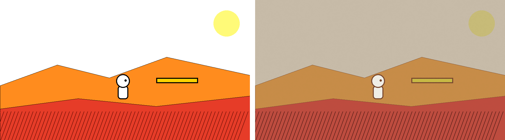
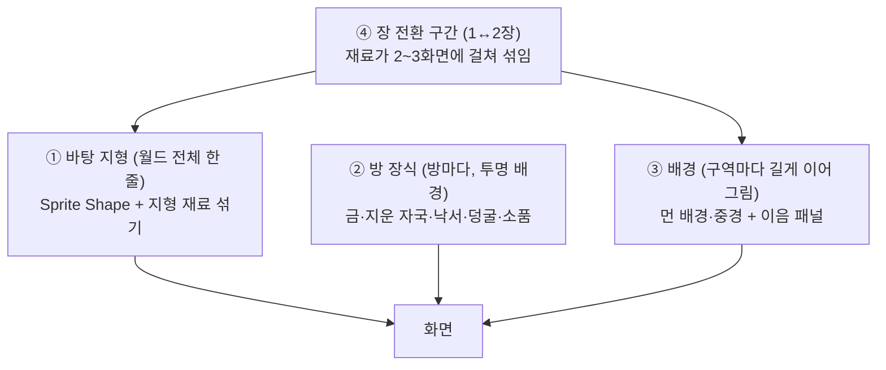
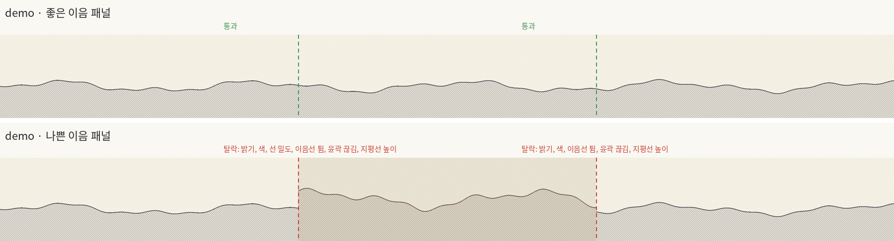
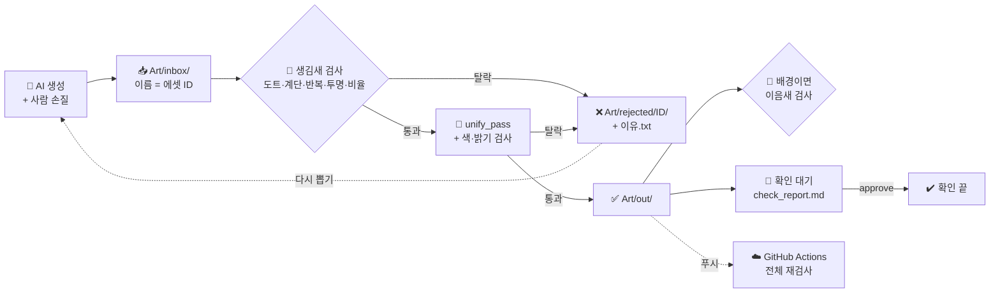
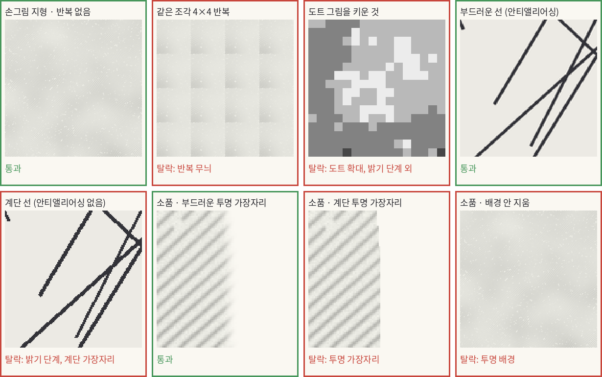

# 19. 에셋 목록 · 완성 프롬프트

> 상태: ✅ 목록·규칙 확정 (1·2장 기준 **374개**) · ✅ v4: **게임 그림체 · 미드키 · 픽셀·도트 금지 · 부드러운 가장자리 · 반복 없는 벽/바닥 · 끊김 없이 이어지는 월드 · 자동 검증** · 💡 3~5장은 맵 설계 후 추가
> 기준: [16 아트 컨셉](16_아트_컨셉.md) · [17 AI 아트 프롬프트](17_AI_아트_프롬프트.md) · [18 애니메이션](18_애니메이션_프롬프트.md)
> 이 문서 하나로 **"무엇을 · 어떤 프롬프트로 · 무엇을 참고해서 · 어디에 저장하는지"**가 다 정해져. 완성 프롬프트 전문은 `Art/ALL_PROMPTS.md` (복사용) / `Art/prompts_full.csv` (스프레드시트용).
> 이 문서는 `python Tools/build_doc19.py`로 자동 생성돼. 손으로 고치지 말고 스크립트를 고쳐.

---

## 0. 가장 중요한 것: 모든 그림이 한 게임처럼 보이게 하는 **4중 잠금**

> 플레이어 · 보스 · 몬스터 · 배경 · 구조물 · 이펙트 · UI 전부 **조명 · 질감 · 패턴 · 가장자리 · 명도 · 그림체**가 같아야 해. 프롬프트 하나로는 절대 안 돼서 네 겹으로 잠가.

| 잠금 | 무엇 | 어떻게 지키나 |
|---|---|---|
| 🔒 ① **프롬프트 블록** | 모든 에셋 프롬프트 끝에 똑같은 **MSB v3 + UNIFY v3**가 붙음 | `Tools/build_prompts.py`가 자동 조립. 사람이 손으로 고치지 않음 |
| 🔒 ② **골든 레퍼런스** | 모든 생성에 **같은 기준 그림 5장 + 그 장 2장**을 레퍼런스로 넣음 | 목록의 `레퍼런스` 칸 그대로 |
| 🔒 ③ **통일 후처리** | 채택한 모든 그림을 **같은 설정으로** 후처리 (채도 상한 · 종이색 · 선색 · 레이어 대비 · **같은 종이 결 텍스처**) | `Tools/unify_pass.py` |
| 🔒 ④ **한 화면 검수** | 새 에셋을 **골든 G1과 실제 게임 화면 위에 같이** 놓고 확인 | §7 검수 |

### MSB v3 블록 (모든 프롬프트에 자동 포함)
```
stylized hand-drawn 2D side-scrolling game art, looks like a screen from a polished indie metroidvania game, drawn on a page of a child's sketchbook, simplified readable game shapes, not realistic, not photographic, muted warm gray-beige paper toned down like a page seen under a dim desk lamp, mid-key overall brightness (neither bright nor dark), visible paper grain and a very faint square grid, muted art-supply colors with low saturation, soft dark ink-gray outlines (not pure black), outline weight thick and consistent on gameplay objects, thinner on background, slightly wobbly hand-drawn lines, a few intentionally unfinished strokes and eraser marks, matte paper look, flat lighting, shading done with drawing-material texture (not gradients), calm melancholic mood with a quiet tension of adventure and combat, clear readable silhouettes, orthographic side view, quiet composition with breathing room, high-resolution smooth hand-drawn illustration (not pixel art), soft natural anti-aliased edges, organic irregular contours, every wall and floor surface drawn uniquely by hand with no repeating pattern
```

### UNIFY v3 블록 (모든 프롬프트에 자동 포함)
```
UNIFIED LOOK: identical flat ambient light from the front for every asset, no directional light, no cast shadows, no highlights, no rim light, only a soft faint contact shadow under grounded objects; the same fine paper grain pattern visible through every surface; all shading uses the same 45-degree diagonal hatching direction (top-right to bottom-left); every outline uses the same ink-gray and the same wobble; same line weight for the same layer; same muted color temperature; looks like part of one continuous hand-drawn game; MID-KEY VALUES: the page paper sits around 70 percent brightness, far background slightly darker than the paper, middle background darker again, terrain mid-dark, outlines dark ink-gray, the protagonist is the lightest shape on screen, no large pure white areas, no crushed pure black areas, moderate contrast that keeps combat easy to read; GAME LOOK: stylized and simplified like game art, details grouped into big simple masses, shapes read at a glance, no realistic micro-detail, no painterly realism; SMOOTH AND ORGANIC: soft natural edges everywhere, rounded imperfect corners, no hard square tile edges, no repeated stamps or copy-pasted texture, hatching density and stroke placement vary naturally across every surface
```

| 통일 항목 | 규칙 | 프롬프트 | 후처리 |
|---|---|---|---|
| 💡 조명 | **정면 평면광 하나**. 방향광·그림자·하이라이트·림라이트 없음. 바닥 닿은 물체만 옅은 접지 그림자 | UNIFY + 네거티브(`directional shadows, specular highlight, rim light`) | 종이색보다 밝은 반점 평탄화 |
| 📄 질감 | **같은 종이 결**이 모든 면에 비침 | MSB + UNIFY | `Tools/paper_grain.png` 하나를 모든 에셋에 같은 세기로 곱함 |
| ✏️ 패턴 | 명암은 전부 **45° 해칭, 오른쪽 위 → 왼쪽 아래** 한 방향. 단, **밀도·획 위치는 자연스럽게 계속 달라짐** | UNIFY + 재료 블록 | 검수 때 해칭 방향 확인 (반대면 좌우 반전 금지 → 다시 뽑기) |
| 🖊️ 선 | 같은 잉크 회색 · 같은 흔들림 · 레이어별 같은 굵기 | MSB + UNIFY | 가장 어두운 선을 장 선색으로 치환 |
| 🎨 색 온도 | 같은 낮은 채도, 장마다 상한 | 재료 블록 + 팔레트 단어 | 장별 채도 상한 |
| 🌊 **가장자리** | **픽셀·도트 절대 금지.** 부드럽고 자연스러운(안티앨리어싱) 손그림 가장자리, 모서리는 둥글고 조금씩 삐뚤 | MSB v3 + UNIFY v3 + NEG 맨 앞 `pixel art, pixelated, 8-bit, dot art, aliased jagged edges…` | 확대해서 계단 가장자리 있으면 탈락. Unity는 Bilinear/Trilinear + 밉맵 (Point 금지) |
| 🔁 **반복 없음** | 벽·바닥에 **같은 무늬가 두 번 보이면 안 됨**. 도장 찍은 듯한 벽돌·격자 무늬 금지 | UNIFY v3 + NEG `repeating tile pattern, tiled texture, copy-pasted stamps…` | 바탕 재료 변형 4장 섞기 + 방마다 다른 장식 (§1) |
| 🎮 **게임 그림체** | 현실적인 그림 ❌ → 게임 화면처럼 단순·정돈, 디테일은 큰 덩어리 | MSB v3 `stylized … game art, not realistic` + UNIFY v3 `GAME LOOK` + NEG `realistic painting, hyper-detailed…` | 사람 검수 (§7-1) |
| 🌗 **미드키** | 너무 밝지도 어둡지도 않게. 종이 약 70%, 순백·순흑 면 금지, **주인공이 가장 밝음** ([16](16_아트_컨셉.md) §4-6) | MSB v3 `mid-key` + UNIFY v3 `MID-KEY VALUES` + NEG `overexposed, high-key… pitch black` | `unify_pass` 장별 종이색(낮춘 값)·분필 흰색 상한 + `art_check` 밝기 대역·순백 영역 검사 |
| 🔗 **이어짐** | 방·구역·장 경계에서 지형·배경이 **끊기지 않음** | BG `one long continuous world panorama` + 이음 패널 | 바탕은 월드 전체 한 재료 세트, 배경은 이음 패널 (§1) |


> 왼쪽: 일부러 튀게 만든 그림 (순백 바탕 · 순흑 선 · 쨍한 색 · 흰 주인공) → 오른쪽: `unify_pass` 2장 설정 통과 후 (**미드키 종이색** · 크레파스 갈색 선 · 채도 낮춤 · 종이 결 · **주인공만 분필 흰색으로 가장 밝게**). `python Tools/unify_pass.py --demo`로 다시 만들 수 있음

---

## 1. 지형 구조: **이어진 바탕 + 방 장식** (v3 핵심)

> ❌ 방마다 통째로 그리면 방과 방 사이에서 해칭 밀도·선 굵기·종이 톤이 **뚝 끊겨.** 우리는 1장→2장도 책장 없이 쭉 이어지니까 더 티 나.
> ✅ 그래서 **연결감은 하나로 이어진 바탕이**, **반복 없는 느낌과 방 개성은 장식이** 책임지게 나눴어.



| 층 | 무엇 | 어떻게 이어지나 | 어떻게 반복을 막나 |
|---|---|---|---|
| ① **바탕 지형** | `1 지형` — 속 채움 변형 A~D (2048px) + 가장자리 띠 + 둥근 모서리 + 발판 | 월드 전체가 **같은 재료 세트 하나**로 깔림 → 방 경계가 존재하지 않음 | 4장을 **무작위로 섞고 · 돌리고 · 뒤집어서** 깔기. 같은 장이 이웃하지 않게. 가장자리 띠는 4096px로 길어서 이음새가 잘 안 보임 |
| ② **방 장식** | `3 방 장식` — 방 하나당 **투명 배경 장식 한 장** | 바탕 위에 얹기만 하니까 경계에서 끊길 게 없음. 방 경계 근처는 장식을 비워 둠 | 방마다 다른 금·자국·낙서·뿌리·소품 → 같은 바닥이라도 **매번 다르게 보임** |
| ③ **배경** | `2 배경` — 구역별 먼 배경·중경(32:9) + **이음 패널** `BL-` | **지도에서 실제로 맞닿은 구역 쌍마다** 이음 패널을 끼움 (가로 = 앞 패널 오른쪽 끝에서, 세로 = 위 패널 아래 끝에서 아웃페인팅). 이어졌는지는 `seam_check.py`가 숫자로 판정 (§7-3) | 모든 랜드마크가 다름 |
| ④ **장 전환** | `T12-` 전환 지형 4장 + `BL-DE` 배경 이음 + `R-border-1-2` 장식 | 연필 재료가 **2~3화면에 걸쳐** 크레파스로 덧칠됨. 프로토타입의 경계 색 섞기와 같은 개념 | — |

**판정과 그림은 따로:**
- 충돌(판정)은 지금처럼 **네모 타일 격자** 그대로. Unity에서 타일 데이터 → Sprite Shape 윤곽선으로 변환해서 그림만 부드럽게
- 그림 윤곽은 판정 선에서 **최대 1/4타일(32px @×8)** 까지만 흔들림
- **발 딛는 윗면 높이는 판정과 정확히 같게** (2px 이내)
- 벽 옆면·천장은 조금 더 자유롭게 울퉁불퉁해도 됨 (플레이어가 거기 서지 않으니까)

**대신 비용 ⚠️**
- 방 장식은 **투명 배경**으로 뽑아야 해. AI가 투명 배경을 잘 못해서, 종이색 배경으로 나오면 **배경 지우기**(누끼) 단계가 추가돼 (§3 5번)
- 바탕 재료 4장이 게임 전체에 깔리니까 **이 4장 품질이 게임 인상의 절반**이야. 골든급으로 공들이기 (골든 G2·C1-G2·C2-G2 바로 다음 순서)

---

## 2. 폴더 구조
```
Art/
├─ inbox/                 🆕 여기에 그림을 넣으면 자동 검증 (파일 이름 = 에셋 ID) · anim/ = 애니메이션 폴더째
├─ rejected/              🆕 자동 탈락 (ID별 폴더 + 이유.txt)
├─ status.json            🆕 에셋별 상태 (자동 통과 · 확인 끝 · 탈락)
├─ check_report.md        🆕 진행 현황 · 사람 확인 대기 목록 (자동 생성)
├─ asset_catalog.json     에셋 목록 + 블록 원문 (기계용, 자동 생성)
├─ bg_links.json         지도에서 찾은 맞닿은 구역 쌍 (seam_check.py links, 자동 생성)
├─ seam_report.md        배경 이음새 검사 결과 (seam_check.py check, 자동 생성)
├─ seam_preview/         이음새 미리보기 (점선 표시)
├─ prompts_full.csv       에셋별 완성 프롬프트 (스프레드시트용, 자동 생성)
├─ ALL_PROMPTS.md         분류별 완성 프롬프트 (복사용, 자동 생성)
├─ control/               방 장식 위치 참고 이미지 57장 (자동 생성, 1920×1080, 부드러운 윤곽)
├─ golden/                골든 이미지 (확정본)
├─ raw/                   inbox에 넣은 원본 보관 (ID별, 시각 붙여서)
└─ out/                   자동 검증 + 후처리 통과본 (파일 경로는 목록의 '파일' 칸) · GitHub에 올라가는 건 여기
   ├─ ch1/terrain/ …      바탕 지형 재료
   ├─ ch1/decor/ …        방 장식 (투명 PNG)
   ├─ link/ …             배경 이음 패널
   └─ border/ …           1↔2장 전환 재료·장식
Tools/
├─ build_prompts.py       블록·목록 → 완성 프롬프트 생성
├─ build_doc19.py         목록 → 이 문서 생성
├─ make_controls.py       통합 지도 → 방별 컨트롤 이미지
├─ unify_pass.py          통일 후처리
├─ paper_grain.png        공용 종이 결 (바꾸지 말 것)
├─ art_check.py          🆕 자동 검증 파이프라인 (§8)
├─ art_watch.bat         🆕 더블클릭 = inbox 감시 시작 (Windows)
├─ seam_check.py         배경 이음새 검사 (§7-3)
└─ anim_check.py          애니메이션 겹침 검사 (18 문서)
.github/workflows/art-check.yml   🆕 푸시할 때마다 Art/out 전체 재검사 (GitHub Actions)
```

## 3. 한 에셋 만드는 순서 (모든 에셋 공통)

> 🤖 = 자동 (`art_check.py`가 함) · 🙋 = 사람

| # | 단계 | 누가 | 내용 |
|---|---|---|---|
| 1 | 목록에서 고르기 | 🙋 | `Art/ALL_PROMPTS.md`에서 ID로 찾기 (예: `R1-09`) |
| 2 | 레퍼런스 준비 | 🙋 | `레퍼런스` 칸의 골든 이미지 (+ 컨트롤 이미지) |
| 3 | 생성 | 🙋/AI | 완성 프롬프트 + 네거티브 그대로. **목표 크기 그대로 고해상도로** (게임 표시 크기의 2배, 16 문서 §14). 4~8장 뽑기. 후보 거르기는 `python Tools/art_check.py file 후보.png --id R1-09` |
| 4 | 사람 손질 | 🙋 | 판정 선(땅 윗면·벽·적 몸통) 덧그리기, 기능색 칠하기, 글자·이상한 부분 지우기. **방 장식·소품·캐릭터는 배경 지우기(투명 PNG)** |
| 5 | **inbox에 넣기** | 🙋 | `Art/inbox/R1-09.png` (이름 = ID, 뒤에 `_v2` 같은 꼬리 OK). 감시를 켜 두면(`art_watch.bat`) 넣는 즉시 6~8 자동 |
| 6 | 생김새 검사 | 🤖 | 비율 · 해상도 · 도트 확대 · 밝기 단계 · 계단 가장자리 · 투명 배경/가장자리 · 반복 무늬 (§8) |
| 7 | 통일 후처리 + 색 검사 | 🤖 | `unify_pass` (장·레이어 자동, 미드키 종이색·분필 흰색 상한) → 채도 상한 · **밝기 대역 · 순백 영역** · 순흑 선 |
| 8 | 분류 · 이음새 | 🤖 | 통과 → `Art/out/<파일 칸>` / 탈락 → `Art/rejected/<ID>/` + 이유. 배경이면 짝 패널이 다 있을 때 **이음새 자동 검사** |
| 9 | 한 화면 검수 | 🙋 | `Art/check_report.md`의 **확인 대기** 목록을 골든 G1 + 실제 게임 화면에서 확인 (§7-2) → `python Tools/art_check.py approve R1-09` |
| 10 | 푸시 | 🙋 → 🤖 | 커밋·푸시하면 **GitHub Actions가 `Art/out` 전체를 다시 검사** (빠뜨린 것·손으로 넣은 것도 잡음) |

> ⚠️ 해상도가 모자라 업스케일할 땐 **부드러운 그림용 업스케일러**(예: 4x-UltraSharp, ESRGAN 일반 사진/일러스트용)만. **픽셀아트용 업스케일러 · 최근접(Nearest) 확대 금지** — 계단 가장자리가 생겨.

## 4. 프롬프트 조립 순서 (v3)
```
[무엇을 SUBJECT] , [캐릭터 고정 CHAR-LOCK (플레이어만)] , [에셋 종류 TYPE] , [재료 MAT + 팔레트 단어] , [MSB v3] , [UNIFY v3]
네거티브: [NEG 공통 (픽셀·반복 금지가 맨 앞)] + [종류별 NEG]
```
- 이미지 AI는 **앞쪽 단어를 더 강하게** 반영해서 "무엇을"을 맨 앞에 둠. 그림체 통일은 뒤쪽 블록 + 골든 레퍼런스 + 후처리가 책임짐
- 프롬프트가 길어서 Stable Diffusion은 **긴 프롬프트 나눠 넣기(chunking)**가 켜져 있어야 함 (ComfyUI·A1111 기본 지원). 잘리면 MSB·UNIFY가 빠져서 그림체가 흔들림
- 네거티브의 픽셀 금지 단어는 **절대 빼지 말 것**. "game art"라는 말만 들어가도 AI가 픽셀 게임 그림으로 끌려가는 경우가 많아

### NEG 공통 (원문)
```
pixel art, pixelated, 8-bit, 16-bit, retro game sprite, dot art, dithering, aliased jagged edges, stair-step edges, blocky, low resolution, mosaic, grid of square tiles, repeating tile pattern, tiled texture, copy-pasted stamps, identical repeated bricks, photorealistic, realistic painting, hyper-detailed, intricate realistic texture, realistic rendering, matte painting, realistic lighting, 3D render, CGI, voxel, vector clean flat corporate style, anime cel shading, glossy, shiny, metallic, chrome, neon, glow, bloom, lens flare, light rays, rim light, specular highlight, directional shadows, cast shadow, smooth digital gradient, airbrush, heavy drop shadow, pure black outline, high contrast HDR, overexposed, high-key, washed out, bright white paper, blown-out highlights, pitch black, crushed shadows, low-key noir, saturated rainbow colors, dark horror atmosphere, gore, text, letters, numbers, logo, watermark, signature, UI, frame border, blurry, jpeg artifacts, perspective view, isometric, top-down
```

## 5. 방 장식 위치 참고 이미지 규칙 (`Art/control/`)

> 방 장식은 지형을 **그리지 않고** 장식만 그려. 이 이미지는 "땅이 어디 있는지" 알려줘서 장식이 땅 가장자리에 붙고 공중·발판 위를 막지 않게 하는 용도야.

| 색 | 뜻 |
|---|---|
| 짙은 회색 | 단단한 땅·벽 → 장식은 **이 가장자리를 따라** |
| 밝은 종이색 | 빈 공간 (걸어 다니는 곳) → **장식 금지** |
| 중간 회색 둥근 막대 | 통과 발판 (주황 = 녹는 발판, 갈색 = 무너지는 발판) → **윗면 비워 두기** |
| 검보라 / 파랑 | 위험(잉크·늪) / 물 |
| 붉은 회색 · 초록 회색 · 밀랍색 · 노랑 · 보라 | 낙서 벽 · 흑연 덩굴 · 밀랍 벽 · 과녁 문 · 물감 문 (이건 `1 지형` SPECIAL 그림이 따로 있음) |

- 윤곽은 부드럽고 살짝 흔들리는 곡선 (AI가 네모 계단을 따라 그리지 않게)
- ControlNet 세기 **0.4~0.6** 권장 (장식 위치만 맞추면 돼서 예전 덧칠 방식보다 약하게)
- 방 + 둘레 3타일을 **16:9로 맞춰** 자름. **둘레 3타일(겹치는 곳)에는 장식을 그리지 않음** → 이웃 방 장식과 겹치지 않게
- 지도가 바뀌면 `python Tools/make_controls.py`로 다시 만들기

## 6. 에셋 목록 (1·2장 · 374개)
| 분류 | 개수 | 먼저 할 것 |
|---|---|---|
| 0 골든 | 9 | ⭐ **가장 먼저**. 이게 확정돼야 나머지를 뽑음 |
| 1 지형 | 46 | 골든 확정 직후 · ⭐ **바탕 4장이 게임 인상의 절반** |
| 2 배경 | 34 | 지형 다음 · 구역 패널 → 이음 패널 → `seam_check` |
| 3 방 장식 | 57 | 지형·배경 후 · 투명 배경 |
| 4 소품·구조물 | 26 |  |
| 5 플레이어 키 포즈 | 58 | G3 확정 후 |
| 6 적 | 78 | 시트 → 키 포즈 순 |
| 7 엘리트 | 21 |  |
| 8 보스 | 14 |  |
| 9 이펙트 | 15 |  |
| 10 UI | 13 |  |
| 11 키 아트 | 3 | 마지막 |

### 0 골든 (9)
| ID | 파일 (`Art/out/`) | 무엇 (프롬프트 앞부분) | 레퍼런스 · 컨트롤 |
|---|---|---|---|
| G1 | `golden/G1_scene.png` | wide game screenshot-like scene, a small chalk-white child figure standing on pencil-hatched rock ledges in a… | G1 G2 G3 G4 G5 C1-G1 C1-G2 |
| G2 | `golden/G2_ground.png` | solid ground made of pencil hatching that varies naturally everywhere, with an organic wobbly top edge | G1 G2 G3 G4 G5 C1-G1 C1-G2 |
| G3 | `golden/G3_player_sheet.png` | character sheet of the protagonist: the same tiny protagonist in every image: round head about 45% of total he… | G1 G2 G3 G4 G5 |
| G4 | `golden/G4_enemy.png` | a small graphite worm creature made of segmented pencil-lead pieces, one pointed tip at the front | G1 G2 G3 G4 G5 C1-G1 C1-G2 |
| G5 | `golden/G5_prop.png` | a pencil-holder shaped stone statue holding three pencils, used as a save point | G1 G2 G3 G4 G5 C1-G1 C1-G2 |
| C1-G1 | `golden/C1_G1_scene.png` | pencil forest mine tunnel scene with graphite deposits, plank platforms and a pool of ink | G1 G2 G3 G4 G5 C1-G1 C1-G2 |
| C1-G2 | `golden/C1_G2_ground.png` | ground texture of a graphite mine wall, dense hatching with graphite flecks | G1 G2 G3 G4 G5 C1-G1 C1-G2 |
| C2-G1 | `golden/C2_G1_scene.png` | sunset crayon hills scene, thick crayon-painted ridges, melting orange crayon platforms, wax puddles | G1 G2 G3 G4 G5 C2-G1 C2-G2 |
| C2-G2 | `golden/C2_G2_ground.png` | ground texture of overpainted crayon earth, layered crossing crayon strokes | G1 G2 G3 G4 G5 C2-G1 C2-G2 |

### 1 지형 (46)
> 🔁 **월드 전체에 이어 깔리는 바탕.** 같은 종류는 변형(A~D) 여러 장을 섞고 돌리고 뒤집어서 씀. `T12-`는 1↔2장 전환 구간 전용 (§1)
| ID | 파일 (`Art/out/`) | 무엇 (프롬프트 앞부분) | 레퍼런스 · 컨트롤 |
|---|---|---|---|
| T1-fill_a | `ch1/terrain/ch1_fill_a.png` | interior of solid ground, hatching only, variation A | G1 G2 G3 G4 G5 C1-G1 C1-G2 |
| T1-fill_b | `ch1/terrain/ch1_fill_b.png` | interior of solid ground, hatching only, variation B with a few faint eraser smudges | G1 G2 G3 G4 G5 C1-G1 C1-G2 |
| T1-fill_c | `ch1/terrain/ch1_fill_c.png` | interior of solid ground, hatching only, variation C with sparse material flecks | G1 G2 G3 G4 G5 C1-G1 C1-G2 |
| T1-fill_d | `ch1/terrain/ch1_fill_d.png` | interior of solid ground, hatching only, variation D slightly denser near one side | G1 G2 G3 G4 G5 C1-G1 C1-G2 |
| T1-edge_top | `ch1/terrain/ch1_edge_top.png` | top surface edge of ground, thick wobbly contour line on top, material texture below | G1 G2 G3 G4 G5 C1-G1 C1-G2 |
| T1-edge_bottom | `ch1/terrain/ch1_edge_bottom.png` | bottom edge of a ceiling, thick wobbly contour line on the bottom, material texture above | G1 G2 G3 G4 G5 C1-G1 C1-G2 |
| T1-edge_side | `ch1/terrain/ch1_edge_side.png` | vertical wall edge (drawn horizontally, will be rotated), thick wobbly contour line, material texture on one s… | G1 G2 G3 G4 G5 C1-G1 C1-G2 |
| T1-corner_out | `ch1/terrain/ch1_corner_out.png` | outer convex corner of ground, rounded | G1 G2 G3 G4 G5 C1-G1 C1-G2 |
| T1-corner_in | `ch1/terrain/ch1_corner_in.png` | inner concave corner where floor meets wall, soft curve | G1 G2 G3 G4 G5 C1-G1 C1-G2 |
| T1-platform_a | `ch1/terrain/ch1_platform_a.png` | one-way plank platform, variation A | G1 G2 G3 G4 G5 C1-G1 C1-G2 |
| T1-platform_b | `ch1/terrain/ch1_platform_b.png` | one-way plank platform, variation B, slightly bent | G1 G2 G3 G4 G5 C1-G1 C1-G2 |
| T1-platform_c | `ch1/terrain/ch1_platform_c.png` | one-way plank platform, variation C, with a knot | G1 G2 G3 G4 G5 C1-G1 C1-G2 |
| T1-crumble | `ch1/terrain/ch1_crumble.png` | crumbling platform plank with pencil cracks, pieces about to break | G1 G2 G3 G4 G5 C1-G1 C1-G2 |
| T1-ink_hazard | `ch1/terrain/ch1_ink_hazard.png` | pool surface of dark black-violet ink with a gently wavy surface line, dangerous | G1 G2 G3 G4 G5 C1-G1 C1-G2 |
| T1-ink_water | `ch1/terrain/ch1_ink_water.png` | deep ink water body, semi-transparent black-violet, faint uneven surface lines | G1 G2 G3 G4 G5 C1-G1 C1-G2 |
| T1-scribble_wall | `ch1/terrain/ch1_scribble_wall.png` | a tall wall made of angry chaotic scribbles in dusty red-gray | G1 G2 G3 G4 G5 C1-G1 C1-G2 |
| T1-graphite_vine | `ch1/terrain/ch1_graphite_vine.png` | tall tangled graphite vines in sage gray-green | G1 G2 G3 G4 G5 C1-G1 C1-G2 |
| T1-wax_wall | `ch1/terrain/ch1_wax_wall.png` | tall smooth wax wall with vertical sheen stripes drawn with lines, beige, slippery looking | G1 G2 G3 G4 G5 C1-G1 C1-G2 |
| T1-target_door | `ch1/terrain/ch1_target_door.png` | a tall door panel painted muted yellow with a small target symbol | G1 G2 G3 G4 G5 C1-G1 C1-G2 |
| T1-oneway_gate | `ch1/terrain/ch1_oneway_gate.png` | wooden one-way gate plank with a drawn downward arrow | G1 G2 G3 G4 G5 C1-G1 C1-G2 |
| T1-hatch | `ch1/terrain/ch1_hatch.png` | a wooden trapdoor hatch lying flat, hinge on one side | G1 G2 G3 G4 G5 C1-G1 C1-G2 |
| T2-fill_a | `ch2/terrain/ch2_fill_a.png` | interior of solid ground, hatching only, variation A | G1 G2 G3 G4 G5 C2-G1 C2-G2 |
| T2-fill_b | `ch2/terrain/ch2_fill_b.png` | interior of solid ground, hatching only, variation B with a few faint eraser smudges | G1 G2 G3 G4 G5 C2-G1 C2-G2 |
| T2-fill_c | `ch2/terrain/ch2_fill_c.png` | interior of solid ground, hatching only, variation C with sparse material flecks | G1 G2 G3 G4 G5 C2-G1 C2-G2 |
| T2-fill_d | `ch2/terrain/ch2_fill_d.png` | interior of solid ground, hatching only, variation D slightly denser near one side | G1 G2 G3 G4 G5 C2-G1 C2-G2 |
| T2-edge_top | `ch2/terrain/ch2_edge_top.png` | top surface edge of ground, thick wobbly contour line on top, material texture below | G1 G2 G3 G4 G5 C2-G1 C2-G2 |
| T2-edge_bottom | `ch2/terrain/ch2_edge_bottom.png` | bottom edge of a ceiling, thick wobbly contour line on the bottom, material texture above | G1 G2 G3 G4 G5 C2-G1 C2-G2 |
| T2-edge_side | `ch2/terrain/ch2_edge_side.png` | vertical wall edge (drawn horizontally, will be rotated), thick wobbly contour line, material texture on one s… | G1 G2 G3 G4 G5 C2-G1 C2-G2 |
| T2-corner_out | `ch2/terrain/ch2_corner_out.png` | outer convex corner of ground, rounded | G1 G2 G3 G4 G5 C2-G1 C2-G2 |
| T2-corner_in | `ch2/terrain/ch2_corner_in.png` | inner concave corner where floor meets wall, soft curve | G1 G2 G3 G4 G5 C2-G1 C2-G2 |
| T2-platform_a | `ch2/terrain/ch2_platform_a.png` | one-way plank platform, variation A | G1 G2 G3 G4 G5 C2-G1 C2-G2 |
| T2-platform_b | `ch2/terrain/ch2_platform_b.png` | one-way plank platform, variation B, slightly bent | G1 G2 G3 G4 G5 C2-G1 C2-G2 |
| T2-platform_c | `ch2/terrain/ch2_platform_c.png` | one-way plank platform, variation C, with a knot | G1 G2 G3 G4 G5 C2-G1 C2-G2 |
| T2-melting | `ch2/terrain/ch2_melting.png` | platform made of a melting orange crayon, wax drips hanging from its underside, thick line on top only | G1 G2 G3 G4 G5 C2-G1 C2-G2 |
| T2-crayon_swamp | `ch2/terrain/ch2_crayon_swamp.png` | surface of a melted brown-orange crayon swamp, thick wavy waxy surface line, dangerous | G1 G2 G3 G4 G5 C2-G1 C2-G2 |
| T2-wax_puddle | `ch2/terrain/ch2_wax_puddle.png` | shallow pale beige wax puddle lying on the ground surface, sticky looking | G1 G2 G3 G4 G5 C2-G1 C2-G2 |
| T2-paint_water | `ch2/terrain/ch2_paint_water.png` | pool of muted blue paint water, semi-transparent, faint uneven surface lines | G1 G2 G3 G4 G5 C2-G1 C2-G2 |
| T2-scribble_wall | `ch2/terrain/ch2_scribble_wall.png` | a tall wall of chaotic scribbles drawn over with orange crayon, dusty red-gray | G1 G2 G3 G4 G5 C2-G1 C2-G2 |
| T2-graphite_vine | `ch2/terrain/ch2_graphite_vine.png` | tall tangled graphite vines with crayon smudges, sage gray-green | G1 G2 G3 G4 G5 C2-G1 C2-G2 |
| T2-wax_wall | `ch2/terrain/ch2_wax_wall.png` | tall smooth beige wax wall with vertical sheen stripes drawn with lines, slippery looking | G1 G2 G3 G4 G5 C2-G1 C2-G2 |
| T2-paint_door | `ch2/terrain/ch2_paint_door.png` | tall door painted muted purple with three vertical stripe slots for red, blue and yellow paint | G1 G2 G3 G4 G5 C2-G1 C2-G2 |
| T2-target_door | `ch2/terrain/ch2_target_door.png` | a tall door panel painted muted yellow with a small target symbol, crayon texture | G1 G2 G3 G4 G5 C2-G1 C2-G2 |
| T12-fill_a | `border/terrain_12_fill_a.png` | interior of solid ground, variation A, transition: drawn with graphite pencil, 45-degree pencil hatching for s… | G1 G2 G3 G4 G5 C2-G1 C2-G2 T1-fill_a T2-fill_a |
| T12-fill_b | `border/terrain_12_fill_b.png` | interior of solid ground, variation B, transition: drawn with graphite pencil, 45-degree pencil hatching for s… | G1 G2 G3 G4 G5 C2-G1 C2-G2 T1-fill_a T2-fill_a |
| T12-edge_top | `border/terrain_12_edge_top.png` | top surface edge of ground, thick wobbly contour line on top, transition: drawn with graphite pencil, 45-degre… | G1 G2 G3 G4 G5 C2-G1 C2-G2 T1-fill_a T2-fill_a |
| T12-edge_bottom | `border/terrain_12_edge_bottom.png` | bottom edge of a ceiling, thick wobbly contour line on the bottom, transition: drawn with graphite pencil, 45-… | G1 G2 G3 G4 G5 C2-G1 C2-G2 T1-fill_a T2-fill_a |

### 2 배경 (34)
> 🔗 `BL-` 이음 패널은 **지도에서 실제로 맞닿은 구역 쌍**만 있어 (`Art/bg_links.json`). **양쪽 구역 패널을 먼저 확정한 뒤** 아웃페인팅으로 이어 그리고, `seam_check.py check`로 판정 (§7-3)
| ID | 파일 (`Art/out/`) | 무엇 (프롬프트 앞부분) | 레퍼런스 · 컨트롤 |
|---|---|---|---|
| B1-A-far | `ch1/bg/ch1_bg_A_far.png` | rolling blank paper meadow with sparse pencil grass and half-drawn distant trees | G1 G2 G3 G4 G5 C1-G1 C1-G2 |
| B1-A-mid | `ch1/bg/ch1_bg_A_mid.png` | rolling blank paper meadow with sparse pencil grass and half-drawn distant trees | G1 G2 G3 G4 G5 C1-G1 C1-G2 |
| B1-B-far | `ch1/bg/ch1_bg_B_far.png` | deep graphite mine with wooden supports, hanging lamps drawn in pencil, ore veins | G1 G2 G3 G4 G5 C1-G1 C1-G2 |
| B1-B-mid | `ch1/bg/ch1_bg_B_mid.png` | deep graphite mine with wooden supports, hanging lamps drawn in pencil, ore veins | G1 G2 G3 G4 G5 C1-G1 C1-G2 |
| B1-C-far | `ch1/bg/ch1_bg_C_far.png` | inside and around a giant sketched tree, knots, branches and hollow trunk | G1 G2 G3 G4 G5 C1-G1 C1-G2 |
| B1-C-mid | `ch1/bg/ch1_bg_C_mid.png` | inside and around a giant sketched tree, knots, branches and hollow trunk | G1 G2 G3 G4 G5 C1-G1 C1-G2 |
| B1-D-far | `ch1/bg/ch1_bg_D_far.png` | dense tangled forest of scribbled vines and dark knotted lines | G1 G2 G3 G4 G5 C1-G1 C1-G2 |
| B1-D-mid | `ch1/bg/ch1_bg_D_mid.png` | dense tangled forest of scribbled vines and dark knotted lines | G1 G2 G3 G4 G5 C1-G1 C1-G2 |
| B2-E-far | `ch2/bg/ch2_bg_E_far.png` | soft rolling hills under a crayon sunset sky, layered ridgelines | G1 G2 G3 G4 G5 C2-G1 C2-G2 |
| B2-E-mid | `ch2/bg/ch2_bg_E_mid.png` | soft rolling hills under a crayon sunset sky, layered ridgelines | G1 G2 G3 G4 G5 C2-G1 C2-G2 |
| B2-F-far | `ch2/bg/ch2_bg_F_far.png` | crayon-making workshop with wax vats, chimneys and drying racks | G1 G2 G3 G4 G5 C2-G1 C2-G2 |
| B2-F-mid | `ch2/bg/ch2_bg_F_mid.png` | crayon-making workshop with wax vats, chimneys and drying racks | G1 G2 G3 G4 G5 C2-G1 C2-G2 |
| B2-G-far | `ch2/bg/ch2_bg_G_far.png` | deep canyon with painted cliff walls, paint waterfalls and colored strata | G1 G2 G3 G4 G5 C2-G1 C2-G2 |
| B2-G-mid | `ch2/bg/ch2_bg_G_mid.png` | deep canyon with painted cliff walls, paint waterfalls and colored strata | G1 G2 G3 G4 G5 C2-G1 C2-G2 |
| B2-H-far | `ch2/bg/ch2_bg_H_far.png` | tall crayon tower with banners drawn in crayon, wax walls and a training yard | G1 G2 G3 G4 G5 C2-G1 C2-G2 |
| B2-H-mid | `ch2/bg/ch2_bg_H_mid.png` | tall crayon tower with banners drawn in crayon, wax walls and a training yard | G1 G2 G3 G4 G5 C2-G1 C2-G2 |
| BL-AB-far | `link/bg_AB_far.png` | far layer: rolling blank paper meadow with sparse pencil grass and half-drawn distant trees at the top, gradua… | G1 G2 G3 G4 G5 C1-G1 C1-G2 B1-A-far B1-B-far |
| BL-AB-mid | `link/bg_AB_mid.png` | mid layer: rolling blank paper meadow with sparse pencil grass and half-drawn distant trees at the top, gradua… | G1 G2 G3 G4 G5 C1-G1 C1-G2 B1-A-mid B1-B-mid |
| BL-CA-far | `link/bg_CA_far.png` | far layer: inside and around a giant sketched tree, knots, branches and hollow trunk on the left, gradually be… | G1 G2 G3 G4 G5 C1-G1 C1-G2 B1-C-far B1-A-far |
| BL-CA-mid | `link/bg_CA_mid.png` | mid layer: inside and around a giant sketched tree, knots, branches and hollow trunk on the left, gradually be… | G1 G2 G3 G4 G5 C1-G1 C1-G2 B1-C-mid B1-A-mid |
| BL-CD-far | `link/bg_CD_far.png` | far layer: inside and around a giant sketched tree, knots, branches and hollow trunk on the left, gradually be… | G1 G2 G3 G4 G5 C1-G1 C1-G2 B1-C-far B1-D-far |
| BL-CD-mid | `link/bg_CD_mid.png` | mid layer: inside and around a giant sketched tree, knots, branches and hollow trunk on the left, gradually be… | G1 G2 G3 G4 G5 C1-G1 C1-G2 B1-C-mid B1-D-mid |
| BL-DA-far | `link/bg_DA_far.png` | far layer: dense tangled forest of scribbled vines and dark knotted lines at the top, gradually becoming rolli… | G1 G2 G3 G4 G5 C1-G1 C1-G2 B1-D-far B1-A-far |
| BL-DA-mid | `link/bg_DA_mid.png` | mid layer: dense tangled forest of scribbled vines and dark knotted lines at the top, gradually becoming rolli… | G1 G2 G3 G4 G5 C1-G1 C1-G2 B1-D-mid B1-A-mid |
| BL-DE-far | `link/bg_DE_far.png` | far layer: dense tangled forest of scribbled vines and dark knotted lines on the left, gradually becoming soft… | G1 G2 G3 G4 G5 C2-G1 C2-G2 B1-D-far B2-E-far |
| BL-DE-mid | `link/bg_DE_mid.png` | mid layer: dense tangled forest of scribbled vines and dark knotted lines on the left, gradually becoming soft… | G1 G2 G3 G4 G5 C2-G1 C2-G2 B1-D-mid B2-E-mid |
| BL-EF-far | `link/bg_EF_far.png` | far layer: soft rolling hills under a crayon sunset sky, layered ridgelines at the top, gradually becoming cra… | G1 G2 G3 G4 G5 C2-G1 C2-G2 B2-E-far B2-F-far |
| BL-EF-mid | `link/bg_EF_mid.png` | mid layer: soft rolling hills under a crayon sunset sky, layered ridgelines at the top, gradually becoming cra… | G1 G2 G3 G4 G5 C2-G1 C2-G2 B2-E-mid B2-F-mid |
| BL-EG-far | `link/bg_EG_far.png` | far layer: soft rolling hills under a crayon sunset sky, layered ridgelines at the top, gradually becoming dee… | G1 G2 G3 G4 G5 C2-G1 C2-G2 B2-E-far B2-G-far |
| BL-EG-mid | `link/bg_EG_mid.png` | mid layer: soft rolling hills under a crayon sunset sky, layered ridgelines at the top, gradually becoming dee… | G1 G2 G3 G4 G5 C2-G1 C2-G2 B2-E-mid B2-G-mid |
| BL-EH-far | `link/bg_EH_far.png` | far layer: soft rolling hills under a crayon sunset sky, layered ridgelines on the left, gradually becoming ta… | G1 G2 G3 G4 G5 C2-G1 C2-G2 B2-E-far B2-H-far |
| BL-EH-mid | `link/bg_EH_mid.png` | mid layer: soft rolling hills under a crayon sunset sky, layered ridgelines on the left, gradually becoming ta… | G1 G2 G3 G4 G5 C2-G1 C2-G2 B2-E-mid B2-H-mid |
| B1-fore | `ch1/bg/ch1_bg_fore.png` | pencil-drawn grass blades and small paper scraps | G1 G2 G3 G4 G5 C1-G1 C1-G2 |
| B2-fore | `ch2/bg/ch2_bg_fore.png` | crayon grass tufts and tiny wax drips | G1 G2 G3 G4 G5 C2-G1 C2-G2 |

### 3 방 장식 (57)
> 🧩 **지형은 그리지 않음.** 투명 배경 위에 그 방만의 장식만. 위치 참고 이미지 = `Art/control/` (§5)
| ID | 파일 (`Art/out/`) | 무엇 (프롬프트 앞부분) | 레퍼런스 · 컨트롤 |
|---|---|---|---|
| R1-01 | `ch1/decor/ch1_decor_01.png` | decorations for: start path on blank paper, a few pencil grass tufts, gentle beginning | G1 G2 G3 G4 G5 C1-G1 C1-G2 · `r1_01.png` |
| R1-02 | `ch1/decor/ch1_decor_02.png` | decorations for: windy grass field, pencil grass bending, a narrow chimney opening above | G1 G2 G3 G4 G5 C1-G1 C1-G2 · `r1_02.png` |
| R1-03 | `ch1/decor/ch1_decor_03.png` | decorations for: paper hill with folded paper slopes | G1 G2 G3 G4 G5 C1-G1 C1-G2 · `r1_03.png` |
| R1-04 | `ch1/decor/ch1_decor_04.png` | decorations for: shadowy grass cave, side exploration, narrow chimney in the ceiling | G1 G2 G3 G4 G5 C1-G1 C1-G2 · `r1_04.png` |
| R1-05 | `ch1/decor/ch1_decor_05.png` | decorations for: crossroads forest hub, signpost drawn in pencil, many exits | G1 G2 G3 G4 G5 C1-G1 C1-G2 · `r1_05.png` |
| R1-06 | `ch1/decor/ch1_decor_06.png` | decorations for: forest loft with sharpened pencil turret nests and a target door | G1 G2 G3 G4 G5 C1-G1 C1-G2 · `r1_06.png` |
| R1-07 | `ch1/decor/ch1_decor_07.png` | decorations for: mine entrance with wooden frame and minecart tracks | G1 G2 G3 G4 G5 C1-G1 C1-G2 · `r1_07.png` |
| R1-08 | `ch1/decor/ch1_decor_08.png` | decorations for: long graphite tunnel with ink pits | G1 G2 G3 G4 G5 C1-G1 C1-G2 · `r1_08.png` |
| R1-09 | `ch1/decor/ch1_decor_09.png` | decorations for: collapsed mine shaft, cracked walls, ink pool at the bottom, crumbling planks | G1 G2 G3 G4 G5 C1-G1 C1-G2 · `r1_09.png` |
| R1-10 | `ch1/decor/ch1_decor_10.png` | decorations for: miners' rest area, lantern and bench, calm | G1 G2 G3 G4 G5 C1-G1 C1-G2 · `r1_10.png` |
| R1-11 | `ch1/decor/ch1_decor_11.png` | decorations for: foreman's quarry, piles of graphite, eraser shavings everywhere | G1 G2 G3 G4 G5 C1-G1 C1-G2 · `r1_11.png` |
| R1-12 | `ch1/decor/ch1_decor_12.png` | decorations for: small storage behind vines with crates | G1 G2 G3 G4 G5 C1-G1 C1-G2 · `r1_12.png` |
| R1-13 | `ch1/decor/ch1_decor_13.png` | decorations for: knot room inside the sketch tree | G1 G2 G3 G4 G5 C1-G1 C1-G2 · `r1_13.png` |
| R1-14 | `ch1/decor/ch1_decor_14.png` | decorations for: tall hollow tree tower with crumbling step planks | G1 G2 G3 G4 G5 C1-G1 C1-G2 · `r1_14.png` |
| R1-15 | `ch1/decor/ch1_decor_15.png` | decorations for: treetop branch walkway high above, leaves drawn in pencil | G1 G2 G3 G4 G5 C1-G1 C1-G2 · `r1_15.png` |
| R1-16 | `ch1/decor/ch1_decor_16.png` | decorations for: erased nest, faint half-erased bird nest | G1 G2 G3 G4 G5 C1-G1 C1-G2 · `r1_16.png` |
| R1-17 | `ch1/decor/ch1_decor_17.png` | decorations for: bird nest room with feathers | G1 G2 G3 G4 G5 C1-G1 C1-G2 · `r1_17.png` |
| R1-18 | `ch1/decor/ch1_decor_18.png` | decorations for: vine bridge across a gap, hanging vines | G1 G2 G3 G4 G5 C1-G1 C1-G2 · `r1_18.png` |
| R1-19 | `ch1/decor/ch1_decor_19.png` | decorations for: upper fork with ink puddle to the east | G1 G2 G3 G4 G5 C1-G1 C1-G2 · `r1_19.png` |
| R1-20 | `ch1/decor/ch1_decor_20.png` | decorations for: hunter's den with tangled vines and bones of scribbles | G1 G2 G3 G4 G5 C1-G1 C1-G2 · `r1_20.png` |
| R1-21 | `ch1/decor/ch1_decor_21.png` | decorations for: rest area before the boss nest, quiet | G1 G2 G3 G4 G5 C1-G1 C1-G2 · `r1_21.png` |
| R1-22 | `ch1/decor/ch1_decor_22.png` | decorations for: round boss arena nest made of tangled angry scribbles | G1 G2 G3 G4 G5 C1-G1 C1-G2 · `r1_22.png` |
| R1-23 | `ch1/decor/ch1_decor_23.png` | decorations for: root slope descending, roots drawn in pencil, a lever | G1 G2 G3 G4 G5 C1-G1 C1-G2 · `r1_23.png` |
| R1-24 | `ch1/decor/ch1_decor_24.png` | decorations for: tiny secret room behind scribbles | G1 G2 G3 G4 G5 C1-G1 C1-G2 · `r1_24.png` |
| R1-25 | `ch1/decor/ch1_decor_25.png` | decorations for: small study behind a target door with books drawn in pencil | G1 G2 G3 G4 G5 C1-G1 C1-G2 · `r1_25.png` |
| R1-26 | `ch1/decor/ch1_decor_26.png` | decorations for: wax nest at the top of a wax shaft | G1 G2 G3 G4 G5 C1-G1 C1-G2 · `r1_26.png` |
| R1-27 | `ch1/decor/ch1_decor_27.png` | decorations for: flooded tunnel end under ink water | G1 G2 G3 G4 G5 C1-G1 C1-G2 · `r1_27.png` |
| R1-28 | `ch1/decor/ch1_decor_28.png` | decorations for: cloud shelf high up, pencil clouds | G1 G2 G3 G4 G5 C1-G1 C1-G2 · `r1_28.png` |
| R1-29 | `ch1/decor/ch1_decor_29.png` | decorations for: hidden den with an unfinished dog drawing | G1 G2 G3 G4 G5 C1-G1 C1-G2 · `r1_29.png` |
| R1-30 | `ch1/decor/ch1_decor_30.png` | decorations for: sealed torn-page cave with a long ink pool | G1 G2 G3 G4 G5 C1-G1 C1-G2 · `r1_30.png` |
| R2-01 | `ch2/decor/ch2_decor_01.png` | decorations for: paint-smeared gate where pencil turns into crayon | G1 G2 G3 G4 G5 C2-G1 C2-G2 · `r2_01.png` |
| R2-02 | `ch2/decor/ch2_decor_02.png` | decorations for: first ridge with melting crayon platforms | G1 G2 G3 G4 G5 C2-G1 C2-G2 · `r2_02.png` |
| R2-03 | `ch2/decor/ch2_decor_03.png` | decorations for: sunset hill slopes | G1 G2 G3 G4 G5 C2-G1 C2-G2 · `r2_03.png` |
| R2-04 | `ch2/decor/ch2_decor_04.png` | decorations for: three-color plaza hub with a big paint door | G1 G2 G3 G4 G5 C2-G1 C2-G2 · `r2_04.png` |
| R2-05 | `ch2/decor/ch2_decor_05.png` | decorations for: brazier workshop with melting platforms over swamp | G1 G2 G3 G4 G5 C2-G1 C2-G2 · `r2_05.png` |
| R2-06 | `ch2/decor/ch2_decor_06.png` | decorations for: workshop entrance | G1 G2 G3 G4 G5 C2-G1 C2-G2 · `r2_06.png` |
| R2-07 | `ch2/decor/ch2_decor_07.png` | decorations for: wax storage with sticky wax puddles and shelves | G1 G2 G3 G4 G5 C2-G1 C2-G2 · `r2_07.png` |
| R2-08 | `ch2/decor/ch2_decor_08.png` | decorations for: erased painting storage behind scribbles | G1 G2 G3 G4 G5 C2-G1 C2-G2 · `r2_08.png` |
| R2-09 | `ch2/decor/ch2_decor_09.png` | decorations for: red paint bucket room | G1 G2 G3 G4 G5 C2-G1 C2-G2 · `r2_09.png` |
| R2-10 | `ch2/decor/ch2_decor_10.png` | decorations for: turtle's den, rounded cave | G1 G2 G3 G4 G5 C2-G1 C2-G2 · `r2_10.png` |
| R2-11 | `ch2/decor/ch2_decor_11.png` | decorations for: pinwheel hill high up with melting stepping platforms | G1 G2 G3 G4 G5 C2-G1 C2-G2 · `r2_11.png` |
| R2-12 | `ch2/decor/ch2_decor_12.png` | decorations for: canyon midway ledge | G1 G2 G3 G4 G5 C2-G1 C2-G2 · `r2_12.png` |
| R2-13 | `ch2/decor/ch2_decor_13.png` | decorations for: paint storage behind vines | G1 G2 G3 G4 G5 C2-G1 C2-G2 · `r2_13.png` |
| R2-14 | `ch2/decor/ch2_decor_14.png` | decorations for: across the color bar bridge over a cliff | G1 G2 G3 G4 G5 C2-G1 C2-G2 · `r2_14.png` |
| R2-15 | `ch2/decor/ch2_decor_15.png` | decorations for: canyon floor with a villager covered in paint layers | G1 G2 G3 G4 G5 C2-G1 C2-G2 · `r2_15.png` |
| R2-16 | `ch2/decor/ch2_decor_16.png` | decorations for: canyon target room | G1 G2 G3 G4 G5 C2-G1 C2-G2 · `r2_16.png` |
| R2-17 | `ch2/decor/ch2_decor_17.png` | decorations for: melted crayon vein over a swamp | G1 G2 G3 G4 G5 C2-G1 C2-G2 · `r2_17.png` |
| R2-18 | `ch2/decor/ch2_decor_18.png` | decorations for: tall paint waterfall hall with a wax east wall | G1 G2 G3 G4 G5 C2-G1 C2-G2 · `r2_18.png` |
| R2-19 | `ch2/decor/ch2_decor_19.png` | decorations for: rest before the knight | G1 G2 G3 G4 G5 C2-G1 C2-G2 · `r2_19.png` |
| R2-20 | `ch2/decor/ch2_decor_20.png` | decorations for: knight's training yard arena with banners | G1 G2 G3 G4 G5 C2-G1 C2-G2 · `r2_20.png` |
| R2-21 | `ch2/decor/ch2_decor_21.png` | decorations for: small crevice beside the tower | G1 G2 G3 G4 G5 C2-G1 C2-G2 · `r2_21.png` |
| R2-22 | `ch2/decor/ch2_decor_22.png` | decorations for: tower top with sunset sky path to the west | G1 G2 G3 G4 G5 C2-G1 C2-G2 · `r2_22.png` |
| R2-23 | `ch2/decor/ch2_decor_23.png` | decorations for: crevice behind the waterfall | G1 G2 G3 G4 G5 C2-G1 C2-G2 · `r2_23.png` |
| R2-24 | `ch2/decor/ch2_decor_24.png` | decorations for: flooded puddle cave | G1 G2 G3 G4 G5 C2-G1 C2-G2 · `r2_24.png` |
| R2-25 | `ch2/decor/ch2_decor_25.png` | decorations for: windy hill beyond the swamp | G1 G2 G3 G4 G5 C2-G1 C2-G2 · `r2_25.png` |
| R2-26 | `ch2/decor/ch2_decor_26.png` | decorations for: sun attic, small hidden room with an uncolored sun drawing | G1 G2 G3 G4 G5 C2-G1 C2-G2 · `r2_26.png` |
| R-border-1-2 | `border/border_1_2_decor.png` | decorations for the transition zone: pencil scribbles on the left, crayon strokes slowly painted over them tow… | G1 G2 G3 G4 G5 C2-G1 C2-G2 · `border_1_2.png` |

### 4 소품·구조물 (26)
| ID | 파일 (`Art/out/`) | 무엇 (프롬프트 앞부분) | 레퍼런스 · 컨트롤 |
|---|---|---|---|
| P-save_statue-1 | `ch1/props/save_statue.png` | a pencil-holder shaped stone statue holding three pencils, save point | G1 G2 G3 G4 G5 C1-G1 C1-G2 |
| P-save_statue-2 | `ch2/props/save_statue.png` | a crayon-box shaped stone statue holding three crayons, save point | G1 G2 G3 G4 G5 C2-G1 C2-G2 |
| P-ribbon_end | `common/props/ribbon_end.png` | a standing bookmark ribbon stuck in the ground, muted red, notched top, gently curving | G1 G2 G3 G4 G5 C1-G1 C1-G2 |
| P-ribbon_secret | `common/props/ribbon_secret.png` | a torn paper scrap with a slate-blue bookmark ribbon stuck in the ground | G1 G2 G3 G4 G5 C1-G1 C1-G2 |
| P-ribbon_knot | `common/props/ribbon_knot.png` | a standing bookmark ribbon tied with a black knot in the middle, pale blue-gray | G1 G2 G3 G4 G5 C1-G1 C1-G2 |
| P-sketch_dog_unfinished-1 | `ch1/props/sketch_dog_unfinished.png` | a dog drawn in a clumsy child's drawing style, body and head finished, its four legs missing and shown only as… | G1 G2 G3 G4 G5 C1-G1 C1-G2 |
| P-sketch_dog_finished-1 | `ch1/props/sketch_dog_finished.png` | the same clumsy child-drawn dog now with four short legs drawn, happy, tail up | G1 G2 G3 G4 G5 C1-G1 C1-G2 |
| P-sketch_sun_unfinished-2 | `ch2/props/sketch_sun_unfinished.png` | a sun drawn in a clumsy child's drawing style, round face with dot eyes and a flat mouth, uncolored chalk-whit… | G1 G2 G3 G4 G5 C2-G1 C2-G2 |
| P-sketch_sun_finished-2 | `ch2/props/sketch_sun_finished.png` | the same child-drawn sun colored with orange crayon, smiling, eight solid crayon rays | G1 G2 G3 G4 G5 C2-G1 C2-G2 |
| P-orb_heal | `common/props/orb_heal.png` | small floating orb of muted rose paint in a tiny jar | G1 G2 G3 G4 G5 C1-G1 C1-G2 |
| P-orb_shield | `common/props/orb_shield.png` | small folded paper shield charm | G1 G2 G3 G4 G5 C1-G1 C1-G2 |
| P-orb_paint | `common/props/orb_paint.png` | small jar of muted blue paint droplets | G1 G2 G3 G4 G5 C1-G1 C1-G2 |
| P-healup_bottle-2 | `ch2/props/healup_bottle.png` | a small bottle of rose healing paint with a cork | G1 G2 G3 G4 G5 C2-G1 C2-G2 |
| P-heart_piece | `common/props/heart_piece.png` | half of a hand-drawn heart cut from paper, muted rose | G1 G2 G3 G4 G5 C1-G1 C1-G2 |
| P-graphite_shard | `common/props/graphite_shard.png` | a small shard of graphite, diamond shaped, dark gray | G1 G2 G3 G4 G5 C1-G1 C1-G2 |
| P-ability_orb | `common/props/ability_orb.png` | a softly floating paper orb with a pencil swirl inside, ability pickup | G1 G2 G3 G4 G5 C1-G1 C1-G2 |
| P-lever-1 | `ch1/props/lever.png` | a wooden lever drawn in pencil, standing on a base | G1 G2 G3 G4 G5 C1-G1 C1-G2 |
| P-target-1 | `ch1/props/target.png` | a round target on a short stick, yellow and white rings | G1 G2 G3 G4 G5 C1-G1 C1-G2 |
| P-brazier_lit-2 | `ch2/props/brazier_lit.png` | a small crayon-drawn brazier bowl with an orange crayon flame | G1 G2 G3 G4 G5 C2-G1 C2-G2 |
| P-brazier_off-2 | `ch2/props/brazier_off.png` | the same brazier bowl, flame out, a thin wisp of scribbled smoke | G1 G2 G3 G4 G5 C2-G1 C2-G2 |
| P-paint_bucket_red-2 | `ch2/props/paint_bucket_red.png` | a paint bucket with a muted red paint splash, crayon texture | G1 G2 G3 G4 G5 C2-G1 C2-G2 |
| P-paint_bucket_blue-2 | `ch2/props/paint_bucket_blue.png` | a paint bucket with a muted blue paint splash, crayon texture | G1 G2 G3 G4 G5 C2-G1 C2-G2 |
| P-paint_bucket_yellow-2 | `ch2/props/paint_bucket_yellow.png` | a paint bucket with a muted yellow paint splash, crayon texture | G1 G2 G3 G4 G5 C2-G1 C2-G2 |
| P-color_bar-2 | `ch2/props/color_bar.png` | a tall standing crayon stick, orange, pointed top, can fall like a bridge | G1 G2 G3 G4 G5 C2-G1 C2-G2 |
| P-villager_painted-2 | `ch2/props/villager_painted.png` | a round villager covered in too many layers of purple crayon, barely able to move, sad | G1 G2 G3 G4 G5 C2-G1 C2-G2 |
| P-diary_page | `common/props/diary_page.png` | a small torn diary page with childish handwriting lines (no readable text) | G1 G2 G3 G4 G5 C1-G1 C1-G2 |

### 5 플레이어 키 포즈 (58)
| ID | 파일 (`Art/out/`) | 무엇 (프롬프트 앞부분) | 레퍼런스 · 컨트롤 |
|---|---|---|---|
| PL-idle_breath-1 | `common/player/keyposes/pl_idle_breath_key1.png` | standing relaxed, weight centered, head slightly tilted | G1 G2 G3 G4 G5 G3(1순위) |
| PL-idle_look-1 | `common/player/keyposes/pl_idle_look_key1.png` | turning head to look back over its shoulder, body still facing right | G1 G2 G3 G4 G5 G3(1순위) |
| PL-idle_look-2 | `common/player/keyposes/pl_idle_look_key2.png` | looking up curiously, head tilted back slightly | G1 G2 G3 G4 G5 G3(1순위) |
| PL-idle_redraw-1 | `common/player/keyposes/pl_idle_redraw_key1.png` | looking down at its own faded arm line, touching it with the other hand | G1 G2 G3 G4 G5 G3(1순위) |
| PL-idle_redraw-2 | `common/player/keyposes/pl_idle_redraw_key2.png` | shaking its redrawn arm proudly | G1 G2 G3 G4 G5 G3(1순위) |
| PL-idle_stretch-1 | `common/player/keyposes/pl_idle_stretch_key1.png` | stretching both arms high above head, body stretched tall | G1 G2 G3 G4 G5 G3(1순위) |
| PL-idle_stretch-2 | `common/player/keyposes/pl_idle_stretch_key2.png` | head tilted back yawning, arms relaxed | G1 G2 G3 G4 G5 G3(1순위) |
| PL-idle_sit-1 | `common/player/keyposes/pl_idle_sit_key1.png` | sitting on the ground with legs out, head nodding sleepily | G1 G2 G3 G4 G5 G3(1순위) |
| PL-run_start-1 | `common/player/keyposes/pl_run_start_key1.png` | leaning forward strongly, back leg pushing off, arms swinging back | G1 G2 G3 G4 G5 G3(1순위) |
| PL-run_start-2 | `common/player/keyposes/pl_run_start_key2.png` | first long stride, front leg reaching forward | G1 G2 G3 G4 G5 G3(1순위) |
| PL-run_loop-1 | `common/player/keyposes/pl_run_loop_key1.png` | contact: front heel touching ground, legs wide, body at mid height | G1 G2 G3 G4 G5 G3(1순위) |
| PL-run_loop-2 | `common/player/keyposes/pl_run_loop_key2.png` | down: front knee bent, body lowest, back leg lifting | G1 G2 G3 G4 G5 G3(1순위) |
| PL-run_loop-3 | `common/player/keyposes/pl_run_loop_key3.png` | passing: legs crossing under the body, body rising | G1 G2 G3 G4 G5 G3(1순위) |
| PL-run_loop-4 | `common/player/keyposes/pl_run_loop_key4.png` | up: pushing off, body highest, arms at widest swing | G1 G2 G3 G4 G5 G3(1순위) |
| PL-run_stop-1 | `common/player/keyposes/pl_run_stop_key1.png` | braking: leaning back, front foot planted, arms thrown forward | G1 G2 G3 G4 G5 G3(1순위) |
| PL-run_stop-2 | `common/player/keyposes/pl_run_stop_key2.png` | settling into a relaxed stance | G1 G2 G3 G4 G5 G3(1순위) |
| PL-run_turn-1 | `common/player/keyposes/pl_run_turn_key1.png` | skidding turn: body twisting, one foot planted, head already looking the new direction | G1 G2 G3 G4 G5 G3(1순위) |
| PL-jump-1 | `common/player/keyposes/pl_jump_key1.png` | quick crouch, knees bent, arms back | G1 G2 G3 G4 G5 G3(1순위) |
| PL-jump-2 | `common/player/keyposes/pl_jump_key2.png` | body stretched upward, arms raised, legs trailing | G1 G2 G3 G4 G5 G3(1순위) |
| PL-jump-3 | `common/player/keyposes/pl_jump_key3.png` | floating at the top, limbs relaxed and spread | G1 G2 G3 G4 G5 G3(1순위) |
| PL-jump-4 | `common/player/keyposes/pl_jump_key4.png` | falling, arms up, legs reaching down | G1 G2 G3 G4 G5 G3(1순위) |
| PL-jump-5 | `common/player/keyposes/pl_jump_key5.png` | landing squash, knees bent, body wider | G1 G2 G3 G4 G5 G3(1순위) |
| PL-land_hard-1 | `common/player/keyposes/pl_land_hard_key1.png` | heavy landing, deeply squashed, one hand touching the ground | G1 G2 G3 G4 G5 G3(1순위) |
| PL-wall_slide-1 | `common/player/keyposes/pl_wall_slide_key1.png` | pressed against a wall, one hand and one foot on the wall, sliding down | G1 G2 G3 G4 G5 G3(1순위) |
| PL-wall_jump-1 | `common/player/keyposes/pl_wall_jump_key1.png` | coiled against the wall | G1 G2 G3 G4 G5 G3(1순위) |
| PL-wall_jump-2 | `common/player/keyposes/pl_wall_jump_key2.png` | kicking off the wall, body twisting away | G1 G2 G3 G4 G5 G3(1순위) |
| PL-dash-1 | `common/player/keyposes/pl_dash_key1.png` | low crouch before dashing | G1 G2 G3 G4 G5 G3(1순위) |
| PL-dash-2 | `common/player/keyposes/pl_dash_key2.png` | body stretched horizontally, dashing, eraser dust trail behind | G1 G2 G3 G4 G5 G3(1순위) |
| PL-dash-3 | `common/player/keyposes/pl_dash_key3.png` | compressed stop after dash | G1 G2 G3 G4 G5 G3(1순위) |
| PL-attack1-1 | `common/player/keyposes/pl_attack1_key1.png` | wind-up: eraser arm pulled far back, body twisted | G1 G2 G3 G4 G5 G3(1순위) |
| PL-attack1-2 | `common/player/keyposes/pl_attack1_key2.png` | swing contact: arm fully extended forward | G1 G2 G3 G4 G5 G3(1순위) |
| PL-attack1-3 | `common/player/keyposes/pl_attack1_key3.png` | follow-through: arm crossed in front, leaning forward | G1 G2 G3 G4 G5 G3(1순위) |
| PL-attack2-1 | `common/player/keyposes/pl_attack2_key1.png` | reverse backhand wind-up | G1 G2 G3 G4 G5 G3(1순위) |
| PL-attack2-2 | `common/player/keyposes/pl_attack2_key2.png` | backhand contact | G1 G2 G3 G4 G5 G3(1순위) |
| PL-attack2-3 | `common/player/keyposes/pl_attack2_key3.png` | upward backhand finish | G1 G2 G3 G4 G5 G3(1순위) |
| PL-attack3_fold-1 | `common/player/keyposes/pl_attack3_fold_key1.png` | big leap wind-up, eraser raised over head | G1 G2 G3 G4 G5 G3(1순위) |
| PL-attack3_fold-2 | `common/player/keyposes/pl_attack3_fold_key2.png` | slamming down, body folded like paper | G1 G2 G3 G4 G5 G3(1순위) |
| PL-attack3_fold-3 | `common/player/keyposes/pl_attack3_fold_key3.png` | recovering from the slam | G1 G2 G3 G4 G5 G3(1순위) |
| PL-dash_slash-1 | `common/player/keyposes/pl_dash_slash_key1.png` | lunging forward, body stretched horizontally, eraser leading | G1 G2 G3 G4 G5 G3(1순위) |
| PL-parry-1 | `common/player/keyposes/pl_parry_key1.png` | eraser held up in front to block, braced stance | G1 G2 G3 G4 G5 G3(1순위) |
| PL-parry-2 | `common/player/keyposes/pl_parry_key2.png` | recoiling from a successful parry, golden spark at the eraser | G1 G2 G3 G4 G5 G3(1순위) |
| PL-counter-1 | `common/player/keyposes/pl_counter_key1.png` | spinning counter swing | G1 G2 G3 G4 G5 G3(1순위) |
| PL-charge-1 | `common/player/keyposes/pl_charge_key1.png` | crouched gathering an ink stroke, trembling | G1 G2 G3 G4 G5 G3(1순위) |
| PL-charge-2 | `common/player/keyposes/pl_charge_key2.png` | releasing a heavy ink stroke, whole body thrust forward | G1 G2 G3 G4 G5 G3(1순위) |
| PL-hurt-1 | `common/player/keyposes/pl_hurt_key1.png` | recoiling backward from a hit, body bent, outline partly smudged | G1 G2 G3 G4 G5 G3(1순위) |
| PL-death-1 | `common/player/keyposes/pl_death_key1.png` | knocked back into the air | G1 G2 G3 G4 G5 G3(1순위) |
| PL-death-2 | `common/player/keyposes/pl_death_key2.png` | kneeling, one hand on the ground, trembling | G1 G2 G3 G4 G5 G3(1순위) |
| PL-death-3 | `common/player/keyposes/pl_death_key3.png` | collapsed flat on the ground like paper | G1 G2 G3 G4 G5 G3(1순위) |
| PL-death-4 | `common/player/keyposes/pl_death_key4.png` | being erased from the top, eraser crumbs flying | G1 G2 G3 G4 G5 G3(1순위) |
| PL-respawn-1 | `common/player/keyposes/pl_respawn_key1.png` | being drawn back from the feet up with a pencil line | G1 G2 G3 G4 G5 G3(1순위) |
| PL-heal-1 | `common/player/keyposes/pl_heal_key1.png` | rubbing rose paint onto its own arm, lines becoming clearer | G1 G2 G3 G4 G5 G3(1순위) |
| PL-throw-1 | `common/player/keyposes/pl_throw_key1.png` | throwing a paint droplet forward | G1 G2 G3 G4 G5 G3(1순위) |
| PL-draw-1 | `common/player/keyposes/pl_draw_key1.png` | leaning toward a drawing, holding a pencil, drawing a line | G1 G2 G3 G4 G5 G3(1순위) |
| PL-ability_get-1 | `common/player/keyposes/pl_ability_get_key1.png` | lifting a glowing paper orb with both hands | G1 G2 G3 G4 G5 G3(1순위) |
| PL-ability_get-2 | `common/player/keyposes/pl_ability_get_key2.png` | looking at its own clearer hand | G1 G2 G3 G4 G5 G3(1순위) |
| PL-climb-1 | `common/player/keyposes/pl_climb_key1.png` | climbing a wax wall by drawing crayon footholds | G1 G2 G3 G4 G5 G3(1순위) |
| PL-swim-1 | `common/player/keyposes/pl_swim_key1.png` | paddling in paint water, little splash | G1 G2 G3 G4 G5 G3(1순위) |
| PL-glide-1 | `common/player/keyposes/pl_glide_key1.png` | gliding with folded paper wings, legs dangling | G1 G2 G3 G4 G5 G3(1순위) |

### 6 적 (78)
| ID | 파일 (`Art/out/`) | 무엇 (프롬프트 앞부분) | 레퍼런스 · 컨트롤 |
|---|---|---|---|
| E-graphite_worm | `ch1/enemies/graphite_worm_sheet.png` | small worm made of segmented pencil-lead pieces, one sharp tip at the front | G1 G2 G3 G4 G5 C1-G1 C1-G2 |
| E-graphite_worm-k1 | `ch1/enemies/keyposes/graphite_worm_key1.png` | small worm made of segmented pencil-lead pieces, one sharp tip at the front, idle stance | G1 G2 G3 G4 G5 C1-G1 C1-G2 E-graphite_worm |
| E-graphite_worm-k2 | `ch1/enemies/keyposes/graphite_worm_key2.png` | small worm made of segmented pencil-lead pieces, one sharp tip at the front, wind-up telegraph, body coiled an… | G1 G2 G3 G4 G5 C1-G1 C1-G2 E-graphite_worm |
| E-graphite_worm-k3 | `ch1/enemies/keyposes/graphite_worm_key3.png` | small worm made of segmented pencil-lead pieces, one sharp tip at the front, attack at full extension | G1 G2 G3 G4 G5 C1-G1 C1-G2 E-graphite_worm |
| E-graphite_worm-k4 | `ch1/enemies/keyposes/graphite_worm_key4.png` | small worm made of segmented pencil-lead pieces, one sharp tip at the front, hurt recoil | G1 G2 G3 G4 G5 C1-G1 C1-G2 E-graphite_worm |
| E-graphite_worm-k5 | `ch1/enemies/keyposes/graphite_worm_key5.png` | small worm made of segmented pencil-lead pieces, one sharp tip at the front, defeated, breaking apart into its… | G1 G2 G3 G4 G5 C1-G1 C1-G2 E-graphite_worm |
| E-graphite_worm_red | `ch1/enemies/graphite_worm_red_sheet.png` | the same segmented worm with a dusty red tint and three small spikes on its back, slightly bigger | G1 G2 G3 G4 G5 C1-G1 C1-G2 |
| E-graphite_worm_red-k1 | `ch1/enemies/keyposes/graphite_worm_red_key1.png` | the same segmented worm with a dusty red tint and three small spikes on its back, slightly bigger, idle stance | G1 G2 G3 G4 G5 C1-G1 C1-G2 E-graphite_worm_red |
| E-graphite_worm_red-k2 | `ch1/enemies/keyposes/graphite_worm_red_key2.png` | the same segmented worm with a dusty red tint and three small spikes on its back, slightly bigger, wind-up tel… | G1 G2 G3 G4 G5 C1-G1 C1-G2 E-graphite_worm_red |
| E-graphite_worm_red-k3 | `ch1/enemies/keyposes/graphite_worm_red_key3.png` | the same segmented worm with a dusty red tint and three small spikes on its back, slightly bigger, attack at f… | G1 G2 G3 G4 G5 C1-G1 C1-G2 E-graphite_worm_red |
| E-graphite_worm_red-k4 | `ch1/enemies/keyposes/graphite_worm_red_key4.png` | the same segmented worm with a dusty red tint and three small spikes on its back, slightly bigger, hurt recoil | G1 G2 G3 G4 G5 C1-G1 C1-G2 E-graphite_worm_red |
| E-graphite_worm_red-k5 | `ch1/enemies/keyposes/graphite_worm_red_key5.png` | the same segmented worm with a dusty red tint and three small spikes on its back, slightly bigger, defeated, b… | G1 G2 G3 G4 G5 C1-G1 C1-G2 E-graphite_worm_red |
| E-sharpener_turret | `ch1/enemies/sharpener_turret_sheet.png` | small pencil sharpener turret with a crank handle and a hole that shoots shavings | G1 G2 G3 G4 G5 C1-G1 C1-G2 |
| E-sharpener_turret-k1 | `ch1/enemies/keyposes/sharpener_turret_key1.png` | small pencil sharpener turret with a crank handle and a hole that shoots shavings, idle stance | G1 G2 G3 G4 G5 C1-G1 C1-G2 E-sharpener_turret |
| E-sharpener_turret-k2 | `ch1/enemies/keyposes/sharpener_turret_key2.png` | small pencil sharpener turret with a crank handle and a hole that shoots shavings, wind-up telegraph, body coi… | G1 G2 G3 G4 G5 C1-G1 C1-G2 E-sharpener_turret |
| E-sharpener_turret-k3 | `ch1/enemies/keyposes/sharpener_turret_key3.png` | small pencil sharpener turret with a crank handle and a hole that shoots shavings, attack at full extension | G1 G2 G3 G4 G5 C1-G1 C1-G2 E-sharpener_turret |
| E-sharpener_turret-k4 | `ch1/enemies/keyposes/sharpener_turret_key4.png` | small pencil sharpener turret with a crank handle and a hole that shoots shavings, hurt recoil | G1 G2 G3 G4 G5 C1-G1 C1-G2 E-sharpener_turret |
| E-sharpener_turret-k5 | `ch1/enemies/keyposes/sharpener_turret_key5.png` | small pencil sharpener turret with a crank handle and a hole that shoots shavings, defeated, breaking apart in… | G1 G2 G3 G4 G5 C1-G1 C1-G2 E-sharpener_turret |
| E-paper_moth | `ch1/enemies/paper_moth_sheet.png` | small moth made of folded paper with simple pencil patterns on its wings | G1 G2 G3 G4 G5 C1-G1 C1-G2 |
| E-paper_moth-k1 | `ch1/enemies/keyposes/paper_moth_key1.png` | small moth made of folded paper with simple pencil patterns on its wings, idle stance | G1 G2 G3 G4 G5 C1-G1 C1-G2 E-paper_moth |
| E-paper_moth-k2 | `ch1/enemies/keyposes/paper_moth_key2.png` | small moth made of folded paper with simple pencil patterns on its wings, wind-up telegraph, body coiled and c… | G1 G2 G3 G4 G5 C1-G1 C1-G2 E-paper_moth |
| E-paper_moth-k3 | `ch1/enemies/keyposes/paper_moth_key3.png` | small moth made of folded paper with simple pencil patterns on its wings, attack at full extension | G1 G2 G3 G4 G5 C1-G1 C1-G2 E-paper_moth |
| E-paper_moth-k4 | `ch1/enemies/keyposes/paper_moth_key4.png` | small moth made of folded paper with simple pencil patterns on its wings, hurt recoil | G1 G2 G3 G4 G5 C1-G1 C1-G2 E-paper_moth |
| E-paper_moth-k5 | `ch1/enemies/keyposes/paper_moth_key5.png` | small moth made of folded paper with simple pencil patterns on its wings, defeated, breaking apart into its dr… | G1 G2 G3 G4 G5 C1-G1 C1-G2 E-paper_moth |
| E-crumpled_ball | `ch1/enemies/crumpled_ball_sheet.png` | crumpled paper ball creature with two dot eyes peeking from the creases | G1 G2 G3 G4 G5 C1-G1 C1-G2 |
| E-crumpled_ball-k1 | `ch1/enemies/keyposes/crumpled_ball_key1.png` | crumpled paper ball creature with two dot eyes peeking from the creases, idle stance | G1 G2 G3 G4 G5 C1-G1 C1-G2 E-crumpled_ball |
| E-crumpled_ball-k2 | `ch1/enemies/keyposes/crumpled_ball_key2.png` | crumpled paper ball creature with two dot eyes peeking from the creases, wind-up telegraph, body coiled and co… | G1 G2 G3 G4 G5 C1-G1 C1-G2 E-crumpled_ball |
| E-crumpled_ball-k3 | `ch1/enemies/keyposes/crumpled_ball_key3.png` | crumpled paper ball creature with two dot eyes peeking from the creases, attack at full extension | G1 G2 G3 G4 G5 C1-G1 C1-G2 E-crumpled_ball |
| E-crumpled_ball-k4 | `ch1/enemies/keyposes/crumpled_ball_key4.png` | crumpled paper ball creature with two dot eyes peeking from the creases, hurt recoil | G1 G2 G3 G4 G5 C1-G1 C1-G2 E-crumpled_ball |
| E-crumpled_ball-k5 | `ch1/enemies/keyposes/crumpled_ball_key5.png` | crumpled paper ball creature with two dot eyes peeking from the creases, defeated, breaking apart into its dra… | G1 G2 G3 G4 G5 C1-G1 C1-G2 E-crumpled_ball |
| E-graphite_mole | `ch1/enemies/graphite_mole_sheet.png` | mole made of graphite with big digging paws, mostly hidden under a dirt mound | G1 G2 G3 G4 G5 C1-G1 C1-G2 |
| E-graphite_mole-k1 | `ch1/enemies/keyposes/graphite_mole_key1.png` | mole made of graphite with big digging paws, mostly hidden under a dirt mound, idle stance | G1 G2 G3 G4 G5 C1-G1 C1-G2 E-graphite_mole |
| E-graphite_mole-k2 | `ch1/enemies/keyposes/graphite_mole_key2.png` | mole made of graphite with big digging paws, mostly hidden under a dirt mound, wind-up telegraph, body coiled… | G1 G2 G3 G4 G5 C1-G1 C1-G2 E-graphite_mole |
| E-graphite_mole-k3 | `ch1/enemies/keyposes/graphite_mole_key3.png` | mole made of graphite with big digging paws, mostly hidden under a dirt mound, attack at full extension | G1 G2 G3 G4 G5 C1-G1 C1-G2 E-graphite_mole |
| E-graphite_mole-k4 | `ch1/enemies/keyposes/graphite_mole_key4.png` | mole made of graphite with big digging paws, mostly hidden under a dirt mound, hurt recoil | G1 G2 G3 G4 G5 C1-G1 C1-G2 E-graphite_mole |
| E-graphite_mole-k5 | `ch1/enemies/keyposes/graphite_mole_key5.png` | mole made of graphite with big digging paws, mostly hidden under a dirt mound, defeated, breaking apart into i… | G1 G2 G3 G4 G5 C1-G1 C1-G2 E-graphite_mole |
| E-eraser_spider | `ch1/enemies/eraser_spider_sheet.png` | spider with an eraser body hanging on a pencil-drawn thread | G1 G2 G3 G4 G5 C1-G1 C1-G2 |
| E-eraser_spider-k1 | `ch1/enemies/keyposes/eraser_spider_key1.png` | spider with an eraser body hanging on a pencil-drawn thread, idle stance | G1 G2 G3 G4 G5 C1-G1 C1-G2 E-eraser_spider |
| E-eraser_spider-k2 | `ch1/enemies/keyposes/eraser_spider_key2.png` | spider with an eraser body hanging on a pencil-drawn thread, wind-up telegraph, body coiled and color slightly… | G1 G2 G3 G4 G5 C1-G1 C1-G2 E-eraser_spider |
| E-eraser_spider-k3 | `ch1/enemies/keyposes/eraser_spider_key3.png` | spider with an eraser body hanging on a pencil-drawn thread, attack at full extension | G1 G2 G3 G4 G5 C1-G1 C1-G2 E-eraser_spider |
| E-eraser_spider-k4 | `ch1/enemies/keyposes/eraser_spider_key4.png` | spider with an eraser body hanging on a pencil-drawn thread, hurt recoil | G1 G2 G3 G4 G5 C1-G1 C1-G2 E-eraser_spider |
| E-eraser_spider-k5 | `ch1/enemies/keyposes/eraser_spider_key5.png` | spider with an eraser body hanging on a pencil-drawn thread, defeated, breaking apart into its drawing materia… | G1 G2 G3 G4 G5 C1-G1 C1-G2 E-eraser_spider |
| E-ink_blob | `ch1/enemies/ink_blob_sheet.png` | bouncy black-violet ink droplet creature | G1 G2 G3 G4 G5 C1-G1 C1-G2 |
| E-ink_blob-k1 | `ch1/enemies/keyposes/ink_blob_key1.png` | bouncy black-violet ink droplet creature, idle stance | G1 G2 G3 G4 G5 C1-G1 C1-G2 E-ink_blob |
| E-ink_blob-k2 | `ch1/enemies/keyposes/ink_blob_key2.png` | bouncy black-violet ink droplet creature, wind-up telegraph, body coiled and color slightly brighter | G1 G2 G3 G4 G5 C1-G1 C1-G2 E-ink_blob |
| E-ink_blob-k3 | `ch1/enemies/keyposes/ink_blob_key3.png` | bouncy black-violet ink droplet creature, attack at full extension | G1 G2 G3 G4 G5 C1-G1 C1-G2 E-ink_blob |
| E-ink_blob-k4 | `ch1/enemies/keyposes/ink_blob_key4.png` | bouncy black-violet ink droplet creature, hurt recoil | G1 G2 G3 G4 G5 C1-G1 C1-G2 E-ink_blob |
| E-ink_blob-k5 | `ch1/enemies/keyposes/ink_blob_key5.png` | bouncy black-violet ink droplet creature, defeated, breaking apart into its drawing material | G1 G2 G3 G4 G5 C1-G1 C1-G2 E-ink_blob |
| E-crayon_soldier | `ch2/enemies/crayon_soldier_sheet.png` | small soldier made of an orange crayon, pointed crayon tip as a helmet, holding a crayon spear | G1 G2 G3 G4 G5 C2-G1 C2-G2 |
| E-crayon_soldier-k1 | `ch2/enemies/keyposes/crayon_soldier_key1.png` | small soldier made of an orange crayon, pointed crayon tip as a helmet, holding a crayon spear, idle stance | G1 G2 G3 G4 G5 C2-G1 C2-G2 E-crayon_soldier |
| E-crayon_soldier-k2 | `ch2/enemies/keyposes/crayon_soldier_key2.png` | small soldier made of an orange crayon, pointed crayon tip as a helmet, holding a crayon spear, wind-up telegr… | G1 G2 G3 G4 G5 C2-G1 C2-G2 E-crayon_soldier |
| E-crayon_soldier-k3 | `ch2/enemies/keyposes/crayon_soldier_key3.png` | small soldier made of an orange crayon, pointed crayon tip as a helmet, holding a crayon spear, attack at full… | G1 G2 G3 G4 G5 C2-G1 C2-G2 E-crayon_soldier |
| E-crayon_soldier-k4 | `ch2/enemies/keyposes/crayon_soldier_key4.png` | small soldier made of an orange crayon, pointed crayon tip as a helmet, holding a crayon spear, hurt recoil | G1 G2 G3 G4 G5 C2-G1 C2-G2 E-crayon_soldier |
| E-crayon_soldier-k5 | `ch2/enemies/keyposes/crayon_soldier_key5.png` | small soldier made of an orange crayon, pointed crayon tip as a helmet, holding a crayon spear, defeated, brea… | G1 G2 G3 G4 G5 C2-G1 C2-G2 E-crayon_soldier |
| E-wax_thrower | `ch2/enemies/wax_thrower_sheet.png` | lumpy beige wax creature that throws wax balls | G1 G2 G3 G4 G5 C2-G1 C2-G2 |
| E-wax_thrower-k1 | `ch2/enemies/keyposes/wax_thrower_key1.png` | lumpy beige wax creature that throws wax balls, idle stance | G1 G2 G3 G4 G5 C2-G1 C2-G2 E-wax_thrower |
| E-wax_thrower-k2 | `ch2/enemies/keyposes/wax_thrower_key2.png` | lumpy beige wax creature that throws wax balls, wind-up telegraph, body coiled and color slightly brighter | G1 G2 G3 G4 G5 C2-G1 C2-G2 E-wax_thrower |
| E-wax_thrower-k3 | `ch2/enemies/keyposes/wax_thrower_key3.png` | lumpy beige wax creature that throws wax balls, attack at full extension | G1 G2 G3 G4 G5 C2-G1 C2-G2 E-wax_thrower |
| E-wax_thrower-k4 | `ch2/enemies/keyposes/wax_thrower_key4.png` | lumpy beige wax creature that throws wax balls, hurt recoil | G1 G2 G3 G4 G5 C2-G1 C2-G2 E-wax_thrower |
| E-wax_thrower-k5 | `ch2/enemies/keyposes/wax_thrower_key5.png` | lumpy beige wax creature that throws wax balls, defeated, breaking apart into its drawing material | G1 G2 G3 G4 G5 C2-G1 C2-G2 E-wax_thrower |
| E-pigment_bat | `ch2/enemies/pigment_bat_sheet.png` | bat made of colored crayon dust, muted sage wings | G1 G2 G3 G4 G5 C2-G1 C2-G2 |
| E-pigment_bat-k1 | `ch2/enemies/keyposes/pigment_bat_key1.png` | bat made of colored crayon dust, muted sage wings, idle stance | G1 G2 G3 G4 G5 C2-G1 C2-G2 E-pigment_bat |
| E-pigment_bat-k2 | `ch2/enemies/keyposes/pigment_bat_key2.png` | bat made of colored crayon dust, muted sage wings, wind-up telegraph, body coiled and color slightly brighter | G1 G2 G3 G4 G5 C2-G1 C2-G2 E-pigment_bat |
| E-pigment_bat-k3 | `ch2/enemies/keyposes/pigment_bat_key3.png` | bat made of colored crayon dust, muted sage wings, attack at full extension | G1 G2 G3 G4 G5 C2-G1 C2-G2 E-pigment_bat |
| E-pigment_bat-k4 | `ch2/enemies/keyposes/pigment_bat_key4.png` | bat made of colored crayon dust, muted sage wings, hurt recoil | G1 G2 G3 G4 G5 C2-G1 C2-G2 E-pigment_bat |
| E-pigment_bat-k5 | `ch2/enemies/keyposes/pigment_bat_key5.png` | bat made of colored crayon dust, muted sage wings, defeated, breaking apart into its drawing material | G1 G2 G3 G4 G5 C2-G1 C2-G2 E-pigment_bat |
| E-melt_drip | `ch2/enemies/melt_drip_sheet.png` | small creeping drop of melted orange crayon leaving a trail | G1 G2 G3 G4 G5 C2-G1 C2-G2 |
| E-melt_drip-k1 | `ch2/enemies/keyposes/melt_drip_key1.png` | small creeping drop of melted orange crayon leaving a trail, idle stance | G1 G2 G3 G4 G5 C2-G1 C2-G2 E-melt_drip |
| E-melt_drip-k2 | `ch2/enemies/keyposes/melt_drip_key2.png` | small creeping drop of melted orange crayon leaving a trail, wind-up telegraph, body coiled and color slightly… | G1 G2 G3 G4 G5 C2-G1 C2-G2 E-melt_drip |
| E-melt_drip-k3 | `ch2/enemies/keyposes/melt_drip_key3.png` | small creeping drop of melted orange crayon leaving a trail, attack at full extension | G1 G2 G3 G4 G5 C2-G1 C2-G2 E-melt_drip |
| E-melt_drip-k4 | `ch2/enemies/keyposes/melt_drip_key4.png` | small creeping drop of melted orange crayon leaving a trail, hurt recoil | G1 G2 G3 G4 G5 C2-G1 C2-G2 E-melt_drip |
| E-melt_drip-k5 | `ch2/enemies/keyposes/melt_drip_key5.png` | small creeping drop of melted orange crayon leaving a trail, defeated, breaking apart into its drawing materia… | G1 G2 G3 G4 G5 C2-G1 C2-G2 E-melt_drip |
| E-range_ink_shooter | `ch1/enemies/range_ink_shooter_sheet.png` | small pencil sharpener turret variant with a crayon-stained base (appears in chapter 2 too) | G1 G2 G3 G4 G5 C1-G1 C1-G2 |
| E-range_ink_shooter-k1 | `ch1/enemies/keyposes/range_ink_shooter_key1.png` | small pencil sharpener turret variant with a crayon-stained base (appears in chapter 2 too), idle stance | G1 G2 G3 G4 G5 C1-G1 C1-G2 E-range_ink_shooter |
| E-range_ink_shooter-k2 | `ch1/enemies/keyposes/range_ink_shooter_key2.png` | small pencil sharpener turret variant with a crayon-stained base (appears in chapter 2 too), wind-up telegraph… | G1 G2 G3 G4 G5 C1-G1 C1-G2 E-range_ink_shooter |
| E-range_ink_shooter-k3 | `ch1/enemies/keyposes/range_ink_shooter_key3.png` | small pencil sharpener turret variant with a crayon-stained base (appears in chapter 2 too), attack at full ex… | G1 G2 G3 G4 G5 C1-G1 C1-G2 E-range_ink_shooter |
| E-range_ink_shooter-k4 | `ch1/enemies/keyposes/range_ink_shooter_key4.png` | small pencil sharpener turret variant with a crayon-stained base (appears in chapter 2 too), hurt recoil | G1 G2 G3 G4 G5 C1-G1 C1-G2 E-range_ink_shooter |
| E-range_ink_shooter-k5 | `ch1/enemies/keyposes/range_ink_shooter_key5.png` | small pencil sharpener turret variant with a crayon-stained base (appears in chapter 2 too), defeated, breakin… | G1 G2 G3 G4 G5 C1-G1 C1-G2 E-range_ink_shooter |

### 7 엘리트 (21)
| ID | 파일 (`Art/out/`) | 무엇 (프롬프트 앞부분) | 레퍼런스 · 컨트롤 |
|---|---|---|---|
| EL-foreman_eraser | `ch1/elites/foreman_eraser_sheet.png` | larger elite enemy, 1.5 to 2 times bigger, one defining feature: one worn rounded corner, big rectangular eras… | G1 G2 G3 G4 G5 C1-G1 C1-G2 |
| EL-foreman_eraser-k1 | `ch1/elites/keyposes/foreman_eraser_key1.png` | big rectangular eraser foreman with a worn corner and a helmet lamp drawn in pencil, charges forward, idle sta… | G1 G2 G3 G4 G5 C1-G1 C1-G2 EL-foreman_eraser |
| EL-foreman_eraser-k2 | `ch1/elites/keyposes/foreman_eraser_key2.png` | big rectangular eraser foreman with a worn corner and a helmet lamp drawn in pencil, charges forward, wind-up… | G1 G2 G3 G4 G5 C1-G1 C1-G2 EL-foreman_eraser |
| EL-foreman_eraser-k3 | `ch1/elites/keyposes/foreman_eraser_key3.png` | big rectangular eraser foreman with a worn corner and a helmet lamp drawn in pencil, charges forward, attack a… | G1 G2 G3 G4 G5 C1-G1 C1-G2 EL-foreman_eraser |
| EL-foreman_eraser-k4 | `ch1/elites/keyposes/foreman_eraser_key4.png` | big rectangular eraser foreman with a worn corner and a helmet lamp drawn in pencil, charges forward, hurt rec… | G1 G2 G3 G4 G5 C1-G1 C1-G2 EL-foreman_eraser |
| EL-foreman_eraser-k5 | `ch1/elites/keyposes/foreman_eraser_key5.png` | big rectangular eraser foreman with a worn corner and a helmet lamp drawn in pencil, charges forward, defeated… | G1 G2 G3 G4 G5 C1-G1 C1-G2 EL-foreman_eraser |
| EL-foreman_eraser-k6 | `ch1/elites/keyposes/foreman_eraser_key6.png` | big rectangular eraser foreman with a worn corner and a helmet lamp drawn in pencil, charges forward, exhauste… | G1 G2 G3 G4 G5 C1-G1 C1-G2 EL-foreman_eraser |
| EL-vine_hunter | `ch1/elites/vine_hunter_sheet.png` | larger elite enemy, 1.5 to 2 times bigger, one defining feature: a whip arm of vines, tall hunter made of tang… | G1 G2 G3 G4 G5 C1-G1 C1-G2 |
| EL-vine_hunter-k1 | `ch1/elites/keyposes/vine_hunter_key1.png` | tall hunter made of tangled graphite vines with a vine whip arm, idle stance | G1 G2 G3 G4 G5 C1-G1 C1-G2 EL-vine_hunter |
| EL-vine_hunter-k2 | `ch1/elites/keyposes/vine_hunter_key2.png` | tall hunter made of tangled graphite vines with a vine whip arm, wind-up telegraph, body coiled and color slig… | G1 G2 G3 G4 G5 C1-G1 C1-G2 EL-vine_hunter |
| EL-vine_hunter-k3 | `ch1/elites/keyposes/vine_hunter_key3.png` | tall hunter made of tangled graphite vines with a vine whip arm, attack at full extension | G1 G2 G3 G4 G5 C1-G1 C1-G2 EL-vine_hunter |
| EL-vine_hunter-k4 | `ch1/elites/keyposes/vine_hunter_key4.png` | tall hunter made of tangled graphite vines with a vine whip arm, hurt recoil | G1 G2 G3 G4 G5 C1-G1 C1-G2 EL-vine_hunter |
| EL-vine_hunter-k5 | `ch1/elites/keyposes/vine_hunter_key5.png` | tall hunter made of tangled graphite vines with a vine whip arm, defeated, breaking apart into its drawing mat… | G1 G2 G3 G4 G5 C1-G1 C1-G2 EL-vine_hunter |
| EL-vine_hunter-k6 | `ch1/elites/keyposes/vine_hunter_key6.png` | tall hunter made of tangled graphite vines with a vine whip arm, exhausted vulnerable state after a failed att… | G1 G2 G3 G4 G5 C1-G1 C1-G2 EL-vine_hunter |
| EL-sharpened_turtle | `ch2/elites/sharpened_turtle_sheet.png` | larger elite enemy, 1.5 to 2 times bigger, one defining feature: a sharpened crayon-stub shell, turtle with a… | G1 G2 G3 G4 G5 C2-G1 C2-G2 |
| EL-sharpened_turtle-k1 | `ch2/elites/keyposes/sharpened_turtle_key1.png` | turtle with a shell made of a sharpened crayon stub, the front of the shell blocks attacks, soft back, idle st… | G1 G2 G3 G4 G5 C2-G1 C2-G2 EL-sharpened_turtle |
| EL-sharpened_turtle-k2 | `ch2/elites/keyposes/sharpened_turtle_key2.png` | turtle with a shell made of a sharpened crayon stub, the front of the shell blocks attacks, soft back, wind-up… | G1 G2 G3 G4 G5 C2-G1 C2-G2 EL-sharpened_turtle |
| EL-sharpened_turtle-k3 | `ch2/elites/keyposes/sharpened_turtle_key3.png` | turtle with a shell made of a sharpened crayon stub, the front of the shell blocks attacks, soft back, attack… | G1 G2 G3 G4 G5 C2-G1 C2-G2 EL-sharpened_turtle |
| EL-sharpened_turtle-k4 | `ch2/elites/keyposes/sharpened_turtle_key4.png` | turtle with a shell made of a sharpened crayon stub, the front of the shell blocks attacks, soft back, hurt re… | G1 G2 G3 G4 G5 C2-G1 C2-G2 EL-sharpened_turtle |
| EL-sharpened_turtle-k5 | `ch2/elites/keyposes/sharpened_turtle_key5.png` | turtle with a shell made of a sharpened crayon stub, the front of the shell blocks attacks, soft back, defeate… | G1 G2 G3 G4 G5 C2-G1 C2-G2 EL-sharpened_turtle |
| EL-sharpened_turtle-k6 | `ch2/elites/keyposes/sharpened_turtle_key6.png` | turtle with a shell made of a sharpened crayon stub, the front of the shell blocks attacks, soft back, exhaust… | G1 G2 G3 G4 G5 C2-G1 C2-G2 EL-sharpened_turtle |

### 8 보스 (14)
| ID | 파일 (`Art/out/`) | 무엇 (프롬프트 앞부분) | 레퍼런스 · 컨트롤 |
|---|---|---|---|
| BS-tangled_scribble | `ch1/bosses/tangled_scribble_sheet.png` | large boss, fills one third of the frame, one broken or unfinished part as its symbol: a ball of angry scribbl… | G1 G2 G3 G4 G5 C1-G1 C1-G2 |
| BS-tangled_scribble-k1 | `ch1/bosses/keyposes/tangled_scribble_key1.png` | large boss made of a giant angry tangle of scribbled lines, two dot eyes inside the mess, a small bird drawing… | G1 G2 G3 G4 G5 C1-G1 C1-G2 BS-tangled_scribble |
| BS-tangled_scribble-k2 | `ch1/bosses/keyposes/tangled_scribble_key2.png` | large boss made of a giant angry tangle of scribbled lines, two dot eyes inside the mess, a small bird drawing… | G1 G2 G3 G4 G5 C1-G1 C1-G2 BS-tangled_scribble |
| BS-tangled_scribble-k3 | `ch1/bosses/keyposes/tangled_scribble_key3.png` | large boss made of a giant angry tangle of scribbled lines, two dot eyes inside the mess, a small bird drawing… | G1 G2 G3 G4 G5 C1-G1 C1-G2 BS-tangled_scribble |
| BS-tangled_scribble-k4 | `ch1/bosses/keyposes/tangled_scribble_key4.png` | large boss made of a giant angry tangle of scribbled lines, two dot eyes inside the mess, a small bird drawing… | G1 G2 G3 G4 G5 C1-G1 C1-G2 BS-tangled_scribble |
| BS-tangled_scribble-k5 | `ch1/bosses/keyposes/tangled_scribble_key5.png` | large boss made of a giant angry tangle of scribbled lines, two dot eyes inside the mess, a small bird drawing… | G1 G2 G3 G4 G5 C1-G1 C1-G2 BS-tangled_scribble |
| BS-tangled_scribble-k6 | `ch1/bosses/keyposes/tangled_scribble_key6.png` | large boss made of a giant angry tangle of scribbled lines, two dot eyes inside the mess, a small bird drawing… | G1 G2 G3 G4 G5 C1-G1 C1-G2 BS-tangled_scribble |
| BS-broken_crayon_knight | `ch2/bosses/broken_crayon_knight_sheet.png` | large boss, fills one third of the frame, one broken or unfinished part as its symbol: a spear snapped in half… | G1 G2 G3 G4 G5 C2-G1 C2-G2 |
| BS-broken_crayon_knight-k1 | `ch2/bosses/keyposes/broken_crayon_knight_key1.png` | large knight made of a thick red-orange crayon, its spear is a crayon snapped in half, proud stance, idle, men… | G1 G2 G3 G4 G5 C2-G1 C2-G2 BS-broken_crayon_knight |
| BS-broken_crayon_knight-k2 | `ch2/bosses/keyposes/broken_crayon_knight_key2.png` | large knight made of a thick red-orange crayon, its spear is a crayon snapped in half, proud stance, long slow… | G1 G2 G3 G4 G5 C2-G1 C2-G2 BS-broken_crayon_knight |
| BS-broken_crayon_knight-k3 | `ch2/bosses/keyposes/broken_crayon_knight_key3.png` | large knight made of a thick red-orange crayon, its spear is a crayon snapped in half, proud stance, fast atta… | G1 G2 G3 G4 G5 C2-G1 C2-G2 BS-broken_crayon_knight |
| BS-broken_crayon_knight-k4 | `ch2/bosses/keyposes/broken_crayon_knight_key4.png` | large knight made of a thick red-orange crayon, its spear is a crayon snapped in half, proud stance, stuck or… | G1 G2 G3 G4 G5 C2-G1 C2-G2 BS-broken_crayon_knight |
| BS-broken_crayon_knight-k5 | `ch2/bosses/keyposes/broken_crayon_knight_key5.png` | large knight made of a thick red-orange crayon, its spear is a crayon snapped in half, proud stance, phase two… | G1 G2 G3 G4 G5 C2-G1 C2-G2 BS-broken_crayon_knight |
| BS-broken_crayon_knight-k6 | `ch2/bosses/keyposes/broken_crayon_knight_key6.png` | large knight made of a thick red-orange crayon, its spear is a crayon snapped in half, proud stance, defeated,… | G1 G2 G3 G4 G5 C2-G1 C2-G2 BS-broken_crayon_knight |

### 9 이펙트 (15)
| ID | 파일 (`Art/out/`) | 무엇 (프롬프트 앞부분) | 레퍼런스 · 컨트롤 |
|---|---|---|---|
| FX-paper_scraps | `common/fx/paper_scraps.png` | small torn paper scraps flying | G1 G2 G3 G4 G5 C1-G1 C1-G2 |
| FX-pencil_ring | `common/fx/pencil_ring.png` | a thin pencil-drawn circle expanding | G1 G2 G3 G4 G5 C1-G1 C1-G2 |
| FX-hit_spark | `common/fx/hit_spark.png` | short crossed pencil strokes marking an impact | G1 G2 G3 G4 G5 C1-G1 C1-G2 |
| FX-smear_swing | `common/fx/smear_swing.png` | a curved streak of pencil strokes for a fast eraser swing | G1 G2 G3 G4 G5 C1-G1 C1-G2 |
| FX-parry_flash | `common/fx/parry_flash.png` | a small golden-yellow star burst drawn with crayon lines | G1 G2 G3 G4 G5 C1-G1 C1-G2 |
| FX-eraser_crumbs | `common/fx/eraser_crumbs.png` | pinkish gray eraser crumbs scattering | G1 G2 G3 G4 G5 C1-G1 C1-G2 |
| FX-erase_wipe | `common/fx/erase_wipe.png` | a band of eraser marks wiping across | G1 G2 G3 G4 G5 C1-G1 C1-G2 |
| FX-redraw_line | `common/fx/redraw_line.png` | a single pencil line being drawn | G1 G2 G3 G4 G5 C1-G1 C1-G2 |
| FX-dust_land | `common/fx/dust_land.png` | small puff of paper dust on landing | G1 G2 G3 G4 G5 C1-G1 C1-G2 |
| FX-graphite_dust | `ch1/fx/graphite_dust.png` | graphite powder puff | G1 G2 G3 G4 G5 C1-G1 C1-G2 |
| FX-ink_splash | `ch1/fx/ink_splash.png` | black-violet ink splash and drops | G1 G2 G3 G4 G5 C1-G1 C1-G2 |
| FX-crayon_crumbs | `ch2/fx/crayon_crumbs.png` | crumbs of orange and beige crayon | G1 G2 G3 G4 G5 C2-G1 C2-G2 |
| FX-wax_drip | `ch2/fx/wax_drip.png` | drops of melted wax falling | G1 G2 G3 G4 G5 C2-G1 C2-G2 |
| FX-crayon_flame | `ch2/fx/crayon_flame.png` | small orange crayon-drawn flame | G1 G2 G3 G4 G5 C2-G1 C2-G2 |
| FX-scribble_smoke | `ch2/fx/scribble_smoke.png` | a wisp of scribbled gray smoke | G1 G2 G3 G4 G5 C2-G1 C2-G2 |

### 10 UI (13)
| ID | 파일 (`Art/out/`) | 무엇 (프롬프트 앞부분) | 레퍼런스 · 컨트롤 |
|---|---|---|---|
| UI-heart_full | `common/ui/heart_full.png` | a hand-drawn heart icon filled with muted rose | G1 G2 G3 G4 G5 C1-G1 C1-G2 |
| UI-heart_half | `common/ui/heart_half.png` | a hand-drawn heart icon half filled with muted rose | G1 G2 G3 G4 G5 C1-G1 C1-G2 |
| UI-heart_empty | `common/ui/heart_empty.png` | an empty hand-drawn heart outline | G1 G2 G3 G4 G5 C1-G1 C1-G2 |
| UI-item_note | `common/ui/item_note.png` | a small paper note taped on the corner, for an item slot | G1 G2 G3 G4 G5 C1-G1 C1-G2 |
| UI-ability_wj | `common/ui/ability_wj.png` | small doodle icon of a hand gripping a wall | G1 G2 G3 G4 G5 C1-G1 C1-G2 |
| UI-ability_cut | `common/ui/ability_cut.png` | small doodle icon of a sharpened pencil | G1 G2 G3 G4 G5 C1-G1 C1-G2 |
| UI-ability_dash | `common/ui/ability_dash.png` | small doodle icon of an eraser with speed lines | G1 G2 G3 G4 G5 C1-G1 C1-G2 |
| UI-ability_parry | `common/ui/ability_parry.png` | small doodle icon of a deflected wax ball | G1 G2 G3 G4 G5 C1-G1 C1-G2 |
| UI-ability_climb | `common/ui/ability_climb.png` | small doodle icon of a crayon climbing a wall | G1 G2 G3 G4 G5 C1-G1 C1-G2 |
| UI-map_page | `common/ui/map_page.png` | a sketchbook page used as the map screen background | G1 G2 G3 G4 G5 C1-G1 C1-G2 |
| UI-title_underline | `common/ui/title_underline.png` | a single hand-drawn crayon underline stroke | G1 G2 G3 G4 G5 C1-G1 C1-G2 |
| UI-pencil_hint | `common/ui/pencil_hint.png` | a tiny pencil icon pointing down | G1 G2 G3 G4 G5 C1-G1 C1-G2 |
| UI-up_hint | `common/ui/up_hint.png` | a tiny hand-drawn caret arrow pointing up | G1 G2 G3 G4 G5 C1-G1 C1-G2 |

### 11 키 아트 (3)
| ID | 파일 (`Art/out/`) | 무엇 (프롬프트 앞부분) | 레퍼런스 · 컨트롤 |
|---|---|---|---|
| K-cover | `common/key/cover.png` | the sketchbook cover with an empty title area, worn edges, a small paper figure sitting on it | G1 G2 G3 G4 G5 C1-G1 C1-G2 |
| K-ch1 | `ch1/key/ch1_title.png` | chapter one title page: pencil forest drawn in graphite, a tiny paper figure at the edge | G1 G2 G3 G4 G5 C1-G1 C1-G2 |
| K-ch2 | `ch2/key/ch2_title.png` | chapter two title page: crayon hills at sunset, the broken crayon knight far away | G1 G2 G3 G4 G5 C2-G1 C2-G2 |

## 7. 검수

### 7-1. 한 장씩 (17 문서 §11 + 아래)
| 확인 | 통과 | 다시 뽑기 |
|---|---|---|
| 🎮 **그림체** | 게임 화면처럼 단순·정돈, 큰 덩어리로 읽힘 | 사실적인 묘사·세밀한 질감·실사 같은 빛 (그림 작품 느낌) |
| 🌗 **밝기** | 미드키 (종이 약 70%), 주인공이 가장 밝음 | 하얗게 뜸 · 너무 어두워 적·탄이 안 보임 · 주인공보다 밝은 물체 |
| 🚫 **픽셀·도트** | 200% 확대해도 가장자리가 **부드럽게 번진 손그림 선** | 계단 가장자리, 네모 점, 도트 느낌, 디더링 → **무조건 탈락** |
| 🔁 **반복** | 벽·바닥 무늬가 어디도 똑같이 되풀이되지 않음 | 같은 벽돌·같은 해칭 덩어리가 2번 이상 보임, 격자처럼 줄 맞춰 반복 |
| 🌊 가장자리 모양 | 모서리 둥글고 조금 삐뚤, 윤곽이 자연스러운 곡선 | 자로 그은 직선 · 정확한 90° 모서리가 줄줄이 |
| 조명 | 평면광, 그림자는 바닥 접지 그림자만 | 한쪽에서 빛이 옴, 하이라이트, 림라이트 |
| 질감 | 종이 결이 보임, 재료 질감 있음 | 매끈함, 다른 재료처럼 보임 |
| 패턴 | 해칭이 **오른쪽 위 → 왼쪽 아래** 45° | 방향이 다르거나 섞임 |
| 선 | 잉크 회색, 같은 흔들림 | 순흑, 너무 깔끔한 벡터 선 |
| 크기 감 | 같은 레이어끼리 선 굵기 같음 | 소품만 선이 얇거나 굵음 |
| 방 장식 | 배경 투명, 장식이 땅 가장자리에 붙음, 걸어 다니는 공중·발판 윗면 깨끗 | 지형·종이 배경까지 그려 옴, 장식이 공중에 떠 있음, 둘레 3타일에 장식 |
| 🔗 이어짐 | 이음 패널을 양쪽 패널 사이에 놓았을 때 지평선·밝기가 그대로 이어짐 | 지평선 높이가 다름, 이음새에서 밝기·톤이 뚝 바뀜 |

### 7-2. 한 화면 검수 (가장 중요)
새 에셋은 혼자 보면 괜찮아 보여도 **같이 놓으면 튀어.** 그래서 반드시:
1. **골든 G1 옆**에 나란히 → "같은 게임 같아?"
2. **실제 게임 화면**(통합 프로토타입 또는 Unity) 위에 **플레이어 + 적 1 + 구조물 1 + 그 방 배경**을 함께 올리기
3. 흑백으로 바꿔서 보기 → 명도 단계가 다른 에셋과 같은지 (플레이 레이어는 배경보다 30% 이상 어두운가)
4. 화면을 작게(25%) 줄여서 보기 → 혼자 튀는 색·질감이 있는지, **반복 무늬가 줄무늬처럼 보이는지** (작게 줄이면 반복이 더 잘 보여)
5. **방 경계를 지나가며 보기** → 방이 바뀌는 순간 지형 톤·해칭이 끊겨 보이면 바탕 재료 배치를 다시 섞기
6. Unity에서 실제 카메라로 이동하며 보기 → 가장자리가 지글거리거나 계단처럼 보이면 텍스처 필터(Bilinear/Trilinear·밉맵) 확인
7. 3장 이상 연속 탈락하면 **프롬프트가 아니라 골든 레퍼런스를 다시 점검**

### 7-3. 배경 이음새 자동 검사 (`Tools/seam_check.py`) 🔗

> 이미지 AI는 그림을 뽑기만 하고, 앞 패널이랑 이어지는지는 **확인하지 않아.** 대화형 AI한테 보여줘도 눈대중이야. 그래서 이어짐 판정은 **우리 도구가 숫자로** 해.

| 명령 | 하는 일 |
|---|---|
| `python Tools/seam_check.py links` | 통합 지도에서 **실제로 맞닿은 구역 쌍**을 찾아 `Art/bg_links.json` 저장 → 이음 패널 목록의 기준 |
| `python Tools/seam_check.py check` | `Art/out/`의 구역 패널 + 이음 패널을 쌍마다 검사 → `Art/seam_report.md` + `Art/seam_preview/` |
| `python Tools/seam_check.py pair A.png 이음.png B.png --dir h` | 파일 3장을 바로 검사 (뽑자마자 확인용, `--dir v`는 위→아래) |

**맞닿은 구역 쌍 (8쌍 → 이음 패널 16장, 먼 배경·중경 각각)**
| 이음 패널 | 앞(왼쪽·위) | 뒤(오른쪽·아래) | 방향 | 맞닿은 길이 |
|---|---|---|---|---|
| `BL-AB` | A 백지 들판 | B 흑연 광산 | 세로 (위→아래) | 5칸 |
| `BL-CA` | C 스케치 나무 | A 백지 들판 | 가로 (왼→오) | 4칸 |
| `BL-CD` | C 스케치 나무 | D 엉킨 숲 심부 | 가로 (왼→오) | 4칸 |
| `BL-DA` | D 엉킨 숲 심부 | A 백지 들판 | 세로 (위→아래) | 5칸 |
| `BL-DE` | D 엉킨 숲 심부 | E 노을 능선 | 가로 (왼→오) | 4칸 · ⭐ 장 경계 |
| `BL-EF` | E 노을 능선 | F 밀랍 공방 | 세로 (위→아래) | 10칸 |
| `BL-EG` | E 노을 능선 | G 색칠 협곡 | 세로 (위→아래) | 6칸 |
| `BL-EH` | E 노을 능선 | H 기사의 탑 | 가로 (왼→오) | 6칸 |

**판정 기준 (이음새마다 양쪽 끝 띠를 비교)**
| 항목 | 무엇을 재나 | 통과 | 탈락이면 |
|---|---|---|---|
| 밝기 | 두 띠 평균 밝기 차 (0~255) | ≤ 6 | `unify_pass.py` 다시 돌리기 → 그래도 안 되면 다시 뽑기 |
| 색 | 두 띠 평균색 차이 (Lab ΔE) | ≤ 5 | 색 보정 / 다시 뽑기 |
| 선 밀도 | 두 띠의 선 픽셀 비율의 비 | 0.70 ~ 1.43 | 해칭이 한쪽만 빽빽함 → 다시 뽑기 |
| 이음선 튐 | 맞닿는 두 줄 차이 ÷ 그림 안쪽의 평소 차이 | ≤ 2.0 | 세로줄 이음새가 보임 → 이음새 부분만 인페인팅 |
| 윤곽 이어짐 | 이음새를 따라 잰 밝기 곡선의 상관 | ≥ 0.6 | 능선·랜드마크가 끊김 → 아웃페인팅 다시 |
| 지평선 (가로만) | 이음새 양쪽 스카이라인 높이 차 | ≤ 화면 2% | 지평선이 계단처럼 꺾임 → 다시 뽑기 |
| 참고 ⚠️ | 각 패널 스카이라인이 목표 62%에서 5% 넘게 벗어남 | 경고만 | 같은 층 다른 패널과 비교해서 판단 |


> 위: 앞 패널 끝에서 이어 그린 이음 패널 → 두 이음새 모두 통과. 아래: 지평선·종이색·능선이 어긋난 이음 패널 → 밝기·색·이음선 튐·지평선 등으로 탈락. (`python Tools/seam_check.py demo`로 다시 만들 수 있음)

- 숫자 통과 ≠ 끝. 미리보기(`Art/seam_preview/`)를 **사람이 한 번 더 보고** §7-2 한 화면 검수까지 해야 확정
- 기준값은 `seam_check.py` 맨 위 `LIMITS`에서 조절. 실제 골든 배경이 나오면 그걸로 한 번 맞춰 보기 (지금 값은 가짜 패널로 정한 첫 기준)


## 8. 자동 검증 파이프라인 (`Tools/art_check.py`) 🤖

> 목표: **그림을 넣기만 하면** 검사 · 후처리 · 분류 · 이음새 판정까지 자동. 사람은 "넣기"와 "마지막 눈으로 확인"만.



### 8-1. 켜는 법
| 방법 | 언제 | 하는 법 |
|---|---|---|
| **감시 모드** ⭐ | 그림 작업하는 동안 | `Tools/art_watch.bat` 더블클릭 (또는 `python Tools/art_check.py watch`). 3초마다 inbox 확인, 복사 중인 파일은 기다렸다가 처리 |
| 한 번 처리 | 가끔 몰아서 | `python Tools/art_check.py run` |
| 후보 거르기 | 뽑은 직후 | `python Tools/art_check.py file 후보.png --id R1-09` (이동 없이 판정만) |
| 전체 재검사 | 푸시할 때 (자동) | GitHub Actions `Art check` — 결과는 Actions 요약 화면 + `art-check-report` 다운로드 |
| 사람 확인 끝 | 한 화면 검수 후 | `python Tools/art_check.py approve R1-09 R1-10 …` |

필요한 것: PC에 **Python 3.10 이상** (bat이 `numpy pillow scipy`를 자동 설치)

### 8-2. 자동 검사 항목
| 검사 | 무엇을 잡나 | 어떻게 재나 | 대상 | 탈락 기준 |
|---|---|---|---|---|
| 비율 | 잘못된 크기 비율 | 목록의 `ar`와 비교 | 전부 | 오차 4% 넘음 |
| 해상도 | 너무 작은 그림 | 긴 변 | 전부 (지형 2048 · 띠 4096 · 배경·장식 3840 · 나머지 1024) | 목표의 절반 미만 (절반~목표는 ⚠️) |
| 🚫 도트 확대 | 도트 그림을 키운 것 | k×k 블록 안이 같은 색인데 블록끼리 다름 | 전부 | 블록 패턴 발견 |
| 🚫 밝기 단계 | 팔레트·도트 그림 | 밝기 범위 안을 얼마나 빈틈없이 쓰나 | 전부 | 35% 미만 (손그림은 흐린 배경도 거의 100%) |
| 🚫 계단 가장자리 | 안티앨리어싱 없는 선 | 강한 경계가 1px에서 뚝 바뀌는 비율 | 전부 | 50% 넘음 (35% 넘으면 ⚠️) |
| 투명 배경 | 배경을 안 지움 | 투명 픽셀 유무 | 지형 띠·모서리·발판·특수·장식·소품·캐릭터·포즈·이펙트·UI·전경 | 투명 없음 (골든은 ⚠️) |
| 🚫 투명 가장자리 | 누끼가 계단처럼 | 가장자리의 반투명 픽셀 비율 | 투명 대상 | 15% 미만 |
| 🔁 반복 무늬 | 같은 무늬 되풀이 | 중간 크기 무늬의 자기상관 봉우리 (해칭 같은 잔무늬는 제외) | 지형·띠·특수·장식·배경·키 아트 | 0.45 넘음 (0.30 넘으면 ⚠️) |
| 채도 상한 | 튀는 원색 | 후처리 후 장별 상한 넘는 픽셀 | 전부 | 2% 넘음 |
| 🌗 밝기 대역 | 너무 밝음 / 너무 어두움 (미드키) | 후처리 후 평균 밝기 | 먼 배경 55~82% · 이음 45~82% · 중경 45~80% · 지형 25~70% · 키 아트 35~78% | 대역 밖 |
| 🌗 순백 영역 | 하얗게 뜬 면 | 밝기 245 넘는 픽셀 비율 (주인공도 분필 흰색 240까지) | UI 빼고 전부 | 3% 넘음 |
| 순흑 선 | 순흑 외곽선 | 가장 어두운 0.5% 밝기 | 전부 | ⚠️만 |
| 🔗 이음새 | 배경 끊김 | `seam_check` (§7-3) | 배경·이음 패널 | §7-3 기준 |
| 🎞️ 애니메이션 | 튀는 프레임 | `anim_check` (18 문서) | `inbox/anim/<이름>/` | 실패 프레임 있음 |


> 가짜 그림 8장으로 확인한 결과: 손그림 지형·부드러운 선·부드러운 누끼만 통과, 반복·도트 확대·계단 선·계단 누끼·배경 안 지운 소품은 탈락. (`python Tools/art_check.py demo`로 다시 만들 수 있음)

### 8-3. 자동이 못 하는 것 (사람 몫) 🙋
- **그림이 맞는 내용인지** (방 9가 진짜 무너진 갱도로 보이는지, 캐릭터 비율이 G3와 같은지)
- **판정 선이 정확한지** (땅 윗면이 판정과 2px 이내인지는 Unity에서 확인)
- **조명 방향 · 해칭 방향 · 게임 그림체인지(사실적이지 않은지)** (숫자로 잡기 어려워 §7-1 검수표로)
- 그래서 자동 통과는 **"확인 대기"**까지만. `approve`해야 확정

### 8-4. 코드를 실행할 수 있는 다른 AI에게 맡길 때 (복사용)
```
이 저장소는 Unfin(손그림 스케치북 메트로배니아)의 아트 파이프라인이야.
1. Docs/19_에셋_목록_프롬프트.md 를 읽고, Art/ALL_PROMPTS.md 에서 맡은 ID의 프롬프트·네거티브·레퍼런스를 그대로 써.
2. 그림을 만들 때마다 `python Tools/art_check.py file <그림> --id <ID>` 를 실행해.
3. ❌가 나오면 이유를 읽고 프롬프트는 그대로 둔 채 다시 생성해 (블록 문구 수정 금지). 3번 연속 탈락하면 멈추고 보고해.
4. 통과한 그림만 Art/inbox/<ID>.png 로 저장하고 `python Tools/art_check.py run` 을 실행해.
5. 배경 패널이면 Art/seam_report.md 의 이음새 결과도 함께 보고해.
6. approve 는 하지 마 (사람이 직접 확인함).
```


## 9. 목록 · 블록 고치는 법
| 하고 싶은 것 | 방법 |
|---|---|
| 에셋 추가 | `Tools/build_prompts.py`의 목록에 한 줄 추가 → 다시 실행 → `Tools/build_doc19.py` 실행 |
| SUBJECT 수정 | 같은 파일에서 해당 줄만 수정 → 다시 실행 |
| 블록(MSB·UNIFY·MAT) 수정 | 버전 올리고 17 문서 변경 이력 기록 → **골든부터 다시 비교** |
| 🗺️ 지도가 바뀜 | `python Tools/seam_check.py links` → `build_prompts.py` → `build_doc19.py` 순서로 실행 (맞닿은 구역 쌍이 바뀌면 이음 패널 목록도 바뀜) |
| 3~5장 추가 | 그 장 맵 설계가 끝나면 재료·구역·방·적 목록 추가 (MAT-3~5 블록은 이미 있음) |

## 변경 이력
| 버전 | 내용 |
|---|---|
| v1 | 1·2장 354개 목록, 4중 잠금, UNIFY v1 |
| v2 | **픽셀·도트 금지 · 부드러운 가장자리 · 반복 없는 벽/바닥.** MSB v2 · UNIFY v2 · NEG 강화, `1 타일` → `1 지형`(변형 섞기 + 가장자리 띠 + 둥근 모서리), 컨트롤 이미지 부드러운 윤곽, 업스케일·검수 규칙 추가, 생성기 스크립트화 |
| v3 | **이어진 바탕 + 방 장식.** 방 통째 그리기(`3 방 꾸미기`) → 투명 배경 `3 방 장식`, 배경 이음 패널 `BL-`, 1↔2장 전환 지형 `T12-` 4장 추가 |
| v4 | **게임 그림체 + 미드키.** MSB v3 · UNIFY v3 (사실적 묘사 금지·큰 덩어리, 종이 약 70%·주인공이 가장 밝음·순백/순흑 면 금지), NEG 강화, 장별 종이색 낮춤(`unify_pass`), 자동 검사에 밝기 대역·순백 영역 추가 |
| v3.2 | **자동 검증 파이프라인 `art_check.py`.** inbox에 넣으면 생김새 검사(도트·계단·반복·투명·비율) → 통일 후처리 → 색 검사 → out/rejected 분류 → 배경 이음새 자동, 감시 모드(`art_watch.bat`), GitHub Actions 전체 재검사, 사람 확인(approve) 단계 |
| v3.1 | **배경 이음새 자동 검사 `seam_check.py`.** 이음 패널을 '왼→오 순서 가정'에서 **지도에서 실제로 맞닿은 8쌍**(가로 4 · 세로 4)으로 교체, 세로 이음 프롬프트(BG_LINK_V) 추가 |
