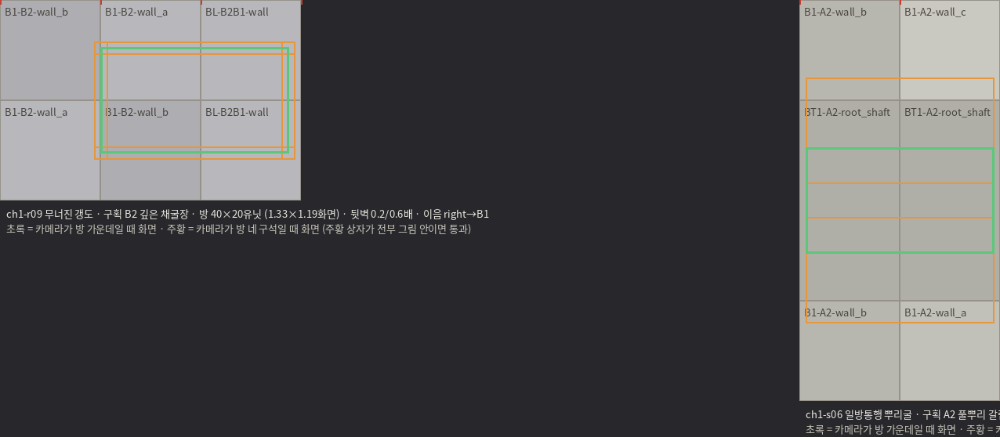

# 20. 배경 제작 파이프라인 — 해상도 → 제작 → 연결 → 유니티 → 검증 🧱

> 배경(뒷벽·세트 조각·전경)과 그 앞의 지형을 **한 줄로** 만드는 법. 프롬프트 문장은 [17](17_AI_아트_프롬프트.md) · 에셋별 완성 프롬프트는 [19](19_에셋_목록_프롬프트.md) / `Art/ALL_PROMPTS.md`, 이 문서는 **크기·순서·이어 붙이기·유니티 배치·검사**만 다뤄.
> 표는 `python Tools/build_doc20.py`로 자동 생성 (손으로 고치지 말고 `build_prompts.py` → 이 스크립트).
> 그림체: **분위기 중심의 선명한 2D 일러스트 · 강한 실루엣 · 깊은 공간** — MSB v5 / UNIFY v5. 할로우 나이트를 분위기 레퍼런스로 삼되 Unfin의 화구 세계를 표현한다.
> **v5 적용 상태:** 아래 자동화의 평균 밝기 검사·종이색 후처리는 이전 v3/v4 기준이다. 새 골든 장면에 맞게 프로파일을 재조정한 뒤 자동 채택을 사용한다. 현재 문서/프롬프트 개정만으로 검사 도구의 스타일 기준이 바뀐 것은 아니다.

---

## 2026-10-16 · 현재 배경 디자인과 실제 적용 규격

[1지역 배경 v1](../Art/samples/region1-backgrounds-v1/design.json)은 구역별 대표 배경 4장과 실제 연결 방향을 반영한 전환 시안 4장이다. 이미지와 생성 프롬프트는 같은 폴더에 있다. 30개 방과 11개 세부 구획의 변주 기준까지 배정했으며, 이번 원화는 구역 대표 디자인이다. 아직 승인된 반복 타일·분리된 패럴랙스 레이어·Unity 적용 결과가 아니다.

현행 Unity 프로토타입은 **128px 타일·PPU 128, 1920×1080에서 15×8.4375유닛 시야**다. 아래의 기존 256px·30유닛 제작 표와 자동 배치 수치를 실제 적용 시 그대로 복사하지 않는다. 새 배경을 넣을 때 실제 원본 해상도와 이 시야에 맞춰 크기·패럴랙스 범위를 다시 계산한다.

구역 경계는 A→B 세로, C→A 세로, C→D 가로, D→A 세로의 네 연결을 우선한다. 전환 원화의 가운데에서 양쪽 재료가 겹치며 공통 공기색으로 이어지게 디자인했다. 실제 제작에서는 구역 뒷벽의 경계 띠를 맞추고 이음 원화를 연결한 뒤, 같은 월드 좌표의 전환 가중치를 원경·중경·안개에 적용한다. 패럴랙스마다 경계 위치가 달라지거나 구역 진입 프레임에 그림이 통째로 바뀌지 않도록 이동 중 검수한다. 현재 시안은 가장자리 픽셀 일치나 4방향 반복성을 보장하지 않는다.

## 0. 한눈에 🗺️

```
  [1 크기]          [2 만들기]                          [3 잇기]                 [4 유니티]                    [5 검증]
 AI 요청 크기  →  뽑기 → prep(자르고 키우기)  →  A 테두리 원본 → B·C·세로·이음  →  bg_manifest.py build  →  art_check → seam_check
 (1024~1536)       → unify_pass(색·명도)             (공통 테두리 띠 10%)         → BgRoomBuilder로 자동 배치      → bg_manifest check/preview
                                                                                                                    → 유니티 화면 검수 → approve
```

| 숫자 | 값 | 어디서 |
|---|---|---|
| 배경 구획 | **22개** (구역 8 × 2~3) · 구획마다 뒷벽 3장 = 66장 | §4 |
| 구획 이음 | **22장** (지도에서 실제로 맞닿은 쌍만) | §3 · §6 |
| 세로 전용 뒷벽 | **6장** (1.5화면 이상 높은 곳) | §4 |
| 세트 조각 | **109개** (방 대표 + 높은 방 추가 + 구역 공용 40) | §4 |
| 지형 | 속 채움·띠 67 · 구역 이음 8 | §6-3 |
| 방 · 수직굴 | **56 + 14** · 뒷벽 칸 357개 자동 배치 | `Art/bg_unity_manifest.json` |

---

## 1. 해상도 📐

### 1-1. 기준 숫자

> [21 고해상도 타일맵 규격](21_고해상도_타일맵_규격.md)이 공통 기준이다. 지형·캐릭터 PPU 256, 기존 큰 배경·방 전체 장식 PPU 128을 구분한다. 표의 큰 지형 원본은 최종 256px 셀로 잘라 쓰거나 여러 칸을 덮는 그림으로 사용한다.

| 항목 | 값 | 설명 |
|---|---|---|
| 지도 1칸 | **유니티 1유닛** = HTML 16 논리 단위 (이미지 픽셀 아님) | 프로토타입 지도 좌표 그대로 |
| 화면 | 시야 **30×16.875유닛** → 1080p·1440p·4K 직접 렌더링 | 카메라 Orthographic Size **8.4375** |
| 지형·캐릭터 | **256px/유닛, PPU 256** · 단일 타일 256×256px | 1080p에서 1/4, 4K에서 1/2로 축소 |
| 큰 배경·방 오버레이 | **PPU 128** 유지 | 지형 타일과 별도 크기; 2배 고밀도 교체 시 이미지와 PPU를 함께 2배 |
| 뒷벽 한 장 | 2048² = **16 × 16 유닛** (화면 반 장 조금 넘음) | 뒷벽은 0.2배로 움직여서 한 방에 보통 2~6장 |
| 세로 뒷벽 | 2048×4096 = **16 × 32 유닛** | 2.7화면 높이 방도 위아래는 뒷벽 A로 이어 채움 |
| 방 장식 | 3840×2160 = **30 × 16.875 유닛 = 화면 한 장** | |

### 1-2. 종류별 원본 크기 (AI 요청 → 최종 원본 → 유니티)

> L3 지형 원본은 PPU 256, 나머지 큰 배경과 방 장식은 PPU 128로 환산한다. 모서리·발판·특수 원본의 표기 크기는 자르기 전 전체 캔버스다. 실제 배치 칸 수에 맞게 자르고 256px/유닛으로 내보내며, 원본 전체를 무조건 한 칸에 축소하지 않는다.

> 프로젝트 기본 생성 예시는 **한 변 약 1024~1536px · 비율 1:1 / 3:2 / 2:3 / 16:9**다. 실제 지원 크기는 도구별로 확인하고, 최종 크기로 직접 생성할 수 있으면 불필요한 업스케일을 생략한다.
> 자르기·키우기: `python Tools/tile_kit.py prep 뽑은그림.png --id <에셋ID> [--seamless]` (Lanczos = 임시, 최종은 **일러스트용 AI 업스케일러** ×2 권장)

| 층 | 그림 | 개수 | ① AI에 요청 (비율 · 보통 크기) | ② 최종 PNG | ③ 유니티 크기 (유닛) | 만드는 법 |
|---|---|---|---|---|---|---|
| L1 | 구획 뒷벽 (A·B·C) | 66 | 1:1 · 1024×1024 | **2048×2048** | 16 × 16 | A = 타일링 옵션으로 생성 → B·C = `variant-base` + 안쪽 인페인팅 |
| L1 | 세로 전용 뒷벽 | 6 | 2:3 · 1024×1536 | **2048×4096** | 16 × 32 | `tall-base` 밑그림 → 1024 조각씩 아래→위 인페인팅 |
| L1 | 구획 이음 (뒷벽) | 22 | 1:1 · 1024×1024 | **2048×2048** | 16 × 16 | `link-base` 밑그림 → 가운데만 인페인팅 |
| L2 | 세트 조각 (대표·공용) | 109 | 3:2 · 1536×1024<br>2:3 · 1024×1536<br>1:1 · 1024×1024<br>3:2 · 1536×1024 | **2048×1365<br>1024×2048<br>2048×2048<br>2048×1024** | 16 × 10.66<br>8 × 16<br>16 × 16<br>16 × 8 | 낱개 투명 PNG (↕️ 조각은 세로 타일링) |
| L4 | 전경 테두리 | 2 | 3:2 · 1536×1024 | **2048×1024** | 16 × 8 | 가로 타일링 옵션, 가운데 투명 |
| L3 | 지형 속 채움 (+ 골든) | 29 | 1:1 · 1024×1024 | **2048×2048** | 8 × 8 | fill_a = 타일링 → b·c = `variant-base` |
| L3 | 지형 가장자리 띠 (+ 띠 이음) | 38 | 3:2 · 1536×1024 | **2048×512** | 8 × 2 | 3:2로 뽑아 가운데 4:1 띠 → `prep --seamless` |
| L3 | 구역 지형 이음 (속) | 8 | 1:1 · 1024×1024 | **2048×2048** | 8 × 8 | `link-base` 두 구역 fill_a |
| L3 | 지형 모서리 | 4 | 1:1 · 1024×1024 | **1024×1024** | 4 × 4 | 투명 낱개 |
| L3 | 발판 | 9 | 3:2 · 1536×1024 | **2048×512** | 8 × 2 | 투명 낱개 |
| L3 | 특수 지형 | 10 | 2:3 · 1024×1536 | **1024×2048** | 4 × 8 | 투명 낱개 |
| L3 | 방 장식 (투명 오버레이) | 57 | 16:9 (안 되면 3:2) · 1792×1024 또는 1536×1024 | **3840×2160** | 30 × 16.88 | ControlNet(방 윤곽) 0.4~0.6, 투명 |

- 최종 원본 크기에 못 미치는 생성물은 제작용 중간 결과다. 원래 배치 크기를 맞추려고 PPU만 낮추면 화질이 부족해질 수 있다. 고해상도 재생성 또는 일러스트용 업스케일·선 보정 후 최종 크기와 실제 화면 품질을 함께 검수한다. 낮은 해상도 도트를 크게 늘리는 방식은 금지한다.
- ⚠️ 업스케일 후 **선 굵기 확인** (지형 원본은 1080p 굵기 ×4, 기존 배경은 ×2): 뒷벽 2~3px · 세트 조각 3px · 지형·발판 10~12px @ PPU 256 ([16](16_아트_컨셉.md) §2-2)
- ⚠️ 이어지는 그림(뒷벽·채움·띠·이음·전경·↕️ 조각)은 **업스케일 뒤에 다시 이어짐 검사** — 업스케일러가 가장자리를 바꿀 수 있음

---

## 2. 층 구조 · 패럴랙스 🥞

| 층 | 무엇 | 정렬 레이어 (Sorting Layer) | 패럴랙스 f (가로, 세로) | 그림 |
|---|---|---|---|---|
| L0 | 종이 바탕 | 카메라 배경색 (`BgPaperColor`) | 화면 고정 | 장 종이색 (1장 `#BDBCB5`, 2장 `#C7BBA8`) |
| L1 | **구획 뒷벽** | `BG_Wall` | **0.2, 0.6** | 뒷벽 A·B·C · 세로 뒷벽 · 구획 이음 |
| L2 | **세트 조각** | `BG_Set` | **0.5, 0.8** | 방 대표 조각 · 공용 조각 |
| L3 | 플레이 | `Terrain` < `Decor` < `Actors` < `Fx` | 1, 1 | 지형(고해상도 다중 Tilemap) · 방 장식 · 캐릭터 |
| L4 | 전경 테두리 | `Fore` | **1.3, 0** (세로는 화면 고정) | 위·아래 가장자리 매달린 덩어리, 투명도 40% |

**패럴랙스 식 (방 가운데 기준)** — `Tools/unity/Runtime/BgParallax.cs`
```
층 위치 = 방 가운데 + (카메라 − 방 가운데) × (1 − f)
f = 플레이 층이 1 움직일 때 이 층이 화면에서 움직이는 양 (0 = 화면에 붙음, 1 = 지형과 같이)
```
- **방 가운데 기준**이라 카메라가 방 가운데일 때 = 씬에 놓은 자리 그대로 보임 → 배치는 "카메라가 방 가운데" 기준으로 하면 됨
- 세로 f가 가로보다 큰 이유: 높은 방에서 위아래로 오갈 때 배경이 덜 미끄러지게 (세트 조각이 지형 위로 떠 보이는 것 방지)
- 이 층이 보일 수 있는 범위(한쪽) = `화면/2 + max(0, 방/2 − 화면/2) × f + 1` → 뒷벽은 이 범위를 칸으로 덮음 (`bg_manifest.py`가 계산)

---

## 3. 제작 방식 🛠️

### 3-1. 만드는 순서 (앞 단계가 뒤 단계의 테두리·밑그림이 됨)

| # | 무엇 | 왜 이 순서 | 통과해야 다음으로 |
|---|---|---|---|
| 0 | 골든 G1~G5 (+ 장 골든) | 모든 그림의 스타일·명도 기준 | 사람 승인 |
| 1 | 구획 뒷벽 **A** 22장 | **테두리 원본** — B·C·세로·이음이 전부 A의 띠를 씀 | `art_check` + `tile_kit check A` |
| 2 | 구획 뒷벽 **B·C** 44장 | A의 띠 그대로 + 안쪽만 새로 | `tile_kit check A B C` (테두리 차이 ≤ 4) |
| 3 | 세로 전용 뒷벽 6장 | 위·아래 띠 = 그 구획 A | `seam_check check` (A 위·아래로 붙여 검사) |
| 4 | 구획 이음 22장 | 양 끝 = 두 구획의 A | `seam_check check` |
| 5 | 지형 fill_a → b·c → 띠 3종 (구역마다) | 뒷벽과 같은 방식 (fill_a = 테두리 원본) | `art_check` 이어짐 + 3단 가장자리 |
| 6 | 지형 구역 이음 (속 + 띠) | 두 구역 fill_a·띠가 있어야 밑그림 가능 | `seam_check check` |
| 7 | 공용 세트 조각 40 → 방 대표 조각 64 | 뒷벽 위에 올려 명도 확인하면서 | `art_check` (투명·발판처럼 평평한 위 금지) |
| 8 | 전경 2장 · 방 장식 57장 | 방 화면이 거의 다 갖춰진 뒤 | 한 화면 검수 |

### 3-2. 그림마다 한 장 만드는 흐름 (공통)

```
① 프롬프트 복사       Art/ALL_PROMPTS.md 에서 에셋 ID 찾기 (MSB v5 + TYPE + MAT + UNIFY v5 + 네거티브가 이미 조립돼 있음)
② AI에 요청          📐 줄의 비율로 (예: 뒷벽 1:1 · 세로 뒷벽 2:3 · 띠 3:2) + 레퍼런스 = 골든 + 같은 구획 A
③ 자르고 키우기       python Tools/tile_kit.py prep 뽑은.png --id B1-A1-wall_a --seamless
④ 넣기               Art/inbox/B1-A1-wall_a.png  (파일 이름 = 에셋 ID)
⑤ 자동 처리          art_check: 크기·이어짐·명도·반복 검사 → unify_pass(장 색·종이 결) → Art/out/<경로> 또는 Art/rejected/<ID>/이유.txt
```

### 3-3. 종류별 만드는 법

**① 구획 뒷벽 A (테두리 원본)**
- SD: A1111 `Tiling` 체크 / ComfyUI Seamless Tile(순환 패딩) · Midjourney `--tile` · **타일링 옵션 없는 AI** → 뽑은 뒤 `tile_kit.py seamless 그림.png` → 가운데 십자 이음 자리만 인페인팅
- 확인: `tile_kit.py offset A.png` (반 칸 밀어 보기) → 가운데 십자에 선이 보이면 다시
- 하늘·지평선·바닥·위아래 방향 ❌ (어느 쪽으로 이어 붙여도 말이 되는 벽 질감) · 가장자리 어둡게(비네트)·테두리 선 ❌

**② 같은 구획 B·C**
```
python Tools/tile_kit.py variant-base B1-A1-wall_a.png      → _base.png (안쪽 = A를 반 칸 민 그림) + _base_mask.png (흰색 = 새로 그릴 곳)
인페인팅: 밑그림 + 마스크, 같은 프롬프트 (variation B/C), 디노이즈 0.55~0.7, 마스크 바깥(테두리 띠 10%) 절대 안 건드림
python Tools/tile_kit.py check A.png B.png C.png            → 좌↔우·위↔아래 ≤ 2.0 · 테두리 차이 ≤ 4
```

**③ 세로 전용 뒷벽** (2048×4096 한 번에 못 뽑음)
```
python Tools/tile_kit.py tall-base B1-C2-wall_a.png --ratio 2   → A를 세로로 2장 이은 밑그림 + 마스크(위·아래 띠만 지킴)
인페인팅: 1024 높이 조각씩 아래 → 위로 (아래 = 무겁고 진함, 위 = 가볍고 밝은 틈) · 좌우 타일링(Tiling X)만 켬
```
- 위·아래 띠가 A와 같아서 **세로 뒷벽 위아래로 A·B·C를 이어 깔 수 있음** (방이 32유닛보다 높아도 OK)
- 좌우는 자기 자신과 이어짐 → 높은 방은 **세로 뒷벽을 가로로 반복**해서 깔아 (A와 옆으로 붙이지 않음)

**④ 구획 이음**
```
python Tools/tile_kit.py link-base B1-A2-wall_a.png B1-A1-wall_a.png --dir h --out BL-A2A1-wall_base.png
인페인팅: 양 끝 10% 띠 지키고 가운데만, 프롬프트 = BL-A2A1-wall (왼쪽은 A2 재료, 오른쪽은 A1 재료)
```
- 가로 이음(h): 왼쪽 끝 = 앞 구획 A의 왼쪽 띠, 오른쪽 끝 = 뒤 구획 A의 오른쪽 띠, **위↔아래는 자기 자신과 이어짐**
- 세로 이음(v): 위 끝 = 앞 구획, 아래 끝 = 뒤 구획, **좌↔우는 자기 자신과 이어짐**

**⑤ 세트 조각** — 투명 낱개, 붙는 곳 4종 (프롬프트에 끝 처리 문구가 이미 들어 있음)

| 붙는 곳 | 그림 끝 | 유니티 |
|---|---|---|
| ⬇️ 매달림 | 위 끝이 잘림 (천장 뒤로) | 위 끝을 천장 지형 뒤로 `buryMin` 이상 |
| ⬆️ 솟음 | 밑동이 어둡게 흐려지거나 잘림 | 밑동을 바닥 지형 뒤로 `buryMin` 이상 |
| ↕️ 바닥~천장 | 위아래 잘림 + **세로로 이어짐** | Draw Mode Tiled로 방 높이만큼 늘림 |
| 🧱 벽에 붙음 | 가장자리가 뒷벽으로 흐려짐 | 자유 배치 |

- 위가 **평평한 조각 금지** (발판으로 착각) · 지형보다 밝고 뒷벽보다 진하게 (뒷벽보다 15~20 어둡게)

**⑥ 전경** — 2:1, 가로로 이어짐 (Tiling X), **가운데 60%는 투명**, 위·아래 가장자리만 덩어리

---

## 4. 구역 · 구획별 이미지 🧭

> 같은 장 = 같은 재료·명도 → **한 지역으로 보이게**. 구역마다 **디테일·아주 옅은 색 기운**만 달라서 → **다른 구역에 온 느낌**. 구획(구역 안 2~3개)마다 뒷벽이 다르고, 방마다 대표 조각이 달라서 **같은 구획 안에서도 방마다 다르게** 보임.
> 화면 수 = 방 크기 ÷ 화면 (1.0×1.0 = 딱 한 화면). 세로 1.5 이상인 곳에 세로 뒷벽.

#### A · 구겨진 종이굴 (1장) · 색 기운 `#C2C1B9`

- 공용 세트 조각 5: `B1-A-set_boulder` ⬆️ · `B1-A-set_column` ↕️ · `B1-A-set_opening` 🧱 · `B1-A-set_roots` ⬇️ · `B1-A-set_support` ↕️
- 지형 (구역 전용): `TZ1-A-edge_bottom` · `TZ1-A-edge_side` · `TZ1-A-edge_top` · `TZ1-A-fill_a` · `TZ1-A-fill_b` · `TZ1-A-fill_c`

| 구획 | 이름 | 뒷벽 (변형 3) | 방 · 수직굴 (화면 수 가로×세로) | 대표 조각 | 세로 뒷벽 |
|---|---|---|---|---|---|
| **A1** | 종이 틈 입구 | `B1-A1-wall_a` (테두리 원본) · `_b` · `_c` | `ch1-r01` 시작의 백지길 (1.0×1.07)<br>`ch1-r02` 바람 드는 종이 틈 (1.0×1.07)<br>`ch1-r03` 구겨진 종이 비탈 (0.8×1.07)<br>`ch1-s01` 바람 굴뚝 (0.17×1.36) | `BR1-01`🧱 `BR1-02`🧱 `BR1-03`⬆️ | — |
| **A2** | 풀뿌리 갈림굴 | `B1-A2-wall_a` (테두리 원본) · `_b` · `_c` | `ch1-r04` 풀 그림자 굴 (0.47×1.9)<br>`ch1-r05` 갈림길 굴 (1.47×1.96)<br>`ch1-r06` 갈림굴 다락 (0.87×1.07)<br>`ch1-r25` 과녁 뒤 서재 (0.27×0.36)<br>`ch1-s06` 일방통행 뿌리굴 (0.17×5.1) | `BR1-04`⬇️ `BR1-04b`⬇️ `BR1-05`⬆️ `BR1-05b`⬇️ `BR1-06`🧱 `BR1-25`🧱 | `BT1-A2-root_shaft` → `ch1-s06` |

#### B · 흑연 광산 (1장) · 색 기운 `#B8B8BC`

- 공용 세트 조각 5: `B1-B-set_frame` ↕️ · `B1-B-set_ladder` ⬇️ · `B1-B-set_lantern` ⬇️ · `B1-B-set_stalactites` ⬇️ · `B1-B-set_trestle` ⬆️
- 지형 (구역 전용): `TZ1-B-edge_bottom` · `TZ1-B-edge_side` · `TZ1-B-edge_top` · `TZ1-B-fill_a` · `TZ1-B-fill_b` · `TZ1-B-fill_c`

| 구획 | 이름 | 뒷벽 (변형 3) | 방 · 수직굴 (화면 수 가로×세로) | 대표 조각 | 세로 뒷벽 |
|---|---|---|---|---|---|
| **B1** | 광산 입구·갱도 | `B1-B1-wall_a` (테두리 원본) · `_b` · `_c` | `ch1-r07` 광산 입구 (1.0×1.96)<br>`ch1-r08` 흑연 갱도 (1.67×1.07)<br>`ch1-r12` 덩굴 뒤 창고 (0.33×0.24)<br>`ch1-r27` 잠긴 수로 끝 (0.3×0.24)<br>`ch1-s02` 광산 승강로 (0.17×1.66) | `BR1-07`↕️ `BR1-07b`⬇️ `BR1-08`↕️ `BR1-12`⬆️ `BR1-27`🧱 | — |
| **B2** | 깊은 채굴장 | `B1-B2-wall_a` (테두리 원본) · `_b` · `_c` | `ch1-r09` 무너진 갱도 (1.33×2.37)<br>`ch1-r10` 광부의 쉼터 (0.8×1.78)<br>`ch1-r11` 감독의 채굴장 (1.0×2.01)<br>`ch1-r29` 그리다 만 강아지 굴 (0.47×0.36) | `BR1-09`⬆️ `BR1-09b`🧱 `BR1-10`🧱 `BR1-10b`🧱 `BR1-11`🧱 `BR1-11b`⬇️ `BR1-29`🧱 | — |
| **B3** | 찢긴 페이지 굴 | `B1-B3-wall_a` (테두리 원본) · `_b` · `_c` | `ch1-r30` 찢긴 페이지 굴 (1.33×0.41) | `BR1-30`🧱 | — |

#### C · 스케치 나무 속 (1장) · 색 기운 `#B6BDB6`

- 공용 세트 조각 5: `B1-C-set_branch_stub` 🧱 · `B1-C-set_fungus` 🧱 · `B1-C-set_knot_hole` 🧱 · `B1-C-set_moss` ⬇️ · `B1-C-set_root_arch` ⬆️
- 지형 (구역 전용): `TZ1-C-edge_bottom` · `TZ1-C-edge_side` · `TZ1-C-edge_top` · `TZ1-C-fill_a` · `TZ1-C-fill_b` · `TZ1-C-fill_c`

| 구획 | 이름 | 뒷벽 (변형 3) | 방 · 수직굴 (화면 수 가로×세로) | 대표 조각 | 세로 뒷벽 |
|---|---|---|---|---|---|
| **C1** | 나무 밑동 속 | `B1-C1-wall_a` (테두리 원본) · `_b` · `_c` | `ch1-r13` 옹이 방 (1.0×1.07)<br>`ch1-r26` 밀랍 둥지 (0.37×0.3)<br>`ch1-s03` 덩굴 수직굴 (0.17×2.37)<br>`ch1-s07` 밀랍 수직굴 (0.17×1.19) | `BR1-13`🧱 `BR1-26`⬇️ | `BT1-C1-vine_shaft` → `ch1-s03` |
| **C2** | 속 빈 줄기 | `B1-C2-wall_a` (테두리 원본) · `_b` · `_c` | `ch1-r14` 나무 속 탑 (0.73×4.09) | `BR1-14`↕️ `BR1-14b`🧱 `BR1-14c`🧱 | `BT1-C2-tower` → `ch1-r14` |
| **C3** | 가지 속·둥지 | `B1-C3-wall_a` (테두리 원본) · `_b` · `_c` | `ch1-r15` 가지 속 통로 (2.0×1.13)<br>`ch1-r16` 지워진 둥지 (0.4×0.95)<br>`ch1-r17` 새 둥지 (0.73×1.07) | `BR1-15`🧱 `BR1-16`🧱 `BR1-17`🧱 | — |

#### D · 엉킨 뿌리 심부 (1장) · 색 기운 `#C0B8B6`

- 공용 세트 조각 5: `B1-D-set_nest` 🧱 · `B1-D-set_root_bridge` ⬇️ · `B1-D-set_root_pillar` ↕️ · `B1-D-set_thorn_knot` 🧱 · `B1-D-set_vine_curtain` ⬇️
- 지형 (구역 전용): `TZ1-D-edge_bottom` · `TZ1-D-edge_side` · `TZ1-D-edge_top` · `TZ1-D-fill_a` · `TZ1-D-fill_b` · `TZ1-D-fill_c`

| 구획 | 이름 | 뒷벽 (변형 3) | 방 · 수직굴 (화면 수 가로×세로) | 대표 조각 | 세로 뒷벽 |
|---|---|---|---|---|---|
| **D1** | 덩굴 다리 위층 | `B1-D1-wall_a` (테두리 원본) · `_b` · `_c` | `ch1-r18` 덩굴 다리 (1.33×1.9)<br>`ch1-r19` 위쪽 갈림 (1.0×1.07)<br>`ch1-r28` 솜뭉치 선반 (0.53×0.41)<br>`ch1-s04` 다리 아래 굴 (0.17×1.19) | `BR1-18`⬇️ `BR1-18b`⬇️ `BR1-19`🧱 `BR1-28`⬇️ | — |
| **D2** | 사냥꾼의 굴 | `B1-D2-wall_a` (테두리 원본) · `_b` · `_c` | `ch1-r20` 사냥꾼의 굴 (1.2×1.72)<br>`ch1-r21` 둥지 앞 쉼터 (0.73×1.07)<br>`ch1-r23` 뿌리 내리막 (1.33×1.07)<br>`ch1-s05` 쉼터 아래 굴 (0.17×1.19) | `BR1-20`🧱 `BR1-21`🧱 `BR1-23`⬆️ | — |
| **D3** | 낙서 둥지 | `B1-D3-wall_a` (테두리 원본) · `_b` · `_c` | `ch1-r22` 낙서 덩어리의 둥지 (0.93×1.96)<br>`ch1-r24` 둥지 뒤 비밀 방 (0.23×0.18) | `BR1-22`↕️ `BR1-22b`⬇️ `BR1-24`🧱 | — |

#### E · 노을 크레파스 굴 (2장) · 색 기운 `#C5BCB1`

- 공용 세트 조각 5: `B2-E-set_broken_pillar` ⬆️ · `B2-E-set_drips` ⬇️ · `B2-E-set_glow_crack` 🧱 · `B2-E-set_ledge` ⬆️ · `B2-E-set_stalagmite` ⬆️
- 지형 (구역 전용): `TZ2-E-edge_bottom` · `TZ2-E-edge_side` · `TZ2-E-edge_top` · `TZ2-E-fill_a` · `TZ2-E-fill_b` · `TZ2-E-fill_c`

| 구획 | 이름 | 뒷벽 (변형 3) | 방 · 수직굴 (화면 수 가로×세로) | 대표 조각 | 세로 뒷벽 |
|---|---|---|---|---|---|
| **E1** | 물감 번진 관문 | `B2-E1-wall_a` (테두리 원본) · `_b` · `_c` | `ch2-r01` 물감 번진 관문 (0.8×0.59) | `BR2-01`🧱 | — |
| **E2** | 노을빛 굴 | `B2-E2-wall_a` (테두리 원본) · `_b` · `_c` | `ch2-r02` 첫 크레파스 비탈 (1.33×0.71)<br>`ch2-r03` 노을빛 큰 굴 (1.53×0.83)<br>`ch2-r11` 바람개비 환기굴 (1.2×0.47)<br>`ch2-s08` 바람개비 수직굴 (0.17×1.3) | `BR2-02`🧱 `BR2-03`🧱 `BR2-11`↕️ | — |
| **E3** | 삼색 광장 | `B2-E3-wall_a` (테두리 원본) · `_b` · `_c` | `ch2-r04` 삼색 광장 (1.47×0.83) | `BR2-04`🧱 | — |

#### F · 밀랍 공방 (2장) · 색 기운 `#C0BAB3`

- 공용 세트 조각 5: `B2-F-set_flue` ↕️ · `B2-F-set_pulley` ⬇️ · `B2-F-set_rack` ⬆️ · `B2-F-set_shelves` 🧱 · `B2-F-set_vat` ⬆️
- 지형 (구역 전용): `TZ2-F-edge_bottom` · `TZ2-F-edge_side` · `TZ2-F-edge_top` · `TZ2-F-fill_a` · `TZ2-F-fill_b` · `TZ2-F-fill_c`

| 구획 | 이름 | 뒷벽 (변형 3) | 방 · 수직굴 (화면 수 가로×세로) | 대표 조각 | 세로 뒷벽 |
|---|---|---|---|---|---|
| **F1** | 공방 작업장 | `B2-F1-wall_a` (테두리 원본) · `_b` · `_c` | `ch2-r05` 화로 작업장 (1.47×0.83)<br>`ch2-r06` 공방 입구 (1.2×0.59)<br>`ch2-s09` 녹아내린 굴뚝 (0.17×1.42)<br>`ch2-s10` 저장고 승강로 (0.17×0.47)<br>`ch2-s11` 공방 굴뚝 (크레파스 굴 지름길) (0.17×1.3) | `BR2-05`⬆️ `BR2-06`🧱 | — |
| **F2** | 밀랍 저장고 | `B2-F2-wall_a` (테두리 원본) · `_b` · `_c` | `ch2-r07` 밀랍 저장고 (1.33×0.95)<br>`ch2-r08` 지워진 그림 창고 (0.2×0.24)<br>`ch2-r09` 빨강 물감통 방 (0.87×0.59) | `BR2-07`🧱 `BR2-08`⬆️ `BR2-09`⬆️ | — |
| **F3** | 물 고인 아래층 | `B2-F3-wall_a` (테두리 원본) · `_b` · `_c` | `ch2-r10` 거북의 굴 (1.13×0.95)<br>`ch2-r24` 잠긴 물웅덩이 동굴 (1.0×0.36) | `BR2-10`🧱 `BR2-24`🧱 | — |

#### G · 색칠 지하 협곡 (2장) · 색 기운 `#BABBC2`

- 공용 세트 조각 5: `B2-G-set_arch` ⬆️ · `B2-G-set_boulder` ⬆️ · `B2-G-set_paint_fall` ↕️ · `B2-G-set_paint_stalactites` ⬇️ · `B2-G-set_strata_spire` ⬆️
- 지형 (구역 전용): `TZ2-G-edge_bottom` · `TZ2-G-edge_side` · `TZ2-G-edge_top` · `TZ2-G-fill_a` · `TZ2-G-fill_b` · `TZ2-G-fill_c`

| 구획 | 이름 | 뒷벽 (변형 3) | 방 · 수직굴 (화면 수 가로×세로) | 대표 조각 | 세로 뒷벽 |
|---|---|---|---|---|---|
| **G1** | 협곡 중턱 | `B2-G1-wall_a` (테두리 원본) · `_b` · `_c` | `ch2-r12` 협곡 중턱 (1.67×0.59)<br>`ch2-r13` 덩굴 뒤 물감 창고 (0.2×0.36)<br>`ch2-r14` 막대 다리 건너 (1.0×0.59)<br>`ch2-r25` 바람 굴 (1.2×0.47)<br>`ch2-s12` 협곡 낭떠러지 (0.2×2.49)<br>`ch2-s13` 협곡 사다리 (0.17×1.42) | `BR2-12`🧱 `BR2-13`⬇️ `BR2-14`⬆️ `BR2-25`⬇️ | `BT2-G1-cliff_shaft` → `ch2-s12` |
| **G2** | 협곡 바닥 | `B2-G2-wall_a` (테두리 원본) · `_b` · `_c` | `ch2-r15` 협곡 바닥 (2.33×0.71)<br>`ch2-r16` 협곡 과녁 방 (0.67×0.47)<br>`ch2-r17` 녹은 크레파스 광맥 (1.13×0.71) | `BR2-15`⬆️ `BR2-16`🧱 `BR2-17`🧱 | — |
| **G3** | 물감 폭포 홀 | `B2-G3-wall_a` (테두리 원본) · `_b` · `_c` | `ch2-r18` 물감 폭포 홀 (1.13×1.66)<br>`ch2-r23` 폭포 뒤 틈 (0.2×0.24) | `BR2-18`↕️ `BR2-18b`🧱 `BR2-18c`🧱 `BR2-23`🧱 | `BT2-G3-hall` → `ch2-r18` |

#### H · 기사의 탑 (2장) · 색 기운 `#C2B8B5`

- 공용 세트 조각 5: `B2-H-set_banner` ⬇️ · `B2-H-set_column` ↕️ · `B2-H-set_stair` ⬆️ · `B2-H-set_weapon_rack` ⬆️ · `B2-H-set_window` 🧱
- 지형 (구역 전용): `TZ2-H-edge_bottom` · `TZ2-H-edge_side` · `TZ2-H-edge_top` · `TZ2-H-fill_a` · `TZ2-H-fill_b` · `TZ2-H-fill_c`

| 구획 | 이름 | 뒷벽 (변형 3) | 방 · 수직굴 (화면 수 가로×세로) | 대표 조각 | 세로 뒷벽 |
|---|---|---|---|---|---|
| **H1** | 탑 아래층 | `B2-H1-wall_a` (테두리 원본) · `_b` · `_c` | `ch2-r19` 기사 앞 쉼터 (0.67×0.47)<br>`ch2-r20` 기사의 연병장 (1.2×1.19)<br>`ch2-r21` 탑 옆 틈새 (0.2×0.24)<br>`ch2-s14` 크레파스 탑 (0.23×2.25) | `BR2-19`⬆️ `BR2-20`⬆️ `BR2-20b`🧱 `BR2-21`🧱 | `BT2-H1-tower_shaft` → `ch2-s14` |
| **H2** | 탑 위층 | `B2-H2-wall_a` (테두리 원본) · `_b` · `_c` | `ch2-r22` 탑 꼭대기 (1.47×0.47)<br>`ch2-r26` 해님 다락 (0.8×0.36) | `BR2-22`🧱 `BR2-26`🧱 | — |

---

## 5. 유니티에 넣는 법 🎮

### 5-0. 준비물 (이 저장소 → 유니티 프로젝트 `Unfin/`)

| 이 저장소 | 유니티 | 비고 |
|---|---|---|
| `Art/out/**` (승인된 그림) | `Assets/Art/**` (경로 그대로) | 경로가 같아야 매니페스트가 찾음 |
| `Art/bg_unity_manifest.json` | `Assets/Art/bg_unity_manifest.json` | 방마다 깔 그림 목록 (자동 생성) |
| `Tools/unity/Runtime/*.cs` | `Assets/Scripts/Unfin/Background/` | `BgParallax` · `BgSetPiece` · `BgPaperColor` |
| `Tools/unity/Editor/*.cs` | `Assets/Scripts/Unfin/Background/Editor/` | `UnfinArtImporter` · `BgRoomBuilder` (**Editor 폴더 안에**) |

### 5-1. 가져오기 목표 설정

> **구현 상태:** 현재 `UnfinArtImporter`는 모든 이미지에 PPU 128을 적용한다. 아래 지형·캐릭터 PPU 256 분기는 아직 미구현이다. Unity 적용 전에 타입별 분기를 반영해야 하며, 배경 매니페스트 PPU 128은 유지한다. 문서 수정만으로 자동 가져오기가 바뀌지는 않는다.

| 항목 | 값 | 이유 |
|---|---|---|
| Texture Type / Mode | Sprite (2D and UI); 타일 시트 Multiple, 낱개 Single | 타일 내용 256×256px, 여백 별도 |
| Pixels Per Unit | **지형·캐릭터 256 / 큰 배경·방 전체 오버레이 128** | 256px 지형 셀 = 1유닛. 배경의 기존 월드 크기 보존 |
| Filter | **Trilinear** + **Generate Mip Maps** | 🚫 Point·Pixel Perfect 금지 (픽셀 아트 아님) |
| Wrap Mode | 타일 아틀라스·뒷벽·세트 = **Clamp** / 독립 반복 재료만 **Repeat** | 아틀라스 셀 밖 색상 확장 여백 최소 4px, 밉 단계에 따라 증가 |
| Mesh Type | 배경·지형 = **Full Rect** / 나머지 Tight | Draw Mode Tiled는 Full Rect만 |
| Alpha | 뒷벽·채움 = 없음 (불투명) / 나머지 = 투명 | |
| Max Size | 2048 (세로 뒷벽·방 장식·골든 4096) | |
| Compression | **High Quality** (PC BC7) · Crunch 끔 | 넓은 그라디언트에 띠 생기면 None |
| Pivot | Center | 매니페스트 좌표가 가운데 기준 |

### 5-2. 정렬 레이어 · 카메라

- 메뉴 **Unfin ▸ 배경 ▸ 정렬 레이어 만들기** → `BG_Paper < BG_Wall < BG_Set < Terrain < Decor < Actors < Fx < Fore`
- 카메라: Orthographic, Size **8.4375**, Clear = Solid Color. 출력 해상도에서 직접 렌더링하며 480×270 저해상도 화면 확대·픽셀 스냅은 사용하지 않는다.
- URP 2D면 반복 배경 재료는 중립 조명으로 유지하고, 방 단위의 국소광·공기색·안개 레이어를 별도로 합성한다. 플레이어·적·탄의 가독성은 최종 장면에서 확인한다

### 5-3. 방 배경 자동 배치 (`BgRoomBuilder`)

```
python Tools/build_prompts.py           (자동으로 bg_manifest.py build 까지)
→ Art/out, Art/bg_unity_manifest.json 을 유니티 Assets/Art/ 로 복사
→ 유니티 메뉴 Unfin ▸ 배경 ▸ 방 배경 만들기 → 방 ID (예: ch1-r09) 또는 '모든 방 만들기'
```

만들어지는 것 (방 하나 = `BG_<방ID>` 오브젝트, 위치 = 방 가운데):

| 자식 | 내용 | 컴포넌트 |
|---|---|---|
| `L1_Wall` | 매니페스트의 칸 목록 그대로 — 변형 A·B·C (왼쪽·아래 칸과 같은 변형 피함, 방마다 고정 시드) · 이음 칸 · 세로 뒷벽 | `BgParallax (0.2, 0.6)` |
| `L2_Set` | 방 대표 조각을 붙는 곳에 맞는 기본 자리에 (사람이 옮겨서 다듬기), 옵션으로 공용 1개 | `BgParallax (0.5, 0.8)` + 조각마다 `BgSetPiece` |
| `L4_Fore` | 전경 띠, 화면 높이에 맞춰 가로로 늘림, 투명도 40% | `BgParallax (1.3, 0)` |

- 칸 고르기는 **파이썬(`bg_manifest.py`)이 한 번만** 정함 → 유니티 결과 = `Art/bg_preview/<방ID>.png` 와 똑같음
- **돌리기·뒤집기 금지** (테두리 띠가 어긋남). 반복 숨기기는 변형 섞기 + 대표 조각 + 공용 조각 몫
- 방을 다시 만들면 `BG_<방ID>`를 지우고 새로 만듦 → **손으로 옮긴 세트 조각은 프리팹으로 따로 저장**해 두기

### 5-4. 세트 조각 다듬기

- `BgSetPiece`를 선택하면 **빨간 선** = 지형이 최소 여기까지 가려 줘야 하는 높이 (`buryMin`)
- `buryMin = min(화면 높이, 카메라 세로 이동) × (1 − 0.8) + 0.5` — 바닥이 보이는 동안 조각이 바닥보다 덜 움직이는 만큼 묻어야 안 떠 보임
- 기본 자리는 **카메라가 맨 아래(바닥이 보일 때)·맨 위(천장이 보일 때)** 기준 → 그대로 두면 바닥·천장에 맞음
- 방마다 대표 조각 1개(높은 방은 2~3개) + 공용 1~3개, **플레이 동선 뒤에 큰 덩어리를 두지 않기** (지형과 겹쳐 읽힘)

### 5-5. 지형 (L3, 고해상도 다중 Tilemap)

- **Grid:** Cell Size 1×1유닛. 충돌 Tilemap은 숨기고 이미지와 분리한다.
- **Terrain Fill:** 구역별 A~C 재료 세트, 256px/칸. 2048² 큰 채움 원본은 8×8유닛 영역에 사용한다.
- **Terrain Detail:** 최소 4가지 무늬 계열, 인접 반복 금지·고정 시드. 여러 칸을 덮는 장식으로 일정한 격자감을 없앤다.
- **Terrain Edge:** 바닥·벽·천장·안팎 모서리를 Rule Tile 또는 같은 이웃 판정으로 선택한다. 아틀라스의 셀 내용 256px와 여백을 구분한다.
- **Decor:** 방 고유 장식·재료 조각을 추가한다. 방 전체 오버레이는 별도 PPU 128이다.
- **전환:** 구역 경계는 TL- 재료로 연결한다. 2048px 전환 원본의 기본 폭은 8유닛이며, 더 넓은 전환은 여러 조각으로 연결한다.
- **Sprite Shape:** 긴 곡선 구간에만 선택 사용. 지형 재료 PPU 256과 월드 UV 정렬을 Tilemap 쪽과 맞춘다.
- **검수:** 실제 발 딛는 높이와 벽 접촉은 충돌에 맞추고, 이미지 해상도 변경 때문에 통로·점프 거리를 바꾸지 않는다.

### 5-6. 방이 바뀔 때

- 방마다 `BG_<방ID>`를 켜고 끔 (방 들어갈 때 켜기 → `BgPaperColor`가 종이색 적용). 옆 방 배경은 미리 켜 두지 않아도 됨 — 각 방이 자기 가운데 기준
- 화면 전환(밀기·페이드) 중엔 두 방 배경이 같이 보일 수 있음 → 경계 방은 **이음 칸이 문 쪽 화면 끝**에 오게 이미 밀려 있음 (§6-2)

---

## 6. 배경끼리 연결하는 법 🔗

### 6-1. 같은 구획 안 — 공통 테두리 띠
- A·B·C의 **바깥 10% 띠가 같은 그림** → 어떤 순서로 섞어 깔아도 이음새 없음 (가로·세로 모두)
- 세로 뒷벽의 위·아래 띠 = A 띠 → 위아래로 A·B·C와 붙음

### 6-2. 구획 사이 — 구획 이음 칸
- 지도에서 맞닿은 구획 쌍마다 이음 1장 (`seam_check.py links`가 지도에서 자동으로 찾음)
- **맞닿은 곳에서 가장 가까운 방**의 그 변 끝 한 줄(가로 이음 = 맨 왼쪽/오른쪽 열, 세로 이음 = 맨 위/아래 줄)이 이음 칸
- 뒷벽 격자를 밀어서 **이음 칸 바깥 끝 = 카메라가 끝까지 갔을 때 화면 끝** → 문 앞에서 이음이 통째로 보이고, 옆 방은 뒤 구획 뒷벽으로 시작
- 이음 칸 안쪽 끝 = 이 구획 띠 → 옆 칸(이 구획 A·B·C)과 이음새 없음

| 구획 이음 | 방향 | 앞 → 뒤 | 들어가는 방 (변) | 지형 이음 (구역이 바뀔 때) |
|---|---|---|---|---|
| `BL-A2A1-wall` | 가로 (왼→오) | A2 풀뿌리 갈림굴 → A1 종이 틈 입구 | `ch1-r03` left · `ch1-r05` right | 같은 구역 |
| `BL-A2B1-wall` | 세로 (위→아래) | A2 풀뿌리 갈림굴 → B1 광산 입구·갱도 | `ch1-r05` bottom · `ch1-s02` top | `TL-AB-edge_side` `TL-AB-fill` |
| `BL-B2B1-wall` | 가로 (왼→오) | B2 깊은 채굴장 → B1 광산 입구·갱도 | `ch1-r08` left · `ch1-r09` right | 같은 구역 |
| `BL-C1A2-wall` | 세로 (위→아래) | C1 나무 밑동 속 → A2 풀뿌리 갈림굴 | `ch1-r25` top · `ch1-s03` bottom | `TL-CA-edge_side` `TL-CA-fill` |
| `BL-C2C1-wall` | 세로 (위→아래) | C2 속 빈 줄기 → C1 나무 밑동 속 | `ch1-r13` top · `ch1-r14` bottom | 같은 구역 |
| `BL-C3C2-wall` | 세로 (위→아래) | C3 가지 속·둥지 → C2 속 빈 줄기 | `ch1-r14` top · `ch1-r15` bottom | 같은 구역 |
| `BL-C3D1-wall` | 가로 (왼→오) | C3 가지 속·둥지 → D1 덩굴 다리 위층 | `ch1-r15` right · `ch1-r18` left | `TL-CD-edge_bottom` `TL-CD-edge_top` `TL-CD-fill` |
| `BL-D1D2-wall` | 세로 (위→아래) | D1 덩굴 다리 위층 → D2 사냥꾼의 굴 | `ch1-r20` top · `ch1-s04` bottom | 같은 구역 |
| `BL-D1D3-wall` | 세로 (위→아래) | D1 덩굴 다리 위층 → D3 낙서 둥지 | `ch1-r22` top · `ch1-r28` bottom | 같은 구역 |
| `BL-D2A1-wall` | 세로 (위→아래) | D2 사냥꾼의 굴 → A1 종이 틈 입구 | `ch1-r03` top · `ch1-r23` bottom | `TL-DA-edge_side` `TL-DA-fill` |
| `BL-D2D3-wall` | 가로 (왼→오) | D2 사냥꾼의 굴 → D3 낙서 둥지 | `ch1-r21` right · `ch1-r22` left | 같은 구역 |
| `BL-D3E1-wall` ⭐ 장 경계 | 가로 (왼→오) | D3 낙서 둥지 → E1 물감 번진 관문 | `ch1-r22` right · `ch2-r01` left | `TL-DE-edge_bottom` `TL-DE-edge_top` `TL-DE-fill` |
| `BL-E1E2-wall` | 가로 (왼→오) | E1 물감 번진 관문 → E2 노을빛 굴 | `ch2-r01` right · `ch2-r02` left | 같은 구역 |
| `BL-E2E3-wall` | 가로 (왼→오) | E2 노을빛 굴 → E3 삼색 광장 | `ch2-r03` right · `ch2-r04` left | 같은 구역 |
| `BL-E2F1-wall` | 세로 (위→아래) | E2 노을빛 굴 → F1 공방 작업장 | `ch2-r03` bottom · `ch2-s11` top | `TL-EF-edge_side` `TL-EF-fill` |
| `BL-E3G1-wall` | 세로 (위→아래) | E3 삼색 광장 → G1 협곡 중턱 | `ch2-r04` bottom · `ch2-s12` top | `TL-EG-edge_side` `TL-EG-fill` |
| `BL-E3H1-wall` | 가로 (왼→오) | E3 삼색 광장 → H1 탑 아래층 | `ch2-r04` right · `ch2-r19` left | `TL-EH-edge_bottom` `TL-EH-edge_top` `TL-EH-fill` |
| `BL-F1F2-wall` | 세로 (위→아래) | F1 공방 작업장 → F2 밀랍 저장고 | `ch2-r07` top · `ch2-s10` bottom | 같은 구역 |
| `BL-F2F3-wall` | 가로 (왼→오) | F2 밀랍 저장고 → F3 물 고인 아래층 | `ch2-r09` right · `ch2-r10` left | 같은 구역 |
| `BL-G1G2-wall` | 세로 (위→아래) | G1 협곡 중턱 → G2 협곡 바닥 | `ch2-r12` bottom · `ch2-r15` top | 같은 구역 |
| `BL-G2G3-wall` | 가로 (왼→오) | G2 협곡 바닥 → G3 물감 폭포 홀 | `ch2-r17` right · `ch2-r18` left | 같은 구역 |
| `BL-H2H1-wall` | 가로 (왼→오) | H2 탑 위층 → H1 탑 아래층 | `ch2-r22` right · `ch2-s14` left | 같은 구역 |

### 6-3. 구역 사이 지형 — 지형 이음
- 구역이 바뀌는 구획 이음 자리엔 지형도 바뀜 → **채움 원본 1장 기준 경계 8유닛 폭**에 `TL-<앞><뒤>-fill` (속) + 띠 이음 (가로 경계 = `edge_top`·`edge_bottom`, 세로 경계 = `edge_side`)
- 띠 이음 양 끝 = 각 구역 띠 → 바닥 선이 구역 경계를 지나도 끊기지 않음
- ⭐ **장 경계 D→E** (`TL-DE-*`, `BL-D?E?`): 연필 → 크레파스 재료가 섞이는 유일한 곳. 명도는 같게, 재료만 서서히

### 6-4. 높은 곳
- 1.5화면 이상 = 세로 뒷벽 (가운데 두 줄, 가로로 반복) + 위·아래는 A·B·C
- 세로 뒷벽 줄과 좌우 이음이 겹치는 곳 2곳(`ch2-r18` 물감 폭포 홀, `ch2-s14` 크레파스 탑)은 세로 뒷벽이 우선 → **유니티 화면에서 꼭 확인**

---

## 7. 검증 ✅

| 단계 | 언제 | 명령 | 통과 기준 | 실패하면 |
|---|---|---|---|---|
| ① 그림 한 장 | inbox에 넣을 때마다 (자동) | `python Tools/art_check.py run` (또는 `art_watch.bat` 감시) | 크기·비율 = 최종 · 이어짐 ≤ 2.0 · 기존 명도 띠는 v5 스타일 판정에서 제외·재조정 필요 · 순백 ≤ 3% · 반복·단색·딱딱한 가장자리 없음 | `Art/rejected/<ID>/이유.txt` 보고 다시 뽑기 |
| ② 같은 구획 묶음 | B·C 만든 뒤 | `python Tools/tile_kit.py check A.png B.png C.png` · `preview A B C` | 이어짐 ≤ 2.0 · 테두리 차이 ≤ 4 · 미리보기에 격자 선 없음 | 마스크 밖이 바뀜 → 다시 인페인팅 |
| ③ 이음새 | 이음·세로 뒷벽·지형 이음 넣은 뒤 | `python Tools/seam_check.py check` | 쌍마다 밝기 차 ≤ 6 · 색 차 ≤ 5 · 선 밀도 0.70~1.43배 · 윤곽 튐 ≤ 2 → `Art/seam_report.md` + `Art/seam_preview/` | 미리보기 빨간 쌍 → 이음 다시 |
| ④ 방 단위 | 유니티 넣기 전 | `python Tools/bg_manifest.py check` · `preview <방ID>` | 방에 필요한 그림 전부 ✅ → `Art/bg_room_report.md` · 주황 상자(카메라 네 구석 화면)가 전부 그림 안 | 빠진 그림부터 만들기 |
| ⑤ 유니티 화면 | 방 배치 후 | 플레이 모드로 방 네 구석까지 이동 | 아래 체크리스트 | 조각 위치·묻는 깊이 조정 |
| ⑥ 승인 | 사람이 보고 | `python Tools/art_check.py approve <ID>` | 🟡 자동 통과 → ✅ 승인 | |
| ⑦ 푸시 때 | GitHub Actions (자동) | `art-check.yml` | 전체 재검사 + 방별 준비 상태 → Actions 요약 · 보고서 다운로드 | |


> `bg_manifest.py preview` 예시 (그림이 아직 없어서 구획 색 상자로 대신). 왼쪽 `ch1-r09`: 오른쪽 끝 열이 구획 이음 `BL-B2B1` — 격자가 밀려서 카메라가 오른쪽 끝일 때 화면 끝 = 이음 끝. 오른쪽 `ch1-s06` 수직굴: 가운데 두 줄 = 세로 뒷벽, 위아래 = 구획 A·B·C. 초록 = 방 가운데에서 본 화면, 주황 = 네 구석에서 본 화면

**⑤ 유니티 화면 체크리스트**
- [ ] 뒷벽에 **격자 선·같은 무늬 반복**이 안 보임 (특히 방 가운데 → 네 구석으로 이동할 때)
- [ ] 화면 끝에 **뒷벽이 비는 곳(종이색만 보이는 곳)이 없음**
- [ ] 구획 경계 방: 문 앞에서 다음 구획 재료가 보이기 시작하고, 옆 방이 그 재료로 시작
- [ ] 세트 조각 밑동·윗동이 **지형 뒤로 숨음** (점프·낙하 중에도 공중에 뜬 순간 없음)
- [ ] 세트 조각 위가 **발판처럼 안 보임**, 플레이어(분필 흰색)가 화면에서 가장 밝음
- [ ] 명도: 방별 분위기·먼 배경의 낮은 대비·전경 실루엣·선명한 접촉 면. 종이 70% 고정 금지; 주인공·적·탄이 읽히는지 확인
- [ ] 전경이 플레이를 가리지 않음 (가운데 비어 있음)
- [ ] 1920×1080·2560×1440·3840×2160 세 해상도에서 선이 뭉개지거나 계단지지 않음

---

## 8. 다른 AI에게 맡길 때 (복사해서 붙여넣기) 🤖

**8-1. 이미지 생성 AI** (그림 한 장)
```
너는 Unfin 게임의 배경 그림을 만든다. 그림체는 부드러운 그래픽 디자인: 선명하고 일정한 굵기의 외곽선, 평평한 색 + 부드러운 2단 음영,
거친 선·해칭·사실적 미세 질감 금지. 강한 실루엣, 층별 공간 깊이, 방별 낮은~중간 명도, 장면의 국소광과 얇은 안개. 타일 원본에는 광원을 굽지 않는다.
아래 프롬프트와 네거티브를 그대로 쓰고, 비율은 📐 줄의 'AI에 요청' 비율로 만든다. 이어지는 그림이면 타일링(이어지는 질감) 옵션을 켠다.
하늘·지평선·바닥선·사람·글자를 넣지 않는다. 가장자리를 어둡게 하거나 테두리를 그리지 않는다.
[Art/ALL_PROMPTS.md 에서 해당 에셋 블록(### <ID> 부터 네거티브까지)을 붙여넣기]
```

**8-2. 제작 관리 AI** (저장소를 읽고 배경 전체를 진행)
```
Unfin 저장소의 Docs/20_배경_제작_파이프라인.md 를 따라 배경을 만든다.
1) Art/bg_room_report.md 를 열어 아직 없는(·) 그림을 §3-1 순서대로 고른다 (구획 뒷벽 A가 먼저, B·C·세로·이음은 A가 승인된 뒤).
2) 그림마다 Art/ALL_PROMPTS.md 의 프롬프트로 생성 → python Tools/tile_kit.py prep <파일> --id <ID> --seamless
   B·C는 tile_kit.py variant-base, 세로 뒷벽은 tall-base --ratio 2, 이음은 link-base 밑그림 + 인페인팅 (테두리 띠 10% 고정).
3) 결과를 Art/inbox/<ID>.png 로 넣고 python Tools/art_check.py run → 탈락이면 Art/rejected/<ID>/이유.txt 를 읽고 다시.
4) 묶음이 끝나면 python Tools/tile_kit.py check A B C · python Tools/seam_check.py check · python Tools/bg_manifest.py check 를 돌리고
   실패 항목과 미리보기(Art/seam_preview, Art/bg_preview) 경로를 보고한다. 승인(approve)은 사람이 한다.
금지: 그림을 돌리거나 뒤집어서 변형 만들기, 테두리 띠를 다시 그리기, Art/out 의 기존 파일 지우기, 크기를 최종 크기와 다르게 넣기.
```

**8-3. 유니티 작업 AI**
```
Unfin 유니티 프로젝트에 배경을 넣는다. Docs/20 §5를 따른다.
- Tools/unity/Runtime/*.cs → Assets/Scripts/Unfin/Background/, Tools/unity/Editor/*.cs → 같은 폴더의 Editor/ 하위.
- Art/out/** → Assets/Art/** (경로 유지), Art/bg_unity_manifest.json → Assets/Art/.
- 메뉴 Unfin ▸ 배경 ▸ 정렬 레이어 만들기 → 방 배경 만들기(모든 방).
- 카메라 Orthographic Size 8.4375, 지형·캐릭터 PPU 256 / 큰 배경·방 오버레이 PPU 128. 먼저 기존 공통 PPU 128 가져오기 코드를 타입별로 분리한다. 필터 Trilinear + 밉맵 (Point/Pixel Perfect 금지).
- 패럴랙스는 BgParallax의 방 가운데 기준 식만 쓴다 (뒷벽 0.2/0.6, 세트 0.5/0.8, 전경 1.3/0). 뒷벽 칸 배치는 매니페스트 그대로, 임의로 돌리기·뒤집기 금지.
- 지형은 256px/칸 Tilemap/Rule Tile, 채움·무늬·가장자리·장식 레이어를 분리한다. 2048px 채움 원본은 8유닛 주기, 구역 경계에는 TL- 이음 그림. Sprite Shape는 필요한 긴 곡선에만 선택 사용.
- 끝나면 §7 ⑤ 체크리스트를 방마다 확인하고, 이상한 방 ID와 스크린샷을 보고한다.
```

---

## 9. 문제가 생기면 🩹

| 증상 | 원인 | 해결 |
|---|---|---|
| 뒷벽에 격자 선 | B·C 인페인팅 때 테두리 띠가 바뀜 / 업스케일러가 가장자리를 바꿈 | `tile_kit check` 테두리 차이 확인 → 마스크 다시, 업스케일 후 `prep --seamless` |
| 칸 사이 가는 밝은 선 | 밉맵·압축 번짐 | Wrap Clamp 확인, 압축 None으로 비교, 카메라 위치 소수점 → 픽셀 스냅 없이 그대로 |
| 화면 끝에 종이색 | 매니페스트가 오래됨 (방 크기 바뀜) | `build_prompts.py` 다시 → 매니페스트 복사 → 방 다시 만들기 |
| 세트 조각이 떠 보임 | 묻는 깊이 부족 / 방 가운데 기준이 아님 | 빨간 선까지 지형 뒤로, `roomCenter` 확인 |
| 구획 경계에서 뚝 바뀜 | 이음 칸이 그 방에 없음 / 이음 그림 없음 | `bg_room_report.md` 이음 칸 확인, `seam_check links`가 쌍을 찾았는지 |
| 지형 무늬가 경계에서 어긋남 | Fill PPU·UV 기준이 다름 | 지형 PPU 256, 256px 셀과 8유닛 큰 채움 원본의 정렬 확인 |
| 전체가 너무 밝음/어두움 | unify_pass 안 거침 / 2D 조명 | 최종 방 조명·안개·노출 확인; 이전 종이색 후처리를 무조건 적용하지 않기 |

---

### 변경 기록
| 날짜 | 내용 |
|---|---|
| 2026-10-15 | 고해상도 타일맵 개정: 지형 256px/칸·PPU 256, 큰 배경 128 분리, 지형 원본 유닛 재계산, Tilemap/Rule Tile 기본, 기존 가져오기 도구의 미반영 상태 명시. [21 공통 규격](21_고해상도_타일맵_규격.md) |
| 2026-10-15 | 처음 작성 — 해상도(AI 요청 → 최종 → 유니티 유닛), 제작 순서·종류별 방법, 구역·구획별 이미지 표, 유니티 가져오기 설정·정렬 레이어·방 가운데 패럴랙스, `bg_manifest.py`(방별 뒷벽 칸 자동 배치·준비 상태·미리보기), `Tools/unity/`(BgParallax·BgSetPiece·BgPaperColor·UnfinArtImporter·BgRoomBuilder), 이음 칸을 문 쪽 화면 끝에 맞추는 격자 밀기, 세트 조각 묻는 깊이 식, 전경 세로 화면 고정, 검증 7단계, 다른 AI용 지시문 3종 |
