# 일반 몬스터 33종 — 1·2지역 설계 시안 v1

2026-10-18 · 외형/전투 기획 시안. 2026-10-19 업데이트: 1지역 18종의 이동·공격·죽음 애니메이션을 Unity에 연결했다. 2026-10-24 현재 2지역 15종의 이동·공격·죽음 원화 360장, 실제 투사체·피해·패링 반사와 장치 연결까지 구현했다. 하단의 최신 2지역 구현 항목을 현재 기준으로 사용한다.

### 현재 원거리 공격 구현

- R102 연필깎이 포탑: 공격 예고 뒤 총구에서 흑연·연필밥 탄을 수평 단발 발사한다.
- COMMON03 잉크 방울: 예고 때 정한 플레이어 위치를 향해 포물선 잉크탄을 발사하며, 바닥에 닿으면 1.5초간 작은 웅덩이가 남는다.
- D02 씨주머니 보행자: 씨앗탄을 낮게 던진다. 지면에 한 번 튄 뒤 다음 충돌에서 깨지며, 개체당 비행 탄은 하나만 유지한다.
- 공격 모션의 실행 프레임에 한 번만 발사한다. 화면 밖 새 발사는 금지하고, 탄은 벽을 관통하지 않는다. 비행 탄은 플레이어 공격으로 제거할 수 있으나 웅덩이는 베어지지 않는다. 재스폰 시 남은 탄과 웅덩이는 정리한다.
- 플레이어 접촉은 피격 효과·HP 감소·사망으로 이어진다. 패링 획득 뒤 반사한 탄은 적과 지정 장치에 실제로 충돌한다.
- 투사체 원화: `Book/Assets/Unfin/Resources/EnemyProjectiles/`. 내장 이미지 생성 도구로 제작했으며 사용 프롬프트는 `Art/samples/enemy-projectiles-v1/prompts.json`에 기록했다.

## 범위와 진행 기준

- 공통 3종 + 1지역 전용 3종 + 1지역 4구역×3종 + 2지역 전용 3종 + 2지역 4구역×3종 = 고유 33종.
- 한 지역의 후보는 18종, 한 구역의 후보는 공통3+지역3+구역3=9종. 모든 방에 9종을 넣지 않는다. 한 전투 공간은 보통 1~2종, 학습 이후 최대 3역할로 제한한다.
- 기존 06 문서의 1지역 7종/52마리와 월드 문서의 지역당 6~12종은 이전 배치 기준이다. 이번 확장안은 신규 제작 후보 수이며 배치 수를 늘린다는 뜻이 아니다.
- **패링은 2지역 10번 ‘거북의 굴’의 깎인 크레파스 거북을 처치한 뒤 획득.** 거북 자체는 패링 없이 정면 공격을 피하고 뒤를 공격해 이겨야 한다.
- 1지역 첫 방문: 걷기·점프·공격으로 대응. 벽 점프는 2번 서쪽에서 획득. 대시는 1지역 보스 뒤 획득하므로 초반 대응법에 요구하지 않는다.
- 2지역 E·F는 패링 전 학습. G의 12·15·17·18번도 패링 전에 방문 가능하므로 전투를 패링으로 막지 않는다. 14번 다리와 16번 과녁 문은 패링 기믹 관문으로 유지.
- H는 물감 문과 보스 진행 이후. 19·22번 안전실과 20번 보스 아레나는 일반 적 추가 금지. 21번/탑 중간층의 선택 전투로 전용종을 소개한다.
- 지역 전용은 해당 지역에만, 구역 전용은 해당 구역에만 등장한다. 공통종의 지역별 재질 변형은 별도 종으로 세지 않고 공격 타이밍·실루엣을 유지한다.

## 패링과 공격 가독성

일반 전투의 패링 필수 의존도는 모두 0. 획득 뒤에는 경직·반사·가드 해제 보상을 제공한다. 장치용 탄의 반사는 전투와 별개로 필수이며, 장치용 사수는 작동 전 보호 표식과 탄 재공급을 보장한다. 해금 뒤 10번 출구의 넓은 공간에서 기존 밀랍 투척꾼 1마리로 선택 연습을 제공하고, 피하기/근접 처치도 가능하게 한다. 장치 연습은 14번에서 진행한다.

반사 가능한 탄은 밝은 중심+둥근 테두리와 선명한 소리, 타격 패링은 무기 끝의 짧은 섬광, 지속 웅덩이/낙하 환경 공격은 바닥 면 표시로 구별한다. 색만으로 판정하지 않는다. 화면 밖 공격 금지, 예고 후 추적 방향 고정, 첫 새 종은 단독 소개. 공격 예고·실행·회복 수치는 초 단위 제안이며 플레이 테스트 전 확정 밸런스가 아니다. 패링 입력 허용 시간은 별도 시스템 조정 대상으로 이 문서에서 고정하지 않는다.

패링 없이 보통 2~4회 안전한 공격 기회로 처치 가능하도록 체력 조정. 패링 보상은 약 1회의 공격 기회를 추가하는 수준부터 검증한다. 보스급 영구 가드, 패링 실패 즉사, 피할 수 없는 복수 탄막은 일반종에 적용하지 않는다.

## 외형·애니메이션 공통 규격

부드러운 외곽과 큰 재료 면, 절제된 종이/흑연/밀랍 질감. 미세한 털·선·가시 반복과 실사 광택을 피한다. 주인공의 밝은 아이보리보다 어둡게, 배경보다 외곽은 읽히게 한다. 위험한 부위 한 곳만 강조한다. 각 종의 형태가 공격 범위를 설명해야 한다. 컨셉 시트의 옆모습/약한 3/4 시점은 외형 검토용이며 실제 스프라이트는 정측면으로 다시 제작한다.

그림은 종류별 디자인 원화이며 런타임 스프라이트 시트가 아니다. 투명 배경 분리, 정측면 정렬, 피벗·실제 크기·프레임 연결·판정 검증은 후속 단계다. 카드의 키는 플레이어 직립 높이 대비 제안이며 원화 시트의 그림 크기와는 별개다.

현재 1지역 제작 상태: 기본 이동 4프레임, 공격 4프레임(예고·실행·회복), 죽음 4프레임. 구겨진 종이공·종이 나방·종이 귀뚜라미·옹이 도마뱀은 이동과 공격을 각각 8프레임으로 보강했다. 총 18종·54동작·248프레임이며, 기존 216프레임과 공격 총시간은 유지한다. 프레임별 지속 시간을 달리해 예고는 읽히고 실제 공격은 빠르게 한다. **피격 애니메이션은 만들지 않는다.** 맞으면 짧은 색 변화만 표시하고 이동·공격의 재생 위치는 유지한다. 체력이 소진되면 죽음으로 전환한다. 패링 경직은 추후 별도 설계한다.

## 도입과 배치

새 전용종은 기존 몬스터 슬롯을 교체하며 소개한다. 1지역 18종을 짧은 첫 방문에 모두 강제 학습시키지 않는다. 선택 방/재방문으로 분산하고 세이브·보상방 안전 공간은 유지한다. 아래 ‘첫 배치’는 제안 지점이며 방 크기/충돌/진행 검사 후 확정한다. 낭떠러지·무너지는 발판과 새 공격을 동시에 처음 소개하지 않는다.

1지역: 흑연 벌레 → 종이공/나방/포탑 → 선택 종이굴 적 → 두더지 → 광산 전용 적 → 나무 전용 적 → 잉크 방울/뿌리 전용 적 순서. 2지역: 병정 → 투척꾼 → 공방 지상 적 → 거북(패링 해금) → 선택 반사 연습 → 협곡 반사 장치 → 보스/벽타기 → 탑 전용 적.

1지역 전용 포탑을 2지역에 두는 기존 데이터와는 충돌한다. 2지역 15번의 과녁 탄 공급 역할을 안료 사수 G03으로 교체하는 안을 제안하며, 기존 문서의 ‘잉크 사수/연필깎이 포탑’ 명칭도 그때 함께 통일한다. 기존 지우개 거미·흑연 두더지는 이제 각각 나무/광산 전용 후보로 옮긴다. 다른 구역 기존 배치는 AI 적용 시 교체 검토하며 현재 게임은 변경하지 않는다.

## 맵 배치 이미지 읽는 법

사용자 요청에 따라 별도 원화 시트 대신 현재 로컬 Unity WebGL 화면 11장을 직접 캡처하고, built-in image_gen으로 몬스터를 합성했다. 이 이미지는 Unity에 몬스터를 설치해 렌더한 결과가 아니다. 생성 과정에서 배경 일부와 크기 표현이 달라질 수 있으며 원본 캡처는 Art/samples/monster-design-v1/map-originals에 보존한다. 정확한 렌더 비교는 도감의 원본 링크를 사용한다. 한 장의 3종은 디자인 비교를 위해 모은 것으로 확정 전투 배치나 해금 순서를 뜻하지 않는다.

- 실제 사용 프롬프트: Art/samples/monster-design-v1/map-prompts.json
- 캡처 방과 좌표: map-captures.json
- 생성 출처: generation.json
- 최초 미실행 원화 프롬프트 초안: prompts.json (현재 이미지 생성에 사용하지 않음)

## 33종 상세

### 공통 · 여러 지역 — 공통

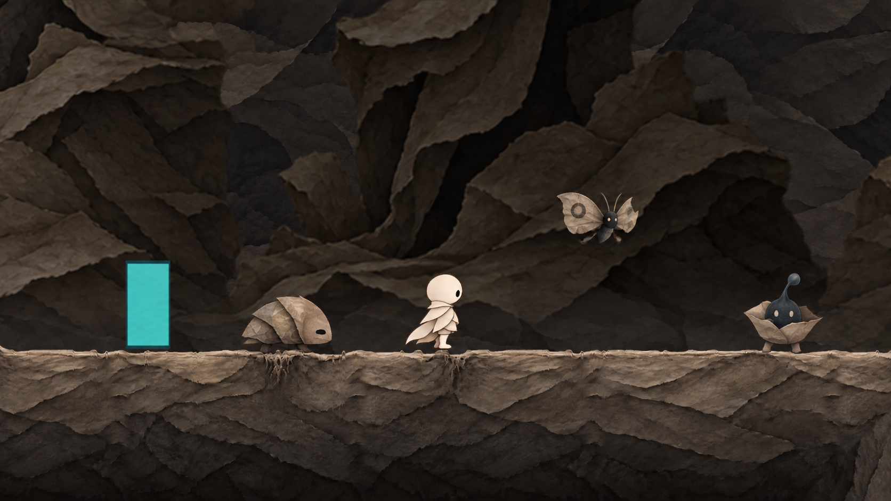

#### COMMON01 구겨진 종이공

- 역할 / 크기: 수평 돌진 / 플레이어 키 ×0.65.
- 도입 제안: 1지역 3번 종이 비탈 / 2지역 2번 비탈.
- 공격: 몸을 압축한 뒤 한 방향으로 구름. 벽 충돌 시 납작하게 펼쳐짐.
- 예고 / 실행 / 회복: 0.65 / 0.35 / 0.9초.
- 패링 없이: 점프로 넘기거나 뒤로 물러난 뒤 펼쳐진 몸 공격.
- 패링 획득 후: 구르는 몸은 반사 불가. 벽 충돌로 같은 빈틈 확보.
- 배치 주의: 낭떠러지 바로 옆 첫 배치 금지; 지역별 겉종이 색만 변경.

#### COMMON02 종이 나방

- 역할 / 크기: 공중 접근 / 플레이어 키 ×0.55.
- 도입 제안: 1지역 2번 후반 / 2지역 3번 넓은 공간.
- 공격: 날개를 접고 조준선을 고정한 뒤 짧은 대각선 급강하.
- 예고 / 실행 / 회복: 0.7 / 0.3 / 0.85초.
- 패링 없이: 조준 고정 후 한 걸음 옆으로 이동; 저공 회복 때 공격.
- 패링 획득 후: 획득 후 급강하 접촉을 튕기면 바닥에 떨어져 1초 노출.
- 배치 주의: 첫 등장 1마리. 발판 착지 위치를 매복하지 않음.

#### COMMON03 잉크 방울

- 역할 / 크기: 곡사 견제 / 플레이어 키 ×0.7.
- 도입 제안: 1지역 18번 덩굴 다리 / 2지역 15번 넓은 바닥.
- 공격: 주머니가 부풀고 큰 잉크탄 한 발. 바닥 착탄 그림자 뒤 작은 웅덩이 1.5초.
- 예고 / 실행 / 회복: 0.8 / 0.15 / 1.1초.
- 패링 없이: 탄을 베거나 착탄 표시 밖으로 이동; 웅덩이를 점프로 넘음.
- 패링 획득 후: 탄 반사 시 사수 경직 1초. 웅덩이 자체는 패링 불가.
- 배치 주의: 다리 전체를 웅덩이가 막지 않도록 안전 폭 유지.

### 연필 숲 · 지역 전용 — 지역 전용

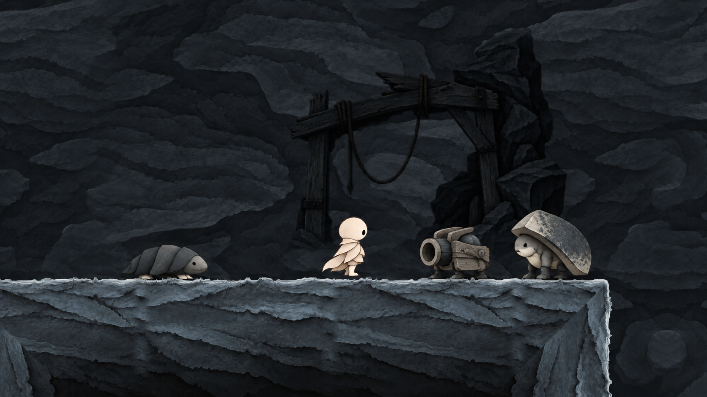

#### R101 흑연 벌레

- 역할 / 크기: 기초 근접 / 플레이어 키 ×0.55.
- 도입 제안: 1지역 1번 시작의 백지길.
- 공격: 머리를 들어 멈춘 뒤 몸 길이만큼 짧게 들이받음.
- 예고 / 실행 / 회복: 0.65 / 0.18 / 0.85초.
- 패링 없이: 뒤로 한 걸음 피하고 긴 회복에 공격; 대시 불필요.
- 패링 획득 후: 재방문 시 머리 타격을 튕기면 즉시 뒤집힘.
- 배치 주의: 시작 세이브에서 충분히 떨어진 평지에 단독 배치.

#### R102 연필깎이 포탑

- 역할 / 크기: 수평 탄 / 플레이어 키 ×0.85.
- 도입 제안: 1지역 2번 바람 드는 종이 틈.
- 공격: 구멍 안에 흑연이 모인 뒤 수평으로 단발 사격.
- 예고 / 실행 / 회복: 0.75 / 0.12 / 1.3초.
- 패링 없이: 점프로 넘기거나 탄을 베기; 총구 뒤 안전.
- 패링 획득 후: 재방문 탄 반사로 긴 경직. 6번→25번 과녁 문 탄 공급 역할 유지.
- 배치 주의: 1지역 전용으로 재분류. 기존 2지역 15번 포탑 역할은 G03으로 교체 제안.

#### R103 지우개 짐꾼

- 역할 / 크기: 정면 압박 / 플레이어 키 ×1.0.
- 도입 제안: 1지역 5번 갈림길 굴 전투 공간.
- 공격: 앞판을 세우고 짧게 밀친 뒤 배가 드러남. 정면 상시 무적 아님.
- 예고 / 실행 / 회복: 0.85 / 0.25 / 1.1초.
- 패링 없이: 밀치기 거리 밖에서 기다리거나 점프로 뒤를 잡고 공격.
- 패링 획득 후: 재방문 정면 밀치기 패링으로 앞판 벌어짐.
- 배치 주의: 통로 출구를 완전히 봉쇄하지 않음; 기존 엘리트 지우개와 크기·장비 구별.

### 구겨진 종이굴 — 구역 전용

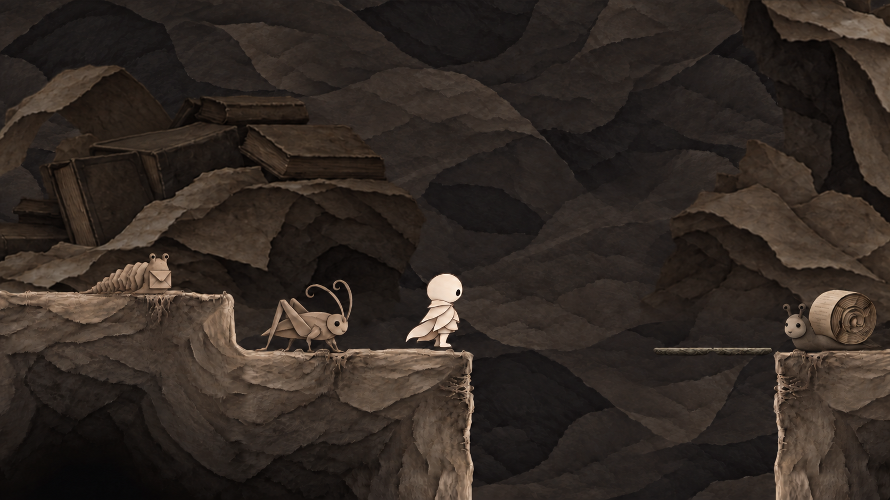

#### A01 접힌 입 종이벌레

- 역할 / 크기: 짧은 물기 / 플레이어 키 ×0.55.
- 도입 제안: 1지역 3번 상단 평지.
- 공격: 봉투 입을 벌려 멈춘 뒤 앞쪽 반 몸통 거리 물기.
- 예고 / 실행 / 회복: 0.75 / 0.15 / 0.9초.
- 패링 없이: 공격 범위 밖에서 기다렸다 닫힌 입 공격.
- 패링 획득 후: 재방문 입 닫힘 타격 패링 시 경직.
- 배치 주의: 벽 점프 획득 전후 모두 지상 대응 가능.

#### A02 종이 귀뚜라미

- 역할 / 크기: 착지 공격 / 플레이어 키 ×0.65.
- 도입 제안: 1지역 4번 풀 그림자 굴 바닥.
- 공격: 뒷다리를 접고 낮은 포물선으로 한 번 뛰어 착지.
- 예고 / 실행 / 회복: 0.8 / 0.45 / 1.0초.
- 패링 없이: 착지 그림자 밖으로 걷고 착지 후 공격.
- 패링 획득 후: 재방문 착지 몸통 타격 패링으로 넘어진 상태.
- 배치 주의: 머리 위 화면 밖에서 뛰어들지 않음.

#### A03 책장 소라

- 역할 / 크기: 방어와 빈틈 / 플레이어 키 ×0.8.
- 도입 제안: 1지역 6번 갈림굴 다락 넓은 선반.
- 공격: 껍질 속에 숨었다가 페이지를 한 번 펼쳐 앞쪽을 쓸음.
- 예고 / 실행 / 회복: 0.9 / 0.2 / 1.2초.
- 패링 없이: 범위를 빠져나온 뒤 노출된 얼굴 공격.
- 패링 획득 후: 재방문 페이지 쓸기 패링으로 껍질 열린 상태 유지.
- 배치 주의: 기존 포탑 2마리와 동시 첫 소개 금지.

### 흑연 광산 — 구역 전용

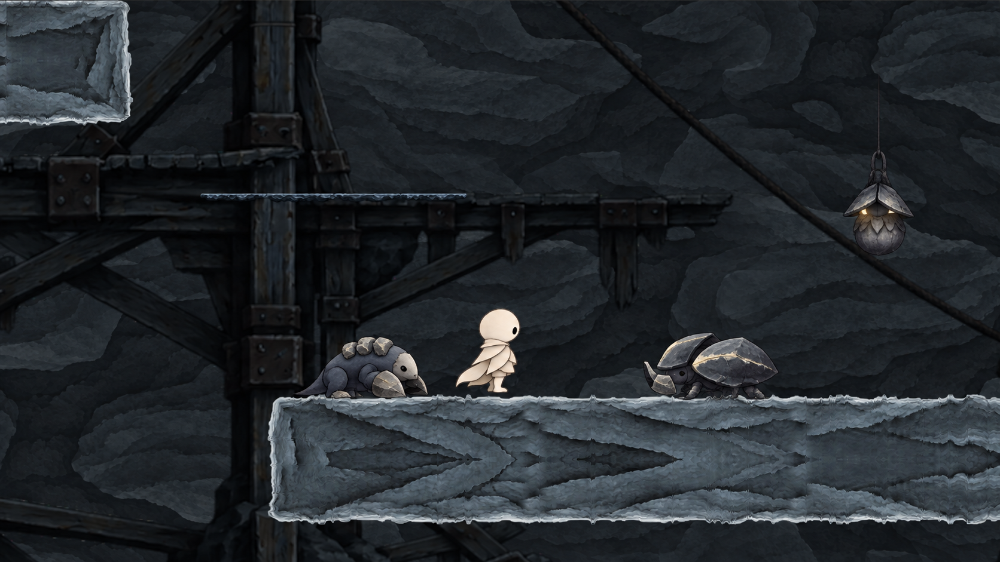

#### B01 흑연 두더지

- 역할 / 크기: 지면 예고 / 플레이어 키 ×0.8.
- 도입 제안: 1지역 7번 광산 입구.
- 공격: 이동 흙더미가 멈춘 위치에서 솟아오르고 잠깐 노출.
- 예고 / 실행 / 회복: 0.7 / 0.25 / 1.2초.
- 패링 없이: 흙더미를 옆으로 피하고 나온 뒤 공격.
- 패링 획득 후: 솟아오르는 몸은 패링 불가; 지상 앞발 타격만 가능.
- 배치 주의: 불투명 바닥 위에서만 잠복; 첫 등장 단독 유지.

#### B02 흑연 등딱지

- 역할 / 크기: 낮은 횡공격 / 플레이어 키 ×0.85.
- 도입 제안: 1지역 8번 흑연 갱도 평지.
- 공격: 앞판으로 바닥을 긁고 낮게 1.5몸 길이 밀어냄.
- 예고 / 실행 / 회복: 0.85 / 0.25 / 1.15초.
- 패링 없이: 점프로 넘긴 뒤 뒤쪽 열린 틈 공격.
- 패링 획득 후: 재방문 긁는 앞판 패링 시 옆으로 뒤집힘.
- 배치 주의: 6칸 높이 갱도에서 높은 점프를 요구하지 않음.

#### B03 갱등 주머니

- 역할 / 크기: 천장 낙하 / 플레이어 키 ×0.7.
- 도입 제안: 1지역 9번 무너진 갱도 안전 선반 위.
- 공격: 고리가 흔들리고 바닥 그림자 표시 후 수직 낙하.
- 예고 / 실행 / 회복: 0.9 / 0.3 / 1.3초.
- 패링 없이: 그림자 밖 이동; 떨어진 주머니 공격.
- 패링 획득 후: 몸통 낙하는 패링 불가.
- 배치 주의: 무너지는 발판 첫 점프 구간과 중첩 금지; 복귀 이동은 무피해.

### 스케치 나무 속 — 구역 전용

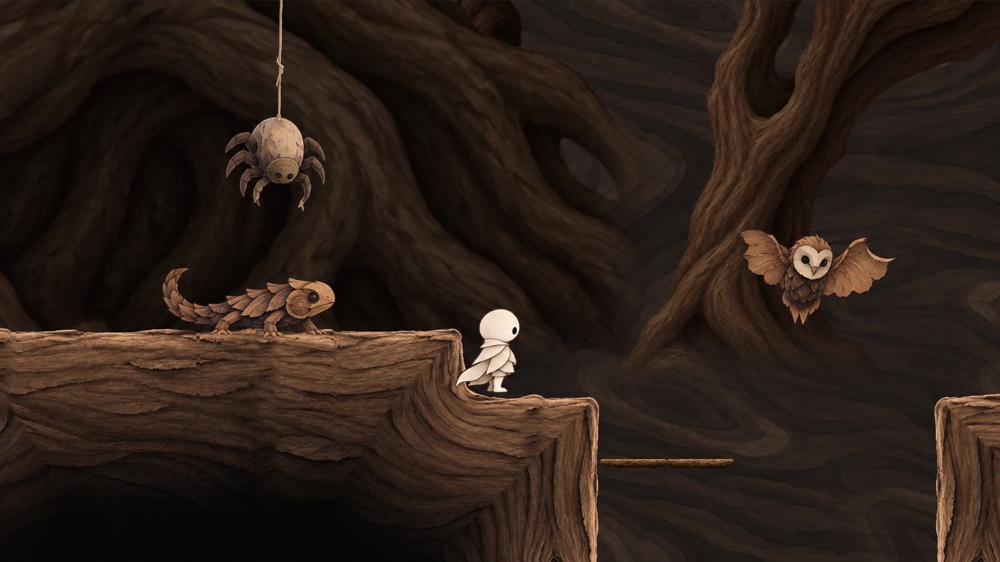

#### C01 지우개 거미

- 역할 / 크기: 수직 견제 / 플레이어 키 ×0.65.
- 도입 제안: 1지역 13번 옹이 방.
- 공격: 실을 팽팽히 당긴 뒤 정해진 높이까지 내려와 다리 쓸기.
- 예고 / 실행 / 회복: 0.8 / 0.35 / 1.0초.
- 패링 없이: 실 아래에서 비켜나고 낮아진 몸 공격.
- 패링 획득 후: 획득 후 다리 쓸기만 패링 가능; 실은 공격으로 절단.
- 배치 주의: 첫 배치는 넓은 바닥; 화면 밖 수직 기습 금지.

#### C02 옹이 도마뱀

- 역할 / 크기: 벽 이동 / 플레이어 키 ×0.75.
- 도입 제안: 1지역 14번 나무 속 탑의 넓은 중간층.
- 공격: 벽에 붙어 머리를 돌리고 선반으로 짧게 도약.
- 예고 / 실행 / 회복: 0.75 / 0.25 / 0.95초.
- 패링 없이: 도약 방향 고정 후 이동; 착지 중 노출.
- 패링 획득 후: 재방문 도약의 머리 타격 패링으로 선반에 쓰러짐.
- 배치 주의: 벽 점프 입력을 가로막는 좁은 벽에 배치 금지.

#### C03 연필씨 부엉이

- 역할 / 크기: 수평 활공 / 플레이어 키 ×0.8.
- 도입 제안: 1지역 17번 새 둥지.
- 공격: 날개를 넓게 펴고 일정 높이로 한 번 활공.
- 예고 / 실행 / 회복: 0.85 / 0.4 / 1.05초.
- 패링 없이: 낮은 활공은 점프; 높은 활공은 아래로 통과.
- 패링 획득 후: 재방문 날개 타격 패링 시 착지 경직.
- 배치 주의: 횡단 중 플레이어 추적 회전 금지.

### 엉킨 뿌리 심부 — 구역 전용

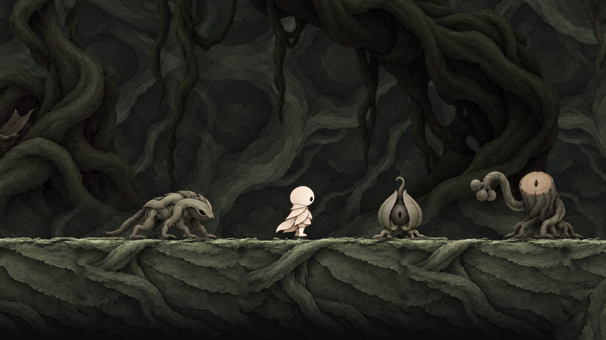

#### D01 뿌리 매듭개

- 역할 / 크기: 추격 후 물기 / 플레이어 키 ×0.9.
- 도입 제안: 1지역 18번 덩굴 다리의 넓은 끝부분.
- 공격: 일정 거리까지 접근 후 멈추고 목을 낮춰 한 번 물기.
- 예고 / 실행 / 회복: 0.7 / 0.2 / 0.9초.
- 패링 없이: 멈춤을 보고 점프 또는 후퇴, 물기 종료 후 공격.
- 패링 획득 후: 재방문 물기 패링 시 매듭이 느슨해져 경직.
- 배치 주의: 첫 잉크 방울 튜토리얼과 구분된 공간에서 소개.

#### D02 씨주머니 보행자

- 역할 / 크기: 시간차 탄 / 플레이어 키 ×0.85.
- 도입 제안: 1지역 19번 위쪽 갈림의 평지.
- 공격: 껍질이 열리고 땅에 닿아 한 번 튀는 씨앗 하나 발사.
- 예고 / 실행 / 회복: 0.9 / 0.15 / 1.2초.
- 패링 없이: 첫 탄을 베거나 튀는 높이 아래로 이동.
- 패링 획득 후: 재방문 씨앗 반사로 껍질 열림 1.2초.
- 배치 주의: 탄은 한 개만 유지; 좁은 필수 착지점 겨냥 금지.

#### D03 덩굴 손아귀

- 역할 / 크기: 영역 쓸기 / 플레이어 키 ×1.1.
- 도입 제안: 1지역 23번 뿌리 내리막.
- 공격: 손을 뒤로 말고 지면 가까이 한 번 쓸어냄.
- 예고 / 실행 / 회복: 0.95 / 0.3 / 1.3초.
- 패링 없이: 점프로 손을 넘거나 범위 밖 후 공격.
- 패링 획득 후: 재방문 손끝 타격 패링 시 팔이 뒤로 접힘.
- 배치 주의: 연필 깎기로 제거하는 기믹 덩굴과 실루엣 구분; 잡기 QTE 없음.

### 크레파스 언덕 · 지역 전용 — 지역 전용

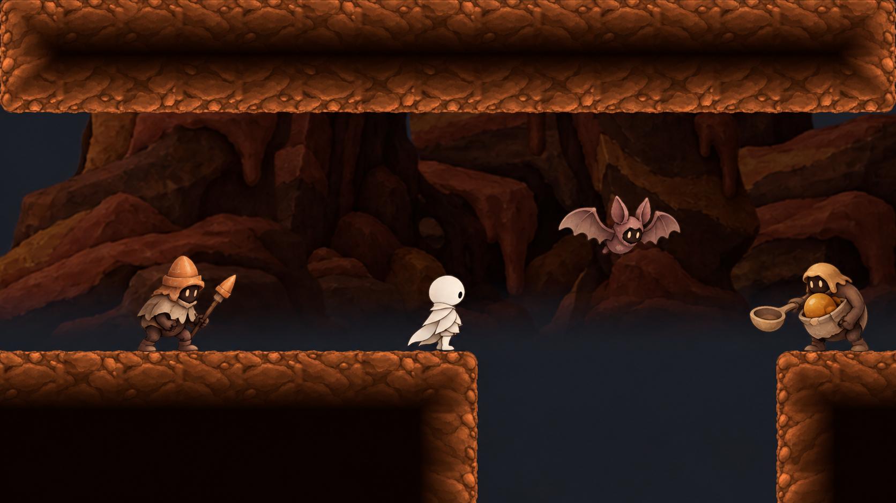

#### R201 크레용 병정

- 역할 / 크기: 두 번 찌르기 / 플레이어 키 ×1.0.
- 도입 제안: 2지역 2번 첫 크레파스 비탈.
- 공격: 창을 당기고 2회 찌름. 두 타 사이 0.28초, 두 번째까지 방향 고정.
- 예고 / 실행 / 회복: 0.7 / 0.46 / 1.05초.
- 패링 없이: 뒤로 거리를 벌리거나 등 뒤로 이동해 두 번째 뒤 공격.
- 패링 획득 후: 습득 후 두 타 모두 패링하면 1.2초 그로기; 한 번만 성공해도 해당 타격 방어.
- 배치 주의: 0.46초 공격 구간은 두 타와 사이 텀 포함; 첫 소개에 다른 원거리 금지.

#### R202 밀랍 투척꾼

- 역할 / 크기: 곡사 반사 / 플레이어 키 ×0.95.
- 도입 제안: 2지역 3번 노을빛 큰 굴.
- 공격: 팔 위 밀랍을 크게 들고 한 덩이 투척; 착탄에 둔화 웅덩이.
- 예고 / 실행 / 회복: 0.85 / 0.15 / 1.2초.
- 패링 없이: 몸을 이동해 착탄 회피; 근접 중 긴 회복 공격.
- 패링 획득 후: 탄 반사로 경직과 색 막대 장치 가동. 14번 장치용 개체 별도 관리.
- 배치 주의: 장치용은 다리 작동 전 처치 불가 표시+재공급 보장; 일반 개체는 정상 처치.

#### R203 색가루 박쥐

- 역할 / 크기: 대각 급강하 / 플레이어 키 ×0.6.
- 도입 제안: 2지역 3번 넓은 천장 공간.
- 공격: 가루가 모이고 목표 방향 고정 후 짧은 급강하, 낮게 복귀.
- 예고 / 실행 / 회복: 0.8 / 0.28 / 1.0초.
- 패링 없이: 예고 후 옆으로 이동; 복귀 중 공격.
- 패링 획득 후: 습득 후 급강하 패링 시 바닥에 눕고 1초 노출.
- 배치 주의: 공통 나방보다 느린 대기·빠른 직선, 동시 배치 금지로 역할 중복 완화.

### 노을 크레파스 굴 — 구역 전용

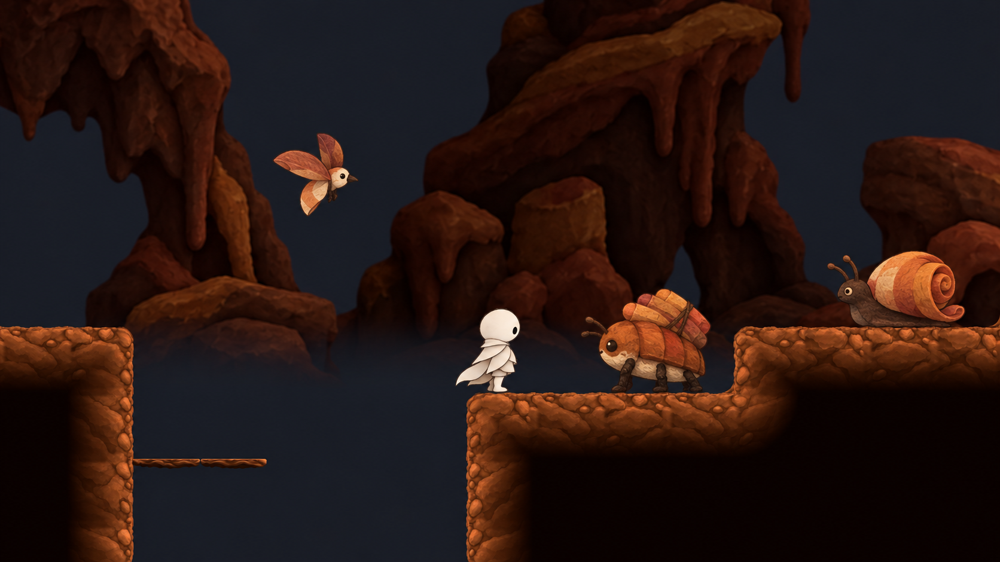

#### E01 노을 등짐충

- 역할 / 크기: 무거운 돌진 / 플레이어 키 ×0.9.
- 도입 제안: 2지역 2번 비탈의 넓은 다음 구간.
- 공격: 등짐을 앞으로 기울이고 비탈 따라 짧게 돌진.
- 예고 / 실행 / 회복: 0.9 / 0.35 / 1.15초.
- 패링 없이: 점프로 넘기고 멈춘 뒤 배 공격.
- 패링 획득 후: 획득 후 정면 돌진 패링으로 등짐 흔들림.
- 배치 주의: 종이공과 다른 평지에서 소개; 비탈 아래 안전 공간 확보.

#### E02 색띠 달팽이

- 역할 / 크기: 국소 바닥 봉쇄 / 플레이어 키 ×0.75.
- 도입 제안: 2지역 3번 큰 굴 가장자리.
- 공격: 몸을 들어 뒤쪽에 짧은 밀랍 띠 하나 흘림, 1.5초 후 소멸.
- 예고 / 실행 / 회복: 0.9 / 0.2 / 1.25초.
- 패링 없이: 앞쪽으로 돌아 접근하거나 띠를 점프로 넘음.
- 패링 획득 후: 바닥 띠는 패링 불가; 전방 머리 밀기만 가능.
- 배치 주의: 길 전체 봉쇄 금지; 달팽이 사망 즉시 띠 제거.

#### E03 바람개비 새

- 역할 / 크기: 통로 가로지르기 / 플레이어 키 ×0.65.
- 도입 제안: 2지역 11번 바람개비 환기굴의 출발 선반.
- 공격: 날개가 한 번 접힌 뒤 수평으로 고정 경로 횡단.
- 예고 / 실행 / 회복: 0.85 / 0.4 / 1.1초.
- 패링 없이: 출발 선반에서 기다리거나 지나간 뒤 이동.
- 패링 획득 후: 패링 가능하지만 성공 없이 징검다리 통과 가능.
- 배치 주의: 녹는 발판 위에서 정지 대기를 강요하지 않음.

### 밀랍 공방 — 구역 전용

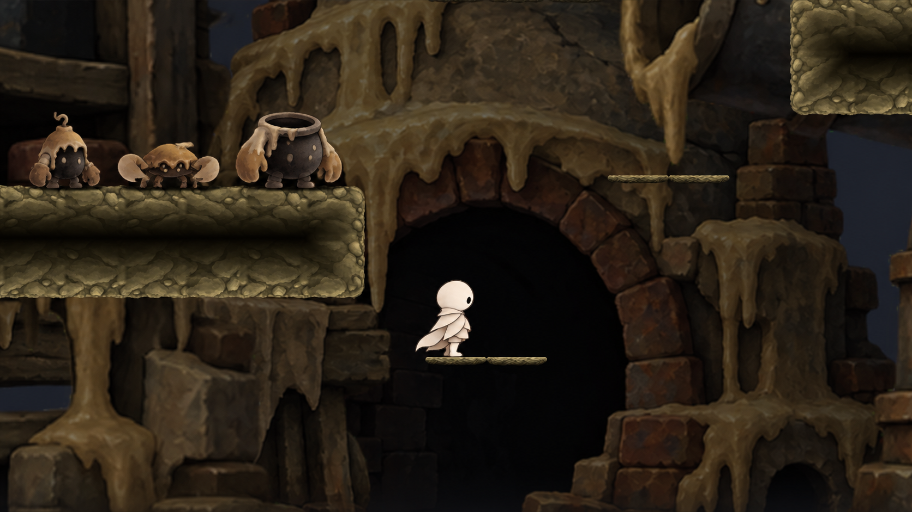

#### F01 심지 꼬마

- 역할 / 크기: 근접 내려치기 / 플레이어 키 ×0.75.
- 도입 제안: 2지역 6번 공방 입구 전투 공간.
- 공격: 두 손을 들어 앞쪽 지면을 한 번 두드림.
- 예고 / 실행 / 회복: 0.8 / 0.2 / 1.0초.
- 패링 없이: 한 걸음 빠진 뒤 손이 바닥에 붙은 동안 공격.
- 패링 획득 후: 습득 후 손 타격 패링 시 굳은 손 부서져 긴 경직.
- 배치 주의: 세이브 안전 구역 밖; 화염 지속 피해 없음.

#### F02 주걱 밀랍게

- 역할 / 크기: 방향 읽기 / 플레이어 키 ×0.8.
- 도입 제안: 2지역 7번 밀랍 저장고.
- 공격: 큰 주걱을 들어 그쪽으로 한 번 쓸기, 반대 집게는 공격 안 함.
- 예고 / 실행 / 회복: 0.9 / 0.25 / 1.15초.
- 패링 없이: 작은 집게 쪽으로 돌아가 공격.
- 패링 획득 후: 습득 후 큰 집게 패링으로 옆구리 노출.
- 배치 주의: 전방 영구 방패 없음; 패링 없을 때도 등 뒤 접근 가능.

#### F03 도가니 배불뚝이

- 역할 / 크기: 안전지대 읽기 / 플레이어 키 ×1.1.
- 도입 제안: 2지역 8번 지워진 그림 창고 전투 입구.
- 공격: 몸이 부풀고 양옆 짧은 거리로 밀랍 두 덩이 분출, 바닥 표시.
- 예고 / 실행 / 회복: 1.0 / 0.2 / 1.4초.
- 패링 없이: 몸 가까운 중앙 또는 바깥으로 이동 후 공격.
- 패링 획득 후: 습득 후 개별 탄 반사 가능; 폭발 자체 패링 불가.
- 배치 주의: 선택 방용. 패링 획득 전 전투, 좁은 보상 자리에는 배치하지 않음.

### 색칠 지하 협곡 — 구역 전용

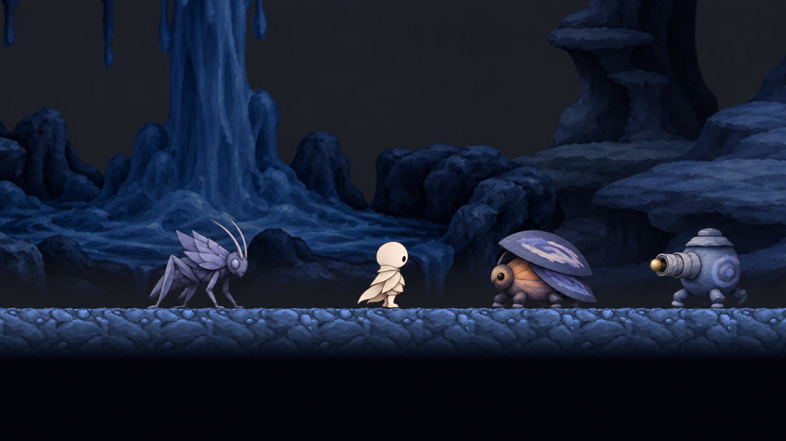

#### G01 지층 도약충

- 역할 / 크기: 높낮이 도약 / 플레이어 키 ×0.8.
- 도입 제안: 2지역 12번 협곡 중턱 넓은 선반.
- 공격: 목표 선반을 보고 다리를 접어 한 번 건너뛰기.
- 예고 / 실행 / 회복: 0.8 / 0.4 / 1.1초.
- 패링 없이: 목표 그림자 밖으로 이동; 착지 경직 공략.
- 패링 획득 후: 패링으로 착지 경직 연장 가능하지만 회피만으로 처치 가능.
- 배치 주의: 공방 전 진입 가능. 패링 보유 여부로 공격 속도 바꾸지 않음.

#### G02 덧칠 방패벌레

- 역할 / 크기: 가드 해제 / 플레이어 키 ×0.95.
- 도입 제안: 2지역 17번 광맥의 넓은 시작 바닥.
- 공격: 앞판을 닫고 짧게 밀친 뒤 과하게 벌어짐.
- 예고 / 실행 / 회복: 0.95 / 0.25 / 1.25초.
- 패링 없이: 밀치기를 피하고 열린 옆구리 공격; 무리한 정면 연타 유도 안 함.
- 패링 획득 후: 패링 시 앞판 즉시 벌어져 1.4초 빈틈.
- 배치 주의: 늪 위 발판에는 배치하지 않음; 패링 필수 장갑 금지.

#### G03 안료 사수

- 역할 / 크기: 정밀 반사 탄 / 플레이어 키 ×0.85.
- 도입 제안: 2지역 15번 협곡 바닥 과녁 장치 앞.
- 공격: 총구 안에 큰 안료 구슬이 모여 수평 단발 발사.
- 예고 / 실행 / 회복: 0.9 / 0.12 / 1.4초.
- 패링 없이: 점프로 넘기거나 탄을 베고 뒤에서 공격.
- 패링 획득 후: 15→16 과녁 문은 반사 필수. 일반 전투는 반사 없이 처치.
- 배치 주의: 기존 포탑/잉크 사수 명칭 충돌을 이 종으로 통일 제안. 장치 작동 전 보호 표식·탄 재공급.

### 기사의 탑 — 구역 전용

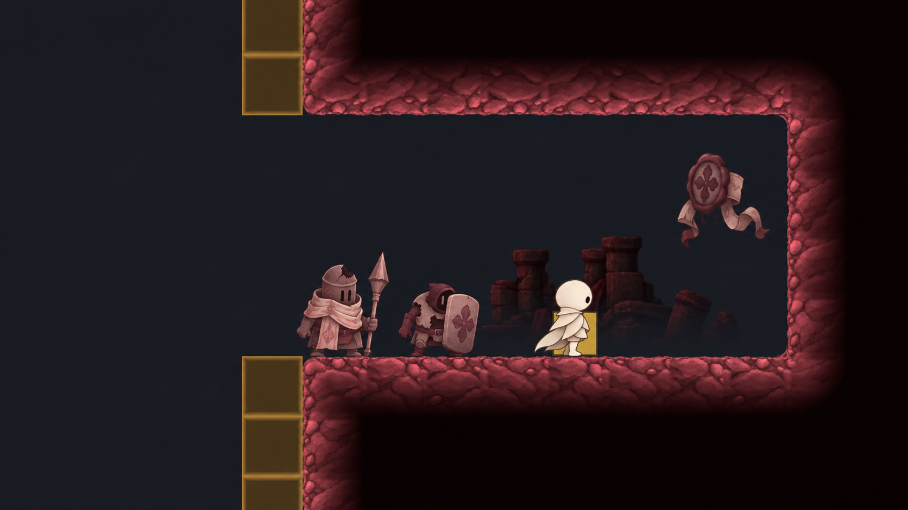

#### H01 무딘 창 시종

- 역할 / 크기: 지연 단발 / 플레이어 키 ×1.05.
- 도입 제안: 2지역 21번 탑 옆 틈새 접근 선반.
- 공격: 창을 비스듬히 들고 잠깐 멈춘 뒤 수평 단발 찌르기.
- 예고 / 실행 / 회복: 0.95 / 0.18 / 1.2초.
- 패링 없이: 멈춤을 보고 거리 확보; 찌르기 뒤 긴 회복 공격.
- 패링 획득 후: 단발 패링으로 창이 바닥에 박혀 1.4초 노출.
- 배치 주의: 보스 뒤 추가 도전으로 도입. 안전 방 19·22와 보스 방 20에 일반 몬스터 추가 안 함.

#### H02 밀랍 방패 인형

- 역할 / 크기: 방패 반격 / 플레이어 키 ×0.9.
- 도입 제안: 2지역 크레파스 탑 넓은 중간층.
- 공격: 방패를 두드려 예고 후 짧은 밀치기; 연타 자동 반격 없음.
- 예고 / 실행 / 회복: 0.8 / 0.22 / 1.1초.
- 패링 없이: 등 뒤 이동하거나 밀치기 종료 노출 때 공격.
- 패링 획득 후: 패링 시 방패가 열려 큰 빈틈; 비패링도 같은 약점 공략 가능.
- 배치 주의: 벽타기 중인 플레이어를 밀랍 벽에서 떼는 매복 금지.

#### H03 봉인 리본 망령

- 역할 / 크기: 시간차 횡탄 / 플레이어 키 ×0.8.
- 도입 제안: 2지역 크레파스 탑 상단 넓은 선반.
- 공격: 리본을 벌리고 느린 봉인 탄 둘을 0.25초 차이로 같은 높이에 발사.
- 예고 / 실행 / 회복: 0.95 / 0.4 / 1.2초.
- 패링 없이: 같은 점프로 두 탄을 넘기거나 한 발씩 베기.
- 패링 획득 후: 두 탄 반사 시 빠른 처치; 첫 반사만으로 경직해 두 번째 발사 취소.
- 배치 주의: 22번 세이브 내부 제외. 좁은 벽타기 통로에 탄막 금지.

## 근거 문서

- [지역 구성](03_월드_5지역.md)
- [1지역 방 구조](04_1지역_연필숲_맵.md)
- [기존 몬스터](06_적_몬스터.md)
- [능력 해금](10_능력_성장.md)
- [2지역 방 구조·패링 관문](13_2지역_크레파스언덕_맵.md)
- [아트 방향](16_아트_컨셉.md)
## 2026-10-24 · 2지역 실행본

2지역 전용 R201~R203과 E·F·G·H의 각 3종, 총 15종을 `Resources/EnemyAnimations/`에 적용했다. 각각 이동·공격·죽음 8장으로 360개 전신 그림이다. 공통 3종은 승인된 1지역 전신 그림을 공유한다. 고유 33종이 현재 런타임 manifest에 있으며 일반 슬롯 수를 늘리지 않고 2지역의 42곳을 교체했다. 원화 후보 표의 타이밍은 현재 manifest의 개별 프레임 시간을 우선한다.

지상 돌진·도약·공중 급강하는 실제 위치를 움직인다. 도약충은 지형과 지지면을 확인한 착지점으로 이동하며, 박쥐는 예고 때 고정한 플레이어 방향으로 내려온다. 병정의 두 번 찌르기와 창 시종의 찌르기는 무기 쪽 판정을 사용한다. 주걱·방패 공격은 항상 무적 장갑으로 막지 않아 패링 전에도 공략할 수 있다.

밀랍 투척꾼·도가니·색띠 달팽이·안료 사수·봉인 리본 망령의 투사체와 웅덩이를 연결했다. 도가니는 양쪽 바깥으로 분출하며, 달팽이는 뒤쪽에 짧은 띠를 남긴다. 망령은 0.25초 차이로 두 탄을 쏜다. 새 탄과 웅덩이 그림은 판정 크기에 맞춰 표시한다. 일반종은 패링 없이 처치 가능하며 성공하면 빈틈·반사 보상을 얻는다.

74번 투척꾼과 75번 안료 사수는 연결 장치가 열릴 때까지 보호한다. 다른 지역 전용 R102 포탑의 2지역 과녁 역할은 G03 안료 사수로 교체했다. 탑의 H01~H03은 기존 22번 회랑 슬롯에서만 소개한다. 19번 안전실과 20번 보스방에는 일반 적을 추가하지 않는다. 붉은 강화 개체는 기존 두 슬롯만 사용하며 체력 +2와 빠른 동작을 적용한다. 피격은 색 변화로만 표현하고 현재 이동·공격 프레임을 끊지 않는다.

## 2026-10-26 · 일반 몬스터별 강점 적용

현재 런타임은 아래 강점과 대응법을 기준으로 한다. 위의 초기 시안 수치보다 이 절과 `EnemySpecialties.cs`가 우선한다. 체력과 드롭 수량은 유지하고, 공격 예고·실행·회복·대기시간, 추격 속도, 방어, 궤도와 공간 점유를 차별화했다. 기존 이동·공격·죽음 원화를 유지하며 공격 프레임, 이동, 타격 구간, 이펙트는 같은 시간축을 사용한다.

- **구겨진 종이공 (COMMON01)** — 강점: 긴 지상 돌진. 대응: 점프로 넘긴 뒤 추격.
- **종이 나방 (COMMON02)** — 강점: 현재 높이를 노리는 급강하. 대응: 날개를 접은 뒤 옆으로 피하기.
- **잉크 방울 (COMMON03)** — 강점: 착탄 후 잉크 지대. 대응: 착탄 지점에서 벗어나 점프.
- **흑연 벌레 (R101)** — 강점: 끊임없는 근거리 압박. 대응: 들어 올린 머리를 보고 후퇴.
- **연필깎이 포탑 (R102)** — 강점: 수평 통로 속사. 대응: 점프로 넘기거나 탄 베기.
- **지우개 짐꾼 (R103)** — 강점: 앞판 방어. 대응: 뒤쪽 또는 밀치기 후 노출 공략.
- **접힌 입 종이벌레 (A01)** — 강점: 빠른 근접 물기. 대응: 짧은 사거리 바깥에서 유도.
- **종이 귀뚜라미 (A02)** — 강점: 머리 위 도약. 대응: 도약 아래로 지나가 착지 뒤 공격.
- **책장 소라 (A03)** — 강점: 접힌 책장 전방위 방어. 대응: 페이지를 펼친 뒤 공격.
- **흑연 두더지 (B01)** — 강점: 흑연 속 잠복 접근. 대응: 흙더미를 피하고 솟은 뒤 공격.
- **흑연 등딱지 (B02)** — 강점: 앞판으로 낮게 밀어내기. 대응: 점프로 뒤쪽 공략.
- **갱등 주머니 (B03)** — 강점: 머리 위 수직 낙하. 대응: 아래를 빠르게 통과.
- **지우개 거미 (C01)** — 강점: 매달린 통로 봉쇄. 대응: 거미가 올라가는 틈에 통과.
- **옹이 도마뱀 (C02)** — 강점: 먼 거리 도약 접근. 대응: 도약 방향 고정 뒤 반대편으로.
- **연필씨 부엉이 (C03)** — 강점: 일정 높이 활공. 대응: 비행 높이 위아래로 피하기.
- **뿌리 매듭개 (D01)** — 강점: 빠른 장거리 추격. 대응: 멈춰 무는 순간 점프로 넘기기.
- **씨주머니 보행자 (D02)** — 강점: 튀어 오르는 시간차 씨앗. 대응: 첫 탄을 베거나 두 번째 궤도 피하기.
- **덩굴 손아귀 (D03)** — 강점: 넓은 지면 쓸기. 대응: 손이 닿는 낮은 범위를 점프로 넘기기.
- **크레용 병정 (R201)** — 강점: 두 번 이어지는 창 찌르기. 대응: 첫 찌르기 후 바로 들어가지 않기.
- **밀랍 투척꾼 (R202)** — 강점: 거리 유지와 곡사 둔화탄. 대응: 곡사 안쪽으로 파고들기.
- **색가루 박쥐 (R203)** — 강점: 높은 곳에서 긴 급강하. 대응: 고정된 대각선 밖으로 이동.
- **노을 등짐충 (E01)** — 강점: 등짐을 앞세운 돌진. 대응: 정면 연타 대신 돌진을 넘기기.
- **색띠 달팽이 (E02)** — 강점: 뒤쪽 밀랍 띠로 추격 차단. 대응: 앞쪽으로 돌아 공격.
- **바람개비 새 (E03)** — 강점: 긴 통로를 빠르게 횡단. 대응: 횡단 높이를 피하고 복귀 틈 공략.
- **심지 꼬마 (F01)** — 강점: 양옆 지면 내려치기. 대응: 바닥 충격을 점프로 피하기.
- **주걱 밀랍게 (F02)** — 강점: 큰 주걱 쪽 방어와 쓸기. 대응: 작은 집게 쪽으로 돌아가기.
- **도가니 배불뚝이 (F03)** — 강점: 양옆 동시 밀랍 분출. 대응: 중앙 가까운 틈 또는 바깥으로.
- **지층 도약충 (G01)** — 강점: 높이가 다른 선반 추격. 대응: 목표 선반 착지 위치에서 벗어나기.
- **덧칠 방패벌레 (G02)** — 강점: 밀치는 동안 유지되는 방패. 대응: 방패를 벌린 회복 때 공격.
- **안료 사수 (G03)** — 강점: 빠른 장거리 정밀탄. 대응: 조준 후 점프 또는 패링.
- **무딘 창 시종 (H01)** — 강점: 엇박자 장거리 창. 대응: 긴 준비에 속지 말고 찌른 뒤 접근.
- **밀랍 방패 인형 (H02)** — 강점: 방패를 때리면 예고 반격. 대응: 등 뒤 또는 반격 후 공략.
- **봉인 리본 망령 (H03)** — 강점: 간격을 두고 오는 봉인 탄 두 발. 대응: 한 발 뒤 멈추지 말고 두 발 모두 피하기.

### 방어와 가독성

- 지우개 짐꾼·흑연 등딱지·노을 등짐충·주걱 밀랍게·덧칠 방패벌레·밀랍 방패 인형은 정면을 방어한다. 등 뒤는 항상 공격 가능하며, 회복 시간에는 정면도 열린다.
- 등짐충과 방패벌레는 공격 실행 중에도 앞판을 유지한다. 방패 인형은 막힌 타격 뒤 즉발 피해가 아니라 **전체 준비 모션을 거친 반격**을 시작한다.
- 책장 소라는 접힌 동안 양쪽이 막히고 페이지를 펼친 실행·회복 중에 열린다. 흑연 두더지는 잠복 이동과 준비 초반에 보호되고 솟아오르면 열린다.
- 보호 중에는 몸에 차가운 톤, 잠복 중에는 낮은 불투명도를 적용한다. 막힌 타격은 작은 방어 파편과 낮은 방어음으로 표시한다. 별도 피격 프레임은 추가하지 않는다.
- 방패는 이동 중 반대쪽을 즉시 따라 돌지 않는다. 앞에서 뒤로 넘어가면 방향 전환 전에 공격할 수 있다.
- 덩굴 손아귀와 심지 꼬마의 지면 공격은 넓지만 높이는 0.44칸으로 제한한다. 판정과 먹 이펙트가 같은 범위를 사용하며 기본 점프로 피할 수 있다.

### 원거리·공중 차별화

- 포탑은 6.25칸/초 수평 단발을 짧은 주기로, 안료 사수는 9칸/초 정밀탄을 긴 예고 뒤 발사한다. 반사 장치 공급자의 배치·보호 조건은 유지한다.
- 잉크 웅덩이는 최대 1.6칸·2.2초로 바닥을 점유한다. 달팽이의 뒤쪽 밀랍 띠는 최대 1.8칸·2.6초이며 피해 대신 둔화를 준다. 실제 받침이 없는 지면으로는 넓어지지 않는다.
- 투척꾼은 근접 시 지형을 확인하며 뒤로 물러난다. 씨앗탄은 한 번 튀고 다음 충돌에서 소멸하며 한 개체당 비행 탄 하나로 제한한다. 리본 망령은 예고 뒤 두 발만 발사한다.
- 나방은 고정한 목표를 향해 대각 돌진한다. 부엉이와 바람개비 새는 현재 높이를 유지한 채 수평 활공하며, 갱등 주머니와 거미는 수직으로 내려왔다 돌아간다. 준비 후반에는 조준이 고정된다.
- 화면 밖 신규 공격 금지, 벽 관통 방지, 지상 추격의 낭떠러지 확인, 플레이어 피격 무적 시간은 유지한다. 1지역에서 대시·패링을 필수 대응으로 요구하지 않는다.

구현: `EnemySpecialties.cs`, `PaperEnemySpecialty.cs`, `PaperEnemyAnimation.cs`, `EnemyProjectileSystem.cs`, `EnemyCombatVfx.cs`. 검증 기록: `Book/Validation/enemy-specialties.json` 및 웹 검증 기록.
