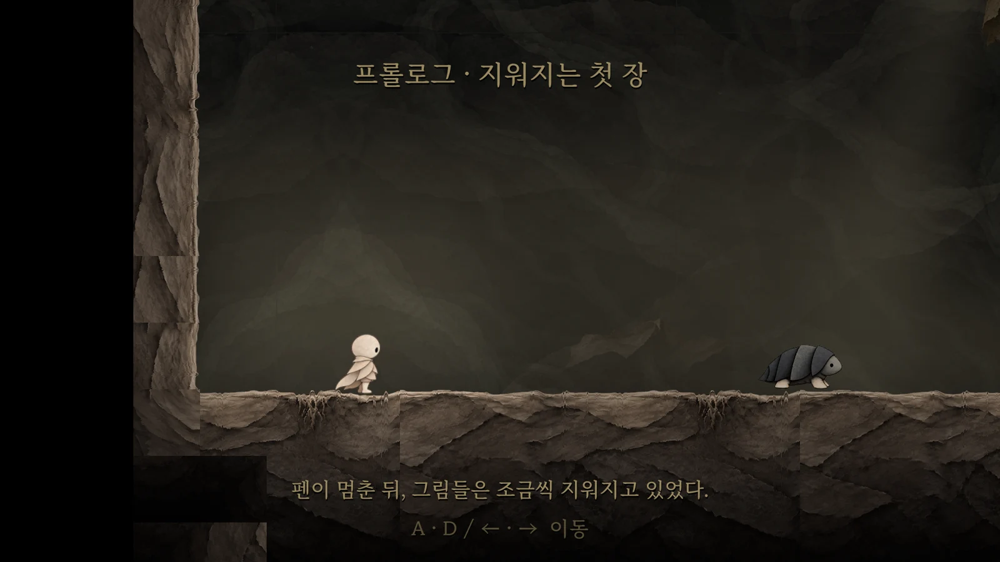

# StillDrawn

**스케치북 세계에서 이동 능력을 활용해 길을 탐색하고, 체크포인트를 이어가며 진행하는 2D 탐험 액션 게임입니다.**

1인 개발 중 · 2D 탐험 액션 · Unity 6000.5.3f1 · C#

[Windows 실행 파일](https://github.com/lde0707/portfolio-game-builds/releases/tag/stilldrawn-2026-11-14) · [QA 엑셀](https://leedoeon.vercel.app/qa/reports/stilldrawn.xlsx) · [QA 포트폴리오](https://leedoeon.vercel.app/qa/index.html)

## 내가 맡은 역할

맵·능력·체크포인트 구현과 테스트를 담당하고 있습니다.

## 게임의 주요 흐름

새 게임 → 프롤로그 이동·점프 → 본편 → 이어하기

## 실행 방법

### Unity 없이 플레이

1. 위 **Windows 실행 파일** 링크에서 `StillDrawn-Windows-x64.zip`을 받습니다.
2. ZIP **전체를 압축 해제**합니다.
3. `StillDrawn.exe`를 실행합니다.

Windows 64비트용입니다. EXE와 `Data` 폴더·`UnityPlayer.dll`을 함께 유지하세요. GitHub의 `Source code` 압축 파일은 게임 실행 패키지가 아닙니다.

**기본 조작:** A·D 이동 / Space 점프 / M 지도 / Esc 지도 닫기·일시정지 / 타이틀에서 새 게임·이어하기 선택

Unity에서 소스 열기

1. Unity Hub에서 `Book` 폴더를 프로젝트로 추가합니다.
2. **Unity 6000.5.3f1**으로 엽니다.
3. `Assets/Scenes/World12Prototype.unity` 씬을 열고 Play를 실행합니다.
4. 실행 파일을 만들 때 Windows Build Support를 설치하고 기존 Build Settings의 씬 구성으로 Windows x64를 빌드합니다.

## QA 테스트

Windows 빌드에 실제 키보드·마우스 입력을 보내 확인한 내용입니다. 세부 조건과 관찰값은 **QA 엑셀의 플레이 재검증 시트**에서 볼 수 있습니다.

| 확인 기능 | 테스트 조건 | 관찰 결과 |
|---|---|---|
| 새 게임·본편 진입 | 이동·점프로 프롤로그 통과 | 본편 진입 확인 |
| 지도·일시정지 | M·Esc 입력 후 이동 입력 | 지도 열기·닫기, 정지 중 위치 유지 |
| 체크포인트 저장 | 타이틀 복귀·종료 후 이어하기 | 저장한 본편 체크포인트 복원 |

**검증 범위:** 일반 공격 입력은 보냈지만 적 처치·모든 능력·전체 맵 완주는 확인하지 않았습니다.

[실제 입력 검증 기록](PLAYTEST.md) · [실행·검증 안내](PLAY.md)

## 소스와 상세 문서

- [플레이어 이동](Book/Assets/Unfin/Runtime/PlayerMotion.cs)
- [월드 표시](Book/Assets/Unfin/Runtime/WorldViewport.cs)
- [기존 개발·설계 기록](README-DEV-NOTES.md)
